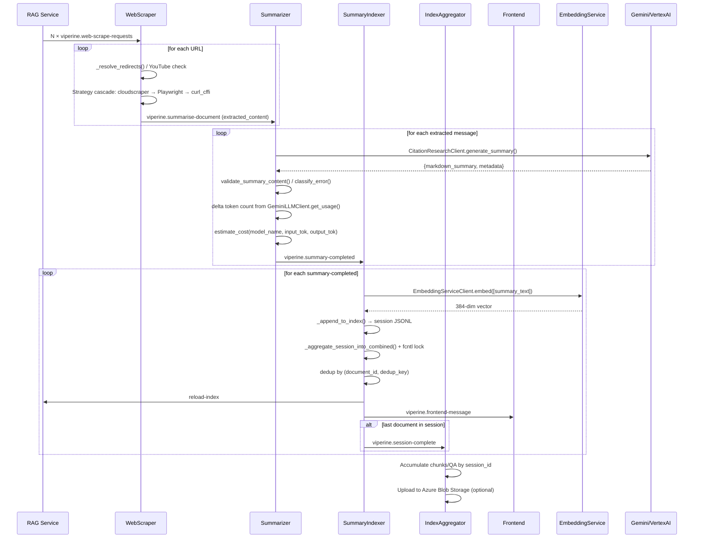
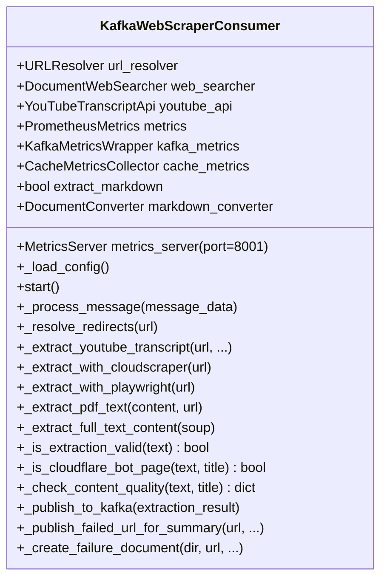
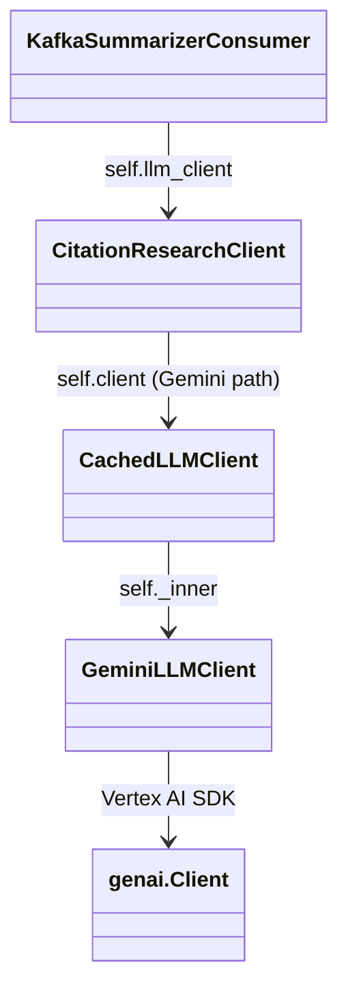
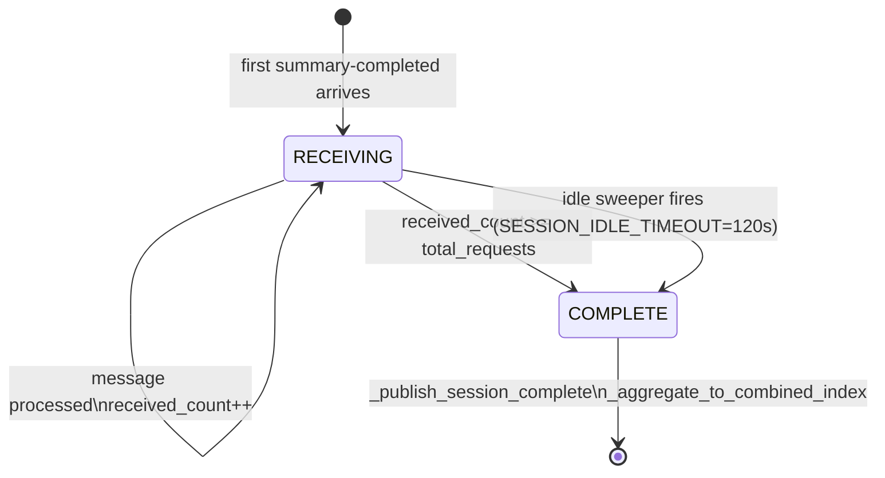
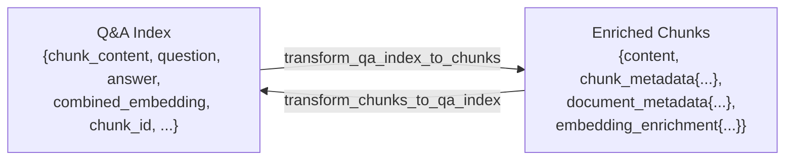
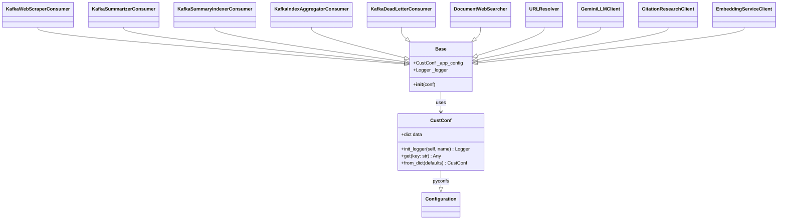
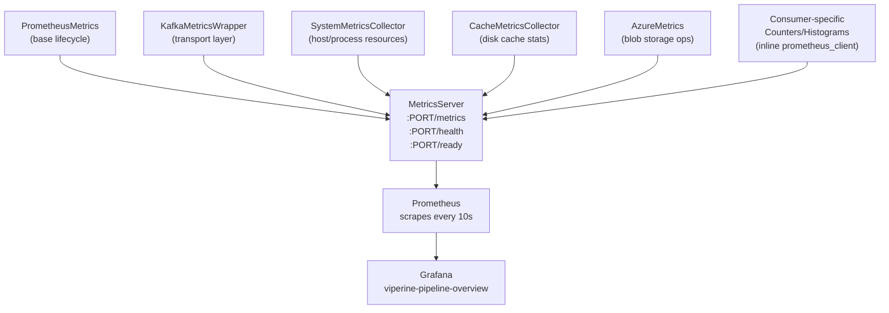
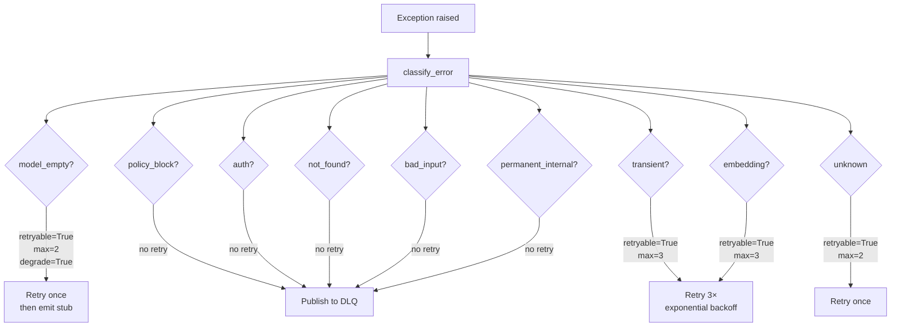
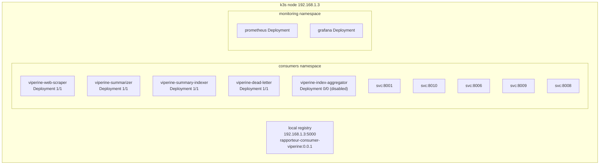

# Viperine Pipeline — Architecture

> Generated by thorough line-by-line analysis of all source modules (June 2026).
> Describes the active production codebase: `src/`, `monitoring/`, `helm/`, `grafana/`.

---

## Table of Contents

1. [System Overview](#1-system-overview)
2. [Component Inventory](#2-component-inventory)
3. [Kafka Topic Topology](#3-kafka-topic-topology)
4. [Message Flow — End to End](#4-message-flow--end-to-end)
5. [Consumer Deep-Dives](#5-consumer-deep-dives)
   - 5.1 [KafkaWebScraperConsumer](#51-kafkawebscraperconsumer)
   - 5.2 [KafkaSummarizerConsumer](#52-kafkasummarizerconsumer)
   - 5.3 [KafkaSummaryIndexerConsumer](#53-kafkasummaryindexerconsumer)
   - 5.4 [KafkaIndexAggregatorConsumer](#54-kafkaindexaggregatorconsumer)
   - 5.5 [KafkaDeadLetterConsumer](#55-kafkadeadletterconsumer)
6. [Shared Infrastructure](#6-shared-infrastructure)
   - 6.1 [Configuration System](#61-configuration-system)
   - 6.2 [Client Library](#62-client-library)
   - 6.3 [Component Library](#63-component-library)
   - 6.4 [Utility Library](#64-utility-library)
7. [Observability Stack](#7-observability-stack)
8. [Error Handling & Resilience](#8-error-handling--resilience)
9. [Kubernetes Deployment](#9-kubernetes-deployment)
10. [Data Schemas](#10-data-schemas)
11. [Design Patterns](#11-design-patterns)

---

## 1. System Overview

Viperine is a Kafka-based document ingestion pipeline. It sits between the **RAG service** (which enqueues scrape requests) and the **RAG index** (which it feeds). Five independent Python processes each own one responsibility; they communicate exclusively through Kafka topics and share a filesystem cache volume.

```mermaid
graph TB
    RAG["RapportuerRAG Service"]
    FE["RapportuerFrontEnd"]
    EMBED["Embedding Service\nhttp://embeddings.../embeddings"]
    GEMINI["Google Vertex AI\nGemini 2.5 Pro"]
    AZURE["Azure Blob Storage\n(optional)"]

    subgraph Kafka Cluster
        T1["viperine.web-scrape-requests"]
        T2["viperine.summarise-document"]
        T3["viperine.summary-completed"]
        T4["viperine.session-complete"]
        T5["viperine.frontend-message"]
        T6["viperine.dead-letter-queue"]
        T7["reload-index"]
        T8["index-folder-switch"]
    end

    subgraph k3s — consumers namespace
        WS["KafkaWebScraperConsumer\n:8001"]
        SU["KafkaSummarizerConsumer\n:8010"]
        SI["KafkaSummaryIndexerConsumer\n:8006"]
        IA["KafkaIndexAggregatorConsumer\n:8008"]
        DL["KafkaDeadLetterConsumer\n:8009"]
    end

    subgraph k3s — monitoring namespace
        PROM["Prometheus\n:30090"]
        GF["Grafana\n:30030"]
    end

    RAG --> T1
    T1 --> WS
    WS --> T2
    WS --> T6

    T2 --> SU
    SU --> T3
    SU --> T6

    T3 --> SI
    SI --> T4
    SI --> T7
    SI --> T5
    SI --> T6

    T4 --> IA
    IA --> AZURE
    IA --> T4

    T5 --> FE
    T7 --> RAG
    T8 --> SI

    SU --> GEMINI
    SI --> EMBED

    WS -- /metrics 10s --> PROM
    SU -- /metrics 10s --> PROM
    SI -- /metrics 10s --> PROM
    IA -- /metrics 10s --> PROM
    DL -- /metrics 10s --> PROM
    PROM --> GF

    T6 --> DL
```

**Sibling repositories**
- `RapportuerRAG` — RAG service; enqueues `viperine.web-scrape-requests`, reads `reload-index`, serves the `viperine.frontend-message` SSE stream.
- `RapportuerFrontEnd` — consumes `viperine.frontend-message` for live UI updates.

---

## 2. Component Inventory

| Class | File | Port | Group ID |
|-------|------|------|----------|
| `KafkaWebScraperConsumer` | `src/consumers/kafka_web_scraper.py` | 8001 | `viperine-web-scraper-v2` |
| `KafkaSummarizerConsumer` | `src/consumers/kafka_summarizer.py` | 8010 | `viperine-summarizer-v2` |
| `KafkaSummaryIndexerConsumer` | `src/consumers/kafka_summary_indexer.py` | 8006 | `viperine-summary-indexer-v2` |
| `KafkaIndexAggregatorConsumer` | `src/consumers/kafka_index_aggregator.py` | 8008 | `index-aggregator-consumer` |
| `KafkaDeadLetterConsumer` | `src/consumers/kafka_dead_letter_consumer.py` | 8009 | `viperine-dead-letter-v2` |

Supporting classes:

| Class | File | Role |
|-------|------|------|
| `Base` | `src/config_handler.py` | Config + logging base |
| `CustConf` | `src/config.py` | `pyconfs`-backed config with dot-path access |
| `DocumentWebSearcher` | `src/components/document_websearcher.py` | curl\_cffi + Tavily/Google/DuckDuckGo search |
| `URLResolver` | `src/components/url_resolver.py` | Redirect chain resolution |
| `CitationResearchClient` | `src/components/summarise/llm_citation_researcher.py` | LLM orchestration for summarization |
| `GeminiLLMClient` | `src/clients/llm_gcp_client.py` | Vertex AI async wrapper |
| `CachedLLMClient` | `src/clients/llm_cache_client.py` | Redis-backed LLM response cache |
| `EmbeddingServiceClient` | `src/clients/embedding_client.py` | Async httpx embedding API client |
| `PrometheusMetrics` | `src/monitoring/prometheus_metrics.py` | Shared base metric definitions |
| `KafkaMetricsWrapper` | `src/monitoring/kafka_metrics.py` | Lag/poll/publish metrics |
| `SystemMetricsCollector` | `src/monitoring/system_metrics.py` | psutil CPU/RAM/disk collector |
| `MetricsServer` | `src/monitoring/exporters/metrics_server.py` | `/metrics`, `/health`, `/ready` HTTP server |
| `estimate_cost` | `src/monitoring/cost.py` | LLM USD cost from token counts |
| `classify_error` | `src/consumers/_failure_taxonomy.py` | 9-category error taxonomy for retry policy |
| `make_document_id` | `src/consumers/_doc_id.py` | Deterministic `(document_id, dedup_key)` factory |
| `transform_qa_index_to_chunks` | `src/utils/index_adapter.py` | Q&A ↔ enriched-chunks schema adapter |

---

## 3. Kafka Topic Topology

All topics are prefixed `viperine.` to isolate this pipeline from other consumer groups (`kaliya`, `lamia`) on the same broker.

```mermaid
graph LR
    subgraph Input
        R[viperine.web-scrape-requests]
    end

    subgraph Scraper→Summarizer
        SD[viperine.summarise-document]
    end

    subgraph Summarizer→Indexer
        SC[viperine.summary-completed]
    end

    subgraph Indexer→Aggregator
        SE[viperine.session-complete]
    end

    subgraph Notifications
        FE[viperine.frontend-message]
        RI[reload-index]
        FS[index-folder-switch]
    end

    subgraph Error Routing
        DLQ[viperine.dead-letter-queue]
    end

    R -->|1 msg = 1 URL| WS([WebScraper])
    WS -->|extracted content| SD
    SD -->|extraction result| SU([Summarizer])
    SU -->|summary-completed event| SC
    SC --> SI([SummaryIndexer])
    SI --> SE
    SI --> RI
    SI --> FE
    WS -->|failures| DLQ
    SU -->|failures| DLQ
    DLQ --> DL([DeadLetter])
    SE --> IA([IndexAggregator])
    FS -.->|hot folder switch| SI
```

| Topic | Producer | Consumer(s) | Payload summary |
|-------|----------|-------------|-----------------|
| `viperine.web-scrape-requests` | RAG service | `KafkaWebScraperConsumer` | `{uri, title, context[], session_id, request_id, origin, url_index, total_urls}` |
| `viperine.summarise-document` | `KafkaWebScraperConsumer` | `KafkaSummarizerConsumer` | `{extracted_content, session_id, request_id, origin, extraction_failed, url_index, total_urls}` |
| `viperine.summary-completed` | `KafkaSummarizerConsumer` | `KafkaSummaryIndexerConsumer` | `{session_id, request_id, origin, document_id, dedup_key, source_url, summary_file, current_count, total_requests, status}` |
| `viperine.session-complete` | `KafkaSummaryIndexerConsumer` | `KafkaIndexAggregatorConsumer` | `{session_id, summary_index_file, total_summaries, index_type, partial, failed_request_ids}` |
| `viperine.frontend-message` | `KafkaSummaryIndexerConsumer` | Frontend SSE consumer | `{type, session_id, request_id, origin, new_summaries_count, new_summaries[], total_summaries_count}` |
| `reload-index` | `KafkaSummaryIndexerConsumer` | RAG service | `{action, new_summaries, total_summaries, index_file}` |
| `index-folder-switch` | External operator | `KafkaSummaryIndexerConsumer` | `{folder: "x_indices_..."}` |
| `viperine.dead-letter-queue` | All consumers | `KafkaDeadLetterConsumer` | `{original_message, failed_stage, error, request_id, session_id, origin_topic}` |

---

## 4. Message Flow — End to End

A single research session (one user query → N source URLs):



---

## 5. Consumer Deep-Dives

### 5.1 `KafkaWebScraperConsumer`

**File:** `src/consumers/kafka_web_scraper.py` (2 308 lines)
**Port:** 8001 | **Group:** `viperine-web-scraper-v2`

#### Responsibilities
Converts a URL into extracted text and forwards it to the summarizer. Also directly publishes to `viperine.dead-letter-queue` on failure.

#### Initialization



#### Extraction Strategy Cascade

Each URL is processed through a priority cascade. The first successful strategy wins; failures fall through to the next.

```mermaid
flowchart TD
    MSG[Kafka message] --> RESOLVE[_resolve_redirects\nfollow 301/302/Google-q=]
    RESOLVE --> YT{YouTube URL?}
    YT -- yes --> TRANSCRIPT[YouTubeTranscriptApi\nyoutube_api.fetch]
    TRANSCRIPT -- success --> PUBLISH[_publish_to_kafka]
    TRANSCRIPT -- fail --> S1

    YT -- no --> CF{needs CF bypass?}
    CF -- yes --> S1[Strategy 1\n_extract_with_cloudscraper]
    CF -- no --> S3

    S1 -- success + valid --> PUBLISH
    S1 -- fail / bot-page --> S2[Strategy 2\n_extract_with_playwright\nstealth_async]
    S2 -- success + valid --> PUBLISH
    S2 -- fail --> S3[Strategy 3\ncurl_cffi session.get\nor PDF extraction]
    S3 -- 200 + valid --> PUBLISH
    S3 -- low quality --> FALLBACK[_publish_failed_url_for_summary\nextraction_failed=True]
    S3 -- fail --> FALLBACK

    PUBLISH --> SAVE[_save_extraction → cache/{request_id}/extracted_linked_text.jsonl]
    FALLBACK --> DLQ_MSG[viperine.dead-letter-queue\npartial failure record]
```

**Content validation rules:**
- `_is_extraction_valid()` — minimum 10 words (from `web_scraper.min_words_for_valid_extraction`)
- `_is_cloudflare_bot_page()` — title/body heuristics for bot-challenge pages
- `_check_content_quality()` — low-word-count combined with navigation-only heuristics

#### Key design decisions
- **Cloudscraper** is tried first only for a hardcoded domain list (Cloudflare-heavy sites). All other URLs skip straight to curl\_cffi.
- **Producer message.max.bytes = 5 MB + snappy compression** to handle large HTML payloads.
- **Markdown extraction via Docling** is opt-in per `web_scraper.extract_markdown`. When enabled, `DocumentConverter` converts raw HTML to structured Markdown before plain-text fallback.
- On extraction failure the scraper still publishes to `viperine.summarise-document` with `extraction_failed=True`, allowing the summarizer to attempt a Gemini web-grounding recovery.
- URL deduplication is batched: a set of visited URLs is flushed to disk every `url_flush_interval` writes or `url_flush_time_threshold` seconds.

---

### 5.2 `KafkaSummarizerConsumer`

**File:** `src/consumers/kafka_summarizer.py` (1 068 lines)
**Port:** 8010 | **Group:** `viperine-summarizer-v2`

#### Responsibilities
Reads an extracted document, calls the LLM to generate a structured markdown summary, tracks cost/tokens, and publishes a `summary-completed` event.

#### Processing pipeline

```mermaid
flowchart TD
    MSG[viperine.summarise-document] --> LOAD[Deserialize\nextracted_content]
    LOAD --> SNAPSHOT[Snapshot GeminiLLMClient._total_usage\nbefore call]
    SNAPSHOT --> GROUNDING{extraction_failed?}
    GROUNDING -- yes --> WEB[Gemini web-grounding mode\nURL only]
    GROUNDING -- no --> CONTEXT[First 2000 chars\nas context]

    WEB --> CITE[CitationResearchClient\n.generate_summary()]
    CONTEXT --> CITE

    CITE --> VAL[validate_summary_content\n_MODEL_ERROR_OUTPUT_PAT regex]
    VAL -- error-as-content --> TAXONOMY[classify_error → model_empty\nincrement model_error_outputs_total]
    VAL -- ok --> DELTA[Compute token delta\nget_usage after - before]

    DELTA --> COST[estimate_cost(model_name, in, out)\nPRICING_TABLE lookup]
    COST --> METRICS[Emit:\nllm_input/output_tokens_total\nllm_estimated_cost_usd_total\nllm_latency_seconds]

    TAXONOMY --> RETRY{retryable &\nattempts left?}
    RETRY -- yes --> SLEEP[asyncio.sleep 2^n backoff] --> CITE
    RETRY -- no --> DEGRADE{degrade?}
    DEGRADE -- yes --> STUB[Write stub summary\ndegraded=True]
    DEGRADE -- no --> HARDFAIL[status=failed]

    STUB --> EMIT[_publish_summary_completed\nstatus=degraded/success/failed]
    METRICS --> EMIT
    HARDFAIL --> EMIT
    EMIT --> SI[viperine.summary-completed]
```

#### Retry & degradation policy

The `classify_error()` function (in `_failure_taxonomy.py`) maps every exception to a `FailureClassification`:

| Category | Retryable | Max attempts | Degrade |
|----------|-----------|--------------|---------|
| `transient` (timeout/429/503) | Yes | 3 | No |
| `model_empty` (empty STOP response) | Yes | 2 | **Yes** — emits stub |
| `policy_block` (SAFETY/RECITATION) | No | 1 | No |
| `auth` (key invalid / quota) | No | 1 | No |
| `not_found` (404 / no such file) | No | 1 | No |
| `bad_input` (empty text / bad JSON) | No | 1 | No |
| `embedding` (embedding service) | Yes | 3 | No |
| `permanent_internal` (AssertionError etc.) | No | 1 | No |
| `unknown` | Yes | 2 | No |

The **always-emit-terminal-event** invariant: regardless of outcome (success, degraded, or hard failure), `_publish_summary_completed` is always called so the `SummaryIndexer` session counter closes correctly and no session ever hangs.

#### LLM wiring



`CitationResearchClient._init_gemini()` builds the chain:
1. `GeminiLLMClient(model_name=gemini.model_name)` — Vertex AI async wrapper
2. `CachedLLMClient(_inner, redis_host=...)` — Redis-backed SHA-256 keyed cache (5-day TTL)

Token usage is read from `GeminiLLMClient._total_usage`, which is populated inside `generate_content()` from `response.usage_metadata.prompt_token_count` / `candidates_token_count`. The Summarizer snapshots this counter before the call and computes the delta to get per-call token counts.

---

### 5.3 `KafkaSummaryIndexerConsumer`

**File:** `src/consumers/kafka_summary_indexer.py` (1 169 lines)
**Port:** 8006 | **Group:** `viperine-summary-indexer-v2`

#### Responsibilities
Embeds each summary, writes to a per-session JSONL file, deduplicates and appends to the combined master index, then signals the RAG service and the frontend.

#### Session state machine

Each session is tracked through a JSON state file persisted to `cache/summaries/{session_id}/{session_id}_state.json`.



State fields:
```json
{
  "session_id": "...",
  "total_requests": 15,
  "received_count": 14,
  "document_ids_processed": ["req_...", ...],
  "dedup_keys_processed": ["md5hex", ...],
  "failed": ["req_..."],
  "completed": false,
  "last_event_at": "2026-06-10T...",
  "last_updated": "2026-06-10T..."
}
```

#### Idempotency design

Two-key deduplication prevents double-indexing during pod restarts or at-least-once redelivery:
1. **`document_id`** — `req_YYYYMMDD_HHMMSS_1NNN` generated by `make_document_id()` in the Summarizer.
2. **`dedup_key`** — MD5 of `normalize_url(source_url)`, a stable content address. Legacy records without `dedup_key` have it derived on-the-fly.

#### Combined index aggregation

The master index at `ACTIVE_INDEX_FOLDER/research_summaries_filtered.jsonl` is a shared JSONL file written by all indexer pods. Race conditions between concurrent writers (rolling update overlap, retries) are prevented by an **`fcntl.LOCK_EX` advisory lock** on a sibling `.lock` file:

```python
real_index_file = self.combined_index_file.resolve()  # follow symlinks
lock_path = real_index_file.with_suffix('.lock')
with open(lock_path, 'w') as lock_fh:
    fcntl.flock(lock_fh.fileno(), fcntl.LOCK_EX)
    try:
        self._aggregate_session_into_combined(session_id, session_index_file)
    finally:
        fcntl.flock(lock_fh.fileno(), fcntl.LOCK_UN)
```

#### Hot folder switching

A background thread subscribes to `index-folder-switch`. On receiving `{folder: "x_indices_eo"}`, it re-routes `self.combined_index_file` to the new path — zero-downtime index folder migration without pod restart.

#### Downstream notifications (on new entries)
1. **`reload-index`** → RAG service reloads its in-memory index
2. **`viperine.frontend-message`** → frontend SSE stream shows live research progress
3. **`viperine.session-complete`** → consumed by `KafkaIndexAggregatorConsumer` (for Q&A/chunk aggregation path)

---

### 5.4 `KafkaIndexAggregatorConsumer`

**File:** `src/consumers/kafka_index_aggregator.py` (1 831 lines)
**Port:** 8008 | **Group:** `index-aggregator-consumer`
**Status:** Disabled by default (`ENABLE_AGGREGATOR=false`)

#### Responsibilities
Aggregates Q&A pair indexes and chunk indexes from completed research sessions into unified combined files and uploads them to Azure Blob Storage.

#### Session accumulation model

The aggregator uses in-memory dictionaries keyed by `session_id`, accumulating data from three stream types before triggering aggregation:

```python
self.session_chunks: Dict[str, List[Dict]]        # from qa-generation topic
self.session_qa_pairs: Dict[str, List[Dict]]       # from qa-embedding topic
self.session_chunks_complete: Dict[str, bool]      # chunk pipeline done
self.session_qa_complete: Dict[str, bool]          # QA pipeline done
self.session_summaries_complete: Dict[str, bool]   # summary indexer done
```

All three flags must be `True` before `_aggregate_session()` is triggered.

#### Schema transformation

Q&A pairs use a flat schema incompatible with the RAG service's expected enriched-chunks schema. `transform_qa_index_to_chunks()` (in `src/utils/index_adapter.py`) bridges the two:



When `include_qa_in_content=True` (default), the question and answer are prepended to the `content` field, improving RAG retrieval quality by surfacing the semantic question-answer pair to the embedding.

#### Azure upload

On successful aggregation:
1. Download existing combined JSONL from Azure (if present)
2. Merge with new session data, deduplicating by `document_id` and `chunk_id`
3. Upload updated JSONL back to `indices/research_chunks_with_embeddings_combined.jsonl` and `indices/research_qa_pairs_with_embeddings_combined.jsonl`
4. Archive session files to `research-archive/` container
5. Clean up local cache (if `cleanup_after_upload=True`)

---

### 5.5 `KafkaDeadLetterConsumer`

**File:** `src/consumers/kafka_dead_letter_consumer.py` (521 lines)
**Port:** 8009 | **Group:** `viperine-dead-letter-v2`

#### Responsibilities
Consumes failure events from all pipeline stages, persists them to `cache/failures/failures.json` (append-only array) and individual JSON files, and tracks failure statistics by stage.

Every consumer in the pipeline publishes a DLQ record in the form:
```json
{
  "original_message": { "...": "..." },
  "failed_stage": "summarizer",
  "error": "HTTP 429 rate limit...",
  "timestamp": "2026-06-10T09:00:00Z",
  "request_id": "req_20260610_090000_1001",
  "session_id": "sess_abc123",
  "origin_topic": "viperine.summarise-document"
}
```

The DLQ consumer does not retry failed messages — it is a **write-only audit sink**. Retries are handled by the publishing consumer's own retry loop (`classify_error` / backoff).

---

## 6. Shared Infrastructure

### 6.1 Configuration System



`CustConf.get(key)` uses dot-path notation: `"gemini.model_name"` → `defaults["gemini"]["model_name"]`. All components inherit `Base`, giving them a shared `_app_config` and a named `_logger` via `init_logger()`.

**Environment variable overrides** (selected):
| Env var | Config key | Used by |
|---------|-----------|---------|
| `KAFKA_BOOTSTRAP_SERVERS` | `kafka.bootstrap_servers` | all consumers |
| `ACTIVE_INDEX_FOLDER` | `summary_indexer.combined_index_file` | SummaryIndexer |
| `SESSION_IDLE_TIMEOUT` | — | SummaryIndexer sweeper |
| `AZURE_STORAGE_CONNECTION_STRING` | `azure_blob.connection_string` | IndexAggregator |
| `PROJECT_ID` | `gemini.project_id` | GeminiLLMClient |
| `GOOGLE_APPLICATION_CREDENTIALS` | — | Vertex AI SDK |
| `EMBEDDING_SERVICE_URL` | `embedding_service.url` | EmbeddingServiceClient |
| `SUMMARIZER_INPUT_TOPIC` | — | Summarizer slim-pipeline override |

---

### 6.2 Client Library

#### `GeminiLLMClient` (`src/clients/llm_gcp_client.py`)

Wraps `google.genai.Client` (Vertex AI SDK) as an async interface.

Key behaviours:
- **Token tracking**: accumulates `input_tokens` / `output_tokens` / `calls` in `_total_usage` from `response.usage_metadata` on every `generate_content()` call. `get_usage()` / `reset_usage()` are exposed for delta measurement.
- **Per-stage model overrides**: reads `bboa.models` dict from config; `generate_content(stage=...)` selects a different model per stage.
- **Retry with exponential backoff** up to `llm.max_retries` (default 3).
- **Grounding via Google Search**: `enable_search=True` appends the `google_search_retrieval` tool to the request, enabling real-time web data for the summarizer's `extraction_failed` path.
- **Jaccard novelty check** (`_check_query_novelty`): used when Gemini generates query expansions to ensure they are sufficiently distinct from the root query.

#### `CachedLLMClient` (`src/clients/llm_cache_client.py`)

Transparent Redis cache decorator over any `async generate_content(prompt)` client.

```
cache_key = sha256(model_name + "|" + prompt)[:32]
```

- Miss → call `_inner.generate_content()` → store result in Redis with `ttl_seconds=432000` (5 days)
- Hit → return cached string directly
- Pass-through when `redis_host` is empty (local dev / no Redis)
- Creates a fresh `redis.asyncio.Redis` connection per call to avoid event-loop binding issues (the Kafka consumer destroys and recreates the event loop per message with `asyncio.run()`)

#### `EmbeddingServiceClient` (`src/clients/embedding_client.py`)

Async `httpx` client with connection pooling (max 20 connections, 10 keepalive) and exponential retry.

- **Lazy `httpx.AsyncClient` initialization** — tracked per event-loop identity (`_client_loop`). When `asyncio.run()` creates a new loop, the stale client is discarded and a fresh one created, avoiding `RuntimeError: Event loop is closed`.
- Batches texts in chunks of `max_texts_per_request = 64` to stay within server limits.
- Embeds to 384-dimensional vectors (all-MiniLM-L6-v2 model on the embedding service).

---

### 6.3 Component Library

#### `DocumentWebSearcher` (`src/components/document_websearcher.py`)

Multi-strategy web content fetcher. Uses `curl_cffi.requests.Session(impersonate="chrome110")` as the primary HTTP client to defeat TLS/JA3 fingerprinting (the main cause of 403 errors on modern sites).

Search API priority chain (for citation lookup):
1. Tavily API (`TAVILY_API_KEY`)
2. Google Custom Search API (`GOOGLE_API_KEY` + `GOOGLE_SEARCH_ENGINE_ID`)
3. DuckDuckGo (no API key, `curl_cffi` impersonation)

Content extraction helpers:
- `_extract_page_metadata(soup)` — title, author, language, publication date via BeautifulSoup
- `_decompress_response()` — handles gzip/brotli encoded responses

#### `URLResolver` (`src/components/url_resolver.py`)

Follows redirect chains manually (not via `allow_redirects=True`) to record every hop. Special-cases Google redirect URLs (`google.com/url?q=...`) by extracting the target directly from the query string. Returns a full `redirect_chain` list for traceability.

#### `CitationResearchClient` (`src/components/summarise/llm_citation_researcher.py`)

Orchestrates LLM-based document summarization. Supports both `openai` and `gemini` providers (selected by `summarizer.llm_provider` config).

On the Gemini path (`_init_gemini()`):
1. Creates `GeminiLLMClient(model_name=gemini.model_name)`
2. Wraps it in `CachedLLMClient` with Redis params from config
3. Sets `self.client = CachedLLMClient(...)`

`generate_summary()` builds a structured JSON prompt requesting `{metadata: {...}, markdown_summary: "..."}`. For Gemini + URL, `use_web_grounding=True` forces `enable_search=True` so the model fetches the live article. The response JSON is parsed with lenient repair fallback on `JSONDecodeError`. Returns a dict without a `usage` key — token counts must be read from the underlying client's `get_usage()`.

---

### 6.4 Utility Library

#### `make_document_id` (`src/consumers/_doc_id.py`)

```python
def make_document_id(url, batch_index=1, when=None) -> tuple[str, str]:
    document_id = f"req_{YYYYMMDD}_{HHMMSS}_{1000 + batch_index}"
    dedup_key   = md5(normalize_url(url)).hexdigest()
    return document_id, dedup_key
```

- **`document_id`** — time-based, lexicographically sortable, unique per (timestamp, batch position). Each reprocessing of the same URL generates a new ID (correct — it represents a new research event).
- **`dedup_key`** — content-addressed; same URL always produces the same key after normalization (lowercase, trailing-slash stripped, default-port removed, fragment removed).

#### `transform_qa_index_to_chunks` / `transform_chunks_to_qa_index` (`src/utils/index_adapter.py`)

Bidirectional schema bridge between the flat Q&A index format (used by upstream indexers) and the nested enriched-chunks format (expected by the RAG service). Also exposes a `validate_index_schema()` function that auto-detects the schema type from the first record.

---

## 7. Observability Stack

Every consumer follows an identical observability bootstrap:

```python
consumer_id = f"{role}_{os.getpid()}"
configure_logging(format='json', level='INFO', consumer_id=consumer_id)
self.metrics      = PrometheusMetrics(consumer_id)
self.system_metrics = SystemMetricsCollector(consumer_id, cache_mount_path=...)
self.kafka_metrics  = KafkaMetricsWrapper(consumer_id)
self.metrics_server = MetricsServer(port=PORT, consumer_name=ROLE,
    health_check=lambda: self.running,
    ready_check=lambda: self.consumer is not None and self.running)
self.metrics_server.start()
```

### Metric layers



### `MetricsServer` (`src/monitoring/exporters/metrics_server.py`)

Runs a `HTTPServer` on a daemon `Thread`. `MetricsHandler` extends `BaseHTTPRequestHandler`:
- `GET /metrics` → `prometheus_client.generate_latest()` — standard Prometheus text format
- `GET /health` → JSON `{status, code}` — liveness probe (returns 503 if `health_check()` is False)
- `GET /ready` → JSON `{status, code}` — readiness probe (returns 503 if consumer/producer not yet connected)

### Cost estimation (`src/monitoring/cost.py`)

```python
PRICING_TABLE = {
    "gemini-2.5-pro":  PricingEntry(input_per_m=1.25,  output_per_m=10.00),
    "gemini-2.5-flash": PricingEntry(input_per_m=0.15, output_per_m=0.60),
    "gpt-4o":          PricingEntry(input_per_m=2.50,  output_per_m=10.00),
    # … 13 models total
}

def estimate_cost(model, input_tokens, output_tokens) -> float:
    entry = PRICING_TABLE.get(model) or prefix_match(model)
    if entry is None:
        kafka_consumer_cost_unknown_model_total.labels(model=model).inc()
        return 0.0
    return (input_tokens * entry.input_per_m + output_tokens * entry.output_per_m) / 1_000_000
```

`kafka_consumer_cost_unknown_model_total` is a safety counter: if a model name reaches `estimate_cost()` without a pricing entry, the counter fires, alerting operators to add the model to the table.

---

## 8. Error Handling & Resilience

### Error taxonomy (`src/consumers/_failure_taxonomy.py`)

`classify_error(exc)` uses compiled regex patterns against `str(exc)` to assign each exception to one of 9 canonical categories, then returns a `FailureClassification(category, retryable, max_attempts, degrade)` NamedTuple.



### Dead Letter Queue

The DLQ acts as a write-only audit sink. No automatic replay is implemented — recovery is a manual operator action. The `KafkaDeadLetterConsumer` tracks `dlq_failures_by_stage` (a Gauge showing current failure counts by pipeline stage), enabling Grafana dashboards to reveal which stage is failing most.

### Graceful shutdown

Every consumer registers `SIGINT` and `SIGTERM` handlers that set `self.running = False`. The main poll loop checks this flag on each iteration, flushes the producer, and closes the consumer connection before exiting.

### Session idle sweeper

`KafkaSummaryIndexerConsumer` runs a background loop that periodically scans `self.session_states` for sessions whose `last_event_at` is older than `SESSION_IDLE_TIMEOUT` (default 120 s). Idle sessions are force-completed to prevent sessions hanging indefinitely when a summarizer fails silently without publishing a terminal event.

---

## 9. Kubernetes Deployment



**Helm chart:** `helm/rapporteur-consumer-group/` — release name `viperine`, namespace `consumers`.

Selector label: `consumer-group=viperine` (all 5 deployments share this label for `make k8s_logs` / `make k8s_restart` multi-pod operations).

**nvidia-safe rollout** (`make k8s_rollout`): The k3s node has the NVIDIA container runtime. Rolling updates via plain `helm upgrade` leave old pods in `Terminating` forever due to a `permission denied on signal init` bug in the runtime. The safe rollout:
1. Scale all deployments to 0 replicas
2. Wait 15 s for graceful shutdown
3. Force-delete any stuck `Terminating` pods
4. Run `helm upgrade` (all deployments start fresh from 0)

**GCP credentials**: mounted as a Secret into each pod (copied from the RAG service during `make k8s_prereqs`). Required for Vertex AI access.

**`ACTIVE_INDEX_FOLDER`** env var is injected via Helm values to point all indexer pods at the correct index directory on the shared hostPath volume.

---

## 10. Data Schemas

### Kafka message: `viperine.web-scrape-requests`
```json
{
  "uri": "https://example.com/article",
  "title": "Article Title",
  "context": ["sentence 1", "sentence 2"],
  "session_id": "sess_abc123",
  "request_id": "req_20260610_090000_1001",
  "query_id": "q_xyz",
  "total_requests": 15
}
```

### Kafka message: `viperine.summarise-document`
```json
{
  "session_id": "sess_abc123",
  "request_id": "req_20260610_090000_1001",
  "query_id": "q_xyz",
  "extraction_failed": false,
  "total_requests": 15,
  "extracted_content": {
    "url": "https://example.com/article",
    "text": "Full article text...",
    "metadata": {
      "title": "...", "author": "...", "language": "en", "query_id": "q_xyz"
    },
    "extracted_at": "2026-06-10T09:00:01Z",
    "extraction_method": "curl_cffi"
  }
}
```

### Kafka message: `viperine.summary-completed`
```json
{
  "session_id": "sess_abc123",
  "request_id": "req_20260610_090000_1001",
  "document_id": "req_20260610_090000_1001",
  "dedup_key": "6f3e4a2b1c8d7e5f9a0b3c4d2e1f6a7b",
  "source_url": "https://example.com/article",
  "summary_file": "cache/web_scrapes/req_.../summary.jsonl",
  "current_count": 3,
  "total_requests": 15,
  "status": "success"
}
```

### Combined index entry (`research_summaries_filtered.jsonl`)
```json
{
  "document_id": "req_20260610_090000_1001",
  "dedup_key": "6f3e4a2b1c8d7e5f9a0b3c4d2e1f6a7b",
  "source_url": "https://example.com/article",
  "summary_text": "Markdown summary...",
  "summary_embedding": [0.123, ...],
  "doc_metadata": {
    "title": "...", "author": "...", "creation_date": "...", "word_count": 5000
  },
  "embedding_metadata": {
    "embedding_id": "sum_req_...",
    "embedding_dim": 384,
    "embedding_model": "all-MiniLM-L6-v2",
    "embedded_at": "2026-06-10T09:00:10Z"
  },
  "indexed_at": "2026-06-10T09:00:11Z"
}
```

---

## 11. Design Patterns

### Template Method — `Base` + `_load_config()`

All five consumer classes inherit `Base` (which provides `_app_config` and `_logger`) and implement `_load_config()` as a protected template method called in `__init__`. This ensures every consumer has configuration loaded before any component is initialized, without forcing a rigid base-class method call chain.

### Strategy Pattern — Extraction cascade

`KafkaWebScraperConsumer._process_message()` implements a runtime strategy selection: each extraction strategy (cloudscraper, Playwright, curl\_cffi) is tried in sequence, and the first that returns valid content wins. The strategy object (session/browser) is owned by the consumer, not instantiated per-call.

### Decorator Pattern — `CachedLLMClient`

`CachedLLMClient` wraps any object with an `async generate_content(prompt)` interface, transparently adding Redis caching without modifying the inner client. The `model_name`, `get_usage()`, `reset_usage()`, and `cost_tracker` attributes are delegated to `_inner` via `@property`.

### Factory Method — `make_document_id()`

A pure free function factory that generates a `(document_id, dedup_key)` pair. By centralising ID generation in one place, all consumers share the same ID format and deduplication scheme, eliminating a class of divergence bugs that previously occurred when consumers generated their own IDs.

### Saga / Terminal Event guarantee

The Summarizer implements a distributed saga pattern to prevent session deadlock: the "always-emit-terminal-event" rule means every execution path (success, degraded, hard failure, retry exhaustion) unconditionally calls `_publish_summary_completed`. The Indexer's session state machine can therefore always close, regardless of what happened upstream.

### Idempotent Consumer — dual-key deduplication

Both `KafkaSummaryIndexerConsumer` and `KafkaIndexAggregatorConsumer` implement idempotent consumption via dual-key checks (`document_id` + `dedup_key`). Duplicate deliveries (Kafka's at-least-once guarantee) are silently absorbed.

### Observer / Event-Driven Fan-out

When the combined index is updated, `KafkaSummaryIndexerConsumer` publishes to three independent topics in a fan-out pattern (`reload-index`, `viperine.frontend-message`, `viperine.session-complete`), each consumed by a different downstream system. This decouples the RAG service, frontend, and aggregator from each other.

### Background Thread for Blocking I/O — `MetricsServer`

`MetricsServer` uses Python's `HTTPServer` (synchronous) in a daemon `Thread`, allowing the main asyncio event loop to run without blocking on HTTP metric scrapes. The daemon flag ensures the thread does not prevent process shutdown.
