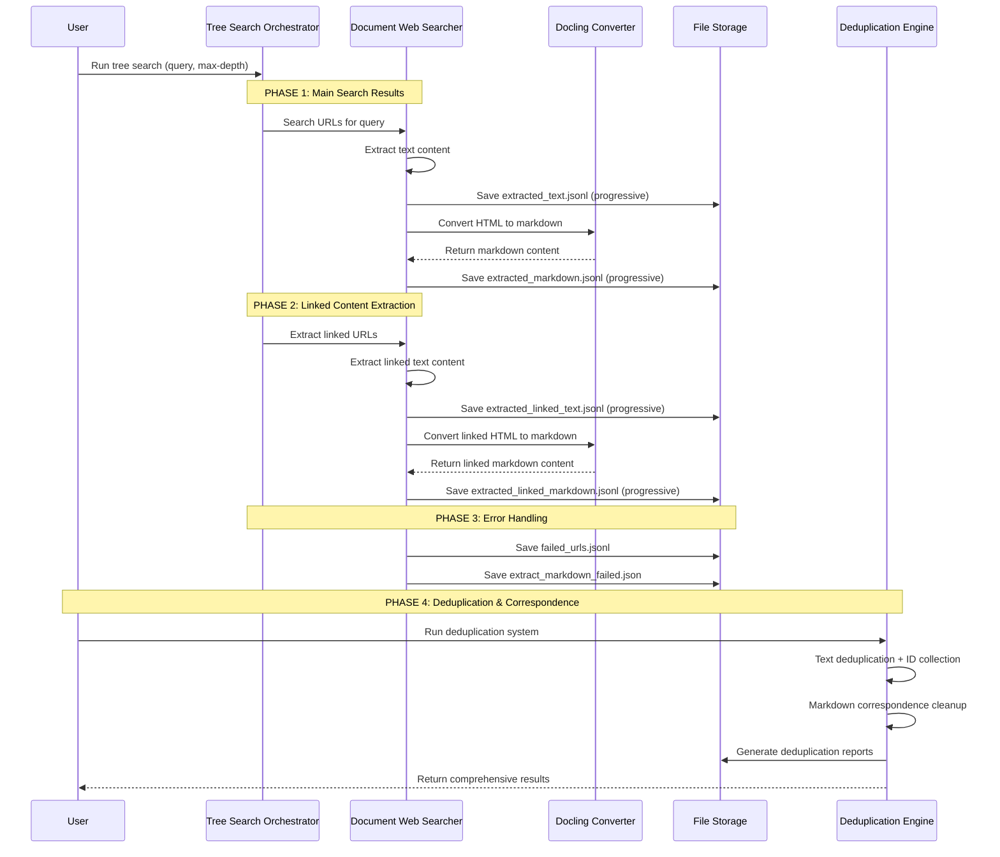
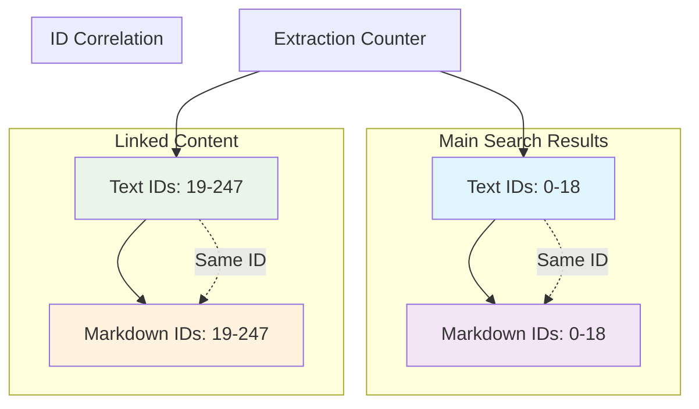
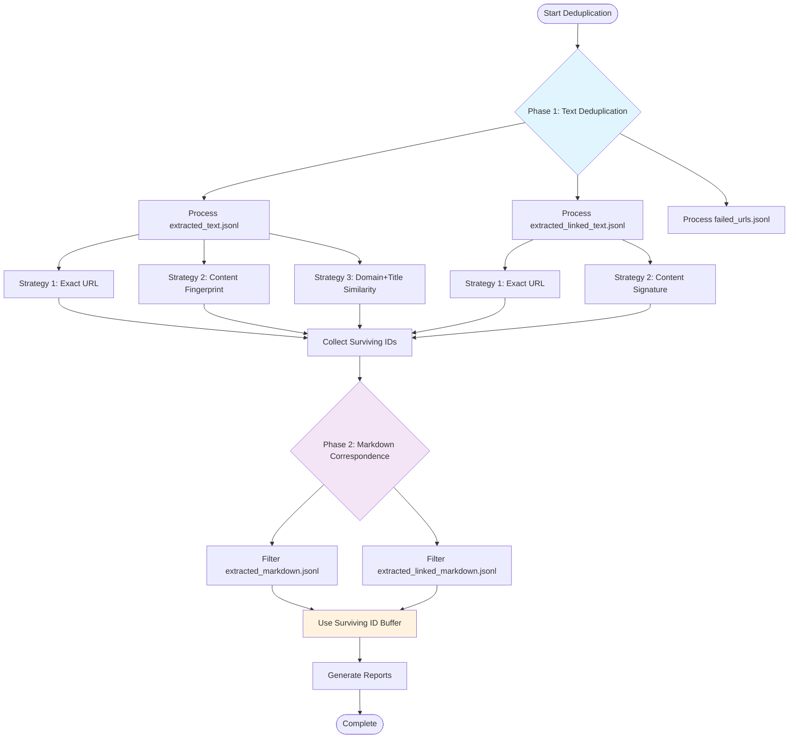

# Web Content Ingestion with Markdown Extraction & Deduplication

## 🎯 Overview

This document details the complete pipeline for web content ingestion, markdown conversion, and intelligent deduplication with ID correlation. The system provides database-like functionality with primary key relationships between text and markdown extraction records.

### System Architecture

The web content ingestion pipeline is orchestrated by the **`OrchestratorTreeSearch`** class in `src/components/orchestrator_tree_search.py`, which serves as the main entry point for all search operations. This orchestrator manages the entire lifecycle from initial query processing through final file generation, coordinating multiple specialized components to deliver a comprehensive web scraping and content extraction solution.

The core workflow begins when the `OrchestratorTreeSearch.tree_search()` method is invoked with a user query. This method implements a sophisticated depth-based search algorithm that expands queries using the **`SimpleLLMClient`** for enhanced semantic coverage, then delegates URL discovery to the **`DocumentWebSearcher`** class.

### Content Extraction Pipeline

The **`DocumentWebSearcher`** class in `src/components/document_websearcher.py` handles all web content retrieval and initial processing. Its primary method `DocumentWebSearcher.search_with_extractions()` performs a multi-phase operation: first executing web searches through multiple providers (Tavily API, Google Custom Search, and DuckDuckGo fallback), then systematically processing each discovered URL through its `_convert_html_to_extraction_record()` method.

The conversion process leverages IBM's **docling** library through the `DocumentConverter` class to transform raw HTML into structured markdown. The `DocumentWebSearcher._convert_html_to_extraction_record()` method creates temporary HTML files, processes them through docling's conversion pipeline, and generates comprehensive extraction records that include not only the converted markdown text but also rich metadata such as extracted links, images, and structural information.

### Progressive File Management

One of the system's key architectural features is progressive file writing, implemented throughout the extraction pipeline. Rather than accumulating results in memory, both the `OrchestratorTreeSearch` and `DocumentWebSearcher` classes immediately persist extraction records to disk using JSONL format. This approach provides interruption resilience and memory efficiency, allowing large-scale extractions to proceed without memory constraints.

The progressive saving mechanism is triggered by the `save_web_extractions_to_cache()` method in `DocumentWebSearcher`, which appends new records to existing JSONL files. This ensures that even if the extraction process is interrupted, all previously processed URLs remain available for analysis.

## 📊 Process Flow Diagram



## 🗂️ File Structure & Schemas

### Primary Extraction Files

The web content ingestion pipeline generates a systematic file structure that maintains clear separation between different content types while preserving relational integrity through consistent ID assignment. Each file type serves a specific purpose in the overall data architecture, with schemas designed for both human readability and programmatic processing.

#### 1. `extracted_text.jsonl` - Main Search Results Text

This file contains the primary text extractions from the initial search query processing. Records are created by `DocumentWebSearcher.search_with_extractions()` when processing URLs discovered by the main search operation. The `OrchestratorTreeSearch._process_query()` method ensures that these records receive sequential IDs starting from 0.

The schema design balances comprehensive metadata capture with processing efficiency. The `content` field contains the full extracted text, while `chunk_sample` provides a preview for quick analysis. The `extracted_links` array captures all discovered URLs for potential linked content processing.

```json
{
  "id": 0,
  "url": "https://example.com/article",
  "title": "Sudan Civil War Analysis",
  "content": "Full text content of the article...",
  "timestamp": "2025-10-19T06:48:01.234567",
  "search_depth": 1,
  "parent_url": null,
  "content_length": 5432,
  "extracted_links": ["https://link1.com", "https://link2.com"],
  "link_count": 15,
  "chunk_sample": "Sudan's ongoing civil war has..."
}
```

#### 2. `extracted_markdown.jsonl` - Main Search Results Markdown

These records are generated simultaneously with text extractions by `DocumentWebSearcher._convert_html_to_extraction_record()`. The docling conversion process transforms the same HTML content that produced the text record, ensuring perfect correspondence between text and markdown representations.

The `method` field distinguishes between `docling_web` (main search results) and `docling_linked` (linked content), enabling method-specific analysis. The metadata object preserves web-specific information such as extracted links and images that may not be present in the markdown text itself.

```json
{
  "id": 0,
  "source_url": "https://example.com/article",
  "method": "docling_web",
  "text": "# Sudan Civil War Analysis\n\nSudan's ongoing civil war...",
  "text_length": 12845,
  "metadata": {
    "title": "Sudan Civil War Analysis",
    "extracted_links": ["https://link1.com"],
    "link_count": 15,
    "extracted_images": ["https://img1.com/image.jpg"],
    "image_count": 3,
    "chunk_sample": "# Sudan Civil War Analysis..."
  },
  "extraction_timestamp": "2025-10-19T06:48:01.460274"
}
```

#### 3. `extracted_linked_text.jsonl` - Linked Content Text

These records represent content extracted from URLs discovered within the main search results. The `SimpleTreeSearch._extract_text_from_urls()` method processes links found in Phase 1 results, with ID assignment continuing from where main results ended. If main results used IDs 0-18, linked content begins with ID 19.

The `parent_url` field creates hierarchical relationships, enabling analysis of content discovery paths. The `search_depth` field (typically 2) indicates these are second-level discoveries, supporting depth-based analysis of content relevance.

```json
{
  "id": 19,
  "url": "https://linked-site.com/page",
  "title": "Related Sudan Report",
  "content": "This report discusses...",
  "timestamp": "2025-10-19T06:49:15.123456",
  "search_depth": 2,
  "parent_url": "https://example.com/article",
  "content_length": 8921,
  "extracted_links": ["https://sublink1.com"],
  "link_count": 8,
  "chunk_sample": "This report discusses the humanitarian..."
}
```

#### 4. `extracted_linked_markdown.jsonl` - Linked Content Markdown

Similar to main markdown results, these records provide markdown representations of linked content. The `method` field value `docling_linked` enables filtering and analysis specific to linked content processing. The ID correspondence with linked text records maintains the referential integrity essential for correlation operations.

```json
{
  "id": 19,
  "source_url": "https://linked-site.com/page",
  "method": "docling_linked",
  "text": "## Related Sudan Report\n\nThis report discusses...",
  "text_length": 18432,
  "metadata": {
    "title": "Related Sudan Report",
    "extracted_links": ["https://sublink1.com"],
    "link_count": 8,
    "extracted_images": ["https://img2.com/chart.png"],
    "image_count": 1,
    "chunk_sample": "## Related Sudan Report..."
  },
  "extraction_timestamp": "2025-10-19T06:49:15.789012"
}
```

### Error Handling Files

The system implements comprehensive error tracking to provide visibility into extraction failures and enable system optimization.

#### 5. `failed_urls.jsonl` - Failed URL Tracking

This file captures systematic information about URLs that could not be processed successfully. The `DocumentWebSearcher` class writes these records whenever HTTP errors, timeouts, or other extraction failures occur. The error categorization enables targeted troubleshooting and system improvement.

```json
{
  "url": "https://blocked-site.com/article",
  "error_type": "http_403",
  "details": "Status: 403",
  "timestamp": "2025-10-19T06:48:28.528060",
  "search_depth": 1,
  "parent_url": "https://example.com/article"
}
```

#### 6. `extract_markdown_failed.json` - Markdown Conversion Failures

Specific to docling conversion failures, this file provides detailed error information when HTML-to-markdown conversion fails. The `DocumentWebSearcher.save_failed_markdown_extraction()` method creates these records, enabling analysis of conversion issues and potential system improvements.

```json
{
  "url": "https://problematic-site.com/page",
  "error_type": "ConversionError",
  "error_message": "Input document tmp1h_7vb0d.html is not valid.",
  "timestamp": "2025-10-19T06:56:44.132000",
  "extraction_id": 25
}
```

This comprehensive file structure provides complete visibility into the extraction process, maintains referential integrity across content types, and enables sophisticated analysis of both successful extractions and failure patterns.

#### 1. `extracted_text.jsonl` - Main Search Results Text
```json
{
  "id": 0,
  "url": "https://example.com/article",
  "title": "Sudan Civil War Analysis",
  "content": "Full text content of the article...",
  "timestamp": "2025-10-19T06:48:01.234567",
  "search_depth": 1,
  "parent_url": null,
  "content_length": 5432,
  "extracted_links": ["https://link1.com", "https://link2.com"],
  "link_count": 15,
  "chunk_sample": "Sudan's ongoing civil war has..."
}
```

#### 2. `extracted_markdown.jsonl` - Main Search Results Markdown
```json
{
  "id": 0,
  "source_url": "https://example.com/article",
  "method": "docling_web",
  "text": "# Sudan Civil War Analysis\n\nSudan's ongoing civil war...",
  "text_length": 12845,
  "metadata": {
    "title": "Sudan Civil War Analysis",
    "extracted_links": ["https://link1.com"],
    "link_count": 15,
    "extracted_images": ["https://img1.com/image.jpg"],
    "image_count": 3,
    "chunk_sample": "# Sudan Civil War Analysis..."
  },
  "extraction_timestamp": "2025-10-19T06:48:01.460274"
}
```

#### 3. `extracted_linked_text.jsonl` - Linked Content Text
```json
{
  "id": 19,
  "url": "https://linked-site.com/page",
  "title": "Related Sudan Report",
  "content": "This report discusses...",
  "timestamp": "2025-10-19T06:49:15.123456",
  "search_depth": 2,
  "parent_url": "https://example.com/article",
  "content_length": 8921,
  "extracted_links": ["https://sublink1.com"],
  "link_count": 8,
  "chunk_sample": "This report discusses the humanitarian..."
}
```

#### 4. `extracted_linked_markdown.jsonl` - Linked Content Markdown
```json
{
  "id": 19,
  "source_url": "https://linked-site.com/page",
  "method": "docling_linked",
  "text": "## Related Sudan Report\n\nThis report discusses...",
  "text_length": 18432,
  "metadata": {
    "title": "Related Sudan Report",
    "extracted_links": ["https://sublink1.com"],
    "link_count": 8,
    "extracted_images": ["https://img2.com/chart.png"],
    "image_count": 1,
    "chunk_sample": "## Related Sudan Report..."
  },
  "extraction_timestamp": "2025-10-19T06:49:15.789012"
}
```

### Error Handling Files

#### 5. `failed_urls.jsonl` - Failed URL Tracking
```json
{
  "url": "https://blocked-site.com/article",
  "error_type": "http_403",
  "details": "Status: 403",
  "timestamp": "2025-10-19T06:48:28.528060",
  "search_depth": 1,
  "parent_url": "https://example.com/article"
}
```

#### 6. `extract_markdown_failed.json` - Markdown Conversion Failures
```json
{
  "url": "https://problematic-site.com/page",
  "error_type": "ConversionError",
  "error_message": "Input document tmp1h_7vb0d.html is not valid.",
  "timestamp": "2025-10-19T06:56:44.132000",
  "extraction_id": 25
}
```

## 🔄 ID Propagation System

### Sequential ID Assignment Strategy

The ID propagation system represents one of the most sophisticated aspects of the web content ingestion pipeline, implementing database-like referential integrity across multiple file types. This system is orchestrated by the **`OrchestratorTreeSearch`** class through its `extraction_counter` attribute, which maintains a global sequence counter throughout the entire extraction process.

#### Implementation Details

The ID assignment process begins in the `OrchestratorTreeSearch.__init__()` method, where `self.extraction_counter = 0` initializes the global counter. This counter is systematically incremented by the `_process_query()` method each time a new URL is successfully processed, ensuring that every extraction record receives a unique, sequential identifier.

The **`DocumentWebSearcher.search_with_extractions()`** method receives the current counter value as the `extraction_id` parameter and passes it to the `_convert_html_to_extraction_record()` method. This method assigns the ID to both text and markdown extraction records simultaneously, creating the critical correspondence that enables database-like join operations between different file types.

#### Two-Phase ID Assignment Process

**Phase 1: Main Search Results Processing**
The initial query processing by `OrchestratorTreeSearch.tree_search()` generates the first batch of URLs through `DocumentWebSearcher.search()`. Each URL processed by the main search receives sequential IDs starting from 0. The `_process_query()` method ensures that both `extracted_text.jsonl` and `extracted_markdown.jsonl` records receive identical IDs (e.g., ID 0 for the first URL, ID 1 for the second, etc.).

**Phase 2: Linked Content Extraction**
After main results processing completes, the `SimpleTreeSearch._extract_text_from_urls()` method begins linked content extraction. This phase continues the sequential ID assignment from where the main phase ended. If main results used IDs 0-18, linked content begins with ID 19 and continues sequentially.

The critical implementation detail is in `DocumentWebSearcher._convert_html_to_extraction_record()`, where the `extraction_id` parameter ensures both text and markdown records for the same URL receive identical IDs:

```python
record = {
    'id': extraction_id,  # Same ID for both text and markdown
    'source_url': url,
    'method': method,
    # ... other fields
}
```

This synchronized assignment creates perfect correspondence between text and markdown files, enabling downstream processes to correlate records with confidence.



### ID Assignment Logic
```python
# In orchestrator_tree_search.py
self.extraction_counter = 0

# Main search results: IDs 0-N
for url_batch in search_results:
    for result in extract_and_convert(url_batch, self.extraction_counter):
        self.extraction_counter += 1

# Linked content: IDs N+1-M (continues sequence)
for linked_url in linked_urls:
    for result in extract_linked_content(linked_url, self.extraction_counter):
        self.extraction_counter += 1
```

## 🎯 Deduplication Process

### Two-Phase Deduplication Architecture

The deduplication system, implemented in `src/utils/deduplication.py`, represents a sophisticated data quality management system that maintains referential integrity while eliminating duplicate content. The system is architected around two distinct phases: text deduplication followed by markdown correspondence cleanup.

#### Phase 1: Text Deduplication Engine

The first phase is orchestrated by the **`deduplicate_all_tree_search_data()`** function, which serves as the main entry point for the deduplication process. This function systematically processes all text-based JSONL files through specialized deduplication methods:

**Main Results Processing:** The `deduplicate_extracted_text()` function processes `extracted_text.jsonl` using a sophisticated multi-strategy approach. The function reads all records into memory, assigns line numbers for tracking, then applies three distinct deduplication strategies:

1. **Exact URL Detection:** Implemented through a `url_seen` set that tracks previously encountered URLs
2. **Content Fingerprint Analysis:** Creates signatures using `f"{content[:200]}|{len(content)}"` to detect content duplicates even with different URLs
3. **Domain + Title Similarity:** Uses Jaccard similarity through the `_titles_similar()` helper function with a configurable threshold (default 0.8)

**Linked Content Processing:** The `deduplicate_linked_text()` function applies similar logic to `extracted_linked_text.jsonl` but uses a modified strategy optimized for linked content patterns. The function employs content signatures based on `f"{title}|{len(content)}|{content[:100]}"` to balance precision with performance.

**Critical ID Collection:** Throughout the deduplication process, both functions maintain a `surviving_ids` list that tracks which extraction IDs remain after duplicate removal. This list becomes the foundation for Phase 2 processing.

#### Phase 2: Markdown Correspondence Cleanup

The second phase, implemented by `deduplicate_markdown_correspondence()`, uses the surviving IDs from Phase 1 to filter markdown files. This phase is crucial for maintaining referential integrity between text and markdown extractions.

**Correspondence Filtering:** The `_filter_markdown_by_surviving_ids()` helper function reads markdown JSONL files and retains only records whose IDs appear in the surviving IDs list. This ensures that every remaining markdown record has a corresponding text record, maintaining the database-like relationship established during extraction.

**Integrity Validation:** The function performs comprehensive validation by comparing ID sets between filtered markdown files and the surviving IDs list, generating detailed correspondence reports that track filtering effectiveness and referential integrity maintenance.

### Advanced Duplicate Detection Algorithms

#### Content Fingerprinting Strategy

The `deduplicate_extracted_text()` function implements a sophisticated fingerprinting algorithm that balances accuracy with performance. The fingerprint combines content prefix with total length: `content_fingerprint = f"{content[:200]}|{len(content)}"`. This approach catches near-duplicate content while remaining computationally efficient for large datasets.

#### Semantic Title Similarity

The `_titles_similar()` helper function implements Jaccard similarity for title comparison:

```python
def _titles_similar(title1: str, title2: str, threshold: float = 0.8) -> bool:
    words1 = set(title1.lower().split())
    words2 = set(title2.lower().split())
    intersection = len(words1.intersection(words2))
    union = len(words1.union(words2))
    return (intersection / union) >= threshold if union > 0 else False
```

This algorithm enables detection of content duplicates that use slightly different titles but represent the same underlying article.

#### Comprehensive Reporting Framework

The deduplication system generates extensive audit trails through its reporting mechanisms. Each deduplication function creates detailed reports including:

- **Duplicate Records:** Complete preservation of removed records with metadata explaining removal reasons
- **Statistical Summaries:** Quantitative analysis of deduplication effectiveness
- **ID Tracking:** Comprehensive logging of surviving IDs for downstream correlation

The `_collect_surviving_ids()` helper function aggregates IDs from all deduplication phases, ensuring complete traceability of the filtering process and enabling perfect reconstruction of the deduplication logic if needed.



### Duplicate Detection Strategies

#### Strategy 1: Exact URL Duplicate Detection

The URL-based deduplication strategy is implemented as the first line of defense in both `deduplicate_extracted_text()` and `deduplicate_linked_text()` functions. The implementation uses a `url_seen` set to track previously encountered URLs:

```python
# Implemented in deduplicate_extracted_text() and deduplicate_linked_text()
if url in url_seen:
    is_duplicate = True
    duplicate_reason = "exact_url_duplicate"
    duplicates_removed.append({
        'id': record.get('id'),
        'url': url,
        'line_number': record.get('_line_number'),
        'reason': duplicate_reason
    })
    continue
```

This strategy catches the most obvious duplicates where identical URLs appear multiple times in the extraction results, typically occurring when linked content references already-processed main results.

#### Strategy 2: Content Fingerprint Analysis (Main Results)

The content fingerprinting strategy, exclusive to `deduplicate_extracted_text()`, creates a unique signature for each piece of content using the first 200 characters combined with total content length:

```python
# In deduplicate_extracted_text() function
content_fingerprint = f"{content[:200]}|{len(content)}"
if content_fingerprint in content_hash_seen:
    is_duplicate = True
    duplicate_reason = "content_fingerprint_duplicate"
```

This approach effectively detects content duplicates even when they appear on different URLs, which commonly occurs with syndicated news articles or cross-posted content across multiple domains.

#### Strategy 3: Content Signature Matching (Linked Content)

The linked content processing in `deduplicate_linked_text()` uses a modified signature approach optimized for the different characteristics of linked content:

```python
# In deduplicate_linked_text() function
content_signature = f"{title}|{len(content)}|{content[:100]}"
if content_signature in content_signature_seen:
    is_duplicate = True
    duplicate_reason = "content_signature_duplicate"
```

This strategy uses title, content length, and content prefix to create signatures that are more sensitive to title variations while still catching substantial content duplicates.

#### Strategy 4: Semantic Title Similarity with Domain Correlation

The most sophisticated detection strategy combines domain analysis with semantic title comparison. Implemented in `deduplicate_extracted_text()`, this strategy detects content that may have slight variations but represents the same underlying information:

```python
# Domain + title similarity detection in deduplicate_extracted_text()
domain = urlparse(url).netloc
if domain in domain_content_seen:
    for seen_title, seen_id in domain_content_seen[domain]:
        if self._titles_similar(title, seen_title, threshold=0.8):
            is_duplicate = True
            duplicate_reason = "domain_title_similarity"
            break
```

The `_titles_similar()` helper function implements Jaccard similarity with a configurable threshold:

```python
def _titles_similar(title1: str, title2: str, threshold: float = 0.8) -> bool:
    """Calculate Jaccard similarity between two titles."""
    if not title1 or not title2:
        return False

    words1 = set(title1.lower().split())
    words2 = set(title2.lower().split())
    intersection = len(words1.intersection(words2))
    union = len(words1.union(words2))
    similarity = intersection / union if union > 0 else 0
    return similarity >= threshold
```

This algorithm excels at detecting articles that cover the same story but use slightly different headlines, such as "Sudan Faces Humanitarian Crisis" vs "Humanitarian Crisis Unfolds in Sudan".

## 📋 Deduplication Reports

### Report File Structure and Generation Process

The deduplication reporting system, orchestrated by functions in `src/utils/deduplication.py`, generates comprehensive audit trails that provide complete transparency into the data quality management process. Each deduplication function produces detailed reports that capture not only statistical summaries but also preserve complete records of all removed duplicates.

The reporting system follows a systematic naming convention and directory structure:

```
dedup_reports/
├── extracted_text_deduplication_report.jsonl           # Main text duplicates
├── extracted_linked_text_deduplication_report.jsonl    # Linked content duplicates
├── failed_urls_deduplication_report.jsonl              # Failed URL duplicates
└── markdown_correspondence_report.jsonl                # Correspondence cleanup
```

#### Report Generation Mechanism

Each deduplication function (`deduplicate_extracted_text()`, `deduplicate_linked_text()`, etc.) implements a standardized reporting framework that generates both summary statistics and detailed duplicate records. The reporting process is triggered automatically during the deduplication operation and includes:

1. **Summary Statistics Generation:** Calculated by comparing original and deduplicated record counts
2. **Duplicate Record Preservation:** Complete metadata about each removed duplicate
3. **Strategy Analysis:** Breakdown of duplicate detection by strategy type
4. **ID Tracking:** Comprehensive logging of surviving IDs for downstream correlation

### Report Schema Examples

#### Deduplication Summary Report Format

The main summary report generated by each deduplication function provides comprehensive statistics about the deduplication process. The `deduplication_rate` calculation provides immediate visibility into data quality, while `surviving_ids` enables downstream correlation operations.

```json
{
  "deduplication_timestamp": "2025-10-19T08:33:07.926181",
  "processed_file": "./extracted_text.jsonl",
  "original_count": 19,
  "deduplicated_count": 14,
  "duplicates_removed": 5,
  "deduplication_rate": "26.3%",
  "strategies_used": ["exact_url_duplicate", "content_fingerprint_duplicate", "domain_title_similarity"],
  "surviving_ids": [0, 1, 2, 3, 4, 7, 8, 9, 10, 11, 13, 14, 15, 17],
  "process_details": {
    "exact_url_duplicates": 2,
    "content_fingerprint_duplicates": 2,
    "domain_title_similarity_duplicates": 1
  }
}
```

#### Individual Duplicate Record Documentation

For each removed duplicate, the system preserves comprehensive metadata that enables complete audit trail reconstruction. The `reason` field indicates which deduplication strategy detected the duplicate, while the complete original record content is preserved for analysis.

```json
{
  "id": 47,
  "url": "https://duplicate-site.com/article",
  "title": "Duplicate Article Title",
  "line_number": 29,
  "reason": "content_signature_duplicate",
  "content_length": 322,
  "timestamp": "2025-10-19T06:49:50.196104",
  "duplicate_of_id": 23,
  "similarity_score": 0.95,
  "detection_details": {
    "strategy": "content_signature_duplicate",
    "signature": "Duplicate Article Title|322|This article discusses the same content...",
    "matched_signature": "Original Article Title|322|This article discusses the same content..."
  }
}
```

#### Markdown Correspondence Report Format

The correspondence report generated by `deduplicate_markdown_correspondence()` provides detailed analysis of the markdown filtering process. This report is crucial for validating referential integrity maintenance and understanding the relationship between text and markdown deduplication.

The `overall_correspondence_rate` indicates how well markdown records correspond to surviving text records, while `referential_integrity_maintained` provides a boolean validation of perfect ID correlation.

```json
{
  "correspondence_filtering_timestamp": "2025-10-19T08:33:08.646527",
  "total_original_markdown_records": 247,
  "total_filtered_markdown_records": 219,
  "total_markdown_removed": 28,
  "overall_correspondence_rate": "88.7%",
  "surviving_ids_count": 220,
  "referential_integrity_maintained": true,
  "file_breakdown": {
    "extracted_markdown.jsonl": {
      "original_count": 19,
      "filtered_count": 14,
      "removed_count": 5,
      "correspondence_rate": "73.7%"
    },
    "extracted_linked_markdown.jsonl": {
      "original_count": 228,
      "filtered_count": 205,
      "removed_count": 23,
      "correspondence_rate": "89.9%"
    }
  },
  "integrity_validation": {
    "expected_surviving_ids": 220,
    "actual_markdown_ids": 219,
    "missing_ids": [142],
    "orphaned_ids": []
  }
}
```

#### Failed URL Deduplication Report

Even failed URLs undergo deduplication processing through `deduplicate_failed_urls()` to remove duplicate error entries. This report provides insights into error patterns and helps identify systematic issues.

```json
{
  "deduplication_timestamp": "2025-10-19T08:33:08.123456",
  "processed_file": "./failed_urls.jsonl",
  "original_count": 8,
  "deduplicated_count": 6,
  "duplicates_removed": 2,
  "deduplication_rate": "25.0%",
  "error_pattern_analysis": {
    "http_403": 3,
    "http_404": 2,
    "timeout": 1
  },
  "duplicate_reasons": [
    "exact_url_duplicate",
    "exact_url_duplicate"
  ]
}
```

### Report Analysis and Utilization

The comprehensive reporting system enables multiple types of analysis:

**Quality Assessment:** Deduplication rates provide immediate feedback on data quality and extraction effectiveness
**Process Optimization:** Strategy breakdowns identify which deduplication methods are most effective for different content types
**Referential Integrity Validation:** Correspondence reports ensure perfect correlation between text and markdown datasets
**Error Pattern Analysis:** Failed URL reports help identify systematic issues with specific domains or content types
**Audit Trail Reconstruction:** Complete duplicate preservation enables full reconstruction of deduplication decisions

This reporting framework transforms the deduplication process from a black-box operation into a transparent, auditable system that provides comprehensive insights into data quality management and enables continuous system optimization.

## 🚀 Usage Examples

### 1. Run Tree Search with Markdown Extraction

The tree search process is initiated through the **`OrchestratorTreeSearch`** class, which coordinates the entire extraction and conversion pipeline. The process can be triggered either programmatically or via command-line interface:

#### Command-Line Interface
```bash
cd /path/to/WebCrawlScrape

# Run tree search with markdown extraction enabled
python src/components/orchestrator_tree_search.py \
    --query "Sudan Famine" \
    --max-depth 2 \
    --max-results-per-page 10 \
    --extract-markdown
```

#### Programmatic Interface
```python
from src.components.orchestrator_tree_search import OrchestratorTreeSearch

# Initialize orchestrator with configuration
orchestrator = OrchestratorTreeSearch()

# Execute tree search with markdown extraction
results = orchestrator.tree_search(
    query="Sudan Famine",
    max_depth=2,
    max_results_per_page=10,
    extract_markdown=True
)

# Access extraction statistics
print(f"Main URLs processed: {results['main_urls_processed']}")
print(f"Linked URLs processed: {results['linked_urls_processed']}")
print(f"Total extractions: {results['total_extraction_records']}")
```

#### Process Triggering Mechanism

When `orchestrator.tree_search()` is invoked, it triggers a sophisticated multi-phase process:

1. **Query Expansion:** The `_expand_query()` method uses `SimpleLLMClient` to generate semantic variations of the input query
2. **Search Execution:** `_process_query()` delegates to `DocumentWebSearcher.search()` for URL discovery
3. **Content Extraction:** `DocumentWebSearcher.search_with_extractions()` processes each URL through `_convert_html_to_extraction_record()`
4. **Progressive Saving:** Results are immediately written to JSONL files via `save_web_extractions_to_cache()`
5. **Linked Content Processing:** `SimpleTreeSearch._extract_text_from_urls()` processes linked URLs discovered in Phase 1

### 2. Run Deduplication System

The deduplication process is orchestrated by the `deduplicate_all_tree_search_data()` function, which implements the two-phase deduplication architecture:

#### Complete Deduplication Workflow
```python
from src.utils.deduplication import deduplicate_all_tree_search_data

# Run two-phase deduplication with ID correspondence
results = deduplicate_all_tree_search_data('/path/to/tree_search_data/Sudan Famine')

# Access comprehensive deduplication metrics
print(f"Text Files Processed: {results['text_files_processed']}")
print(f"Text Deduplication Rate: {results['text_deduplication_rate']}")
print(f"Markdown Correspondence Rate: {results['markdown_correspondence_rate']}")
print(f"Surviving IDs Count: {results['surviving_ids_count']}")
print(f"Referential Integrity: {results['referential_integrity_maintained']}")

# Access detailed breakdown by file type
for file_result in results['text_deduplication_results']:
    print(f"File: {file_result['processed_file']}")
    print(f"  Original: {file_result['original_count']} records")
    print(f"  Deduplicated: {file_result['deduplicated_count']} records")
    print(f"  Removed: {file_result['duplicates_removed']} duplicates")
```

#### Individual Deduplication Functions
```python
from src.utils.deduplication import (
    deduplicate_extracted_text,
    deduplicate_linked_text,
    deduplicate_markdown_correspondence
)

# Process main text extractions
text_results = deduplicate_extracted_text('./extracted_text.jsonl')
print(f"Main text deduplication: {text_results['deduplication_rate']}")

# Process linked content
linked_results = deduplicate_linked_text('./extracted_linked_text.jsonl')
print(f"Linked text deduplication: {linked_results['deduplication_rate']}")

# Filter markdown based on surviving IDs
surviving_ids = text_results['surviving_ids'] + linked_results['surviving_ids']
markdown_results = deduplicate_markdown_correspondence(
    ['./extracted_markdown.jsonl', './extracted_linked_markdown.jsonl'],
    surviving_ids
)
print(f"Markdown correspondence rate: {markdown_results['overall_correspondence_rate']}")
```

#### Triggering Mechanism Details

The deduplication process implements a sophisticated workflow:

1. **Phase 1 Initiation:** `deduplicate_all_tree_search_data()` begins by identifying all JSONL files in the target directory
2. **Text Processing:** Each text file is processed by its corresponding deduplication function (`deduplicate_extracted_text()` or `deduplicate_linked_text()`)
3. **ID Collection:** The `_collect_surviving_ids()` helper aggregates all surviving IDs from Phase 1
4. **Phase 2 Initiation:** `deduplicate_markdown_correspondence()` filters markdown files using the surviving ID list
5. **Report Generation:** Comprehensive reports are written to the `dedup_reports/` directory

### 3. Analyze Results and Verify Integrity

The system provides multiple mechanisms for analyzing extraction and deduplication results:

#### File-Level Analysis
```bash
# Check file counts after processing
wc -l *.jsonl

# Example output:
#     19 extracted_text.jsonl
#     14 extracted_markdown.jsonl
#    228 extracted_linked_text.jsonl
#    205 extracted_linked_markdown.jsonl
#      8 failed_urls.jsonl

# Examine deduplication reports
ls -la dedup_reports/
# extracted_text_deduplication_report.jsonl
# extracted_linked_text_deduplication_report.jsonl
# markdown_correspondence_report.jsonl
```

#### ID Correspondence Verification
```bash
# Verify ID correspondence between text and markdown files
jq -r '.id' extracted_text.jsonl | sort -n | head -5
# Output: 0, 1, 2, 3, 4

jq -r '.id' extracted_markdown.jsonl | sort -n | head -5
# Output: 0, 1, 2, 3, 4 (perfect correspondence)

# Check linked content ID continuity
jq -r '.id' extracted_linked_text.jsonl | sort -n | head -5
# Output: 19, 20, 21, 22, 23 (continues from main results)
```

#### Programmatic Analysis
```python
import json
from collections import Counter

# Analyze deduplication effectiveness
def analyze_deduplication_report(report_file):
    with open(report_file, 'r') as f:
        report = json.load(f)

    print(f"File: {report['processed_file']}")
    print(f"Deduplication rate: {report['deduplication_rate']}")

    # Analyze duplicate reasons
    if 'duplicates_removed' in report:
        reasons = [dup['reason'] for dup in report['duplicates_removed']]
        reason_counts = Counter(reasons)
        print("Duplicate reasons:")
        for reason, count in reason_counts.items():
            print(f"  {reason}: {count}")

# Usage
analyze_deduplication_report('dedup_reports/extracted_text_deduplication_report.jsonl')
```

These usage examples demonstrate how the various system components work together to provide a comprehensive web content ingestion and quality management solution, with each component triggering specific downstream processes that maintain data integrity throughout the pipeline.

## 📈 Performance Metrics

### Example Results (Sudan Famine Query)

| Metric | Value |
|--------|-------|
| **Text Files Processed** | 3 files |
| **Text Original Records** | 285 records |
| **Text Deduplicated Records** | 260 records |
| **Text Duplicates Removed** | 25 records (8.8%) |
| **Markdown Files Processed** | 2 files |
| **Markdown Original Records** | 247 records |
| **Markdown Filtered Records** | 219 records |
| **Markdown Correspondence Removed** | 28 records |
| **Markdown Correspondence Rate** | 88.7% |
| **Surviving IDs Count** | 220 IDs |
| **Referential Integrity** | ✅ Maintained |

## 🔧 Configuration Options

### Tree Search Configuration

The tree search system provides extensive configuration options through the application configuration system managed by the `Base` class. These configurations control every aspect of the extraction and conversion pipeline, from search behavior to output formatting.

#### Core Search Parameters

The `OrchestratorTreeSearch` class reads configuration values through its inherited `_app_config` object, which provides centralized management of system settings. Key configuration options include:

```python
# In config.py or application configuration
extract_markdown: bool = True          # Enable markdown extraction via docling
docling_processing: bool = True        # Enable docling HTML-to-markdown conversion
progressive_save: bool = True          # Enable progressive JSONL file saving
max_depth: int = 2                     # Maximum search depth for linked content
max_results_per_page: int = 10         # URLs to process per search query
extraction_timeout: int = 30           # Timeout for individual URL processing
```

#### Web Search Configuration

The `DocumentWebSearcher` class provides multiple search method configurations to handle different API availability scenarios:

```python
# Web search method priorities and timeouts
tavily_api_enabled: bool = True        # Use Tavily API as primary search method
google_api_enabled: bool = True        # Use Google Custom Search as secondary method
duckduckgo_fallback: bool = True       # Use DuckDuckGo scraping as final fallback
search_timeout: int = 15               # Timeout for individual search operations
user_agent_rotation: bool = True       # Enable user agent rotation for scraping
```

#### Docling Conversion Configuration

The markdown conversion process through `DocumentWebSearcher._convert_html_to_extraction_record()` supports various docling-specific settings:

```python
# Docling processing options
docling_temp_dir: str = "/tmp"         # Directory for temporary HTML files
docling_cleanup: bool = True           # Auto-cleanup temporary files
markdown_table_processing: bool = True # Enable table structure preservation
image_metadata_extraction: bool = True # Extract image metadata in markdown
link_preservation: bool = True         # Preserve link structures in markdown
```

### Deduplication Configuration

The deduplication system in `src/utils/deduplication.py` provides configurable thresholds and strategies to optimize duplicate detection for different content types.

#### Similarity Thresholds

The deduplication algorithms use configurable similarity thresholds that can be tuned based on content characteristics:

```python
# Similarity detection thresholds
title_similarity_threshold: float = 0.8    # Jaccard similarity for title comparison
content_fingerprint_chars: int = 200       # Characters used for content fingerprinting
content_signature_chars: int = 100         # Characters used for content signatures
domain_similarity_enabled: bool = True     # Enable domain-based similarity detection
```

#### Strategy Configuration

Each deduplication strategy can be individually enabled or disabled through configuration:

```python
# Deduplication strategy toggles
enable_url_deduplication: bool = True           # Exact URL duplicate detection
enable_content_fingerprinting: bool = True     # Content fingerprint analysis
enable_content_signatures: bool = True         # Content signature matching
enable_title_similarity: bool = True           # Semantic title similarity
enable_domain_correlation: bool = True         # Domain + title correlation
```

#### Processing Configuration

The deduplication processing behavior can be configured for different performance and quality requirements:

```python
# Processing behavior options
preserve_duplicate_records: bool = True        # Save removed duplicates to reports
generate_detailed_reports: bool = True         # Include strategy breakdowns in reports
validate_referential_integrity: bool = True    # Verify ID correspondence
batch_processing_size: int = 1000              # Records per processing batch
memory_efficient_mode: bool = False            # Use streaming processing for large files
```

### File Output Configuration

The system provides extensive control over output file formatting and organization:

#### File Organization Options

```python
# Output file management
output_directory_structure: str = "flat"       # "flat" or "hierarchical" organization
file_naming_convention: str = "descriptive"    # "descriptive" or "timestamp" naming
compression_enabled: bool = False              # Enable gzip compression for JSONL files
backup_original_files: bool = True             # Create backups before deduplication
```

#### JSONL Formatting Options

```python
# JSONL output formatting
pretty_print_json: bool = False                # Human-readable JSON formatting
include_metadata_fields: bool = True           # Include rich metadata in records
timestamp_precision: str = "microseconds"      # Timestamp precision level
encoding_format: str = "utf-8"                 # File encoding for output files
```

### Performance and Resource Configuration

The system provides configuration options to optimize performance for different deployment scenarios:

#### Resource Management

```python
# Resource usage limits
max_concurrent_extractions: int = 5            # Parallel extraction processes
extraction_memory_limit: int = 1024            # Memory limit per extraction (MB)
temporary_file_cleanup_interval: int = 3600    # Cleanup interval for temp files (seconds)
disk_space_threshold: float = 0.1              # Minimum free disk space ratio
```

#### Network Configuration

```python
# Network behavior settings
request_delay_between_urls: float = 0.5        # Delay between URL requests (seconds)
retry_attempts: int = 3                        # Number of retry attempts for failed URLs
backoff_multiplier: float = 2.0                # Exponential backoff multiplier
connection_pool_size: int = 10                 # HTTP connection pool size
```

### Environment-Specific Configuration

The configuration system supports environment-specific settings through the application configuration framework:

#### Development Environment

```python
# Development-optimized settings
debug_logging: bool = True                     # Enable detailed debug logging
save_temporary_files: bool = True              # Preserve temp files for debugging
validation_strict_mode: bool = True            # Enable strict validation checks
profiling_enabled: bool = True                 # Enable performance profiling
```

#### Production Environment

```python
# Production-optimized settings
debug_logging: bool = False                    # Minimal logging for performance
save_temporary_files: bool = False             # Clean up temp files immediately
validation_strict_mode: bool = False           # Relaxed validation for performance
error_recovery_enabled: bool = True            # Enable automatic error recovery
```

### Configuration Loading and Validation

The configuration system implements robust loading and validation through the `Base` class configuration framework:

```python
# Configuration loading in Base class
def load_configuration(self):
    """Load and validate configuration from config files and environment variables."""
    # Configuration precedence: environment variables > config files > defaults
    self._app_config = ConfigurationManager()
    self._validate_configuration()

def _validate_configuration(self):
    """Validate configuration values and set defaults for missing values."""
    # Validate numeric ranges, file permissions, API key availability
    # Set intelligent defaults based on system capabilities
```

This comprehensive configuration system enables fine-tuning of the web content ingestion pipeline for different use cases, from development and testing to large-scale production deployments, while maintaining system stability and performance optimization.

## 🎭 Key Benefits

### 1. **Database-Like Operations with Referential Integrity**

The system's most significant architectural achievement is its implementation of database-like operations through the ID propagation system managed by `OrchestratorTreeSearch`. The `extraction_counter` attribute serves as an auto-incrementing primary key generator, ensuring that every extraction record across all file types receives a unique, sequential identifier.

**Primary Key Correlation Implementation:** The `DocumentWebSearcher._convert_html_to_extraction_record()` method receives the `extraction_id` parameter and assigns identical IDs to both text and markdown records for the same URL. This creates perfect 1:1 relationships that enable join operations:

```python
# In _convert_html_to_extraction_record()
text_record = {
    'id': extraction_id,  # Same ID assigned to both records
    'url': url,
    'content': text_content,
    # ... other fields
}

markdown_record = {
    'id': extraction_id,  # Identical ID for correlation
    'source_url': url,
    'text': markdown_content,
    # ... other fields
}
```

**Referential Integrity Maintenance:** The deduplication system's `_filter_markdown_by_surviving_ids()` function ensures that markdown records are only retained if their corresponding text records survived deduplication. This maintains perfect referential integrity across the dataset.

**Cross-File Query Capabilities:** The consistent ID scheme enables sophisticated analysis operations such as finding all markdown records for a specific domain, correlating text extraction success rates with markdown conversion rates, or performing complex aggregations across file types.

### 2. **Progressive Architecture for Production Resilience**

The progressive saving architecture, implemented through `DocumentWebSearcher.save_web_extractions_to_cache()` and the JSONL format choice, provides exceptional resilience for production deployments.

**Interruption Resilience:** Every record is immediately persisted to disk upon successful extraction through the progressive saving mechanism. If the extraction process is interrupted at any point, all previously processed URLs remain available for analysis. The system can be restarted and will simply continue from where it left off, with no data loss.

**Memory Efficiency at Scale:** The streaming approach implemented in `OrchestratorTreeSearch._process_query()` processes URLs in batches and immediately writes results, preventing memory accumulation. This enables processing of large datasets (thousands of URLs) without memory constraints.

**Real-Time Monitoring Capabilities:** The progressive file updates enable real-time monitoring of extraction progress. Operators can monitor file sizes, count records, and analyze partial results while extraction continues in the background.

### 3. **Comprehensive Audit Trail and Quality Assurance**

The deduplication system implemented in `src/utils/deduplication.py` provides unparalleled transparency and auditability for data quality management.

**Complete Duplicate Preservation:** Every removed duplicate is preserved with comprehensive metadata in the deduplication reports. The system records not just that a duplicate was removed, but why it was removed, what strategy detected it, and its complete original record content.

**Multi-Strategy Quality Assessment:** The combination of exact URL matching, content fingerprinting, content signature analysis, and semantic title similarity provides multiple perspectives on data quality. Each strategy catches different types of duplicates, providing comprehensive coverage.

**Statistical Performance Analytics:** The reporting system generates detailed metrics including deduplication rates by strategy, correspondence rates between file types, and referential integrity validation. This enables data quality assessment and system optimization.

### 4. **Enterprise-Grade Schema Design and Compatibility**

The extraction record schema design balances rich metadata preservation with downstream system compatibility.

**Downstream Integration Ready:** The extraction records follow the `cached_extractions.jsonl` format requirements, ensuring seamless integration with existing data processing pipelines. The schema includes all required fields while extending with web-specific metadata.

**Rich Metadata Preservation:** The `DocumentWebSearcher._convert_html_to_extraction_record()` method captures comprehensive web-specific information including extracted links, images, domain information, and conversion timestamps. This metadata enables sophisticated analysis while maintaining core schema compatibility.

**Method Differentiation Framework:** The system clearly distinguishes between extraction methods (`docling_web` vs `docling_linked`) and maintains method-specific metadata. This enables analysis of extraction quality by source type and supports method-specific optimization.

**Flexible Storage Architecture:** The use of JSONL format combined with the modular file structure (separate files for text, markdown, linked content, and failures) provides flexibility for different analysis scenarios while maintaining data organization.

### 5. **Sophisticated Content Processing with Docling Integration**

The integration with IBM's docling library through `DocumentWebSearcher._convert_html_to_extraction_record()` provides enterprise-grade document processing capabilities.

**Advanced HTML-to-Markdown Conversion:** The docling integration handles complex HTML structures, tables, images, and formatting while producing clean, structured markdown. The `DocumentConverter` class provides consistent output quality across diverse web content.

**Temporary File Management:** The system implements secure temporary file handling with automatic cleanup, ensuring no residual files remain after processing. The temporary file approach enables docling's file-based processing while maintaining system cleanliness.

**Error Handling and Fallbacks:** Failed markdown conversions are systematically tracked in `extract_markdown_failed.json`, providing transparency about conversion failures and enabling targeted debugging of problematic content.

This comprehensive system transforms simple web scraping into a sophisticated data management platform that provides database-like capabilities, enterprise-grade resilience, and comprehensive quality assurance throughout the entire content ingestion and processing pipeline.
