# Viperine Consumer Group — Architecture

**Helm chart version:** 0.1.0
**Prepared:** June 2026
**Scope:** `src/consumers/`, `src/clients/`, `src/components/`, `src/monitoring/`, `src/utils/`, `src/config.py`, `src/config_handler.py`

---

## Table of Contents

1. [Service Overview](#1-service-overview)
2. [High-Level Component Diagram](#2-high-level-component-diagram)
3. [Repository Layout](#3-repository-layout)
4. [Process and Concurrency Model](#4-process-and-concurrency-model)
5. [Module Reference](#5-module-reference)
   - [5.1 Configuration Layer](#51-configuration-layer)
   - [5.2 KafkaWebScraperConsumer](#52-kafkawebscraperconsumer)
   - [5.3 KafkaSummarizerConsumer](#53-kafkasummarizerconsumer)
   - [5.4 KafkaSummaryIndexerConsumer](#54-kafkasummaryindexerconsumer)
   - [5.5 KafkaIndexAggregatorConsumer](#55-kafkaindexaggregatorconsumer)
   - [5.6 KafkaDeadLetterConsumer](#56-kafkadeadletterconsumer)
   - [5.7 Client Library](#57-client-library)
   - [5.8 Component Library](#58-component-library)
   - [5.9 Monitoring Library](#59-monitoring-library)
   - [5.10 Utility Library](#510-utility-library)
6. [Metrics Endpoint Reference](#6-metrics-endpoint-reference)
7. [Security Controls](#7-security-controls)
8. [Deployment](#8-deployment)

---

## 1. Service Overview

The Viperine Consumer Group is the document ingestion and enrichment backbone of the Rapporteur intelligence platform. It sits between the **RapporteurRAG** service that enqueues research requests and the shared index that the RAG service reads at query time. Its job is to take a raw URL, extract its content, summarise it with an LLM, embed the summary, and write the result into the shared research index — all reliably and at scale.

The group is deliberately decomposed into five independent processes. Each consumer owns exactly one transformation step and communicates with the next via a Kafka topic. This means any one stage can be restarted, scaled, or replaced without touching the others. It also means failures at one stage do not cascade: a transient Gemini outage only stalls the Summarizer; the WebScraper and Indexer continue processing whatever is already in their respective topics.

| Consumer | Responsibility | Input topic | Output topic |
|---|---|---|---|
| **KafkaWebScraperConsumer** | Extract content from a URL using a multi-strategy cascade | `viperine.web-scrape-requests` | `viperine.summarise-document` |
| **KafkaSummarizerConsumer** | Generate a structured Markdown summary via the Gemini LLM | `viperine.summarise-document` | `viperine.summary-completed` |
| **KafkaSummaryIndexerConsumer** | Embed the summary and write it into the shared research index | `viperine.summary-completed` | `viperine.session-complete`, `reload-index`, `viperine.frontend-message` |
| **KafkaIndexAggregatorConsumer** | Aggregate per-session chunk/QA indices and upload to Azure Blob Storage | `viperine.session-complete` | Azure Blob Storage |
| **KafkaDeadLetterConsumer** | Persist failed messages as an audit log | `viperine.dead-letter-queue` | `cache/failures/failures.json` |

Every consumer runs as a separate Kubernetes Deployment in the `consumers` namespace of a k3s single-node cluster. They share a common container image (`192.168.1.3:5000/rapporteur-consumer-viperine:0.0.1`) and a common hostPath volume mount for the local cache and index files.

---

## 2. High-Level Component Diagram

The diagram below shows every named component and how data flows between them. There are four distinct data paths: the **document ingestion path** (RAG → WebScraper → Summarizer → Indexer) that carries each URL through extraction and summarisation; the **index aggregation path** (Indexer → Aggregator → Azure) that optionally pushes enriched chunk indices to cloud storage; the **notification path** (Indexer → reload-index + frontend-message) that signals the RAG service and browser UI whenever the index changes; and the **failure path** that routes any stage's error to the Dead Letter Queue for audit.

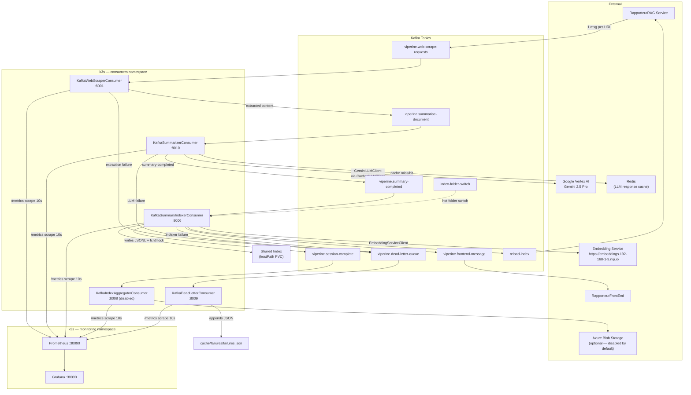

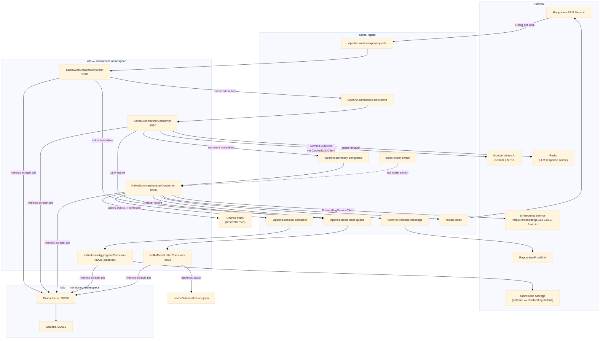

---

## 3. Repository Layout

Files that are active at runtime are annotated. Directories marked *(unused at runtime)* are retained to maintain Python package parity with sibling repos.

```
RapporteurConsumerViperine/
│
├── src/
│   ├── config.py                     # CustConf class + app_conf singleton (pyconfs-backed)
│   ├── config_handler.py             # Base mixin: config + named logger for all subclasses
│   │
│   ├── consumers/
│   │   ├── kafka_web_scraper.py      # KafkaWebScraperConsumer — URL extraction (port 8001)
│   │   ├── kafka_summarizer.py       # KafkaSummarizerConsumer — LLM summarization (port 8010)
│   │   ├── kafka_summary_indexer.py  # KafkaSummaryIndexerConsumer — embed + index (port 8006)
│   │   ├── kafka_index_aggregator.py # KafkaIndexAggregatorConsumer — Azure upload (port 8008)
│   │   ├── kafka_dead_letter_consumer.py  # KafkaDeadLetterConsumer — DLQ audit sink (port 8009)
│   │   ├── _failure_taxonomy.py      # classify_error() — 9-category retry/degrade policy
│   │   ├── _doc_id.py                # make_document_id() — deterministic (id, dedup_key) factory
│   │   ├── run_kafka_consumer.py     # Entry point for WebScraper
│   │   ├── run_kafka_summarizer.py   # Entry point for Summarizer
│   │   ├── run_kafka_summary_indexer.py   # Entry point for SummaryIndexer
│   │   ├── run_kafka_index_aggregator.py  # Entry point for IndexAggregator
│   │   └── run_kafka_dead_letter_consumer.py  # Entry point for DLQ consumer
│   │
│   ├── clients/
│   │   ├── llm_gcp_client.py         # GeminiLLMClient — Vertex AI async wrapper
│   │   ├── llm_cache_client.py       # CachedLLMClient — Redis-backed decorator over any LLM client
│   │   ├── embedding_client.py       # EmbeddingServiceClient — async httpx pool (max 20 conns)
│   │   ├── llm_client.py             # SimpleLLMClient interface base
│   │   ├── llm_openai_client.py      # OpenAI client (inactive — Gemini is the active provider)
│   │   ├── geocoding_client.py       # *(unused at runtime in consumer group)*
│   │   ├── weather_client.py         # *(unused at runtime in consumer group)*
│   │   └── vision_embedding_client.py # *(unused at runtime in consumer group)*
│   │
│   ├── components/
│   │   ├── document_websearcher.py   # DocumentWebSearcher — curl_cffi + Tavily/Google/DDG search
│   │   ├── url_resolver.py           # URLResolver — redirect chain resolution
│   │   └── summarise/
│   │       └── llm_citation_researcher.py  # CitationResearchClient — LLM orchestration
│   │
│   ├── monitoring/
│   │   ├── prometheus_metrics.py     # PrometheusMetrics — base lifecycle counters/gauges/histograms
│   │   ├── kafka_metrics.py          # KafkaMetricsWrapper — lag, poll, publish tracking
│   │   ├── system_metrics.py         # SystemMetricsCollector — psutil CPU/RAM/disk (daemon thread)
│   │   ├── cache_metrics.py          # CacheMetricsCollector — local cache file stats
│   │   ├── azure_metrics.py          # AzureMetricsCollector — blob storage stats + op timing
│   │   ├── cost.py                   # estimate_cost() — USD cost from token counts (13-model table)
│   │   ├── error_categories.py       # ErrorCategory — validated label enum (prevents cardinality bloat)
│   │   ├── logging_config.py         # configure_logging() — structured JSON logging
│   │   └── exporters/
│   │       └── metrics_server.py     # MetricsServer — /metrics, /health, /ready HTTP daemon
│   │
│   └── utils/
│       ├── index_adapter.py          # transform_qa_index_to_chunks() — schema bridge
│       ├── url_normalize.py          # normalize_url() — canonical URL for dedup_key hashing
│       └── async_file_io.py          # Async file I/O helpers
│
├── tests/                            # Pytest suite
├── monitoring/
│   ├── grafana/dashboards/
│   │   └── viperine-pipeline-overview.json  # Grafana dashboard (11 sections, 63 panels)
│   └── prometheus/                   # Prometheus scrape job fragments
├── helm/rapporteur-consumer-group/   # Helm chart — release name: viperine, namespace: consumers
├── grafana/dashboards/               # Dashboard JSON (alternate provisioning path)
├── prometheus.yml                    # Prometheus configuration
├── docker-compose.kafka.yml          # Local Kafka broker for development
├── Makefile                          # Developer commands
└── docs/                             # This documentation
```

---

## 4. Process and Concurrency Model

Each consumer is a single Python process launched by a `run_*.py` entry point. The main thread runs a synchronous Kafka poll loop; async work (LLM calls, embedding requests, file I/O) is executed inside the loop via `asyncio.run()`, which creates a fresh event loop for each message. This means there is no shared asyncio state between messages — each invocation is isolated.

In addition to the main thread, each consumer starts three background daemon threads at startup:

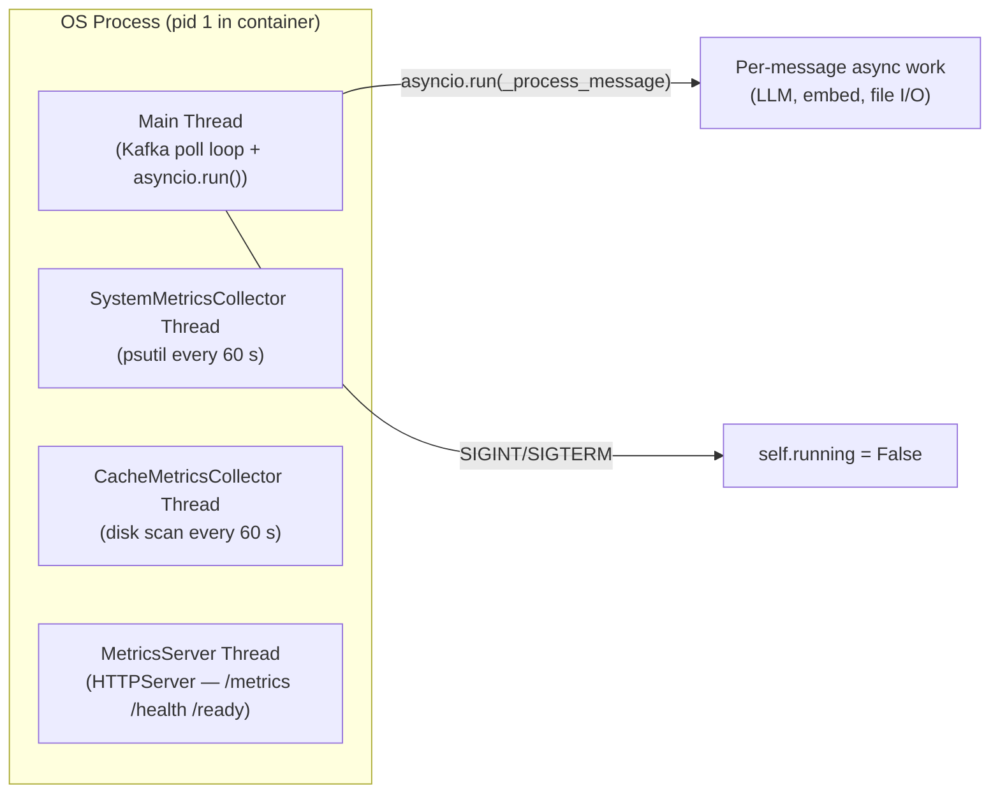

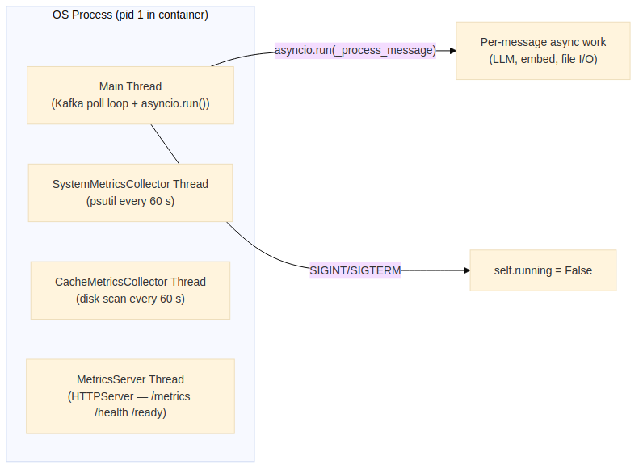

| Thread | Purpose | Termination |
|---|---|---|
| Main | Kafka poll; calls `asyncio.run()` per message | `self.running = False` → breaks poll loop |
| `SystemMetricsCollector` | Collects CPU, RAM, disk stats via `psutil`; updates Prometheus gauges | `daemon=True`; stopped by `collector.stop()` on graceful shutdown |
| `CacheMetricsCollector` | Scans `cache/` directory for file counts and sizes | `daemon=True`; stopped on graceful shutdown |
| `MetricsServer` | Serves `/metrics`, `/health`, `/ready` over HTTP | `daemon=True`; never explicitly stopped (process exit) |

**The `asyncio.run()` per-message pattern** means each message gets a clean event loop. The `EmbeddingServiceClient` detects a stale loop identity (from the previous message's `asyncio.run()`) and creates a fresh `httpx.AsyncClient` rather than reusing the closed one. This avoids `RuntimeError: Event loop is closed` on the second and subsequent messages.

**Graceful shutdown** is coordinated through `SIGINT`/`SIGTERM` handlers registered at init. On signal receipt, `self.running = False` causes the poll loop to exit cleanly: the producer is flushed, the consumer is closed, and all daemon threads are stopped in order.

---

## 5. Module Reference

### 5.1 Configuration Layer

All application settings — Kafka endpoints, topic names, LLM parameters, cache paths, timeouts — are centralised in `src/config.py`. No consumer reads environment variables directly except where noted; instead, `CustConf.get()` is the single access point.

#### `src/config.py`

Defines `defaults` — a two-level dictionary of all settings — and the `CustConf` class that wraps them.

```python
class CustConf(Configuration):       # inherits pyconfs.Configuration
    def get(self, key: str) -> Any    # resolves "namespace.key" via dot-path lookup
    def init_logger(self, obj, name)  # returns a named Logger bound to this config
```

Key config namespaces:

| Namespace | Description |
|---|---|
| `kafka.*` | Bootstrap servers, group IDs, topic names, timeouts |
| `gemini.*` | Project ID, location, model name, generation params |
| `embedding_service.*` | URL, timeout, connection pool limits |
| `web_scraper.*` | Cache dir, URL dedup settings, extraction flags |
| `summarizer.*` | LLM provider, consumer group, topic names |
| `summary_indexer.*` | Cache dir, combined index file path, topic names |
| `index_aggregator.*` | Consumer group, Azure container names |
| `azure_blob.*` | Connection string (from `AZURE_STORAGE_CONNECTION_STRING` env var) |

#### `src/config_handler.py`

```python
class Base:
    _app_config: CustConf    # shared singleton — all consumers inherit this
    _logger: Logger           # named per-class logger via config.init_logger()
```

Every class in the codebase — consumer, client, component — inherits `Base`. This guarantees a uniform configuration and logging interface without passing config objects as arguments.

---

### 5.2 `KafkaWebScraperConsumer`

**File:** `src/consumers/kafka_web_scraper.py` (2 308 lines)
**Port:** 8001 | **Group ID:** `viperine-web-scraper-v2` (config: `kafka.group_id`)

Converts a URL message into an extracted-text message. Applies a multi-strategy extraction cascade; the first strategy that returns valid content wins. Publishes to `viperine.summarise-document` on success, `viperine.dead-letter-queue` on terminal failure.

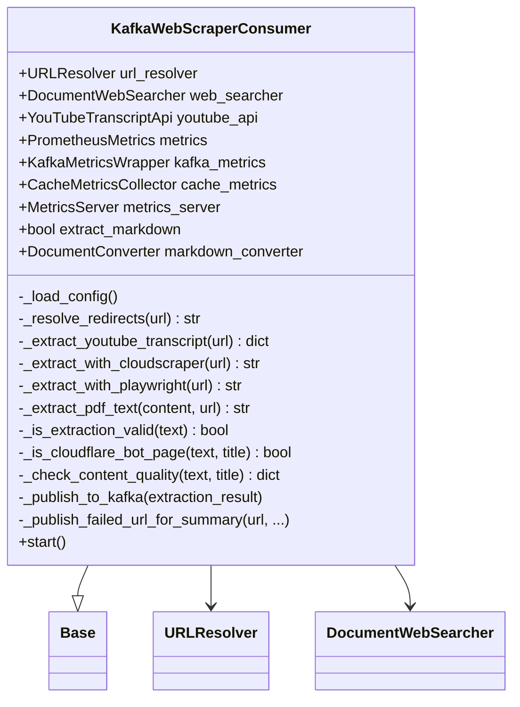

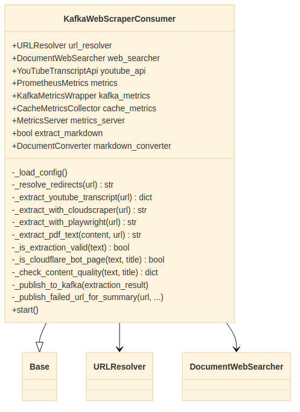

**Consumer-specific metrics** (beyond the shared base set):

| Metric | Type | Labels | Description |
|---|---|---|---|
| `kafka_consumer_urls_scraped_total` | Counter | `consumer_id` | Successfully scraped URLs |
| `kafka_consumer_scraping_duration_seconds` | Histogram | `consumer_id`, `status` | Per-URL scraping time |
| `kafka_consumer_scrape_strategy_total` | Counter | `consumer_id`, `strategy`, `outcome` | Attempts per extraction strategy and outcome |

**Extraction strategy cascade:**

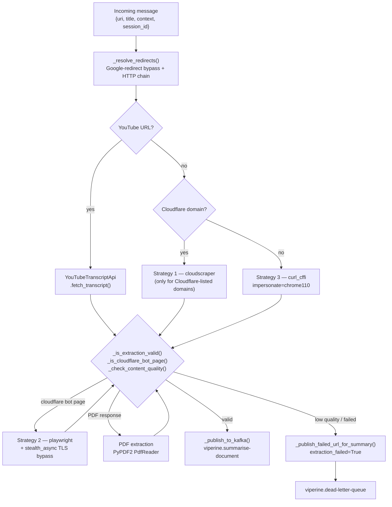

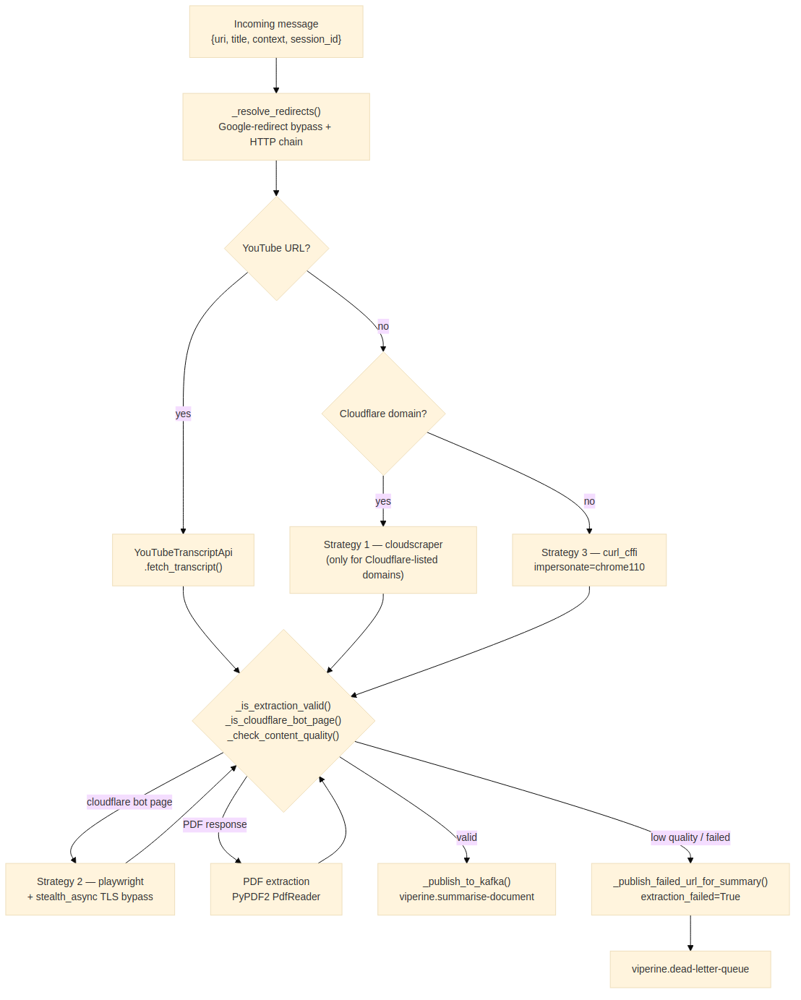

**Content validity rules:**
- `_is_extraction_valid(text)` — minimum `web_scraper.min_words_for_valid_extraction` words (default 10)
- `_is_cloudflare_bot_page(text, title)` — title/body heuristics for bot-challenge pages; triggers Playwright retry
- `_check_content_quality(text, title)` — low word-count combined with navigation-only content patterns marks as degraded

On a failed extraction the scraper still publishes to `viperine.summarise-document` with `extraction_failed=True`, so the Summarizer can attempt a Gemini web-grounding recovery rather than silently dropping the document. This keeps the session counter consistent and ensures the Indexer session closes.

---

### 5.3 `KafkaSummarizerConsumer`

**File:** `src/consumers/kafka_summarizer.py` (1 068 lines)
**Port:** 8010 | **Group ID:** `viperine-summarizer-v2` (config: `summarizer.consumer_group_id`)

Reads an extracted document, calls the LLM to produce a structured Markdown summary, validates the output, tracks token usage and estimated cost, and publishes a `summary-completed` terminal event. The always-emit-terminal-event invariant ensures the Indexer session never hangs regardless of how the summarization attempt ends.

```mermaid
classDiagram
    class KafkaSummarizerConsumer {
        +CitationResearchClient llm_client
        +PrometheusMetrics metrics
        +KafkaMetricsWrapper kafka_metrics
        +MetricsServer metrics_server
        -_load_config()
        -_process_message(message_data) dict
        -_publish_summary_completed(session_id, ...)
        -_publish_to_dead_letter(message_data, error)
        +start()
    }
    KafkaSummarizerConsumer --|> Base
    KafkaSummarizerConsumer --> CitationResearchClient : llm_client
    CitationResearchClient --> CachedLLMClient
    CachedLLMClient --> GeminiLLMClient : _inner
    GeminiLLMClient --> "genai.Client (Vertex AI)"
```

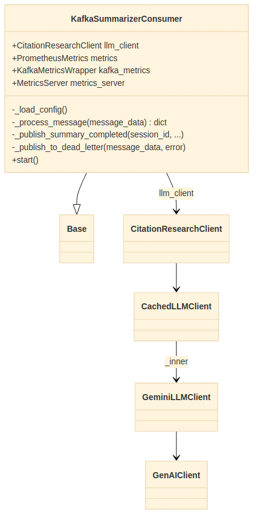

**Consumer-specific metrics:**

| Metric | Type | Labels | Description |
|---|---|---|---|
| `kafka_consumer_documents_summarized_total` | Counter | `consumer_id` | Successfully summarised documents |
| `kafka_consumer_summarization_duration_seconds` | Histogram | `consumer_id`, `status` | End-to-end summarisation latency |
| `kafka_consumer_llm_api_calls_total` | Counter | `consumer_id`, `provider` | Total LLM API invocations |
| `kafka_consumer_llm_api_errors_total` | Counter | `consumer_id`, `error_type` | LLM errors by taxonomy category |
| `kafka_consumer_llm_tokens_used_total` | Counter | `consumer_id`, `provider` | Total tokens (input + output combined) |
| `kafka_consumer_llm_input_tokens_total` | Counter | `consumer_id`, `model` | Input/prompt tokens, labelled by concrete model name |
| `kafka_consumer_llm_output_tokens_total` | Counter | `consumer_id`, `model` | Output/completion tokens |
| `kafka_consumer_llm_estimated_cost_usd_total` | Counter | `consumer_id`, `model` | Estimated USD cost via `estimate_cost()` |
| `kafka_consumer_llm_latency_seconds` | Histogram | `consumer_id`, `model` | Per-call LLM latency |
| `kafka_consumer_summary_length_chars` | Histogram | `consumer_id` | Output summary length in characters |

**Retry and degradation policy** (driven by `_failure_taxonomy.classify_error()`):

| Error category | Retryable | Max attempts | Degrade to stub |
|---|---|---|---|
| `transient` (timeout / 429 / 503) | Yes | 3 | No |
| `model_empty` (STOP with empty body) | Yes | 2 | **Yes** — emit stub summary |
| `policy_block` (SAFETY / RECITATION) | No | 1 | No |
| `auth` (invalid key / quota) | No | 1 | No |
| `not_found` (404 / no such file) | No | 1 | No |
| `bad_input` (empty text / bad JSON) | No | 1 | No |
| `embedding` (embedding service error) | Yes | 3 | No |
| `permanent_internal` (AssertionError etc.) | No | 1 | No |
| `unknown` | Yes | 2 | No |

**Token accounting design:** `CitationResearchClient.generate_summary()` returns a dict that does not include a `usage` key — token counts are tracked inside `GeminiLLMClient._total_usage` which is a running cumulative counter. The Summarizer resolves this by:
1. Snapshotting `_inner_client.get_usage()` as `_usage_before` immediately before the LLM call
2. Calling `_inner_client.get_usage()` again as `_usage_after` after the call
3. Computing `input_tokens = _usage_after['input_tokens'] - _usage_before['input_tokens']`

This gives a per-call delta even though the underlying counter is cumulative.

**Model name resolution for cost:** `getattr(self.llm_client, 'model_name', None)` returns `"gemini-2.5-pro"` (the concrete model name), which matches the `PRICING_TABLE` key in `cost.py`. The LLM provider string (`"gemini"`) is used only for the `llm_api_calls_total` label and never passed to `estimate_cost()`.

---

### 5.4 `KafkaSummaryIndexerConsumer`

**File:** `src/consumers/kafka_summary_indexer.py` (1 169 lines)
**Port:** 8006 | **Group ID:** `viperine-summary-indexer-v2` (config: `summary_indexer.consumer_group_id`)

Embeds each summary, appends it to a per-session JSONL file, deduplicates and merges into the combined master index (with `fcntl.LOCK_EX`), and emits downstream notifications when a session completes.

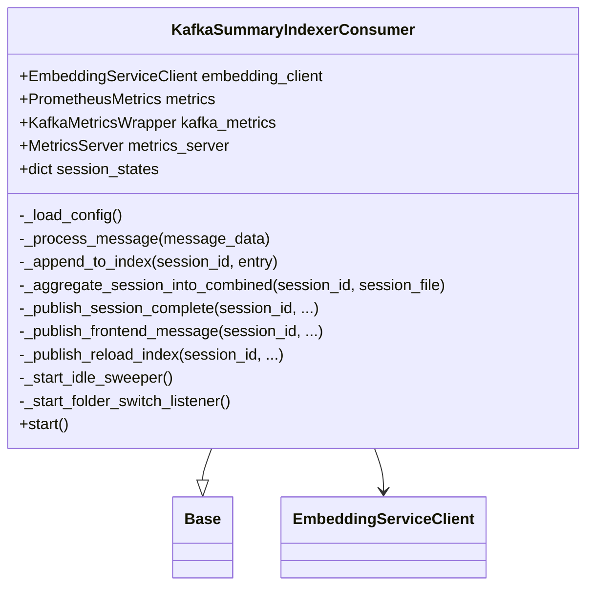

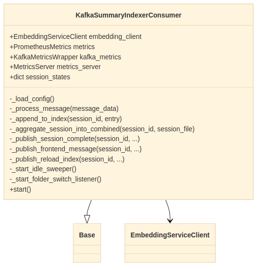

**Consumer-specific metrics:**

| Metric | Type | Labels | Description |
|---|---|---|---|
| `kafka_consumer_summaries_indexed_total` | Counter | `consumer_id` | Total summaries embedded and written |
| `kafka_consumer_summary_sessions_completed_total` | Counter | `consumer_id` | Sessions that reached completion |
| `kafka_consumer_summary_embedding_duration_seconds` | Histogram | `consumer_id`, `status` | Embedding service call latency |
| `kafka_consumer_summaries_per_session` | Histogram | `consumer_id` | Distribution of session sizes |
| `kafka_consumer_summary_duplicates_detected_total` | Counter | `consumer_id`, `match` | Duplicate messages suppressed by dedup_key or document_id |
| `kafka_consumer_summary_id_scheme_total` | Counter | `consumer_id`, `scheme` | Tracks which document_id scheme is in use (`req_`/`doc_`/`uuid_legacy`) |

**Session state machine:**

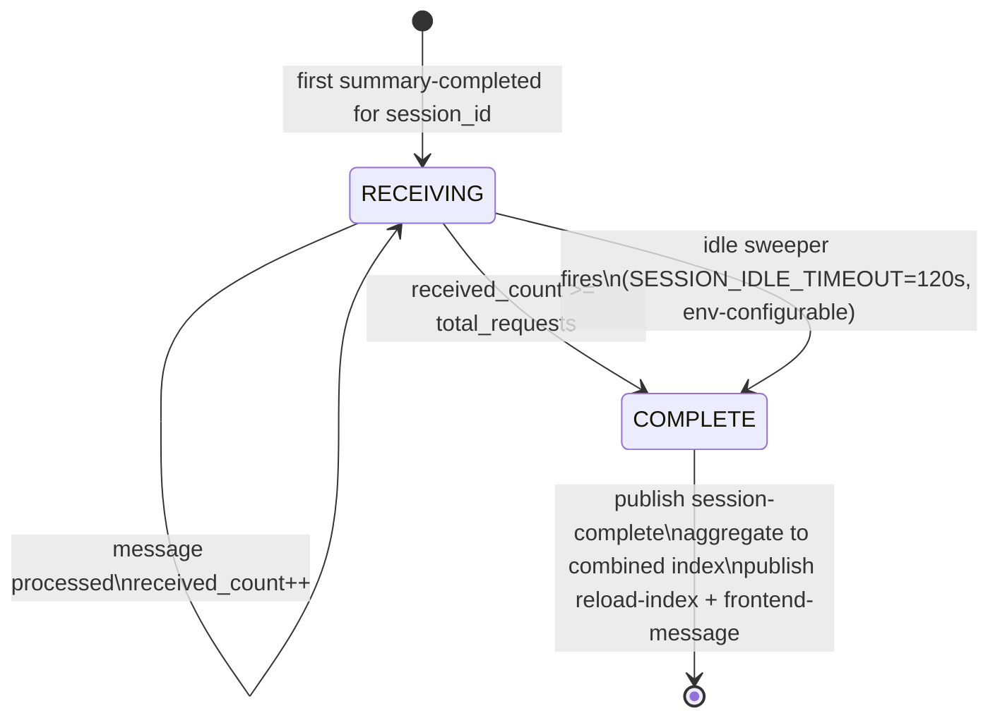

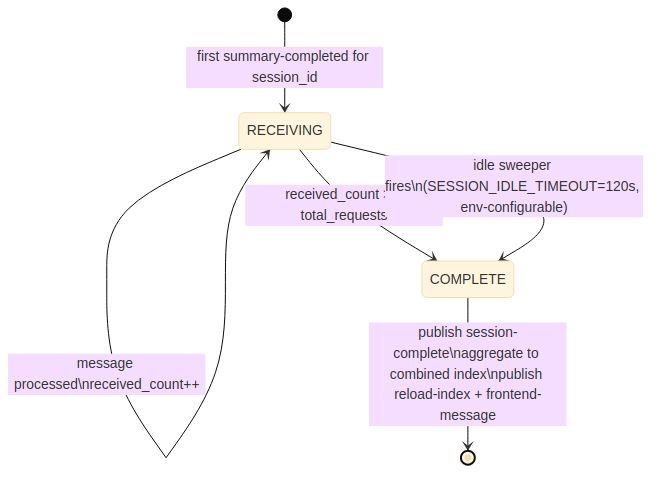

**Idempotency:** Every incoming message is checked against two keys stored in the per-session state file (`cache/summaries/{session_id}/{session_id}_state.json`):
1. `document_ids_processed` — `req_YYYYMMDD_HHMMSS_NNNN` (time-based, per research event)
2. `dedup_keys_processed` — `md5(normalize_url(source_url))` (content-addressed, stable across restarts)

A message is silently dropped if either key is already present. This makes the consumer safe under Kafka's at-least-once delivery guarantee.

**Combined index write safety:** The master index file (`ACTIVE_INDEX_FOLDER/research_summaries_filtered.jsonl`) is shared across all pod replicas. Concurrent writes during rolling updates are prevented by an `fcntl.LOCK_EX` advisory lock on a sibling `.lock` file:

```python
with open(lock_path, 'w') as lock_fh:
    fcntl.flock(lock_fh.fileno(), fcntl.LOCK_EX)
    try:
        self._aggregate_session_into_combined(session_id, session_index_file)
    finally:
        fcntl.flock(lock_fh.fileno(), fcntl.LOCK_UN)
```

**Hot folder switching:** A background thread subscribes to the `index-folder-switch` topic. On receiving `{"folder": "x_indices_eo"}`, it atomically re-routes `self.combined_index_file` to the new path, enabling live index migrations without pod restart.

---

### 5.5 `KafkaIndexAggregatorConsumer`

**File:** `src/consumers/kafka_index_aggregator.py` (1 831 lines)
**Port:** 8008 | **Group ID:** `index-aggregator-consumer`
**Default state:** Disabled (`ENABLE_AGGREGATOR=false` in Helm values)

Accumulates per-session chunk and Q&A pair data, merges it with the existing combined index already in Azure, deduplicates, and uploads the updated file. Only triggers when all three completion flags are set for a session: `session_chunks_complete`, `session_qa_complete`, and `session_summaries_complete`.

**Consumer-specific metrics:**

| Metric | Type | Labels | Description |
|---|---|---|---|
| `kafka_consumer_chunks_aggregated_total` | Counter | `consumer_id` | Chunks written to combined index |
| `kafka_consumer_qa_pairs_aggregated_total` | Counter | `consumer_id` | Q&A pairs written |
| `kafka_consumer_chunks_duplicates_filtered_total` | Counter | `consumer_id` | Duplicate chunks dropped by dedup |
| `kafka_consumer_qa_duplicates_filtered_total` | Counter | `consumer_id` | Duplicate Q&A pairs dropped |
| `kafka_consumer_azure_upload_duration_seconds` | Histogram | `consumer_id`, `blob_type`, `status` | Azure upload latency |
| `kafka_consumer_session_backup_duration_seconds` | Histogram | `consumer_id`, `status` | Session backup time |
| `kafka_consumer_azure_storage_bytes` | Gauge | `consumer_id`, `container`, `blob_name` | Blob size after upload |
| `kafka_consumer_sessions_aggregated_total` | Counter | `consumer_id` | Completed aggregation cycles |
| `kafka_consumer_azure_upload_failures_total` | Counter | `consumer_id`, `index_type` | Azure failures after all retries |

---

### 5.6 `KafkaDeadLetterConsumer`

**File:** `src/consumers/kafka_dead_letter_consumer.py` (521 lines)
**Port:** 8009 | **Group ID:** `viperine-dead-letter-v2` (config: `dead_letter.consumer_group_id`)

A write-only audit sink. Reads every failure event published by any pipeline stage, persists it to `cache/failures/failures.json` (an append-only JSON array), and tracks per-stage failure counts. Does not retry messages — retry is the responsibility of the publishing consumer.

**Consumer-specific metrics:**

| Metric | Type | Labels | Description |
|---|---|---|---|
| `kafka_consumer_dlq_messages_processed_total` | Counter | `consumer_id`, `failed_stage` | DLQ messages received by stage |
| `kafka_consumer_dlq_retry_attempts_total` | Counter | `consumer_id`, `failed_stage` | *Reserved* — retries are handled upstream |
| `kafka_consumer_dlq_messages_reprocessed_total` | Counter | `consumer_id`, `failed_stage` | Messages manually reprocessed |
| `kafka_consumer_dlq_messages_discarded_total` | Counter | `consumer_id`, `failed_stage` | Permanently discarded messages |
| `kafka_consumer_dlq_failures_by_stage` | Gauge | `consumer_id`, `stage` | Current total failures per pipeline stage |
| `kafka_consumer_dlq_processing_duration_seconds` | Histogram | `consumer_id`, `status` | DLQ message processing time |
| `kafka_consumer_dlq_messages_by_origin_total` | Counter | `consumer_id`, `origin_topic` | Messages grouped by the topic where the failure originated |
| `kafka_consumer_dlq_age_seconds` | Histogram | `consumer_id` | Time between failure timestamp and DLQ processing |

---

### 5.7 Client Library

#### `GeminiLLMClient` (`src/clients/llm_gcp_client.py`)

Wraps `google.genai.Client` (Vertex AI SDK) as an async interface.

Key behaviours:
- **`model_name`** — read from `gemini.model_name` (default `"gemini-2.5-pro"`). Exposed as a property so the Summarizer can pass it to `estimate_cost()`.
- **Token accumulation** — `_total_usage` dict (`input_tokens`, `output_tokens`, `calls`) is incremented from `response.usage_metadata` on every `generate_content()` call. `get_usage()` returns a snapshot; `reset_usage()` zeros the counters.
- **Stage model overrides** — reads `bboa.models` dict from config; a specific model name can be selected per LLM stage (e.g. `event_detection`) without changing the default.
- **Grounding via Google Search** — when `enable_search=True` the `google_search_retrieval` tool is appended to the request, enabling real-time web retrieval for the Summarizer's `extraction_failed` path.
- **Exponential backoff** — up to `llm.max_retries` (default 3) with `retry_delay` seconds initial delay.

#### `CachedLLMClient` (`src/clients/llm_cache_client.py`)

Redis-backed cache decorator over any object with an `async generate_content(prompt)` interface.

```
cache_key = sha256(model_name + "|" + prompt)[:32]
```

- **Cache miss** → call `_inner.generate_content()` → store in Redis with TTL `432 000 s` (5 days)
- **Cache hit** → return cached string directly, no LLM call
- **Pass-through** when `redis_host` is empty (local development or no Redis pod)
- Delegates `model_name`, `get_usage()`, `reset_usage()`, and `cost_tracker` to `_inner` via `@property` so the Summarizer's token delta logic works transparently through the cache layer

#### `EmbeddingServiceClient` (`src/clients/embedding_client.py`)

Async `httpx` client with connection pooling (max 20 connections, 10 keepalive) and per-request exponential retry.

- **Lazy loop detection** — tracks `_client_loop` (the event loop ID of the current `httpx.AsyncClient`). When `asyncio.run()` starts a new loop for the next message, the stale client is detected and a fresh one created. This prevents `RuntimeError: Event loop is closed`.
- **Batch splitting** — texts are split into batches of at most `max_texts_per_request=64` before being sent to the embedding service.
- **Embedding dimensions** — 384-dim vectors from all-MiniLM-L6-v2 hosted at `https://embeddings.192-168-1-3.nip.io`.

---

### 5.8 Component Library

#### `DocumentWebSearcher` (`src/components/document_websearcher.py`)

Multi-strategy web content fetcher. Uses `curl_cffi.requests.Session(impersonate="chrome110")` as the primary HTTP client to defeat TLS/JA3 fingerprinting — the most common cause of 403 errors on Cloudflare-protected sites.

Search API priority for citation lookup: Tavily → Google Custom Search → DuckDuckGo (no key required).

Key methods:
- `fetch_page(url)` — primary content fetch with browser impersonation
- `extract_text_from_html(html)` — BeautifulSoup-based text extraction
- `_extract_page_metadata(soup)` — title, author, language, publication date

#### `URLResolver` (`src/components/url_resolver.py`)

Follows redirect chains manually (not via `allow_redirects=True`) to record every hop. Special-cases Google redirect URLs (`google.com/url?q=...`) by extracting the target from the query string directly, avoiding the Google redirect confirmation page. Returns the resolved URL and the full `redirect_chain` list for traceability.

#### `CitationResearchClient` (`src/components/summarise/llm_citation_researcher.py`)

Orchestrates LLM-based document summarization. Supports `openai` and `gemini` providers (selected by `summarizer.llm_provider`).

On the Gemini path: builds `GeminiLLMClient` → wraps with `CachedLLMClient` → sets `self.client`. The `generate_summary()` method constructs a structured JSON prompt requesting `{metadata: {...}, markdown_summary: "..."}`. The response is parsed with a lenient JSON-repair fallback on `JSONDecodeError`. Returns the parsed dict — **the dict does not contain a `usage` key**; token data must be read from the underlying client's `get_usage()`.

---

### 5.9 Monitoring Library

#### `PrometheusMetrics` (`src/monitoring/prometheus_metrics.py`)

Base class providing the metrics shared by all consumers: `messages_consumed_total`, `message_processing_duration_seconds`, `processing_failures_total`, `consumer_state`, `consumer_info`, `retry_attempts_total`, `dead_letter_messages_total`, `startup_timestamp_seconds`, `last_message_processed_timestamp`, `sessions_in_progress`, `model_error_outputs_total`.

`record_failure(topic, error_category)` validates the category against `ErrorCategory.all_categories()` before writing to Prometheus, preventing cardinality explosion from freeform error strings.

#### `ErrorCategory` (`src/monitoring/error_categories.py`)

Fixed enum of every valid `error_type` label value across all consumers. The `validate(category)` class method raises `ValueError` for any value not in the frozen set, catching instrumentation bugs at the call site before they reach Prometheus.

#### `MetricsServer` (`src/monitoring/exporters/metrics_server.py`)

HTTPServer running in a `daemon=True` thread. `MetricsHandler` serves:
- `GET /metrics` — `prometheus_client.generate_latest()` in standard Prometheus text format
- `GET /health` — JSON `{consumer_name, status, code}` — liveness probe; 503 if `health_check()` returns False
- `GET /ready` — JSON `{consumer_name, status, code}` — readiness probe; 503 if consumer/producer not yet initialised

#### `estimate_cost` (`src/monitoring/cost.py`)

```python
PRICING_TABLE: dict[str, PricingEntry]  # 13 models (Gemini, OpenAI, Anthropic)

def estimate_cost(model: str, input_tokens: int, output_tokens: int) -> float
```

Looks up the model name (exact match then prefix match for versioned names like `gemini-2.5-flash-001`). Returns USD float. On a miss, logs a warning and increments `kafka_consumer_cost_unknown_model_total{model=...}` — a Prometheus counter that signals a pricing table update is needed.

---

### 5.10 Utility Library

#### `make_document_id` (`src/consumers/_doc_id.py`)

```python
def make_document_id(url, batch_index=1, when=None) -> tuple[str, str]:
    document_id = f"req_{YYYYMMDD}_{HHMMSS}_{1000 + batch_index}"
    dedup_key   = md5(normalize_url(url)).hexdigest()
    return document_id, dedup_key
```

`document_id` is time-based and lexicographically sortable. `dedup_key` is content-addressed — the same URL always produces the same key regardless of when it is processed, making it safe to use as a deduplication guard under at-least-once delivery.

#### `normalize_url` (`src/utils/url_normalize.py`)

Canonicalises URLs for `dedup_key` generation: lowercases the scheme and host, removes default ports (`:80`, `:443`), strips trailing slashes, removes fragments. The normalised form is what gets MD5-hashed.

#### `transform_qa_index_to_chunks` (`src/utils/index_adapter.py`)

Bidirectional schema adapter between the flat Q&A format (produced by the indexing pipeline) and the enriched-chunks format expected by the RAG service. `validate_index_schema(record)` auto-detects which format a record is in from its top-level keys.

---

## 6. Metrics Endpoint Reference

Every consumer exposes three HTTP endpoints on its metrics port. These are used directly by Kubernetes liveness/readiness probes and by the Prometheus scrape job.

| Endpoint | Method | Purpose | Success | Failure |
|---|---|---|---|---|
| `/metrics` | GET | Prometheus metric scrape | 200 + text/plain metrics body | 500 on registry error |
| `/health` | GET | Kubernetes liveness probe | `200 {"status": "healthy"}` | `503 {"status": "unhealthy"}` when `self.running = False` |
| `/ready` | GET | Kubernetes readiness probe | `200 {"status": "ready"}` | `503 {"status": "not_ready"}` until consumer and producer are both connected |

Port mapping:

| Consumer | Port |
|---|---|
| `KafkaWebScraperConsumer` | 8001 |
| `KafkaSummarizerConsumer` | 8010 |
| `KafkaSummaryIndexerConsumer` | 8006 |
| `KafkaIndexAggregatorConsumer` | 8008 |
| `KafkaDeadLetterConsumer` | 8009 |

---

## 7. Security Controls

**Secret management:** GCP service-account credentials are injected as a Kubernetes Secret and mounted at a well-known path inside the pod. The `GOOGLE_APPLICATION_CREDENTIALS` environment variable points the Vertex AI SDK to the mounted file. Credentials are never baked into the container image.

**Kafka credentials:** SASL username/password (when configured) are read from `KAFKA_SASL_USERNAME` and `KAFKA_SASL_PASSWORD` environment variables injected by Kubernetes. The config file contains no credentials.

**Azure connection string:** Read from `AZURE_STORAGE_CONNECTION_STRING` environment variable only; never written to disk or logged.

**Embedding service API key:** Configured via `embedding_service.api_key` (defaults in config for the internal cluster). Transmitted over HTTPS to `https://embeddings.192-168-1-3.nip.io`.

**No inbound external traffic:** No consumer exposes any port to the internet. The metrics endpoints (`:8001`, `:8006`, `:8008`, `:8009`, `:8010`) are accessible only within the cluster network and are scraped by Prometheus in the same cluster.

**LLM output validation:** `validate_summary_content()` in `_failure_taxonomy.py` rejects LLM outputs that match known error/refusal patterns before they can be written to the index. This prevents garbage content (e.g. `# Error: I am unable to generate a summary...`) from appearing in research results.

**Input size limits:** The Kafka producer is configured with `message.max.bytes=5242880` (5 MB) and Snappy compression to prevent oversized payloads. URL resolution uses a 10-second timeout to prevent hanging on slow redirects.

---

## 8. Deployment

**Container image:** `192.168.1.3:5000/rapporteur-consumer-viperine:0.0.1`

**Helm chart:** `helm/rapporteur-consumer-group/` — release name `viperine`, namespace `consumers`.

**Key Makefile targets:**

| Target | What it does |
|---|---|
| `make k8s_deploy` | Full pipeline: `k8s_build` → `k8s_push` → `k8s_rollout` |
| `make k8s_build` | Build container image locally |
| `make k8s_push` | Push image to local registry at `192.168.1.3:5000` |
| `make k8s_rollout` | nvidia-safe rollout: scale→0, wait 15 s, force-delete stuck pods, `helm upgrade` |
| `make k8s_status` | Show pod status for all consumers |
| `make k8s_logs` | Stream logs from all consumer pods (selector: `consumer-group=viperine`) |
| `make k8s_restart` | Rolling restart of all consumer deployments |
| `make k8s_shell` | Open a shell in the running WebScraper pod |
| `make k8s_prereqs` | Copy GCP credentials secret from RAG namespace |
| `make k8s_uninstall` | Uninstall the Helm release (does not delete PVCs or secrets) |
| `make monitoring_deploy` | Patch Prometheus and Grafana ConfigMaps and reload |
| `make monitoring_status` | Show scrape target health |
| `make monitoring_open` | Open Grafana in browser |

**nvidia-safe rollout rationale:** The k3s node uses the NVIDIA container runtime. Rolling updates via plain `helm upgrade` leave old pods in `Terminating` indefinitely due to a `permission denied on signal init` runtime bug. The safe rollout explicitly scales all deployments to zero replicas first, waits for clean shutdown, force-deletes any pods still in `Terminating`, then applies the Helm upgrade from a clean state.

**ACTIVE_INDEX_FOLDER:** The `KafkaSummaryIndexerConsumer` reads this environment variable (injected via Helm values) to determine which `x_indices_*` directory to write the combined index into. Changing the active folder across all pods is done by updating the Helm release value and running `make k8s_rollout` — or by publishing to the `index-folder-switch` Kafka topic for a live switch without a restart.
