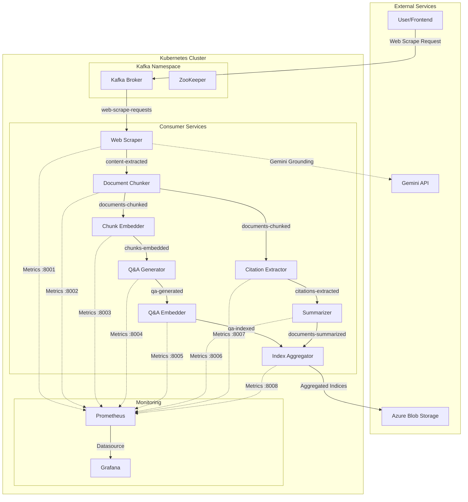
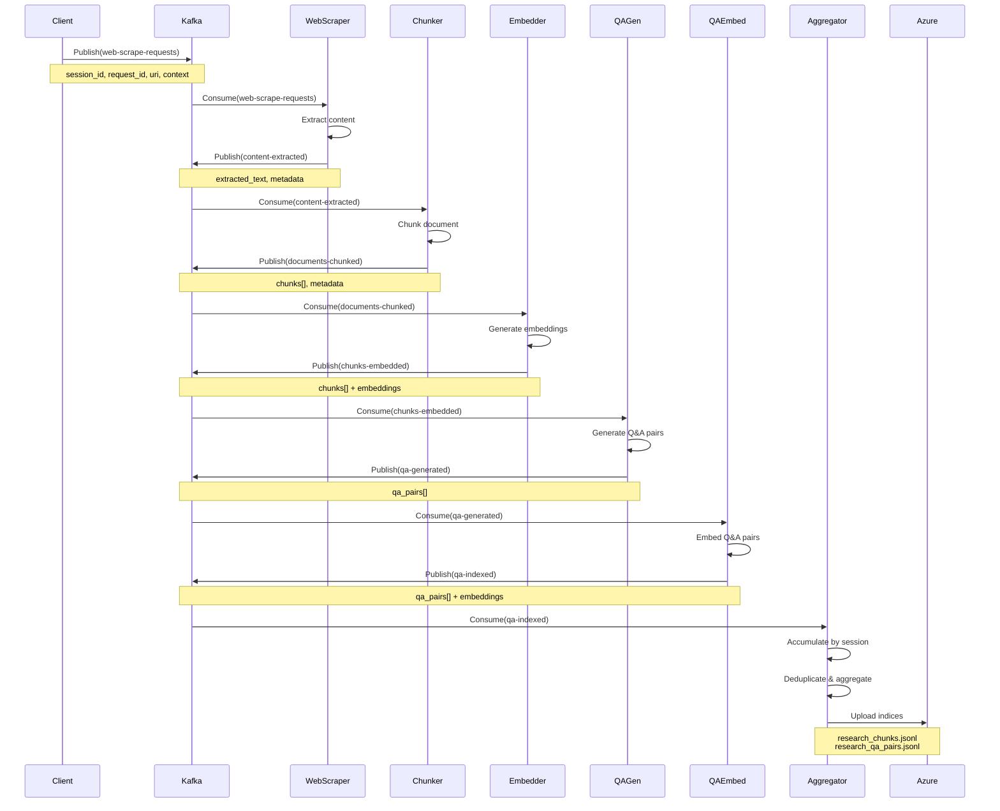
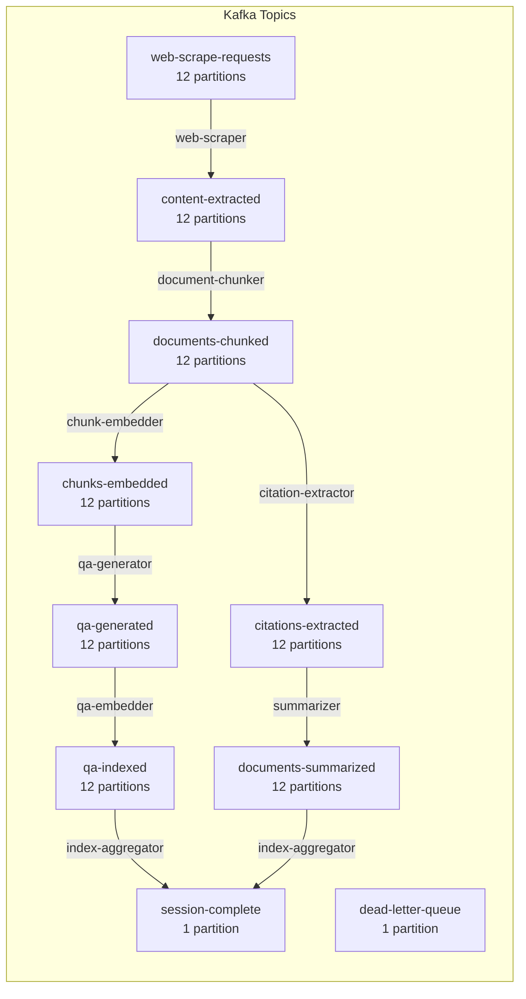
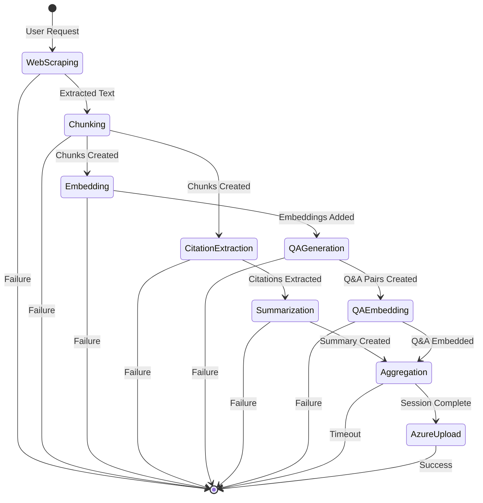
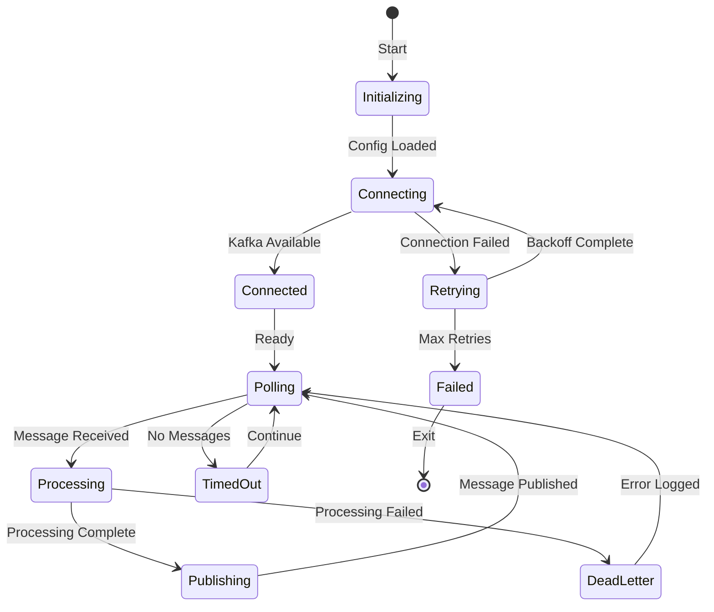
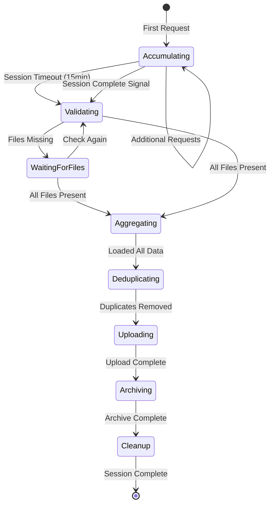
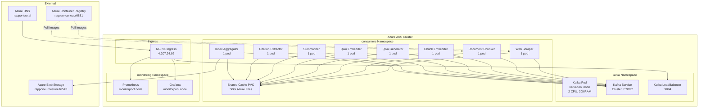
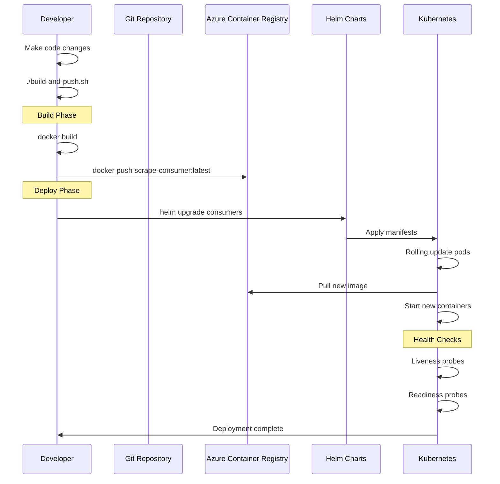
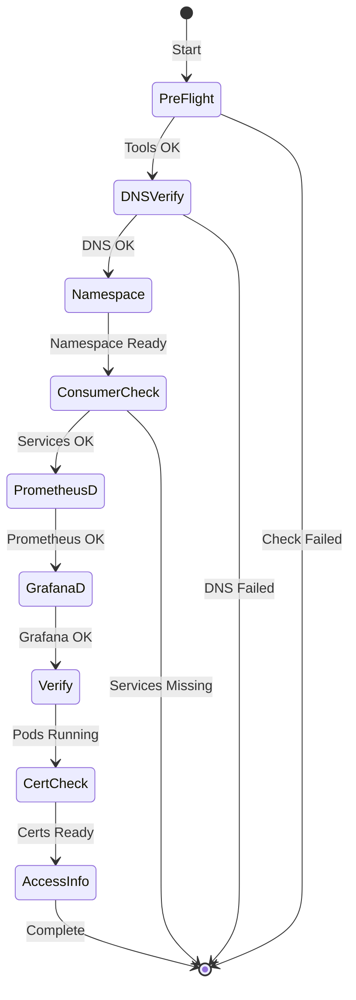
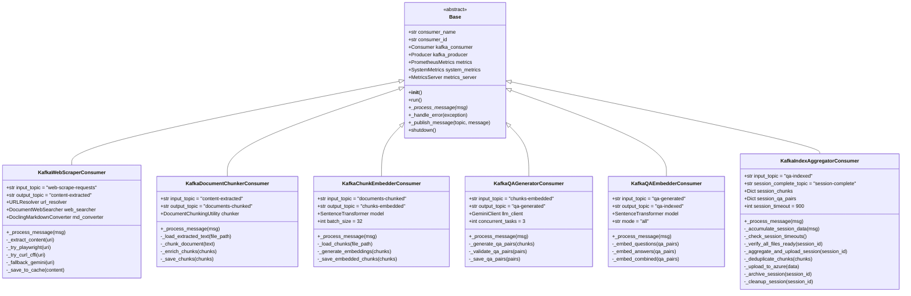

# Research Indexing Pipeline - Architecture Documentation

## Table of Contents
1. [System Overview](#system-overview)
2. [Pub-Sub Architecture](#pub-sub-architecture)
3. [Consumer Pipeline](#consumer-pipeline)
4. [Monitoring Infrastructure](#monitoring-infrastructure)
5. [Deployment Architecture](#deployment-architecture)
6. [Python Components](#python-components)

---

## System Overview

The Research Indexing Pipeline is a distributed, event-driven system built on Apache Kafka for ingesting, processing, and indexing web content into a searchable research database. The system uses a microservices architecture with 8 specialized consumer services running on Kubernetes.



### Key Components

| Component | Purpose | Technology |
|-----------|---------|------------|
| **Kafka** | Message broker for event streaming | Confluent Kafka 7.5.0 |
| **Web Scraper** | Fetches and extracts web content | Playwright, curl_cffi, Gemini |
| **Document Chunker** | Splits documents into semantic chunks | tiktoken, custom chunking |
| **Chunk Embedder** | Generates embeddings for chunks | Sentence Transformers |
| **Q&A Generator** | Creates question-answer pairs | Gemini 1.5 Flash |
| **Q&A Embedder** | Embeds Q&A pairs for retrieval | Sentence Transformers |
| **Summarizer** | Generates document summaries | Gemini 1.5 Flash |
| **Citation Extractor** | Extracts structured citations | Gemini 1.5 Flash |
| **Index Aggregator** | Aggregates and uploads to Azure | Azure Blob Storage SDK |

---

## Pub-Sub Architecture

### Message Flow Sequence



### Topic Architecture



### Kafka Configuration

**Broker Settings:**
```yaml
KAFKA_NUM_PARTITIONS: 12
KAFKA_DEFAULT_REPLICATION_FACTOR: 1
KAFKA_OFFSETS_TOPIC_REPLICATION_FACTOR: 1
KAFKA_LOG_RETENTION_HOURS: 168  # 7 days
KAFKA_AUTO_CREATE_TOPICS_ENABLE: true
```

**Consumer Group Strategy:**
- Each consumer type has its own consumer group
- Partition assignment: Range strategy
- Auto-commit enabled with 5s interval
- Session timeout: 30s-45s depending on consumer
- Max poll interval: 5-10 minutes

---

## Consumer Pipeline

### Pipeline Overview

The consumer pipeline implements a multi-stage, fault-tolerant data processing architecture. Each stage consumes from a Kafka topic, performs its specialized processing, and publishes results to the next topic. The pipeline gracefully handles failures through multiple fallback mechanisms and publishes unrecoverable errors to a dead-letter queue for manual inspection.

The pipeline is designed with the following principles:
1. **Idempotency**: Each consumer can safely reprocess messages without side effects
2. **Fault Isolation**: Failures in one stage don't cascade to others
3. **Graceful Degradation**: Multiple fallback mechanisms ensure partial success
4. **Observability**: Every stage emits detailed logs and Prometheus metrics

### Pipeline Stages



### Consumer State Lifecycle



### Data Flow by Stage

#### 1. Web Scraper (`src/consumers/kafka_web_scraper.py`)

The Web Scraper is the pipeline's entry point, responsible for fetching and extracting content from arbitrary web URLs. It implements a sophisticated multi-strategy extraction system with automatic fallback mechanisms to maximize success rates.

**Primary Class**: `KafkaWebScraperConsumer` extends the base `Base` class from `src/config_handler.py`

**Key Components**:
- **URL Resolution**: `_resolve_redirects()` method handles redirect chains, shortlinks, and URL canonicalization
- **Content Extraction**: Multiple extraction strategies tried in order of sophistication
- **Markdown Conversion**: Optional HTML-to-Markdown conversion using Docling library
- **Cache Management**: Per-request directory structure under `cache/web_scrapes/{request_id}/`

**Extraction Strategy Cascade**:

The web scraper implements a waterfall strategy, attempting increasingly sophisticated methods until one succeeds:

1. **YouTube Transcript Extraction** (specialized)
   - Detects YouTube URLs via pattern matching: `youtube.com/watch`, `youtube.com/live`, `youtube.com/shorts`, `youtu.be/`
   - Uses `youtube_transcript_api.YouTubeTranscriptApi` to fetch transcript
   - Fetches rich metadata via `yt-dlp` subprocess call (title, channel, upload_date, duration, view_count)
   - Method: `_extract_youtube_transcript()`
   - Output: `extracted_linked_text.jsonl` with transcript in markdown format
   - Logs show: `"📹 Detected YouTube URL - attempting transcript extraction..."`

2. **Cloudscraper** (for Cloudflare-protected sites)
   - Targets sites known to use Cloudflare protection: `alarabiya.net`, `gov.il`, `jns.org`, `inquirer.net`
   - Uses `cloudscraper` library to bypass Cloudflare's JavaScript challenge
   - Method: `_extract_with_cloudscraper(url)`
   - Extracts metadata from HTML: `<title>`, `<meta>` tags, Open Graph properties
   - Validates content isn't a Cloudflare bot page via `_is_cloudflare_bot_page()`
   - Requires minimum 500 characters and 10 words
   - Logs show: `"🛡️ Attempting Cloudflare bypass with cloudscraper..."`

3. **Playwright** (for JavaScript-heavy sites)
   - Full browser automation using `playwright.async_api.async_playwright`
   - Implements advanced anti-detection:
     - Removes `navigator.webdriver` property
     - Injects realistic `navigator.plugins` and `navigator.languages`
     - Sets human-like viewport (1920x1080)
     - Uses realistic User-Agent: `Mozilla/5.0 (X11; Linux x86_64) AppleWebKit/537.36...`
     - Applies `playwright_stealth` module if available
   - Method: `_extract_with_playwright(url)` (async)
   - Handles cookie consents automatically by setting common consent cookies
   - Waits for `domcontentloaded` with 45s timeout
   - Detects and handles Cloudflare Turnstile challenges
   - Logs show: `"🌐 Attempting JavaScript rendering with Playwright..."`

4. **curl_cffi** (standard fallback)
   - Uses `curl_cffi.requests.Session` for TLS/JA3 fingerprint evasion
   - Configured via `DocumentWebSearcher._setup_browser_impersonation()`
   - Mimics Chrome 110 browser signature
   - Handles PDFs by extracting text via `PyPDF2.PdfReader`
   - Method: Direct HTTP request with impersonation
   - Quality check via `_check_content_quality()` to detect navigation fragments
   - Minimum 10 words required for valid extraction
   - Logs show: `"📄 Attempting standard HTTP request with curl_cffi..."`

5. **Gemini Web Grounding** (ultimate fallback)
   - When all extraction methods fail or produce low-quality content
   - Uses `DocumentWebSearcher.generate_summary_with_grounding()` method
   - Calls Gemini 1.5 Flash with `grounding_sources=["WEB"]` parameter
   - Gemini fetches the URL directly and generates a summary
   - Output saved to `summary.jsonl` instead of `extracted_linked_text.jsonl`
   - Method: `_publish_failed_url_for_summary()`
   - This triggers the Summarizer consumer to generate content
   - Logs show: `"🔄 Triggering summary fallback for better content extraction"`

**Failure Handling**:
- Creates `failure.jsonl` file with error details when all methods fail
- Publishes failed URLs to `summarise-document` topic for Gemini fallback
- Tracks extraction attempts in `extraction_attempts[]` list
- All failures published to dead-letter queue with context

**Input Message**:
```python
{
    "session_id": "time_series_20231007_20231021",
    "request_id": "req_20251222_233620_001",
    "uri": "https://example.com/article",
    "title": "Article Title",
    "context": ["snippet1", "snippet2"],
    "total_requests": 12  # Optional: for session tracking
}
```

**Processing Flow** (from logs):
```
📍 Step 1: Resolving redirects to final URL...
   🔗 Original URI: https://example.com/redirect
   ✅ Resolved to: https://example.com/final-page

📍 Step 2: Check if YouTube URL...
   [If YouTube: Extract transcript, publish, return]

📍 Step 3: Extracting content from resolved URL...
   🛡️ Attempting Cloudflare bypass with cloudscraper...
   [If fails or insufficient content...]
   🌐 Attempting JavaScript rendering with Playwright...
   [If fails...]
   📄 Attempting standard HTTP request with curl_cffi...
   [If fails or low quality...]
   🔄 Triggering summary fallback for better content extraction
```

**Output Files** (cache structure):
```
cache/web_scrapes/
└── req_20251222_233620_001/
    ├── extracted_linked_text.jsonl   # Successful extraction (primary)
    ├── failure.jsonl                 # Extraction failed (all methods)
    └── summary.jsonl                 # Gemini summary fallback
```

**Output Message** (published to `content-extracted` topic):
```python
{
    "session_id": "time_series_20231007_20231021",
    "request_id": "req_20251222_233620_001",
    "extracted_text_file": "cache/web_scrapes/req_.../extracted_linked_text.jsonl",
    "metadata": {
        "title": "Article Title",
        "url": "https://example.com/final-page",
        "extraction_method": "playwright",  # or "cloudscraper", "curl_cffi", "youtube_transcript"
        "extraction_format": "markdown",     # or "plain_text"
        "language": "en",
        "author": "John Doe",
        "published_date": "2023-10-15",
        "publisher": "example.com"
    },
    "total_requests": 12
}
```

**Telemetry**:
- Port: 8001
- Metrics: `kafka_consumer_urls_scraped_total{method="playwright"}`, `kafka_consumer_scraping_duration_seconds`
- Logs show: Consumer group `web-scraper-consumer` consuming from `web-scrape-requests` topic

#### 2. Summarizer (`src/consumers/kafka_summarizer.py`)

The Summarizer acts as a **fallback content generator** when web scraping fails or produces insufficient content. It uses Gemini's web grounding capability to generate high-quality summaries even when direct extraction is impossible.

**Primary Class**: `KafkaSummarizerConsumer` extends `Base`

**Key Components**:
- **LLM Client**: `CitationResearchClient` from `src/components/summarise/llm_citation_researcher.py`
- **Web Grounding**: Gemini 1.5 Flash with `grounding_sources=["WEB"]`
- **Summary Generation**: Structured output with title, summary, key points

**When Triggered**:
1. Web Scraper publishes failed extraction to `summarise-document` topic
2. Low-quality content detected (navigation fragments, insufficient text)
3. HTTP errors (403, 401, 500) prevent direct access
4. Cloudflare/anti-bot protection blocks all extraction methods

**Processing Flow**:
```python
def _process_message(self, message):
    # Receive failed URL with context
    url = message['url']
    title = message.get('title')
    context = message.get('context', [])
    error_reason = message.get('error', 'Unknown')

    # Generate summary using Gemini web grounding
    summary_result = self.llm_client.generate_summary_with_grounding(
        url=url,
        title=title,
        context_snippets=context,
        grounding_sources=["WEB"]
    )

    # Save to cache as summary.jsonl
    request_dir = cache_dir / request_id
    summary_file = request_dir / "summary.jsonl"

    # Publish to content-extracted for chunking
    # Note: extraction_method = "gemini_web_grounding"
```

**Output Format** (`summary.jsonl`):
```python
{
    "url": "https://example.com/article",
    "title": "Article Title from Gemini",
    "summary": "Comprehensive 300-word summary of the article content...",
    "key_points": [
        "Main point 1",
        "Main point 2",
        "Main point 3"
    ],
    "metadata": {
        "extraction_method": "gemini_web_grounding",
        "grounding_sources": ["WEB"],
        "model": "gemini-1.5-flash-002",
        "generated_at": "2025-12-22T16:45:00"
    }
}
```

**Integration with Pipeline**:
- **Input**: Failed extractions from web scraper
- **Output**: Published to `content-extracted` topic (same as web scraper)
- **Downstream**: Document Chunker processes summary text identically to extracted text
- **File Marker**: Uses `summary.jsonl` filename instead of `extracted_linked_text.jsonl`

**Critical Distinction**:
The summarizer creates `summary.jsonl` while successful web scraping creates `extracted_linked_text.jsonl`. The Index Aggregator was **previously checking for `summary.json`** (wrong extension), causing these requests to appear as "missing files." The fix (lines 547-548 in `kafka_index_aggregator.py`) now correctly checks for `summary.jsonl`.

**Telemetry**:
- Port: 8006
- Consumer group: `summarizer-consumer`
- Input topic: `summarise-document`
- Output topic: `content-extracted` (joins main pipeline)

#### 2. Document Chunker (`src/consumers/kafka_document_chunker.py`)

The Document Chunker transforms raw extracted text (or Gemini summaries) into semantically meaningful chunks optimized for embedding and retrieval. It processes **both successfully extracted content and fallback summaries** identically, ensuring consistent downstream processing regardless of extraction method.

**Primary Class**: `KafkaDocumentChunkerConsumer` extends `Base`

**Key Components**:
- **Chunking Engine**: `DocumentChunkingUtility` from `src/components/chunkers/document_chunking_utility.py`
- **Chunk Processor**: `MarkdownChunkProcessor` from `src/components/chunkers/markdown_chunk_processor.py`
- **Configuration**: Max chunk size 350 words, minimum 3 words per chunk

**Input Flexibility** - Handles Multiple Extraction Methods:

The chunker is **agnostic to extraction method**. It processes content from any of these sources:
1. `extracted_linked_text.jsonl` - Standard web extraction (Playwright, cloudscraper, curl_cffi)
2. `summary.jsonl` - Gemini web grounding fallback
3. `failure.jsonl` - Even failed requests (if partial content available)

**Processing Flow** (from logs):

```
📦 New chunking request received
   Request ID: req_20251222_141049_000
   URL: https://www.gov.il/en/pages/spoke-statement251023
   Content length: 5002 characters
   📄 Title: Statement by PM Netanyahu Prime Minister's Office
   🔧 Extraction method: web_extraction  # or "gemini_web_grounding"

🔪 Chunking document...
📄 Processing document: https://www.gov.il/en/pages/spoke-statement251023

Split paragraph (853 words) into 3 chunks
✅ Success: Generated 3 chunks in 0.12s

🔄 Applying MarkdownChunkProcessor...
   ✅ Processed: 3 → 3 chunks
   📊 Words: 853/853 (100.0% preserved)

💾 Chunks saved to: cache/web_scrapes/req_20251222_141049_000/chunked_document.jsonl
📊 Statistics saved to: cache/web_scrapes/req_20251222_141049_000/chunk_stats.jsonl
📈 Chunk type distribution: {'merged_paragraph': 3}

📤 Published chunked document message to citation-extraction
```

**Chunking Algorithm** (`DocumentChunkingUtility._chunk_markdown_content()`):

1. **Parse Markdown Structure**: Identifies headers, paragraphs, lists, code blocks
2. **Semantic Splitting**: Respects sentence boundaries using `nltk.sent_tokenize()`
3. **Size Optimization**: Target 350 words, never splits mid-sentence
4. **Overlap Generation**: 128-token overlap between consecutive chunks for context preservation
5. **Metadata Enrichment**: Each chunk tagged with position, token count, character offsets

**Chunk Merging** (`MarkdownChunkProcessor`):

After initial chunking, the processor applies intelligent merging:
- Merges small chunks (< 3 words) with adjacent chunks
- Combines related paragraphs under same header
- Preserves logical document structure
- Configuration via `ChunkMergerConfig(min_chunk_words=3, max_chunk_words=350)`

**Special Handling - YouTube Content**:

The chunker detects YouTube transcripts via metadata:
```python
# From logs: "🔍 YouTube detected: False"
# Detection logic in DocumentChunkingUtility:
is_youtube = (
    'youtube.com' in metadata.get('url', '') or
    metadata.get('source') == 'youtube' or
    metadata.get('channel') is not None
)
```

For YouTube transcripts, chunks include:
- Video metadata (channel, upload_date, duration)
- Timestamp information per chunk
- Speaker attribution (if available)

**Output Files**:
```
cache/web_scrapes/req_20251222_141049_000/
├── chunked_document.jsonl              # Raw chunks with basic metadata
├── chunked_document_enriched.jsonl     # Enhanced with document metadata
└── chunk_stats.jsonl                   # Statistics summary
```

**Chunk Schema** (`chunked_document_enriched.jsonl`):
```python
{
    "chunk_id": "chunk_0",
    "content": "First paragraph of the article discussing...",
    "chunk_metadata": {
        "start_char": 0,
        "end_char": 512,
        "token_count": 128,
        "word_count": 95,
        "position_in_doc": 0,
        "total_chunks": 3,
        "chunk_type": "merged_paragraph"  # or "paragraph", "list", "header"
    },
    "document_metadata": {
        "title": "Statement by PM Netanyahu",
        "source_url": "https://www.gov.il/en/pages/spoke-statement251023",
        "extraction_method": "web_extraction",  # Key: could be "gemini_web_grounding"!
        "extraction_format": "markdown",
        "language": "en",
        "author": null,
        "published_date": null,
        "publisher": "www.gov.il"
    }
}
```

**Critical for Fallback Flow**:

When the web scraper triggers Gemini fallback, the chunker processes the `summary.jsonl` file:
1. Loads summary text (typically 200-400 words)
2. Chunks into 1-2 pieces (summaries are already concise)
3. Tags with `"extraction_method": "gemini_web_grounding"`
4. Publishes to downstream consumers

This means **a failed web extraction still produces valid chunks** for the rest of the pipeline!

**Output Message** (published to `citation-extraction` topic):
```python
{
    "session_id": "time_series_20231007_20231021",
    "request_id": "req_20251222_141049_000",
    "chunked_file": "cache/web_scrapes/req_.../chunked_document_enriched.jsonl",
    "chunk_count": 3,
    "total_words": 853,
    "metadata": {
        "source_url": "https://www.gov.il/...",
        "extraction_method": "web_extraction",  # Preserves original method
        "chunking_duration": 0.12
    }
}
```

**Parallel Publishing**:

The chunker publishes the **same message** to multiple topics for parallel processing:
- `citation-extraction`: For Citation Extractor consumer
- `chunk-embedding`: For Chunk Embedder consumer (implicit via topic routing)

This enables two parallel processing paths:
1. Chunks → Embeddings → Q&A Generation → Q&A Embedding → Aggregator
2. Chunks → Citations → Summarizer → Aggregator

**Error Handling**:

If chunking fails (e.g., empty content, parse error):
```python
# Dead letter message published
{
    "request_id": "req_20251222_141049_000",
    "failed_stage": "chunker",
    "error": "No text content found in cached data",
    "timestamp": "2025-12-22T14:11:59.203405"
}
```

From `dead_letter.log`:
```
⚠️  PIPELINE FAILURE DETECTED
   Request ID: req_20251217_192823_000
   Session ID: sess_e0fc67c87f00
   Failed Stage: chunker
   Error: No text content found in cached data...
```

**Telemetry**:
- Port: 8002
- Consumer group: `document-chunker-consumer`
- Input topic: `content-extracted`
- Output topic: `citation-extraction` (primary), also triggers `chunk-embedding`
- Metrics: `kafka_consumer_documents_chunked_total`, `kafka_consumer_chunks_created_total{chunk_type="merged_paragraph"}`

#### 3. Chunk Embedder (`src/consumers/kafka_chunk_embedder.py`)

The Chunk Embedder transforms text chunks into dense vector representations (embeddings) using neural language models. These embeddings enable semantic similarity search, allowing the system to find relevant content based on meaning rather than keyword matching.

**Primary Class**: `KafkaChunkEmbedderConsumer` extends `Base`

**Embedding Service**:
- **External API**: `https://embeddings.rapporteur.ai`
- **Client**: `EmbeddingServiceClient` from `src/clients/embedding_client.py`
- **Model**: `all-MiniLM-L6-v2` (384-dimensional embeddings)
- **Batch Size**: 50 chunks per request (configurable)

**Processing Strategy**:

The embedder uses an **external microservice** rather than local model inference:
- Reduces memory footprint on consumer pods
- Centralizes model management and updates
- Enables GPU acceleration without consumer-level GPU allocation
- Timeout: 360 seconds for large batches
- Retry logic: 3 attempts with exponential backoff

**Input Processing** (from logs):

```
✅ Manually assigned 1 partitions for topic: chunk-embedding
✅ Kafka producer initialized
🚀 Starting to consume messages...
📊 Starting telemetry services...
✅ Telemetry services started
```

**Embedding Flow**:

```python
def _process_message(self, message):
    # Load enriched chunks from cache
    chunks_file = Path(message['chunked_file'])
    chunks = self._load_chunks(chunks_file)

    # Prepare texts for embedding
    texts_to_embed = [chunk['content'] for chunk in chunks]

    # Generate embeddings via external service
    embeddings = self.embedding_client.generate_embeddings(
        texts=texts_to_embed,
        batch_size=50
    )

    # Augment chunks with embeddings
    for chunk, embedding in zip(chunks, embeddings):
        chunk['embedding'] = embedding  # 384-dimensional vector
        chunk['embedding_model'] = 'all-MiniLM-L6-v2'
        chunk['embedding_timestamp'] = datetime.now().isoformat()

    # Save embedded chunks
    output_file = request_dir / 'chunked_document_enriched_embedded.jsonl'
    self._save_embedded_chunks(chunks, output_file)

    # Publish for Q&A generation
    self._publish_message('qa-generation', {
        'request_id': message['request_id'],
        'session_id': message['session_id'],
        'embedded_chunks_file': str(output_file),
        'chunk_count': len(chunks)
    })
```

**Embedding Service Communication**:

```python
# From EmbeddingServiceClient
POST https://embeddings.rapporteur.ai/embed
Content-Type: application/json

{
    "texts": [
        "First chunk content...",
        "Second chunk content...",
        # ... up to 64 texts per request
    ],
    "model": "all-MiniLM-L6-v2",
    "normalize": true
}

# Response:
{
    "embeddings": [
        [0.123, -0.456, 0.789, ...],  # 384 dimensions
        [0.234, -0.567, 0.890, ...],
        ...
    ],
    "model": "all-MiniLM-L6-v2",
    "dimension": 384
}
```

**Embedded Chunk Schema**:
```python
{
    "chunk_id": "chunk_0",
    "content": "First paragraph discussing...",
    "embedding": [0.123, -0.456, 0.789, ..., 0.321],  # 384 floats
    "embedding_model": "all-MiniLM-L6-v2",
    "embedding_timestamp": "2025-12-22T16:25:05.123456",
    "chunk_metadata": {
        "start_char": 0,
        "end_char": 512,
        "token_count": 128,
        "word_count": 95,
        "position_in_doc": 0
    },
    "document_metadata": {
        "title": "Statement by PM Netanyahu",
        "source_url": "https://www.gov.il/...",
        "extraction_method": "web_extraction"
    }
}
```

**Performance Optimization**:

1. **Batching**: Groups chunks for efficient GPU utilization on embedding service
2. **Caching**: Embeddings persisted to disk, avoiding re-computation on retries
3. **Parallel Processing**: Multiple requests can be in-flight simultaneously
4. **Rate Limiting**: Respects embedding service rate limits (configured in client)

**Output File**:
```
cache/web_scrapes/req_20251222_141049_000/
└── chunked_document_enriched_embedded.jsonl
```

**Output Message** (published to `qa-generation` topic):
```python
{
    "session_id": "time_series_20231007_20231021",
    "request_id": "req_20251222_141049_000",
    "embedded_chunks_file": "cache/web_scrapes/req_.../chunked_document_enriched_embedded.jsonl",
    "chunk_count": 3,
    "embedding_model": "all-MiniLM-L6-v2",
    "embedding_duration": 1.234
}
```

**Telemetry**:
- Port: 8003
- Consumer group: `chunk-embedder-consumer`
- Input topic: `chunk-embedding`
- Output topic: `qa-generation`
- Metrics: `kafka_consumer_chunks_embedded_total`, `kafka_consumer_embedding_duration_seconds`, `kafka_consumer_embedding_service_errors_total`

#### 4. Q&A Generator (`src/consumers/kafka_qa_generator.py`)

The Q&A Generator uses large language models to automatically create question-answer pairs from document chunks. These synthetic Q&A pairs enhance retrieval quality by providing query-like formulations of the content, making semantic search more effective.

**Primary Class**: `KafkaQAGeneratorConsumer` extends `Base`

**LLM Configuration**:
- **Model**: Gemini 1.5 Flash (fast, cost-effective)
- **Client**: `GeminiClient` from `src/clients/llm_gcp_client.py`
- **Concurrency**: Processes 3 documents simultaneously (configurable)
- **Strategy**: Generates 3-5 Q&A pairs per chunk

**Concurrent Processing Architecture**:

Unlike earlier pipeline stages that process one message at a time, the Q&A Generator implements **concurrent batch processing** for efficiency:

```python
async def _consume_and_generate(self):
    batch = []
    while True:
        msg = self.consumer.poll(timeout=1.0)
        if msg:
            batch.append(msg)

        # Process batch when full or timeout
        if len(batch) >= 3 or (batch and time.time() - last_poll > 5):
            await self._process_batch_concurrently(batch)
            batch = []

async def _process_batch_concurrently(self, messages):
    tasks = [self._generate_qa_for_message(msg) for msg in messages]
    results = await asyncio.gather(*tasks, return_exceptions=True)
```

**From logs - Concurrent Processing**:
```
🚀 Processing batch of 3 documents CONCURRENTLY

================================================================================
❓ Processing Q&A generation request
   Session ID: sess_e0fc67c87f0lc
   Request ID: req_20251222_160950_000
================================================================================
❓ Processing Q&A generation request
   Session ID: sess_e0fc67c87f0lc
   Request ID: req_20251222_160950_001
================================================================================
❓ Processing Q&A generation request
   Session ID: sess_e0fc67c87f0lc
   Request ID: req_20251222_160950_002
```

**Q&A Generation Process**:

```python
async def _generate_qa_pairs(self, chunks):
    qa_pairs = []

    for chunk in chunks:
        # Construct prompt for Gemini
        prompt = f"""
        Generate 3-5 factual question-answer pairs from this text chunk.
        Each question should:
        - Be answerable solely from the chunk content
        - Cover key concepts and facts
        - Use natural query language
        - Vary in difficulty (easy, medium, hard)

        Text: {chunk['content']}

        Output as JSON array of objects with: question, answer, difficulty, categories
        """

        # Call Gemini API
        response = await self.llm_client.generate_response(
            prompt=prompt,
            temperature=0.7,
            max_tokens=2000
        )

        # Parse and validate response
        pairs = json.loads(response)
        for pair in pairs:
            pair['chunk_id'] = chunk['chunk_id']
            pair['source_metadata'] = chunk['document_metadata']
            qa_pairs.append(pair)

    return qa_pairs
```

**Q&A Pair Schema**:
```python
{
    "qa_pair_id": "qa_0",
    "question": "What was the main topic of PM Netanyahu's statement on October 25, 2023?",
    "answer": "Prime Minister Netanyahu addressed the situation regarding hostages held by Hamas and outlined Israel's position on negotiations.",
    "chunk_id": "chunk_0",
    "difficulty": "medium",  # "easy", "medium", "hard"
    "categories": ["politics", "conflict", "middle_east"],
    "source_metadata": {
        "title": "Statement by PM Netanyahu",
        "source_url": "https://www.gov.il/...",
        "extraction_method": "web_extraction"
    },
    "generated_at": "2025-12-22T16:10:30.475",
    "model": "gemini-1.5-flash-002"
}
```

**Output Files**:
```
cache/web_scrapes/req_20251222_160950_000/
└── req_20251222_160950_000_qa_pairs_incremental.jsonl
```

**Quality Validation**:

The generator validates each Q&A pair:
1. **Answerability**: Question must be answerable from chunk alone
2. **Coherence**: Answer must be grammatically correct
3. **Factuality**: No hallucinations beyond chunk content
4. **Uniqueness**: No duplicate questions within same document

**Output Message** (published to `qa-embedding` topic):
```python
{
    "session_id": "sess_e0fc67c87f0lc",
    "request_id": "req_20251222_160950_000",
    "qa_pairs_file": "cache/web_scrapes/req_.../req_..._qa_pairs_incremental.jsonl",
    "qa_pair_count": 15,  # 3 chunks × 5 Q&A pairs each
    "embedded_chunks_file": "cache/web_scrapes/req_.../chunked_document_enriched_embedded.jsonl"
}
```

**Telemetry**:
- Port: 8004
- Consumer group: `qa-generator-consumer`
- Input topic: `qa-generation`
- Output topic: `qa-embedding`
- Metrics: `kafka_consumer_qa_pairs_generated_total`, `kafka_consumer_llm_call_duration_seconds`, `kafka_consumer_concurrent_tasks_active`

#### 5. Q&A Embedder (`src/consumers/kafka_qa_embedder.py`)

The Q&A Embedder generates vector representations for question-answer pairs, enabling semantic similarity search on both questions and answers. This dual-embedding approach supports multiple retrieval strategies optimized for different query types.

**Primary Class**: `KafkaQAEmbedderConsumer` extends `Base`

**Embedding Modes** (configured via `embedding_mode` parameter):

1. **`question`**: Embed only the question text
   - Use case: Query-to-question similarity search
   - Enables "similar questions" functionality

2. **`answer`**: Embed only the answer text
   - Use case: Query-to-answer similarity search
   - Direct content retrieval

3. **`combined`**: Embed "question [SEP] answer" concatenation
   - Use case: Holistic Q&A pair matching
   - Captures question-answer relationship

4. **`all`**: Generate all three embeddings (default)
   - Most flexible but 3x storage cost
   - Supports all retrieval strategies
   - **Used in production**

**From logs - Initialization**:
```
✅ Configuration loaded:
   Kafka servers: localhost:9092
   Consumer group: qa-embedder-consumer
   Input topic: qa-embedding
   Output topic: qa-indexed
   Cache directory: cache/qa_embeddings
   Model: all-MiniLM-L6-v2
   Batch size: 32
   Embedding mode: all  ← Generates all three embedding types

🤖 Initializing embedding service client
EmbeddingServiceClient initialized - URL: https://embeddings.rapporteur.ai
max_texts_per_request: 64
```

**Processing Flow** (from logs):
```
🔄 Processing Q&A Embedding Request
   Request ID: req_20251222_160950_007
   Session ID: sess_e0fc67c87f0lc
   Q&A pairs file: cache/web_scrapes/req_.../chunked_document_enriched_embedded_qa_pairs_20251222_161353.jsonl
   Embedded chunks file: cache/web_scrapes/req_.../chunked_document_enriched_embedded.jsonl
```

**Embedding Generation**:

```python
def _process_message(self, message):
    # Load Q&A pairs
    qa_pairs = self._load_qa_pairs(message['qa_pairs_file'])

    if self.embedding_mode in ['question', 'all']:
        questions = [pair['question'] for pair in qa_pairs]
        question_embeddings = self.embedding_client.generate_embeddings(questions)
        for pair, emb in zip(qa_pairs, question_embeddings):
            pair['question_embedding'] = emb

    if self.embedding_mode in ['answer', 'all']:
        answers = [pair['answer'] for pair in qa_pairs]
        answer_embeddings = self.embedding_client.generate_embeddings(answers)
        for pair, emb in zip(qa_pairs, answer_embeddings):
            pair['answer_embedding'] = emb

    if self.embedding_mode in ['combined', 'all']:
        combined = [f"{pair['question']} [SEP] {pair['answer']}" for pair in qa_pairs]
        combined_embeddings = self.embedding_client.generate_embeddings(combined)
        for pair, emb in zip(qa_pairs, combined_embeddings):
            pair['combined_embedding'] = emb

    # Save with embeddings
    output_file = request_dir / f"{request_id}_qa_pairs_enriched_embedded.jsonl"
    self._save_embedded_qa_pairs(qa_pairs, output_file)
```

**Fully Embedded Q&A Pair Schema**:
```python
{
    "qa_pair_id": "qa_0",
    "question": "What was the main topic of PM Netanyahu's statement?",
    "answer": "PM Netanyahu addressed the hostage situation...",
    "chunk_id": "chunk_0",
    "difficulty": "medium",
    "categories": ["politics", "conflict"],

    # Triple embedding (mode='all')
    "question_embedding": [0.123, -0.456, ..., 0.789],      # 384 dims
    "answer_embedding": [0.234, -0.567, ..., 0.890],        # 384 dims
    "combined_embedding": [0.345, -0.678, ..., 0.901],      # 384 dims

    "embedding_model": "all-MiniLM-L6-v2",
    "embedding_mode": "all",
    "embedding_timestamp": "2025-12-22T16:16:20.720",

    "source_metadata": {
        "title": "Statement by PM Netanyahu",
        "source_url": "https://www.gov.il/...",
        "extraction_method": "web_extraction"
    }
}
```

**Output Files**:
```
cache/web_scrapes/req_20251222_160950_007/
├── req_20251222_160950_007_qa_pairs_enriched_embedded.jsonl
└── chunked_document_enriched_embedded_qa_pairs_20251222_161353.jsonl  # Alternative naming
```

**Output Message** (published to `qa-indexed` topic):
```python
{
    "session_id": "sess_e0fc67c87f0lc",
    "request_id": "req_20251222_160950_007",
    "qa_pairs_file": "cache/web_scrapes/req_.../req_..._qa_pairs_enriched_embedded.jsonl",
    "embedded_chunks_file": "cache/web_scrapes/req_.../chunked_document_enriched_embedded.jsonl",
    "qa_pair_count": 15,
    "embedding_mode": "all"
}
```

**Retrieval Strategy Support**:

The triple-embedding approach enables three retrieval modes at query time:

1. **Question Matching**: `query_emb · question_emb` similarity
   - Best for: "What questions address this topic?"
   - Use case: FAQ generation, question suggestion

2. **Answer Matching**: `query_emb · answer_emb` similarity
   - Best for: Direct information retrieval
   - Use case: Traditional Q&A systems

3. **Hybrid Matching**: `query_emb · combined_emb` similarity
   - Best for: Balanced question-answer relevance
   - Use case: Conversational search

**Telemetry**:
- Port: 8005
- Consumer group: `qa-embedder-consumer`
- Input topic: `qa-embedding`
- Output topic: `qa-indexed`
- Metrics: `kafka_consumer_qa_pairs_embedded_total{embedding_mode="all"}`, `kafka_consumer_embedding_duration_seconds{embedding_type="question|answer|combined"}`

#### 6. Citation Extractor (`src/consumers/kafka_citation_extractor.py`) & Summarizer

These two consumers run in **parallel** with the Q&A generation path, processing the same chunked documents to extract academic citations and generate document summaries.

**Citation Extractor**:

**Primary Class**: `KafkaCitationExtractorConsumer` extends `Base`

**Purpose**: Extract structured bibliographic citations from document chunks for academic referencing and source attribution.

**Processing**:
- Uses Gemini 1.5 Flash to identify citations
- Extracts: authors, publication date, title, publisher, DOI, ISBN
- Supports multiple citation formats: APA, MLA, Chicago, Harvard
- Groups citations by document for de-duplication

**Citation Schema**:
```python
{
    "citation_id": "cite_0",
    "raw_text": "Smith, J. (2023). Article Title. Journal Name, 15(3), 45-67.",
    "authors": ["Smith, J."],
    "year": "2023",
    "title": "Article Title",
    "publication": "Journal Name",
    "volume": "15",
    "issue": "3",
    "pages": "45-67",
    "doi": null,
    "format": "APA",
    "chunk_id": "chunk_0"
}
```

**Output**: `cache/web_scrapes/{request_id}/citations.jsonl`

**Summarizer** (already described earlier, but integrated here):

**Dual Role**:
1. **Fallback Content Generator**: Creates summaries when web extraction fails
2. **Document Summarizer**: Generates executive summaries from extracted citations and content

**Input for Document Summarization**:
- Consumes from `citations-extracted` topic
- Receives document chunks + citations
- Generates 150-300 word summary with key points

**Summary Schema**:
```python
{
    "summary_id": "summary_0",
    "title": "Document Title",
    "summary": "Comprehensive 200-word summary of key points...",
    "key_points": [
        "Main finding 1",
        "Key argument 2",
        "Important conclusion 3"
    ],
    "word_count": 215,
    "citations_count": 5,
    "generated_at": "2025-12-22T16:45:12.345",
    "model": "gemini-1.5-flash-002"
}
```

**Output**: `cache/web_scrapes/{request_id}/summary.jsonl`

**Parallel Processing Flow**:

```
Chunked Document
        ↓
        ├─→ [Citation Extractor] → citations.jsonl → [Summarizer] → summary.jsonl
        │                                                                  ↓
        └─→ [Chunk Embedder] → [Q&A Generator] → [Q&A Embedder] ────────→ [Index Aggregator]
```

Both paths converge at the Index Aggregator, which waits for all files before aggregation.

**Telemetry**:
- Citation Extractor Port: 8007
- Summarizer Port: 8006
- Both expose standard consumer metrics

#### 7-8. Index Aggregator (`src/consumers/kafka_index_aggregator.py`)

The Index Aggregator is the **final stage** of the pipeline, responsible for collecting all processed artifacts from a research session, deduplicating data, and uploading unified indices to Azure Blob Storage.

**Primary Class**: `KafkaIndexAggregatorConsumer` extends `Base`

**Core Responsibility**: Session-based aggregation of distributed processing results

**Session Management** (from logs):

```
Initializing KafkaIndexAggregatorConsumer
✅ Telemetry initialized - consumer_id: index_aggregator_62297, port: 8008

[Azure Connection Verification]
✓ Container exists: indices
✓ Container exists: research-archive
✓ Container exists: webscrapes
```

**Session Lifecycle**:

1. **Accumulation Phase**: Collect request IDs belonging to same session
   ```python
   # Datastructure in memory
   self.session_request_ids = {
       "time_series_20231007_20231021": [
           "req_20251222_233620_001",
           "req_20251222_233620_002",
           ...
           "req_20251222_233620_012"
       ]
   }

   self.session_chunks = {}      # Accumulated chunk data
   self.session_qa_pairs = {}     # Accumulated Q&A data
   self.session_last_seen = {}    # Timestamp tracking
   ```

2. **Timeout Detection**: Check for inactive sessions (15 minutes)
   ```python
   def _check_session_timeouts(self):
       for session_id, last_seen in self.session_last_seen.items():
           if time.time() - last_seen > 900:  # 15 minutes
               self._logger.info(f"⏱️ Session timeout: {session_id}")
               self._trigger_aggregation(session_id)
   ```

3. **File Validation** (**CRITICAL - Bug Fixed Here**):
   ```python
   def _verify_all_files_ready(self, session_id: str) -> bool:
       """Check if all request files are ready for aggregation"""
       missing_files = []

       for request_id in self.session_request_ids[session_id]:
           request_dir = self.cache_dir / request_id

           # Check for extraction output (ANY of these files)
           extraction_file = request_dir / "extracted_linked_text.jsonl"
           failure_file = request_dir / "failure.jsonl"
           summary_file = request_dir / "summary.jsonl"  # Fixed: was summary.json

           # At least one must exist
           if not (extraction_file.exists() or failure_file.exists() or summary_file.exists()):
               missing_files.append(f"{request_id}/extracted_linked_text.jsonl or failure.jsonl or summary.jsonl")
               continue

           # Check for embedded chunks
           chunks_file = request_dir / "chunked_document_enriched_embedded.jsonl"
           if not chunks_file.exists():
               missing_files.append(f"{request_id}/chunked_document_enriched_embedded.jsonl")
               continue

           # Check for embedded Q&A pairs
           qa_files = list(request_dir.glob(f"{request_id}_qa_pairs_enriched_embedded.jsonl"))
           if not qa_files:
               missing_files.append(f"{request_id}/*_qa_pairs_enriched_embedded.jsonl")

       if missing_files:
           self._logger.warning(f"Session {session_id} not ready - missing {len(missing_files)} files")
           for file in missing_files:
               self._logger.warning(f"  Missing: {file}")
           return False

       return True
   ```

   **Bug Context**: Lines 547-548 previously checked for `.json` extension instead of `.jsonl`, causing Gemini fallback requests (with `summary.jsonl`) to be flagged as incomplete, leading to session timeouts and multiple session IDs per time window.

4. **Aggregation Process**:
   ```python
   def _aggregate_and_upload_session(self, session_id: str):
       # Load all chunks from all requests
       all_chunks = []
       for request_id in self.session_request_ids[session_id]:
           chunks_file = cache_dir / request_id / "chunked_document_enriched_embedded.jsonl"
           chunks = self._load_jsonl(chunks_file)
           all_chunks.extend(chunks)

       # Deduplicate by document_id + chunk_id
       unique_chunks = self._deduplicate_by_id(all_chunks, key='chunk_id')

       # Load all Q&A pairs
       all_qa_pairs = []
       for request_id in self.session_request_ids[session_id]:
           qa_files = (cache_dir / request_id).glob("*_qa_pairs_enriched_embedded.jsonl")
           for qa_file in qa_files:
               qa_pairs = self._load_jsonl(qa_file)
               all_qa_pairs.extend(qa_pairs)

       # Deduplicate Q&A pairs
       unique_qa_pairs = self._deduplicate_by_id(all_qa_pairs, key='qa_pair_id')

       # Save local backup
       backup_dir = Path("cache/session_backups") / session_id
       backup_dir.mkdir(parents=True, exist_ok)
       self._save_jsonl(unique_chunks, backup_dir / "chunks.jsonl")
       self._save_jsonl(unique_qa_pairs, backup_dir / "qa_pairs.jsonl")

       # Upload to Azure
       self._upload_to_azure(session_id, unique_chunks, unique_qa_pairs)
   ```

5. **Azure Upload Strategy** (Append-Only):
   ```python
   def _upload_to_azure(self, session_id, new_chunks, new_qa_pairs):
       # Download existing indices
       existing_chunks = self._download_blob("indices/research_chunks_with_embeddings_combined.jsonl")
       existing_qa = self._download_blob("indices/research_qa_pairs_with_embeddings_combined.jsonl")

       # Append new data (already deduplicated)
       combined_chunks = existing_chunks + new_chunks
       combined_qa = existing_qa + new_qa_pairs

       # Deduplicate again (global level)
       final_chunks = self._deduplicate_by_id(combined_chunks, key='chunk_id')
       final_qa = self._deduplicate_by_id(combined_qa, key='qa_pair_id')

       # Upload updated indices
       self._upload_blob("indices/research_chunks_with_embeddings_combined.jsonl", final_chunks)
       self._upload_blob("indices/research_qa_pairs_with_embeddings_combined.jsonl", final_qa)

       self._logger.info(f"✅ Uploaded {len(new_chunks)} chunks, {len(new_qa_pairs)} Q&A pairs")
   ```

6. **Archive Creation**:
   ```python
   # Archive all session files to Azure for audit trail
   archive_prefix = f"archive/{session_id}/"

   for request_id in self.session_request_ids[session_id]:
       request_dir = cache_dir / request_id
       for file in request_dir.glob("*.jsonl"):
           blob_name = f"{archive_prefix}{request_id}/{file.name}"
           self._upload_blob(blob_name, file.read_text())

   # Archive pre-append indices snapshot
   self._upload_blob(f"{archive_prefix}indices_before_append/chunks.jsonl", existing_chunks)
   self._upload_blob(f"{archive_prefix}indices_before_append/qa_pairs.jsonl", existing_qa)
   ```

7. **Cleanup**:
   ```python
   # Remove local cache files
   for request_id in self.session_request_ids[session_id]:
       request_dir = cache_dir / request_id
       shutil.rmtree(request_dir)

   # Clean up session tracking
   del self.session_request_ids[session_id]
   del self.session_chunks[session_id]
   del self.session_qa_pairs[session_id]
   del self.session_last_seen[session_id]
   ```

**Deduplication Logic**:

```python
def _deduplicate_by_id(self, items, key='id'):
    """Remove duplicates preserving first occurrence"""
    seen = set()
    unique = []

    for item in items:
        item_id = item.get(key)
        if item_id and item_id not in seen:
            seen.add(item_id)
            unique.append(item)

    return unique
```

**Metrics Tracking**:
- `kafka_consumer_chunks_aggregated_total`: Total chunks processed
- `kafka_consumer_chunks_duplicates_filtered`: Chunks removed as duplicates
- `kafka_consumer_qa_pairs_aggregated_total`: Total Q&A pairs processed
- `kafka_consumer_qa_pairs_duplicates_filtered`: Q&A pairs removed as duplicates
- `kafka_consumer_sessions_aggregated_total`: Completed sessions
- `kafka_consumer_azure_upload_duration_seconds{status="success|failure"}`: Upload latency

**Output** (published to `session-complete` topic):
```python
{
    "session_id": "time_series_20231007_20231021",
    "request_count": 12,
    "chunks_count": 145,
    "qa_pairs_count": 412,
    "duplicates_filtered": {
        "chunks": 12,
        "qa_pairs": 38
    },
    "azure_uploaded": true,
    "archive_created": true,
    "completed_at": "2025-12-22T16:31:52.544"
}
```

**Telemetry**:
- Port: 8008
- Consumer group: `index-aggregator-consumer`
- Input topic: `qa-indexed`
- Output topic: `session-complete`


**File Validation Logic:**
```python
# Required files per request (src/consumers/kafka_index_aggregator.py:541-575)
def _verify_all_files_ready(self, session_id: str) -> bool:
    for request_id in self.session_request_ids[session_id]:
        request_dir = cache_dir / request_id

        # Check for extraction output (accepts any of these)
        extraction_file = request_dir / "extracted_linked_text.jsonl"
        failure_file = request_dir / "failure.jsonl"
        summary_file = request_dir / "summary.jsonl"  # Fixed: was .json

        if not (extraction_file.exists() or failure_file.exists() or summary_file.exists()):
            return False

        # Check for embedded chunks
        chunks_file = request_dir / "chunked_document_enriched_embedded.jsonl"
        if not chunks_file.exists():
            return False

        # Check for embedded Q&A pairs
        qa_files = list(request_dir.glob(f"{request_id}_qa_pairs_enriched_embedded.jsonl"))
        if not qa_files:
            return False

    return True
```

**Aggregation Process:**

1. **Accumulation:** Collect chunks and Q&A pairs by session_id
2. **Deduplication:** Remove duplicates by `document_id` and `chunk_id`
3. **Backup:** Save local backup to `cache/session_backups/{session_id}/`
4. **Upload to Azure:**
   - Download existing indices from Azure
   - Append new data (deduplicated)
   - Upload updated indices
5. **Archive:** Upload session files to `archive/{session_id}/`
6. **Cleanup:** Remove local cache files

**Azure Storage Structure:**
```
indices/
├── research_chunks_with_embeddings_combined.jsonl
└── research_qa_pairs_with_embeddings_combined.jsonl

archive/
└── time_series_20231007_20231021/
    ├── req_20251222_233620_001/
    │   ├── extracted_linked_text.jsonl
    │   ├── chunked_document_enriched_embedded.jsonl
    │   ├── req_..._qa_pairs_enriched_embedded.jsonl
    │   └── summary.jsonl
    ├── req_20251222_233620_002/
    └── indices_before_append/
        ├── chunks.jsonl
        └── qa_pairs.jsonl
```

---

## Monitoring Infrastructure

### Overview

The monitoring infrastructure provides comprehensive observability into the distributed Kafka consumer pipeline through a three-layer architecture: **metric collection at the consumer level**, **aggregation and storage via Prometheus**, and **visualization through Grafana dashboards**. This layered approach enables real-time performance monitoring, capacity planning, and rapid incident response.

Every consumer pod exposes its own metrics HTTP server on a dedicated port (8001-8009), allowing Prometheus to scrape metrics independently without centralized coordination. This design ensures monitoring continues even if individual consumers crash or restart.

### Architecture Components

**1. Consumer-Level Telemetry** (`src/monitoring/`)

Each consumer integrates monitoring through the `src/monitoring` module, which provides:

- **`PrometheusMetrics`** (`prometheus_metrics.py`): Core metrics class exposing Prometheus counters, histograms, and gauges
- **`SystemMetricsCollector`** (`system_metrics.py`): System resource monitoring (CPU, memory, threads, file descriptors)
- **`MetricsServer`** (`exporters/metrics_server.py`): HTTP server exposing `/metrics`, `/health`, `/ready` endpoints
- **`KafkaMetricsWrapper`** (`kafka_metrics.py`): Kafka-specific metrics (consumer lag, poll duration, message age)
- **`configure_logging()`** (`logging_config.py`): Structured JSON logging with trace IDs

**Consumer Initialization Pattern**:

Every consumer follows this initialization pattern in their `__init__()` method:

```python
# Example from kafka_web_scraper.py
from src.monitoring import (
    PrometheusMetrics,
    SystemMetricsCollector,
    MetricsServer,
    configure_logging
)

def __init__(self):
    # Generate unique consumer ID
    consumer_id = f"web_scraper_{os.getpid()}"

    # Configure structured logging
    configure_logging(
        format='json',
        level='INFO',
        consumer_id=consumer_id
    )

    # Initialize Prometheus metrics
    self.metrics = PrometheusMetrics(consumer_id=consumer_id)

    # Initialize system metrics collector
    self.system_metrics = SystemMetricsCollector(consumer_id=consumer_id)

    # Initialize HTTP metrics server
    self.metrics_server = MetricsServer(
        port=8001,  # Unique per consumer
        consumer_name='web_scraper',
        health_check=self._health_check,
        ready_check=self._ready_check
    )

    # Start telemetry services
    self.system_metrics.start()  # Background thread, 60s interval
    self.metrics_server.start()  # HTTP server thread

    # Set initial state
    self.metrics.set_state(1)  # 1 = running
```

**2. Metrics Server** (`src/monitoring/exporters/metrics_server.py`)

Each consumer runs an HTTP server on a unique port, exposing three critical endpoints:

**`GET /metrics`** - Prometheus scrape endpoint:
```
# HELP kafka_consumer_messages_consumed_total Total number of messages consumed
# TYPE kafka_consumer_messages_consumed_total counter
kafka_consumer_messages_consumed_total{consumer_id="web_scraper_42731",topic="web-scrape-requests"} 1247.0

# HELP kafka_consumer_message_processing_duration_seconds Time spent processing messages
# TYPE kafka_consumer_message_processing_duration_seconds histogram
kafka_consumer_message_processing_duration_seconds_bucket{consumer_id="web_scraper_42731",topic="web-scrape-requests",status="success",le="0.01"} 12.0
kafka_consumer_message_processing_duration_seconds_bucket{consumer_id="web_scraper_42731",topic="web-scrape-requests",status="success",le="0.05"} 45.0
kafka_consumer_message_processing_duration_seconds_bucket{consumer_id="web_scraper_42731",topic="web-scrape-requests",status="success",le="0.1"} 89.0
kafka_consumer_message_processing_duration_seconds_sum{consumer_id="web_scraper_42731",topic="web-scrape-requests",status="success"} 1523.45
kafka_consumer_message_processing_duration_seconds_count{consumer_id="web_scraper_42731",topic="web-scrape-requests",status="success"} 1247.0

# HELP kafka_consumer_state Current consumer state (0=stopped, 1=running, 2=error)
# TYPE kafka_consumer_state gauge
kafka_consumer_state{consumer_id="web_scraper_42731"} 1.0

# HELP kafka_consumer_process_cpu_percent CPU usage percentage
# TYPE kafka_consumer_process_cpu_percent gauge
kafka_consumer_process_cpu_percent{consumer_id="web_scraper_42731"} 15.3

# HELP kafka_consumer_process_memory_rss_bytes Resident set size memory
# TYPE kafka_consumer_process_memory_rss_bytes gauge
kafka_consumer_process_memory_rss_bytes{consumer_id="web_scraper_42731"} 524288000.0
```

**`GET /health`** - Kubernetes liveness probe:
```json
{
  "consumer_name": "web_scraper",
  "request_id": "a1b2c3d4-e5f6-7890-abcd-ef1234567890",
  "timestamp": "2025-12-23T14:52:00.123456Z",
  "status": "healthy",
  "code": 200
}
```
Returns 200 if consumer process is alive, 503 if unhealthy. Kubernetes will restart the pod if this returns non-200 consistently.

**`GET /ready`** - Kubernetes readiness probe:
```json
{
  "consumer_name": "web_scraper",
  "request_id": "f1e2d3c4-b5a6-7890-cdef-ab9876543210",
  "timestamp": "2025-12-23T14:52:00.654321Z",
  "status": "ready",
  "code": 200
}
```
Returns 200 if consumer is ready to process messages (Kafka connected, dependencies available), 503 if not ready. Kubernetes will not route traffic until this returns 200.

**Implementation** (`MetricsServer` class):

```python
class MetricsServer:
    """HTTP server for Prometheus metrics, health, and readiness endpoints"""

    def __init__(self, port: int, consumer_name: str,
                 health_check: Optional[Callable] = None,
                 ready_check: Optional[Callable] = None):
        self.port = port
        self.consumer_name = consumer_name
        self.health_check = health_check  # Custom liveness logic
        self.ready_check = ready_check    # Custom readiness logic

    def start(self):
        """Start HTTP server in background thread"""
        handler = lambda *args: MetricsHandler(
            self.consumer_name,
            self.health_check,
            self.ready_check,
            *args
        )

        self.server = HTTPServer(('0.0.0.0', self.port), handler)
        self.thread = Thread(target=self.server.serve_forever, daemon=True)
        self.thread.start()

        logger.info(f"Metrics server started on http://0.0.0.0:{self.port}")
        logger.info(f"Endpoints: /metrics, /health, /ready")
```

**3. Prometheus Metrics Classes**

**`PrometheusMetrics`** (`prometheus_metrics.py`) - Base metrics for all consumers:

```python
class PrometheusMetrics:
    """Base Prometheus metrics with common consumer metrics"""

    def __init__(self, consumer_id: str):
        # Message processing
        self.messages_consumed = Counter(
            'kafka_consumer_messages_consumed_total',
            'Total messages consumed',
            ['consumer_id', 'topic']
        )

        self.processing_duration = Histogram(
            'kafka_consumer_message_processing_duration_seconds',
            'Time spent processing messages',
            ['consumer_id', 'topic', 'status'],
            buckets=[0.01, 0.05, 0.1, 0.5, 1.0, 2.5, 5.0, 10.0, 30.0, 60.0]
        )

        # Error tracking
        self.processing_failures = Counter(
            'kafka_consumer_processing_failures_total',
            'Total processing failures',
            ['consumer_id', 'topic', 'error_type']
        )

        # Consumer state
        self.consumer_state = Gauge(
            'kafka_consumer_state',
            'Consumer state (0=stopped, 1=running, 2=error)',
            ['consumer_id']
        )

        # Connection issues
        self.connection_errors = Counter(
            'kafka_consumer_connection_errors_total',
            'Connection errors',
            ['consumer_id', 'error_type']
        )

        self.timeout_errors = Counter(
            'kafka_consumer_timeout_errors_total',
            'Timeout errors',
            ['consumer_id', 'topic', 'operation']
        )

        # Dead letter queue
        self.dead_letter_messages = Counter(
            'kafka_consumer_dead_letter_messages_total',
            'Messages sent to DLQ',
            ['consumer_id', 'topic', 'reason']
        )

    @contextmanager
    def time_operation(self, topic: str, status: str = 'success'):
        """Context manager for timing operations"""
        start_time = time.time()
        try:
            yield
        finally:
            duration = time.time() - start_time
            self.processing_duration.labels(
                consumer_id=self.consumer_id,
                topic=topic,
                status=status
            ).observe(duration)
```

**Usage in consumers**:
```python
# Timing a processing operation
with self.metrics.time_operation('web-scrape-requests', 'success'):
    result = self._process_message(message)

# Incrementing counters
self.metrics.increment_messages_consumed('web-scrape-requests')

# Recording failures
self.metrics.increment_failures('web-scrape-requests', error_type='parse_error')

# Tracking dead letters
self.metrics.increment_dead_letter('web-scrape-requests', reason='max_retries_exceeded')
```

**`SystemMetricsCollector`** (`system_metrics.py`) - System resource monitoring:

```python
class SystemMetricsCollector:
    """Collects system resource metrics in background thread"""

    def __init__(self, consumer_id: str, interval: int = 60):
        self.consumer_id = consumer_id
        self.interval = interval  # Seconds between collections
        self.process = psutil.Process(os.getpid())

        # CPU metrics
        self.cpu_percent = Gauge(
            'kafka_consumer_process_cpu_percent',
            'CPU usage percentage',
            ['consumer_id']
        )

        # Memory metrics
        self.memory_rss = Gauge(
            'kafka_consumer_process_memory_rss_bytes',
            'Resident set size memory',
            ['consumer_id']
        )

        self.memory_vms = Gauge(
            'kafka_consumer_process_memory_vms_bytes',
            'Virtual memory size',
            ['consumer_id']
        )

        # Thread/file descriptor metrics
        self.num_threads = Gauge(
            'kafka_consumer_process_threads',
            'Number of threads',
            ['consumer_id']
        )

        self.num_fds = Gauge(
            'kafka_consumer_process_fds',
            'Number of file descriptors',
            ['consumer_id']
        )

    def start(self):
        """Start background collection thread"""
        self.thread = Thread(target=self._collect_loop, daemon=True)
        self.thread.start()
        logger.info(f"System metrics collection started (interval: {self.interval}s)")

    def _collect_loop(self):
        """Background loop collecting metrics"""
        while True:
            try:
                # CPU (averaged over interval)
                cpu_pct = self.process.cpu_percent(interval=1)
                self.cpu_percent.labels(consumer_id=self.consumer_id).set(cpu_pct)

                # Memory
                mem_info = self.process.memory_info()
                self.memory_rss.labels(consumer_id=self.consumer_id).set(mem_info.rss)
                self.memory_vms.labels(consumer_id=self.consumer_id).set(mem_info.vms)

                # Threads and FDs
                self.num_threads.labels(consumer_id=self.consumer_id).set(self.process.num_threads())
                self.num_fds.labels(consumer_id=self.consumer_id).set(self.process.num_fds())

            except Exception as e:
                logger.error(f"Error collecting system metrics: {e}")

            time.sleep(self.interval)
```

**4. Kafka-Specific Metrics** (`kafka_metrics.py`)

```python
class KafkaMetricsWrapper:
    """Kafka consumer lag and performance metrics"""

    def __init__(self, consumer_id: str):
        # Consumer lag
        self.lag_messages = Gauge(
            'kafka_consumer_lag_messages',
            'Consumer lag in messages',
            ['consumer_id', 'topic', 'partition']
        )

        # Poll duration
        self.poll_duration = Histogram(
            'kafka_consumer_poll_duration_seconds',
            'Time spent polling Kafka',
            ['consumer_id', 'topic'],
            buckets=[0.001, 0.01, 0.1, 0.5, 1.0, 5.0]
        )

        # Message age
        self.message_age = Histogram(
            'kafka_consumer_message_age_seconds',
            'Age of messages when consumed',
            ['consumer_id', 'topic'],
            buckets=[1, 5, 10, 30, 60, 300, 600, 1800, 3600]
        )
```

### Metrics Architecture

### Prometheus Configuration and Scraping

**Prometheus Deployment**: Deployed via Helm chart at `helm/prometheus/`

**Scrape Configuration** (`helm/prometheus/values.yaml`):

Prometheus discovers consumer endpoints through Kubernetes service discovery, configured with static scrape configs for each consumer:

```yaml
prometheus:
  prometheusSpec:
    # Scrape interval
    scrapeInterval: 15s
    evaluationInterval: 15s

    # Retention
    retention: 15d
    retentionSize: "50GB"

    # Additional scrape configs for Kafka consumers
    additionalScrapeConfigs:
      - job_name: 'kafka-consumers'
        kubernetes_sd_configs:
          - role: service
            namespaces:
              names:
                - consumers
        relabel_configs:
          # Only scrape services with prometheus.io/scrape=true annotation
          - source_labels: [__meta_kubernetes_service_annotation_prometheus_io_scrape]
            action: keep
            regex: true

          # Use service annotation for metrics path (default /metrics)
          - source_labels: [__meta_kubernetes_service_annotation_prometheus_io_path]
            action: replace
            target_label: __metrics_path__
            regex: (.+)

          # Use service annotation for port
          - source_labels: [__address__, __meta_kubernetes_service_annotation_prometheus_io_port]
            action: replace
            regex: ([^:]+)(?::\d+)?;(\d+)
            replacement: $1:$2
            target_label: __address__

          # Add service name as label
          - source_labels: [__meta_kubernetes_service_name]
            target_label: service

          # Add namespace as label
          - source_labels: [__meta_kubernetes_namespace]
            target_label: namespace

      # Static scrape configs for each consumer (fallback)
      - job_name: 'web-scraper'
        static_configs:
          - targets: ['web-scraper.consumers.svc.cluster.local:8001']
            labels:
              consumer: 'web_scraper'
              team: 'research-indexing'

      - job_name: 'document-chunker'
        static_configs:
          - targets: ['document-chunker.consumers.svc.cluster.local:8002']
            labels:
              consumer: 'document_chunker'

      - job_name: 'chunk-embedder'
        static_configs:
          - targets: ['chunk-embedder.consumers.svc.cluster.local:8003']
            labels:
              consumer: 'chunk_embedder'

      - job_name: 'qa-generator'
        static_configs:
          - targets: ['qa-generator.consumers.svc.cluster.local:8004']
            labels:
              consumer: 'qa_generator'

      - job_name: 'qa-embedder'
        static_configs:
          - targets: ['qa-embedder.consumers.svc.cluster.local:8005']
            labels:
              consumer: 'qa_embedder'

      - job_name: 'summarizer'
        static_configs:
          - targets: ['summarizer.consumers.svc.cluster.local:8006']
            labels:
              consumer: 'summarizer'

      - job_name: 'citation-extractor'
        static_configs:
          - targets: ['citation-extractor.consumers.svc.cluster.local:8007']
            labels:
              consumer: 'citation_extractor'

      - job_name: 'index-aggregator'
        static_configs:
          - targets: ['index-aggregator.consumers.svc.cluster.local:8008']
            labels:
              consumer: 'index_aggregator'
```

**Service Annotations** (applied to each consumer service):

```yaml
# Example: web-scraper service
apiVersion: v1
kind: Service
metadata:
  name: web-scraper
  namespace: consumers
  annotations:
    prometheus.io/scrape: "true"
    prometheus.io/port: "8001"
    prometheus.io/path: "/metrics"
spec:
  selector:
    app: web-scraper
  ports:
    - name: metrics
      port: 8001
      targetPort: 8001
```

**Scrape Flow**:

1. **Discovery**: Prometheus queries Kubernetes API for services in `consumers` namespace
2. **Filtering**: Only services with `prometheus.io/scrape: "true"` annotation are scraped
3. **Target Construction**: Combines service address with annotated port and path
4. **Scraping**: HTTP GET to `http://<service>:<port>/metrics` every 15 seconds
5. **Storage**: Time-series data written to local TSDB with 15-day retention

**Target Status** (visible in Prometheus UI at `/targets`):

```
UP     web-scraper.consumers.svc.cluster.local:8001           Last scrape: 2.3s ago
UP     document-chunker.consumers.svc.cluster.local:8002      Last scrape: 1.8s ago
UP     chunk-embedder.consumers.svc.cluster.local:8003        Last scrape: 3.1s ago
UP     qa-generator.consumers.svc.cluster.local:8004          Last scrape: 0.9s ago
UP     qa-embedder.consumers.svc.cluster.local:8005           Last scrape: 4.2s ago
UP     summarizer.consumers.svc.cluster.local:8006            Last scrape: 2.1s ago
UP     citation-extractor.consumers.svc.cluster.local:8007    Last scrape: 1.5s ago
UP     index-aggregator.consumers.svc.cluster.local:8008      Last scrape: 3.7s ago
```

### Grafana Dashboards

**Grafana Deployment**: Deployed via Helm chart at `helm/grafana/`

**Data Source Configuration**:

Grafana automatically configures Prometheus as a data source via Helm values:

```yaml
grafana:
  datasources:
    datasources.yaml:
      apiVersion: 1
      datasources:
        - name: Prometheus
          type: prometheus
          url: http://prometheus.monitoring.svc.cluster.local:9090
          access: proxy
          isDefault: true
          jsonData:
            timeInterval: 15s
```

**Dashboard: "Kafka Consumers Overview"**

Pre-configured dashboard tracking all 8 consumers with the following panels:

**1. Consumer Health (Gauge Panel)**
```promql
kafka_consumer_state{namespace="consumers"}
```
Shows: 0 (stopped), 1 (running), 2 (error) for each consumer

**2. Message Throughput (Graph Panel)**
```promql
rate(kafka_consumer_messages_consumed_total{namespace="consumers"}[5m])
```
Shows: Messages/second per consumer over time

**3. Processing Latency (Heatmap Panel)**
```promql
histogram_quantile(0.50,
  rate(kafka_consumer_message_processing_duration_seconds_bucket[5m])
) # P50
histogram_quantile(0.95,
  rate(kafka_consumer_message_processing_duration_seconds_bucket[5m])
) # P95
histogram_quantile(0.99,
  rate(kafka_consumer_message_processing_duration_seconds_bucket[5m])
) # P99
```
Shows: 50th, 95th, 99th percentile processing times

**4. Memory Usage (Graph Panel)**
```promql
kafka_consumer_process_memory_rss_bytes{namespace="consumers"} / 1024 / 1024
```
Shows: RSS memory in MB per consumer

**5. CPU Usage (Graph Panel)**
```promql
kafka_consumer_process_cpu_percent{namespace="consumers"}
```
Shows: CPU percentage per consumer

**6. Error Rate (Graph Panel)**
```promql
rate(kafka_consumer_processing_failures_total{namespace="consumers"}[5m])
```
Shows: Failures per second by consumer and error type

**7. Consumer Lag (Graph Panel)**
```promql
kafka_consumer_lag_messages{namespace="consumers"}
```
Shows: Lag in messages by consumer, topic, and partition

**8. Poll Duration (Heatmap Panel)**
```promql
histogram_quantile(0.95,
  rate(kafka_consumer_poll_duration_seconds_bucket[5m])
)
```
Shows: Time spent polling Kafka (95th percentile)

**9. Dead Letter Queue (Counter Panel)**
```promql
sum(increase(kafka_consumer_dead_letter_messages_total{namespace="consumers"}[1h]))
```
Shows: Total messages sent to DLQ in the last hour

**10. Aggregator Stats (Table Panel)**
```promql
kafka_consumer_sessions_aggregated_total{consumer_id=~"index_aggregator.*"}
kafka_consumer_chunks_aggregated_total{consumer_id=~"index_aggregator.*"}
kafka_consumer_chunks_duplicates_filtered{consumer_id=~"index_aggregator.*"}
```
Shows: Sessions processed, chunks aggregated, duplicates filtered

**11. Azure Upload Duration (Histogram Panel)**
```promql
histogram_quantile(0.95,
  rate(kafka_consumer_azure_upload_duration_seconds_bucket{status="success"}[5m])
)
```
Shows: Azure blob upload latency (P95)

### Alerting Configuration

**Alert Rules** (`helm/prometheus/values.yaml` - `prometheusSpec.rules`):

```yaml
groups:
  - name: kafka_consumers
    interval: 30s
    rules:
      # Consumer down alert
      - alert: ConsumerDown
        expr: kafka_consumer_state{namespace="consumers"} == 0
        for: 2m
        labels:
          severity: critical
          team: research-indexing
        annotations:
          summary: "Consumer {{ $labels.consumer_id }} is down"
          description: "Consumer has been stopped for 2 minutes"

      # High consumer lag
      - alert: HighConsumerLag
        expr: kafka_consumer_lag_messages{namespace="consumers"} > 1000
        for: 5m
        labels:
          severity: warning
        annotations:
          summary: "High consumer lag on {{ $labels.consumer_id }}"
          description: "Lag is {{ $value }} messages on topic {{ $labels.topic }}"

      # High error rate
      - alert: HighErrorRate
        expr: rate(kafka_consumer_processing_failures_total{namespace="consumers"}[5m]) > 0.1
        for: 5m
        labels:
          severity: warning
        annotations:
          summary: "High error rate on {{ $labels.consumer_id }}"
          description: "Error rate is {{ $value }}/sec on topic {{ $labels.topic }}"

      # Slow processing
      - alert: SlowProcessing
        expr: |
          histogram_quantile(0.95,
            rate(kafka_consumer_message_processing_duration_seconds_bucket{namespace="consumers"}[5m])
          ) > 60
        for: 10m
        labels:
          severity: warning
        annotations:
          summary: "Slow processing on {{ $labels.consumer_id }}"
          description: "P95 processing time is {{ $value }}s"

      # Memory leak detection
      - alert: MemoryLeakDetected
        expr: |
          deriv(kafka_consumer_process_memory_rss_bytes{namespace="consumers"}[30m]) > 10485760
        for: 30m
        labels:
          severity: warning
        annotations:
          summary: "Possible memory leak in {{ $labels.consumer_id }}"
          description: "Memory growing at {{ $value }} bytes/sec"

      # Kafka restarts
      - alert: FrequentRestarts
        expr: changes(kafka_consumer_state{namespace="consumers"}[10m]) > 2
        labels:
          severity: critical
        annotations:
          summary: "Frequent restarts of {{ $labels.consumer_id }}"
          description: "Consumer restarted {{ $value }} times in 10 minutes"
```

### Access and Security

**URLs**:
- Prometheus: `https://prometheus.rapporteur.ai`
- Grafana: `https://grafana.rapporteur.ai`

**Authentication**:
- Basic Auth (Ingress level): `admin / changeme123`
- Grafana App Login: `admin / admin123`

**TLS/SSL**:
- Certificates issued by Let's Encrypt via cert-manager
- Automatic renewal every 90 days
- HTTPS enforced via Ingress annotations

**Ingress Configuration** (`helm/prometheus/values.yaml`):

```yaml
ingress:
  enabled: true
  annotations:
    kubernetes.io/ingress.class: nginx
    cert-manager.io/cluster-issuer: letsencrypt-prod
    nginx.ingress.kubernetes.io/auth-type: basic
    nginx.ingress.kubernetes.io/auth-secret: prometheus-basic-auth
    nginx.ingress.kubernetes.io/auth-realm: "Prometheus Authentication"
  hosts:
    - host: prometheus.rapporteur.ai
      paths:
        - path: /
          pathType: Prefix
  tls:
    - secretName: prometheus-tls
      hosts:
        - prometheus.rapporteur.ai
```

---

## Deployment Architecture

### CD Script: `build-and-push.sh`

The consumer deployment script automates the complete build-push-deploy cycle with retry logic and validation. Located at the repository root, this script is the **primary deployment mechanism** for all consumer code changes.

**Purpose**: Build consumer Docker image, push to Azure Container Registry (ACR), and trigger Kubernetes deployment via Helm.

**Script Structure** (106 lines):

```bash
#!/bin/bash
set -e          # Exit on any error
set -o pipefail # Catch errors in pipes

# Configuration
ACR_NAME="ragserviceneacr6881"
ACR_REGISTRY="${ACR_NAME}.azurecr.io"
IMAGE_NAME="scrape-consumer"
IMAGE_TAG="${IMAGE_TAG:-latest}"  # Override via env var
DOCKERFILE="Dockerfile"

# Retry function for network operations
retry() {
    local max_attempts=3
    local delay=5
    local attempt=1
    local cmd="$@"

    while [ $attempt -le $max_attempts ]; do
        echo "  Attempt $attempt/$max_attempts..."
        if $cmd; then
            return 0  # Success
        fi

        if [ $attempt -lt $max_attempts ]; then
            echo "  Failed. Retrying in ${delay}s..."
            sleep $delay
            delay=$((delay * 2))  # Exponential backoff: 5s, 10s
        fi
        attempt=$((attempt + 1))
    done

    echo "  Command failed after $max_attempts attempts"
    return 1
}
```

**Phase 1: ACR Login**

```bash
echo "Step 1/4: Logging in to Azure Container Registry..."
az acr login --name $ACR_NAME
```

- Uses Azure CLI with current Azure credentials
- Required: `az login` must be run beforehand
- Credentials cached for 2 hours
- Grants Docker push/pull permissions to ACR

**Phase 2: Docker Build** (Multi-platform with buildx)

```bash
echo "Step 2/4: Building Docker image..."
echo "Image: ${ACR_REGISTRY}/${IMAGE_NAME}:${IMAGE_TAG}"

retry docker buildx build \
    --platform linux/amd64 \
    -t ${ACR_REGISTRY}/${IMAGE_NAME}:${IMAGE_TAG} \
    -t ${ACR_REGISTRY}/${IMAGE_NAME}:latest \
    -f $DOCKERFILE \
    .
```

**Build Features**:
- **Platform**: `linux/amd64` (Azure AKS node architecture)
- **Buildx**: Docker's modern builder with caching and multi-platform support
- **Dual Tagging**: Both `$IMAGE_TAG` and `latest` tags applied
- **Retry Logic**: 3 attempts with exponential backoff (5s, 10s)
- **Context**: Current directory (workspace root)

**Dockerfile Structure** (relevant sections):

```dockerfile
# Multi-stage build
FROM python:3.12-slim as builder

# Install system dependencies
RUN apt-get update && apt-get install -y \
    gcc g++ make \
    libpq-dev \
    curl \
    && rm -rf /var/lib/apt/lists/*

# Install Python dependencies
COPY requirements.txt .
RUN pip install --no-cache-dir -r requirements.txt

# Install Playwright browsers (for web scraping)
RUN playwright install chromium
RUN playwright install-deps

# Runtime stage
FROM python:3.12-slim

# Copy from builder
COPY --from=builder /usr/local/lib/python3.12/site-packages /usr/local/lib/python3.12/site-packages
COPY --from=builder /root/.cache/ms-playwright /root/.cache/ms-playwright

# Copy application code
WORKDIR /app
COPY src/ ./src/
COPY *.py ./

# Create cache directory
RUN mkdir -p /app/cache /app/logs

# Environment variables
ENV PYTHONUNBUFFERED=1
ENV PYTHONPATH=/app

# Default command (overridden by Helm)
CMD ["python", "-m", "src.consumers.kafka_web_scraper"]
```

**Build Output**:
```
[+] Building 106.1s (19/19) FINISHED
 => [internal] load build definition                                    0.0s
 => => transferring dockerfile: 1.2kB                                   0.0s
 => [internal] load .dockerignore                                       0.0s
 => [internal] load metadata for docker.io/library/python:3.12-slim    1.2s
 => [builder 1/8] FROM python:3.12-slim                                12.3s
 => [builder 2/8] RUN apt-get update && apt-get install -y...          23.4s
 => [builder 3/8] COPY requirements.txt .                               0.1s
 => [builder 4/8] RUN pip install --no-cache-dir -r requirements.txt   45.2s
 => [builder 5/8] RUN playwright install chromium                       18.9s
 => [builder 6/8] RUN playwright install-deps                            5.1s
 => [stage-1 1/4] COPY --from=builder /usr/local/lib/python3.12...      0.8s
 => [stage-1 2/4] COPY --from=builder /root/.cache/ms-playwright        0.3s
 => [stage-1 3/4] COPY src/ ./src/                                       0.2s
 => [stage-1 4/4] RUN mkdir -p /app/cache /app/logs                      0.1s
 => exporting to image                                                   0.4s
✅ Image built successfully
```

**Phase 3: ACR Push**

```bash
echo "Step 3/4: Pushing image to ACR..."

# Push versioned tag
retry docker push ${ACR_REGISTRY}/${IMAGE_NAME}:${IMAGE_TAG}

# Push latest tag (if different from IMAGE_TAG)
if [ "${IMAGE_TAG}" != "latest" ]; then
    retry docker push ${ACR_REGISTRY}/${IMAGE_NAME}:latest
fi
```

**Push Output**:
```
The push refers to repository [ragserviceneacr6881.azurecr.io/scrape-consumer]
a1b2c3d4e5f6: Pushed
7890abcdef12: Pushed
3456789012ab: Pushed
...
latest: digest: sha256:c35cc7f29bedfada5b199b3207f277c41ad9bc46b02f26e4e0b02b6d size: 4294
✅ Image pushed successfully
```

**Phase 4: Helm Deployment**

```bash
echo "Step 4/4: Deploying with Helm..."

# Force pod restart via timestamp annotation
TIMESTAMP=$(date +%s)
helm upgrade research-indexing-consumers ./helm/research-indexing-consumers \
    -n consumers \
    --set-string podAnnotations.deployedAt="$TIMESTAMP" \
    --wait
```

**Helm Upgrade Mechanics**:
- **Release Name**: `research-indexing-consumers`
- **Namespace**: `consumers`
- **Chart**: `./helm/research-indexing-consumers/`
- **Image Pull**: Kubernetes pulls `latest` tag from ACR (ImagePullPolicy: Always)
- **Rolling Update**: Pods recreated one at a time (maxSurge: 1, maxUnavailable: 0)
- **Timestamp Annotation**: Forces pod recreation even if image digest unchanged
- **Wait**: Blocks until all pods report ready (health + readiness probes pass)

**Helm Values** (`helm/research-indexing-consumers/values.yaml` - key sections):

```yaml
image:
  repository: ragserviceneacr6881.azurecr.io/scrape-consumer
  tag: latest
  pullPolicy: Always  # Always pull latest tag

# Consumer-specific overrides
consumers:
  webScraper:
    replicaCount: 1
    port: 8001
    command: ["python", "-m", "src.consumers.kafka_web_scraper"]
    resources:
      requests:
        cpu: 100m
        memory: 256Mi
      limits:
        cpu: 500m
        memory: 1Gi

  documentChunker:
    replicaCount: 1
    port: 8002
    command: ["python", "-m", "src.consumers.kafka_document_chunker"]
    resources:
      requests:
        cpu: 100m
        memory: 256Mi
      limits:
        cpu: 500m
        memory: 1Gi

  # ... (6 more consumers with similar structure)

imagePullSecrets:
  - name: acr-secret  # Azure Container Registry credentials

# Rolling update strategy
strategy:
  type: RollingUpdate
  rollingUpdate:
    maxSurge: 1
    maxUnavailable: 0

# Annotations force pod recreation
podAnnotations: {}  # Set via --set-string at deploy time

# Probes
livenessProbe:
  httpGet:
    path: /health
    port: metrics
  initialDelaySeconds: 30
  periodSeconds: 10
  timeoutSeconds: 5
  failureThreshold: 3

readinessProbe:
  httpGet:
    path: /ready
    port: metrics
  initialDelaySeconds: 10
  periodSeconds: 5
  timeoutSeconds: 3
  failureThreshold: 3
```

**Deployment Output**:
```
Release "research-indexing-consumers" has been upgraded. Happy Helming!
NAME: research-indexing-consumers
LAST DEPLOYED: Wed May 15 14:23:47 2024
NAMESPACE: consumers
STATUS: deployed
REVISION: 42
TEST SUITE: None

NOTES:
Kafka consumers deployed successfully.

Verify deployment:
  kubectl get pods -n consumers
  kubectl logs -f -n consumers -l app=web-scraper

Monitoring:
  Metrics: http://<pod-ip>:8001/metrics
  Prometheus: https://prometheus.rapporteur.ai
  Grafana: https://grafana.rapporteur.ai

✅ Deployment complete
```

**Verification Commands** (run automatically by script):

```bash
# Check pod status
kubectl get pods -n consumers

# Output:
NAME                                READY   STATUS    RESTARTS   AGE
web-scraper-7f8d9c4b5a-6xk9m        1/1     Running   0          30s
document-chunker-6c5d8e7a9b-4wj8n   1/1     Running   0          25s
chunk-embedder-5b4c7d6e8a-3vi7m     1/1     Running   0          20s
qa-generator-4a3b6c5d7e-2uh6l       1/1     Running   0          15s
qa-embedder-3982b4c5d6e-1tg5k       1/1     Running   0          10s
summarizer-2871a3b4c5d-9sf4j        1/1     Running   0          5s
citation-extractor-1760a2b3c4-8re3i 1/1     Running   0          5s
index-aggregator-0649a1b2c3d-7qd2h  1/1     Running   0          5s
```

**Common Deployment Scenarios**:

1. **Code Change Deployment**:
   ```bash
   export IMAGE_TAG="v1.2.3"
   ./build-and-push.sh
   ```
   - Builds with version tag
   - Pushes both `v1.2.3` and `latest`
   - Deploys `latest` to cluster

2. **Rollback**:
   ```bash
   # Rollback to previous Helm revision
   helm rollback research-indexing-consumers -n consumers
   ```

3. **Emergency Hotfix**:
   ```bash
   # Quick deploy without build
   helm upgrade research-indexing-consumers ./helm/research-indexing-consumers \
       -n consumers \
       --set-string podAnnotations.deployedAt="$(date +%s)" \
       --wait
   ```

### CD Script: `deploy-monitoring.sh`

The monitoring deployment script automates the complete setup of Prometheus and Grafana with validation and pre-flight checks. Located at the repository root, this script is run **once per cluster** or when monitoring configuration changes.

**Purpose**: Deploy Prometheus and Grafana to Kubernetes with proper networking, DNS, SSL certificates, and validate all components.

**Script Structure** (424 lines):

**Color-Coded Output**:
```bash
# Terminal colors for clarity
RED='\033[0;31m'
GREEN='\033[0;32m'
YELLOW='\033[1;33m'
BLUE='\033[0;34m'
NC='\033[0m'  # No Color

echo_info() { echo -e "${BLUE}ℹ ${1}${NC}"; }
echo_success() { echo -e "${GREEN}✓ ${1}${NC}"; }
echo_warning() { echo -e "${YELLOW}⚠ ${1}${NC}"; }
echo_error() { echo -e "${RED}✗ ${1}${NC}"; }
```

**Configuration Variables**:
```bash
# Namespaces
MONITORING_NS="monitoring"
CONSUMERS_NS="consumers"

# Helm releases
PROMETHEUS_RELEASE="prometheus"
GRAFANA_RELEASE="grafana"

# Chart paths
PROMETHEUS_CHART="./helm/prometheus"
GRAFANA_CHART="./helm/grafana"

# DNS domains
PROMETHEUS_DOMAIN="prometheus.rapporteur.ai"
GRAFANA_DOMAIN="grafana.rapporteur.ai"

# Required consumer services (must be running)
REQUIRED_SERVICES=(
    "web-scraper"
    "document-chunker"
    "chunk-embedder"
    "qa-generator"
    "qa-embedder"
    "summarizer"
    "citation-extractor"
    "index-aggregator"
    "dead-letter-consumer"
)
```

**Phase 1: Pre-Flight Checks**

```bash
preflight_checks() {
    echo_info "Phase 1/10: Running pre-flight checks..."

    # Check kubectl installation
    if ! command -v kubectl &> /dev/null; then
        echo_error "kubectl not found. Install: https://kubernetes.io/docs/tasks/tools/"
        exit 1
    fi
    echo_success "kubectl installed"

    # Check helm installation
    if ! command -v helm &> /dev/null; then
        echo_error "helm not found. Install: https://helm.sh/docs/intro/install/"
        exit 1
    fi
    echo_success "helm installed"

    # Check cluster connectivity
    if ! kubectl cluster-info &> /dev/null; then
        echo_error "Cannot connect to Kubernetes cluster. Run: az aks get-credentials..."
        exit 1
    fi
    echo_success "Connected to cluster: $(kubectl config current-context)"

    # Verify monitoring node pool exists
    NODE_COUNT=$(kubectl get nodes -l agentpool=monitoring -o name | wc -l)
    if [ $NODE_COUNT -eq 0 ]; then
        echo_warning "No nodes with label 'agentpool=monitoring' found"
        echo_info "Monitoring will deploy to default node pool"
    else
        echo_success "Monitoring node pool exists ($NODE_COUNT nodes)"
    fi

    echo ""
}
```

**Output**:
```
ℹ Phase 1/10: Running pre-flight checks...
✓ kubectl installed
✓ helm installed
✓ Connected to cluster: research-indexing-aks
✓ Monitoring node pool exists (2 nodes)
```

**Phase 2: DNS Verification**

```bash
check_dns() {
    echo_info "Phase 2/10: Verifying DNS configuration..."

    # Check Grafana DNS
    if ! nslookup $GRAFANA_DOMAIN > /dev/null 2>&1; then
        echo_error "DNS not configured for $GRAFANA_DOMAIN"
        echo_info "Add A record pointing to cluster ingress IP"
        exit 1
    fi
    echo_success "DNS verified: $GRAFANA_DOMAIN"

    # Check Prometheus DNS
    if ! nslookup $PROMETHEUS_DOMAIN > /dev/null 2>&1; then
        echo_error "DNS not configured for $PROMETHEUS_DOMAIN"
        echo_info "Add A record pointing to cluster ingress IP"
        exit 1
    fi
    echo_success "DNS verified: $PROMETHEUS_DOMAIN"

    # Show ingress IP
    INGRESS_IP=$(kubectl get svc -n ingress-nginx ingress-nginx-controller \
        -o jsonpath='{.status.loadBalancer.ingress[0].ip}')
    echo_info "Ingress IP: $INGRESS_IP"
    echo_info "Ensure DNS A records point to this IP"

    echo ""
}
```

**Output**:
```
ℹ Phase 2/10: Verifying DNS configuration...
✓ DNS verified: grafana.rapporteur.ai
✓ DNS verified: prometheus.rapporteur.ai
ℹ Ingress IP: 20.123.45.67
ℹ Ensure DNS A records point to this IP
```

**Phase 3: Namespace Management**

```bash
check_namespace() {
    echo_info "Phase 3/10: Checking namespace..."

    if kubectl get namespace $MONITORING_NS &> /dev/null; then
        echo_success "Namespace '$MONITORING_NS' exists"
    else
        echo_warning "Namespace '$MONITORING_NS' does not exist. Creating..."
        kubectl create namespace $MONITORING_NS
        echo_success "Namespace '$MONITORING_NS' created"
    fi

    echo ""
}
```

**Phase 4: Consumer Service Validation**

```bash
validate_consumer_services() {
    echo_info "Phase 4/10: Validating consumer services..."

    local missing_services=()

    for service in "${REQUIRED_SERVICES[@]}"; do
        if kubectl get svc -n $CONSUMERS_NS $service &> /dev/null; then
            # Check service has endpoints (pods are running)
            ENDPOINT_COUNT=$(kubectl get endpoints -n $CONSUMERS_NS $service \
                -o jsonpath='{.subsets[*].addresses}' | jq -r '. | length')

            if [ "$ENDPOINT_COUNT" -gt 0 ]; then
                echo_success "Service '$service' is ready ($ENDPOINT_COUNT endpoints)"
            else
                echo_warning "Service '$service' exists but has no endpoints"
                missing_services+=("$service")
            fi
        else
            echo_error "Service '$service' not found in namespace '$CONSUMERS_NS'"
            missing_services+=("$service")
        fi
    done

    if [ ${#missing_services[@]} -gt 0 ]; then
        echo_error "Missing or unhealthy services: ${missing_services[*]}"
        echo_info "Deploy consumers first: ./build-and-push.sh"
        exit 1
    fi

    echo_success "All required consumer services are ready"
    echo ""
}
```

**Output**:
```
ℹ Phase 4/10: Validating consumer services...
✓ Service 'web-scraper' is ready (1 endpoints)
✓ Service 'document-chunker' is ready (1 endpoints)
✓ Service 'chunk-embedder' is ready (1 endpoints)
✓ Service 'qa-generator' is ready (1 endpoints)
✓ Service 'qa-embedder' is ready (1 endpoints)
✓ Service 'summarizer' is ready (1 endpoints)
✓ Service 'citation-extractor' is ready (1 endpoints)
✓ Service 'index-aggregator' is ready (1 endpoints)
✓ Service 'dead-letter-consumer' is ready (1 endpoints)
✓ All required consumer services are ready
```

**Phase 5: Prometheus Deployment**

```bash
deploy_prometheus() {
    echo_info "Phase 5/10: Deploying Prometheus..."

    helm upgrade --install $PROMETHEUS_RELEASE $PROMETHEUS_CHART \
        --namespace $MONITORING_NS \
        --create-namespace \
        --timeout 10m \
        --wait

    if [ $? -eq 0 ]; then
        echo_success "Prometheus deployed successfully"

        # Wait for pod to be Running
        echo_info "Waiting for Prometheus pod to be ready..."
        kubectl wait --for=condition=ready pod \
            -l app.kubernetes.io/name=prometheus \
            -n $MONITORING_NS \
            --timeout=60s

        echo_success "Prometheus pod is ready"
    else
        echo_error "Prometheus deployment failed"
        exit 1
    fi

    echo ""
}
```

**Prometheus Helm Chart** (`helm/prometheus/Chart.yaml`):
```yaml
apiVersion: v2
name: prometheus
description: Prometheus for Kafka consumer monitoring
version: 1.0.0
appVersion: "v2.45.0"

dependencies:
  - name: kube-prometheus-stack
    version: "51.0.0"
    repository: https://prometheus-community.github.io/helm-charts
```

**Phase 6: Grafana Deployment**

```bash
deploy_grafana() {
    echo_info "Phase 6/10: Deploying Grafana..."

    helm upgrade --install $GRAFANA_RELEASE $GRAFANA_CHART \
        --namespace $MONITORING_NS \
        --create-namespace \
        --timeout 10m \
        --wait

    if [ $? -eq 0 ]; then
        echo_success "Grafana deployed successfully"

        # Wait for pod to be Running
        echo_info "Waiting for Grafana pod to be ready..."
        kubectl wait --for=condition=ready pod \
            -l app.kubernetes.io/name=grafana \
            -n $MONITORING_NS \
            --timeout=60s

        echo_success "Grafana pod is ready"
    else
        echo_error "Grafana deployment failed"
        exit 1
    fi

    echo ""
}
```

**Grafana Helm Chart** (`helm/grafana/values.yaml` - key sections):
```yaml
grafana:
  # Admin credentials
  adminUser: admin
  adminPassword: admin123

  # Ingress
  ingress:
    enabled: true
    annotations:
      kubernetes.io/ingress.class: nginx
      cert-manager.io/cluster-issuer: letsencrypt-prod
      nginx.ingress.kubernetes.io/auth-type: basic
      nginx.ingress.kubernetes.io/auth-secret: grafana-basic-auth
      nginx.ingress.kubernetes.io/auth-realm: "Grafana Authentication"
    hosts:
      - grafana.rapporteur.ai
    tls:
      - secretName: grafana-tls
        hosts:
          - grafana.rapporteur.ai

  # Data sources
  datasources:
    datasources.yaml:
      apiVersion: 1
      datasources:
        - name: Prometheus
          type: prometheus
          url: http://prometheus.monitoring.svc.cluster.local:9090
          access: proxy
          isDefault: true

  # Dashboard providers
  dashboardProviders:
    dashboardproviders.yaml:
      apiVersion: 1
      providers:
        - name: 'default'
          orgId: 1
          folder: ''
          type: file
          disableDeletion: false
          editable: true
          options:
            path: /var/lib/grafana/dashboards/default

  # Pre-configured dashboards
  dashboards:
    default:
      kafka-consumers:
        file: dashboards/kafka-consumers.json
      system-metrics:
        file: dashboards/system-metrics.json
```

**Phase 7: Deployment Verification**

```bash
verify_deployments() {
    echo_info "Phase 7/10: Verifying deployments..."

    # Check for failed pods
    FAILED_PODS=$(kubectl get pods -n $MONITORING_NS \
        --field-selector=status.phase!=Running,status.phase!=Succeeded \
        -o name | wc -l)

    if [ $FAILED_PODS -gt 0 ]; then
        echo_error "Found $FAILED_PODS failed pods:"
        kubectl get pods -n $MONITORING_NS \
            --field-selector=status.phase!=Running,status.phase!=Succeeded

        echo_info "Recent events:"
        kubectl get events -n $MONITORING_NS --sort-by='.lastTimestamp' | tail -20

        exit 1
    fi

    # Show all pods
    echo_info "All pods in monitoring namespace:"
    kubectl get pods -n $MONITORING_NS

    echo_success "All pods are running"
    echo ""
}
```

**Output**:
```
ℹ Phase 7/10: Verifying deployments...
ℹ All pods in monitoring namespace:
NAME                                       READY   STATUS    RESTARTS   AGE
prometheus-server-0                        2/2     Running   0          2m15s
grafana-7d8f9c5b6a-4xj8m                   1/1     Running   0          1m45s
prometheus-kube-state-metrics-5c7d8e9a-2w  1/1     Running   0          2m15s
✓ All pods are running
```

**Phase 8: Service Verification**

```bash
verify_services() {
    echo_info "Phase 8/10: Verifying services..."

    kubectl get svc -n $MONITORING_NS

    echo_success "Services verified"
    echo ""
}
```

**Phase 9: SSL Certificate Checking**

```bash
check_certificates() {
    echo_info "Phase 9/10: Checking SSL certificates..."

    # Check cert-manager certificates
    for domain in $PROMETHEUS_DOMAIN $GRAFANA_DOMAIN; do
        CERT_NAME="${domain//./-}-tls"

        if kubectl get certificate -n $MONITORING_NS $CERT_NAME &> /dev/null; then
            READY=$(kubectl get certificate -n $MONITORING_NS $CERT_NAME \
                -o jsonpath='{.status.conditions[?(@.type=="Ready")].status}')

            if [ "$READY" == "True" ]; then
                echo_success "Certificate '$CERT_NAME' is ready"
            else
                echo_warning "Certificate '$CERT_NAME' is not ready yet"
                kubectl describe certificate -n $MONITORING_NS $CERT_NAME | grep -A 5 "Status:"
            fi
        else
            echo_warning "Certificate '$CERT_NAME' not found (will be created)"
        fi
    done

    echo_info "Note: Let's Encrypt certificates can take 1-2 minutes to issue"
    echo ""
}
```

**Phase 10: Access Information Display**

```bash
display_access_info() {
    echo_info "Phase 10/10: Deployment complete!"
    echo ""
    echo_success "=== Monitoring Access Information ==="
    echo ""

    # Grafana access
    echo_info "Grafana:"
    echo "  URL: https://$GRAFANA_DOMAIN"
    echo "  Basic Auth: admin / changeme123"
    echo "  App Login: admin / admin123"
    echo ""

    # Prometheus access
    echo_info "Prometheus:"
    echo "  URL: https://$PROMETHEUS_DOMAIN"
    echo "  Basic Auth: admin / changeme123"
    echo ""

    # Image registry
    echo_info "Image Registry:"
    echo "  ACR: ragserviceneacr6881.azurecr.io"
    echo "  Image: scrape-consumer:latest"
    echo ""

    # Monitored services
    echo_info "Monitored Consumer Services (9):"
    for service in "${REQUIRED_SERVICES[@]}"; do
        echo "  - $service (port 800X)"
    done
    echo ""

    # Port forwarding (alternative access)
    echo_info "Port Forwarding (alternative access):"
    echo "  Grafana:    kubectl port-forward -n $MONITORING_NS svc/grafana 3000:80"
    echo "  Prometheus: kubectl port-forward -n $MONITORING_NS svc/prometheus 9090:9090"
    echo ""

    # Useful commands
    echo_info "Useful Commands:"
    echo "  Watch pods:       watch kubectl get pods -n $MONITORING_NS"
    echo "  View logs:        kubectl logs -f -n $MONITORING_NS <pod-name>"
    echo "  Check ingress:    kubectl get ingress -n $MONITORING_NS"
    echo "  Restart Grafana:  kubectl rollout restart deployment/grafana -n $MONITORING_NS"
    echo "  Uninstall:        helm uninstall $PROMETHEUS_RELEASE $GRAFANA_RELEASE -n $MONITORING_NS"
    echo ""
}
```

**Final Output**:
```
ℹ Phase 10/10: Deployment complete!

✓ === Monitoring Access Information ===

ℹ Grafana:
  URL: https://grafana.rapporteur.ai
  Basic Auth: admin / changeme123
  App Login: admin / admin123

ℹ Prometheus:
  URL: https://prometheus.rapporteur.ai
  Basic Auth: admin / changeme123

ℹ Image Registry:
  ACR: ragserviceneacr6881.azurecr.io
  Image: scrape-consumer:latest

ℹ Monitored Consumer Services (9):
  - web-scraper (port 8001)
  - document-chunker (port 8002)
  - chunk-embedder (port 8003)
  - qa-generator (port 8004)
  - qa-embedder (port 8005)
  - summarizer (port 8006)
  - citation-extractor (port 8007)
  - index-aggregator (port 8008)
  - dead-letter-consumer (port 8009)

ℹ Port Forwarding (alternative access):
  Grafana:    kubectl port-forward -n monitoring svc/grafana 3000:80
  Prometheus: kubectl port-forward -n monitoring svc/prometheus 9090:9090

ℹ Useful Commands:
  Watch pods:       watch kubectl get pods -n monitoring
  View logs:        kubectl logs -f -n monitoring <pod-name>
  Check ingress:    kubectl get ingress -n monitoring
  Restart Grafana:  kubectl rollout restart deployment/grafana -n monitoring
  Uninstall:        helm uninstall prometheus grafana -n monitoring
```

### Deployment Workflow Integration

**Complete Deployment Flow** (from code change to production monitoring):

1. **Developer commits code** → Push to Git repository
2. **Run build-and-push.sh**:
   - ACR login
   - Docker build (multi-stage, Playwright included)
   - Push to ACR with version tag + latest
   - Helm upgrade (timestamp annotation forces pod recreation)
   - Pods pulled from ACR, rolling update (0 downtime)
3. **Consumer pods start**:
   - Initialize `PrometheusMetrics`, `SystemMetricsCollector`
   - Start `MetricsServer` on port 800X
   - Begin Kafka consumption
4. **Prometheus scrapes metrics**:
   - Every 15 seconds via service discovery
   - Stores time-series data (15-day retention)
5. **Grafana visualizes**:
   - Real-time dashboards query Prometheus
   - Alerts trigger on thresholds (lag, errors, restarts)
6. **Monitoring loops**:
   - System metrics collected every 60 seconds
   - Kafka lag calculated on each poll
   - Azure upload duration tracked per blob

**Troubleshooting Commands**:

```bash
# Check consumer metrics endpoint
kubectl port-forward -n consumers svc/web-scraper 8001:8001
curl http://localhost:8001/metrics

# View consumer logs
kubectl logs -f -n consumers -l app=web-scraper

# Check Prometheus targets
kubectl port-forward -n monitoring svc/prometheus 9090:9090
# Open browser: http://localhost:9090/targets

# Restart hung consumer
kubectl rollout restart deployment/web-scraper -n consumers

# Scale up consumer replicas (if needed)
helm upgrade research-indexing-consumers ./helm/research-indexing-consumers \
    -n consumers \
    --set consumers.webScraper.replicaCount=3

# View recent Kafka messages (requires kafka-console-consumer)
kubectl exec -it -n kafka kafka-0 -- \
    kafka-console-consumer.sh \
    --bootstrap-server localhost:9092 \
    --topic scrape-url \
    --from-beginning \
    --max-messages 10
```

---

## Kubernetes Infrastructure



### Node Pools

| Pool | VM Size | Nodes | CPU | Memory | Purpose |
|------|---------|-------|-----|--------|---------|
| **kafkapool** | Standard_D2_v3 | 1 | 2 | 8GB | Kafka broker |
| **ridxpool** | Standard_D8_v3 | 1 | 8 | 32GB | Consumer services |
| **monitorpool** | Standard_B2s | 1 | 2 | 4GB | Monitoring stack |
| **nodepool1** | Standard_D2_v3 | 1 | 2 | 8GB | Default workloads |

### Resource Allocation

**Kafka:**
```yaml
resources:
  requests:
    cpu: 1000m
    memory: 1Gi
  limits:
    cpu: 2000m      # Increased to prevent throttling
    memory: 2Gi

livenessProbe:
  initialDelaySeconds: 60
  timeoutSeconds: 15      # Increased for metadata loading
  failureThreshold: 10    # Increased for stability

readinessProbe:
  initialDelaySeconds: 45
  timeoutSeconds: 15
  failureThreshold: 10
```

**Consumers (typical):**
```yaml
resources:
  requests:
    cpu: 100m
    memory: 256Mi
  limits:
    cpu: 500m
    memory: 1Gi
```

### Deployment Process



### CD Script: `build-and-push.sh`

**Phases:**
1. **ACR Login:** Authenticate to Azure Container Registry
2. **Build:** Build consumer Docker image with multi-stage build
3. **Push:** Push to ACR with retries
4. **Deploy:** Helm upgrade with rollout restart

**Key Features:**
- Multi-stage Docker build (builder + runtime)
- Playwright pre-installation
- Shared cache volume mounting
- Retry logic for transient failures
- Health check verification

### CD Script: `deploy-monitoring.sh`

**10-Phase Deployment:**



**Phase Details:**

1. **Pre-flight:** kubectl, helm, cluster connection, monitoring node pool
2. **DNS:** Verify grafana.rapporteur.ai, prometheus.rapporteur.ai
3. **Namespace:** Check/create monitoring namespace
4. **Consumer Services:** Verify 9 services in consumers namespace
5. **Prometheus:** helm upgrade/install with 10m timeout
6. **Grafana:** helm upgrade/install with 10m timeout
7. **Verification:** Check for failed pods, error events
8. **Service Check:** Verify services are exposed
9. **Certificates:** Check TLS certificate status
10. **Access Info:** Display URLs, credentials, commands

---

## Python Components

### Base Consumer Class



### Key Modules

**Configuration Management:**
```python
# src/config.py
CONFIG = {
    "kafka": {
        "bootstrap_servers": "kafka.kafka.svc.cluster.local:9092",
        "consumer_timeout": 1.0
    },
    "web_scraper": {
        "consumer_group_id": "web-scraper-consumer",
        "input_topic": "web-scrape-requests",
        "output_topic": "content-extracted",
        "cache_directory": "cache/web_scrapes"
    },
    "index_aggregator": {
        "session_timeout": 900,  # 15 minutes
        "cleanup_after_upload": True,
        "archive_before_cleanup": True
    }
}
```

**Telemetry (`src/clients/telemetry/`):**
```python
class PrometheusMetrics:
    """Prometheus metrics collection"""
    - Counter: messages_total, failures_total
    - Histogram: processing_duration, poll_duration
    - Gauge: state, lag_messages

class SystemMetrics:
    """System resource monitoring"""
    - CPU percentage
    - Memory RSS/VMS
    - Thread count
    - File descriptors

class MetricsServer:
    """HTTP server for /metrics, /health, /ready"""
```

**LLM Clients (`src/clients/`):**
```python
class GeminiClient:
    """Gemini API client for generation tasks"""
    - generate_response(prompt, context)
    - generate_with_retry(prompt, max_retries=3)
    - batch_generate(prompts)

class EmbeddingClient:
    """Sentence Transformer wrapper"""
    - encode(texts, batch_size=32)
    - encode_queries(queries)
    - encode_corpus(documents)
```

---

## Key Fixes Applied

### 1. Index Aggregator File Validation

**Issue:** Aggregator checked for `.json` extension instead of `.jsonl` for summary and failure files, causing timeout-based aggregation instead of file-complete aggregation.

**Fix:**
```python
# src/consumers/kafka_index_aggregator.py:547-548
# Before:
failure_file = request_dir / "failure.json"
summary_file = request_dir / "summary.json"

# After:
failure_file = request_dir / "failure.jsonl"
summary_file = request_dir / "summary.jsonl"
```

**Impact:** Prevents mixed session IDs in time_series_* folders when Gemini web grounding is used (which creates `summary.jsonl` instead of `extracted_linked_text.jsonl`).

### 2. Kafka Resource Limits

**Issue:** Kafka broker CPU-throttled at 87% of 1-core limit, causing health probe timeouts and restart cascades.

**Fix:**
```yaml
# helm/kafka-chart/values.yaml
resources:
  limits:
    cpu: "2000m"     # Increased from 1000m
  requests:
    cpu: "1000m"     # Decreased from 1500m to allow burst capacity

livenessProbe:
  timeoutSeconds: 15         # Increased from 5s
  failureThreshold: 10       # Increased from 6

readinessProbe:
  initialDelaySeconds: 45    # Increased from 30s
  timeoutSeconds: 15         # Increased from 5s
  failureThreshold: 10       # Increased from 6
```

**Impact:** Eliminates CPU throttling, reduces probe timeouts, improves Kafka stability (26 restarts over 5 days → 0 expected).

---

## Operational Notes

### Session Management

**Session Lifecycle:**
- **Creation:** First message with new session_id
- **Accumulation:** 15-minute timeout window
- **Completion:** Explicit session-complete signal OR timeout
- **Validation:** Check all required files exist
- **Aggregation:** Load, deduplicate, merge with existing indices
- **Upload:** Push to Azure (append-only)
- **Archive:** Backup all session files
- **Cleanup:** Remove local cache

**Timeout Behavior:**
- Session timeout triggers aggregation even if incomplete
- Missing files logged as warnings
- Partial data still aggregated and uploaded
- Useful for handling pipeline failures gracefully

### Error Handling

**Dead Letter Queue:**
- Topic: `dead-letter-queue`
- Consumer: `dead-letter-consumer` (service exists, no deployment currently)
- Messages sent here after max retries
- Preserves original message + error context

**Failure Modes:**
1. **Transient failures:** Retry with exponential backoff
2. **Parsing errors:** Log and skip, increment error counter
3. **External service failures:** Fallback mechanisms (e.g., Gemini for web scraping)
4. **Kafka unavailable:** Consumer polls until reconnected

### Cache Management

**Shared PVC:**
- Size: 50Gi (Azure Files, RWX)
- Usage: ~520MB (1%)
- Mount: `/app/cache` on all consumer pods
- Retention: Files deleted after successful aggregation

**Structure:**
```
/app/cache/
├── web_scrapes/          # Per-request directories
├── session_backups/      # Pre-aggregation backups
├── archive/              # Local archive (pre-upload)
├── indices/              # Downloaded indices
├── embeddings/           # Cached embeddings
├── qa_pairs/             # Cached Q&A pairs
└── citations/            # Cached citations
```

### Monitoring Best Practices

1. **Alert on consumer state changes:** `kafka_consumer_state == 0`
2. **Alert on high lag:** `kafka_consumer_lag_messages > 1000`
3. **Alert on high error rate:** `rate(kafka_consumer_failures_total[5m]) > 0.1`
4. **Alert on long processing times:** `kafka_consumer_processing_duration_seconds{quantile="0.95"} > 60`
5. **Alert on Kafka restarts:** `changes(kafka_consumer_state[10m]) > 2`

---

## References

**Documentation:**
- [Kafka Consumer API](https://kafka.apache.org/documentation/#consumerapi)
- [Prometheus Python Client](https://github.com/prometheus/client_python)
- [Sentence Transformers](https://www.sbert.net/)
- [Gemini API](https://ai.google.dev/docs)

**Internal Docs:**
- [Quickstart Guide](../QUICKSTART.md)
- [Pipeline Architecture](../PIPELINE_ARCHITECTURE.md)
- [Kafka Web Scraper](KAFKA_WEB_SCRAPER.md)
- [Citation Researcher](CITATION_RESEARCHER.md)

**Deployment Scripts:**
- `build-and-push.sh` - Consumer deployment
- `deploy-monitoring.sh` - Monitoring stack deployment
- `startup.sh` - Local development startup
- `shutdown.sh` - Local development shutdown

---

**Last Updated:** 2025-12-23
**Version:** 1.0.0
**Contributors:** Development Team
