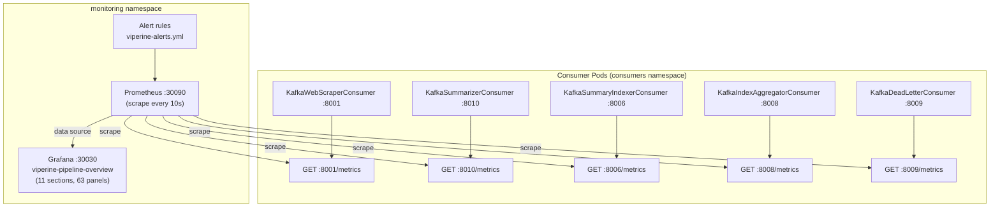
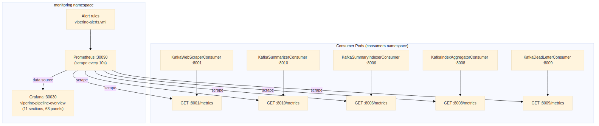

# Viperine Consumer Group — Monitoring and Alerting

**Helm chart version:** 0.1.0
**Prepared:** June 2026
**Scope:** Prometheus metrics, Grafana dashboard, alert rules, and on-call run-book for all five Viperine consumers.

This document is the reference for understanding what the pipeline is telling you at any given moment. Every consumer emits structured metrics about everything it does — every message consumed, every LLM call, every embedding request, every DLQ write, every Kafka lag reading. Those metrics are collected by Prometheus and visualised in Grafana. When something breaks or degrades, the dashboards and troubleshooting guide here are the first place to look.

**Why this level of observability?** The pipeline interacts with external services that are outside the team's control — the Vertex AI platform, third-party websites, the embedding service, Azure Blob Storage. Any of these can degrade or fail independently, and when they do, the failure mode is often subtle: a slow LLM call does not produce an error, it just increases latency; a Cloudflare-blocked page does not crash the scraper, it produces a degraded extraction that results in a lower-quality summary. Without per-stage metrics, these degradations would be invisible until analysts report that research results are poor or incomplete. With per-stage metrics, the Grafana dashboard shows exactly where the pipeline is slowing down, which makes root-cause analysis a matter of reading a few charts rather than trawling through logs.

**For product managers:** Section 5 (LLM Cost) is the primary business health indicator. The `kafka_consumer_llm_estimated_cost_usd_total` counter, broken down by model, shows the relationship between research activity and API spend. Sustained cost growth without proportional growth in `documents_summarized_total` is the clearest signal that something is wrong with the summarization path.

**For DevOps managers:** The recommended triage order when something is wrong is: `consumer_state` (are pods running?) → `lag_messages` (are messages flowing?) → `processing_failures_total` by `error_type` (what is failing and why?) → `dlq_failures_by_stage` (which stage is the source?). Section 7 of this document follows this triage order in its troubleshooting guide.

For operations teams responding to an alert, jump straight to [Section 7 — Troubleshooting Guide](#7-troubleshooting-guide). For engineering teams who want to understand what is being tracked and why, start with [Section 2 — Metric Catalogue](#2-metric-catalogue).

---

## Table of Contents

1. [Observability Architecture](#1-observability-architecture)
2. [Metric Catalogue](#2-metric-catalogue)
   - [2.1 Shared Base Metrics (all consumers)](#21-shared-base-metrics-all-consumers)
   - [2.2 System and Process Resources](#22-system-and-process-resources)
   - [2.3 Kafka Transport Layer](#23-kafka-transport-layer)
   - [2.4 WebScraper — Extraction](#24-webscraper--extraction)
   - [2.5 Summarizer — LLM and Cost](#25-summarizer--llm-and-cost)
   - [2.6 SummaryIndexer — Embedding and Index](#26-summaryindexer--embedding-and-index)
   - [2.7 IndexAggregator — Azure Storage](#27-indexaggregator--azure-storage)
   - [2.8 DeadLetterConsumer — Failure Audit](#28-deadletterconsumer--failure-audit)
3. [Grafana Dashboard Reference](#3-grafana-dashboard-reference)
4. [Error Category Label Values](#4-error-category-label-values)
5. [Prometheus Scrape Configuration](#5-prometheus-scrape-configuration)
6. [Alert Rules](#6-alert-rules)
7. [Troubleshooting Guide](#7-troubleshooting-guide)

---

## 1. Observability Architecture

The observability stack has three layers. The innermost layer is the application itself: every significant action each consumer takes is instrumented using `prometheus_client` objects defined in `src/monitoring/prometheus_metrics.py` and per-consumer inline metric declarations. These are exposed on each pod's `/metrics` endpoint.

The middle layer is Prometheus, running in the `monitoring` namespace of the k3s cluster at port 30090. Prometheus scrapes each consumer's `/metrics` endpoint every 10 seconds and evaluates alert rules. The 10-second interval was chosen to provide enough resolution for the Grafana dashboard panels to show short-lived spikes in Kafka lag or LLM latency.

The outer layer is Grafana, running at port 30030. The `viperine-pipeline-overview` dashboard (11 sections, 63 panels) is provisioned automatically from a ConfigMap and does not need to be imported manually.

An important design decision in this stack is that **Prometheus is not the alerting destination** — it is only the evaluation engine. Alert rules are evaluated in Prometheus and routed through Alertmanager for notification. This means that if the Prometheus pod itself becomes unavailable, alerts will not fire. The `make monitoring_status` command is the recommended manual health check that can be run even when Grafana is unreachable.





### Label cardinality design

All error-type labels are validated against `ErrorCategory.all_categories()` before reaching Prometheus. This means no freeform strings can accidentally create unbounded label cardinality. The `ErrorCategory` class in `src/monitoring/error_categories.py` is the single source of truth for all valid `error_type` label values. Adding a new error category requires updating `ErrorCategory` — see [Section 4](#4-error-category-label-values) for the full list.

### Metric naming convention

All metrics emitted by this codebase use the prefix `kafka_consumer_`. This is the `namespace` argument passed to `PrometheusMetrics(consumer_id, namespace="kafka_consumer")`. The `consumer_id` label (e.g. `web_scraper_12345`) identifies both the consumer role and the pod PID, making multi-replica scenarios unambiguous.

---

## 2. Metric Catalogue

### 2.1 Shared Base Metrics (all consumers)

These metrics are emitted by every consumer via `PrometheusMetrics`. They provide a uniform signal layer regardless of which consumer you are looking at. The `consumer_state` gauge is the primary health indicator for each pod.

| Metric | Type | Labels | Description | Instrumented in |
|---|---|---|---|---|
| `kafka_consumer_messages_consumed_total` | Counter | `consumer_id`, `topic` | Messages successfully consumed and processed | `PrometheusMetrics.record_message_processed()` |
| `kafka_consumer_message_processing_duration_seconds` | Histogram | `consumer_id`, `topic`, `status` | Per-message end-to-end processing time. Buckets: 0.01–60 s | `PrometheusMetrics.time_operation()` context manager |
| `kafka_consumer_processing_failures_total` | Counter | `consumer_id`, `topic`, `error_type` | Processing failures. `error_type` must be a valid `ErrorCategory` | `PrometheusMetrics.record_failure()` |
| `kafka_consumer_state` | Gauge | `consumer_id` | Consumer state: 0=stopped, 1=running, 2=error | `PrometheusMetrics.set_state()` |
| `kafka_consumer_info` | Info | (static labels) | Build information: consumer role, version, hostname | `PrometheusMetrics.set_info()` |
| `kafka_consumer_deserialization_errors_total` | Counter | `consumer_id`, `topic`, `error_type` | Kafka message deserialisation failures | Consumer `_process_message()` |
| `kafka_consumer_retry_attempts_total` | Counter | `consumer_id`, `topic` | Total retry attempts before success or DLQ | `PrometheusMetrics.increment_retries()` |
| `kafka_consumer_dead_letter_messages_total` | Counter | `consumer_id`, `topic`, `reason` | Messages published to the DLQ | `PrometheusMetrics.record_dead_letter()` |
| `kafka_consumer_connection_errors_total` | Counter | `consumer_id`, `error_type` | Kafka broker connection errors | `PrometheusMetrics.increment_connection_errors()` |
| `kafka_consumer_timeout_errors_total` | Counter | `consumer_id`, `topic`, `operation` | Timeout errors by operation name | `PrometheusMetrics.increment_timeout_errors()` |
| `kafka_consumer_startup_timestamp_seconds` | Gauge | `consumer_id` | Unix timestamp of most recent process start | `PrometheusMetrics.record_startup()` |
| `kafka_consumer_last_message_processed_timestamp` | Gauge | `consumer_id`, `topic` | Unix timestamp of last successfully processed message | `PrometheusMetrics.record_message_processed()` |
| `kafka_consumer_sessions_in_progress` | Gauge | `consumer_id` | Active sessions currently being tracked | `PrometheusMetrics.set_sessions_in_progress()` |
| `kafka_consumer_model_error_outputs_total` | Counter | `consumer_id`, `model` | LLM returned HTTP 200 but content is an error/refusal | `PrometheusMetrics.model_error_outputs` |

---

### 2.2 System and Process Resources

These metrics are collected by `SystemMetricsCollector` running in a background daemon thread, updating Prometheus gauges every 60 seconds. They are the first place to look when a consumer pod is slow or OOM-killed.

| Metric | Type | Labels | Description | Instrumented in |
|---|---|---|---|---|
| `kafka_consumer_process_cpu_percent` | Gauge | `consumer_id` | CPU % used by this process (`psutil.Process.cpu_percent`) | `SystemMetricsCollector.collect_metrics()` |
| `kafka_consumer_process_memory_percent` | Gauge | `consumer_id` | Memory % used by this process | `SystemMetricsCollector` |
| `kafka_consumer_process_memory_rss_bytes` | Gauge | `consumer_id` | Resident Set Size in bytes | `SystemMetricsCollector` |
| `kafka_consumer_process_memory_vms_bytes` | Gauge | `consumer_id` | Virtual Memory Size in bytes | `SystemMetricsCollector` |
| `kafka_consumer_system_cpu_percent` | Gauge | `consumer_id` | Overall node CPU % (`psutil.cpu_percent`) | `SystemMetricsCollector` |
| `kafka_consumer_system_memory_percent` | Gauge | `consumer_id` | Overall node memory % | `SystemMetricsCollector` |
| `kafka_consumer_disk_usage_bytes` | Gauge | `consumer_id`, `mount_point` | Disk bytes used on cache mount | `SystemMetricsCollector` |
| `kafka_consumer_disk_available_bytes` | Gauge | `consumer_id`, `mount_point` | Disk bytes available on cache mount | `SystemMetricsCollector` |
| `kafka_consumer_open_file_descriptors` | Gauge | `consumer_id` | Open file descriptor count for this process | `SystemMetricsCollector` |
| `kafka_consumer_thread_count` | Gauge | `consumer_id` | Thread count for this process | `SystemMetricsCollector` |

---

### 2.3 Kafka Transport Layer

These metrics are collected by `KafkaMetricsWrapper` and cover the Kafka transport layer: how long polls take, how large batches are, consumer lag, and how well the producer is performing. `kafka_consumer_lag_messages` is the most operationally significant metric here — a growing lag means a consumer is falling behind its input topic.

**Poll and batch buckets:** `[0.001, 0.005, 0.01, 0.05, 0.1, 0.5, 1.0, 2.0, 5.0]` seconds / `[1, 5, 10, 25, 50, 100, 250, 500, 1000]` messages.

| Metric | Type | Labels | Description | Instrumented in |
|---|---|---|---|---|
| `kafka_consumer_lag_messages` | Gauge | `consumer_id`, `topic`, `partition` | Messages behind the latest offset | `KafkaMetricsWrapper.record_lag()` |
| `kafka_consumer_lag_seconds` | Gauge | `consumer_id`, `topic`, `partition` | Time-based lag from message timestamps | `KafkaMetricsWrapper.record_lag()` |
| `kafka_consumer_poll_duration_seconds` | Histogram | `consumer_id`, `topic` | Time spent in `consumer.poll()` | `KafkaMetricsWrapper.record_poll()` |
| `kafka_consumer_batch_size` | Histogram | `consumer_id`, `topic` | Messages returned per poll | `KafkaMetricsWrapper.record_poll()` |
| `kafka_consumer_rebalances_total` | Counter | `consumer_id` | Partition rebalance events | `KafkaMetricsWrapper.increment_rebalances()` |
| `kafka_consumer_offset_commit_duration_seconds` | Histogram | `consumer_id`, `topic` | Offset commit time | `KafkaMetricsWrapper.record_offset_commit()` |
| `kafka_consumer_offset_commit_failures_total` | Counter | `consumer_id`, `topic`, `error_type` | Offset commit failures | `KafkaMetricsWrapper.record_offset_commit()` |
| `kafka_consumer_messages_in_flight` | Gauge | `consumer_id`, `topic` | Messages currently being processed | `KafkaMetricsWrapper.track_message_processing()` |
| `kafka_consumer_last_successful_poll_timestamp` | Gauge | `consumer_id` | Unix timestamp of last successful poll | `KafkaMetricsWrapper.record_poll()` |
| `kafka_consumer_message_age_seconds` | Histogram | `consumer_id`, `topic` | Time from Kafka publish to consumption. Buckets: 1s–1h | `KafkaMetricsWrapper.record_message_age()` |
| `kafka_consumer_messages_published_total` | Counter | `consumer_id`, `topic`, `result` | Messages produced. `result` ∈ `{success, error}` | `KafkaMetricsWrapper.record_publish()` |
| `kafka_consumer_publish_duration_seconds` | Histogram | `consumer_id`, `topic` | Time spent on `produce()` + `flush()` | `KafkaMetricsWrapper.record_publish()` |

---

### 2.4 WebScraper — Extraction

These metrics are specific to `KafkaWebScraperConsumer` and describe the extraction outcome distribution. The `scrape_strategy_total` counter is the most useful for diagnosing extraction quality: a high `cloudflare_bypass` + `bot_page` failure rate indicates new sites are being added to the scrape list that need to be placed in the cloudscraper domain list.

**Scraping duration buckets:** `[0.1, 0.5, 1.0, 2.5, 5.0, 10.0, 30.0, 60.0]` seconds.

| Metric | Type | Labels | Description | Instrumented in |
|---|---|---|---|---|
| `kafka_consumer_urls_scraped_total` | Counter | `consumer_id` | URLs successfully extracted (valid content returned) | `KafkaWebScraperConsumer._process_message()` |
| `kafka_consumer_scraping_duration_seconds` | Histogram | `consumer_id`, `status` | Per-URL total extraction time | `KafkaWebScraperConsumer._process_message()` |
| `kafka_consumer_scrape_strategy_total` | Counter | `consumer_id`, `strategy`, `outcome` | Attempts per strategy. `strategy` ∈ `{youtube, cloudscraper, playwright, curl_cffi, pdf}`, `outcome` ∈ `{success, failure, bot_page, low_quality}` | `KafkaWebScraperConsumer._process_message()` |

---

### 2.5 Summarizer — LLM and Cost

These are the most financially significant metrics in the pipeline. The `llm_estimated_cost_usd_total` counter is a running USD total per model name. The `llm_input_tokens_total` and `llm_output_tokens_total` counters provide the raw token counts that feed into the cost calculation. A sudden spike in `llm_api_errors_total{error_type="summarization_transient"}` usually means a Gemini rate-limit event.

**Latency buckets:** `[0.5, 1.0, 2.0, 5.0, 10.0, 30.0, 60.0, 120.0]` seconds. **Summary length buckets:** `[100, 500, 1000, 2000, 5000, 10000, 20000, 50000]` characters.

| Metric | Type | Labels | Description | Instrumented in |
|---|---|---|---|---|
| `kafka_consumer_documents_summarized_total` | Counter | `consumer_id` | Documents that produced a valid, non-degraded summary | `KafkaSummarizerConsumer._process_message()` |
| `kafka_consumer_summarization_duration_seconds` | Histogram | `consumer_id`, `status` | End-to-end summarisation time including retries | `KafkaSummarizerConsumer._process_message()` |
| `kafka_consumer_llm_api_calls_total` | Counter | `consumer_id`, `provider` | Total LLM API invocations (per attempt) | `KafkaSummarizerConsumer._process_message()` |
| `kafka_consumer_llm_api_errors_total` | Counter | `consumer_id`, `error_type` | LLM errors classified by `_failure_taxonomy` | `KafkaSummarizerConsumer._process_message()` |
| `kafka_consumer_llm_tokens_used_total` | Counter | `consumer_id`, `provider` | Total tokens (input + output) by provider label | `KafkaSummarizerConsumer._process_message()` |
| `kafka_consumer_llm_input_tokens_total` | Counter | `consumer_id`, `model` | Input/prompt tokens. `model` = concrete model name (e.g. `gemini-2.5-pro`) | `KafkaSummarizerConsumer._process_message()` |
| `kafka_consumer_llm_output_tokens_total` | Counter | `consumer_id`, `model` | Output/completion tokens | `KafkaSummarizerConsumer._process_message()` |
| `kafka_consumer_llm_estimated_cost_usd_total` | Counter | `consumer_id`, `model` | Estimated USD cost via `estimate_cost()` pricing table | `KafkaSummarizerConsumer._process_message()` |
| `kafka_consumer_llm_latency_seconds` | Histogram | `consumer_id`, `model` | Per-call LLM latency | `KafkaSummarizerConsumer._process_message()` |
| `kafka_consumer_summary_length_chars` | Histogram | `consumer_id` | Output summary length in characters | `KafkaSummarizerConsumer._process_message()` |
| `kafka_consumer_cost_unknown_model_total` | Counter | `model` | LLM calls for a model not in the pricing table — signals a pricing table update is needed | `src/monitoring/cost.py:estimate_cost()` |

**Pricing table** (as of June 2026 — update `src/monitoring/cost.py` when prices change):

| Model | Input per 1M tokens (USD) | Output per 1M tokens (USD) |
|---|---|---|
| `gemini-2.5-pro` | $1.25 | $10.00 |
| `gemini-2.5-flash` | $0.15 | $0.60 |
| `gemini-2.0-flash` | $0.10 | $0.40 |
| `gemini-1.5-pro` | $1.25 | $5.00 |
| `gemini-1.5-flash` | $0.075 | $0.30 |
| `gpt-4o` | $2.50 | $10.00 |
| `gpt-4o-mini` | $0.15 | $0.60 |
| `gpt-4.1` | $2.00 | $8.00 |
| `gpt-4.1-mini` | $0.40 | $1.60 |
| `gpt-4.1-nano` | $0.10 | $0.40 |
| `claude-sonnet-4` | $3.00 | $15.00 |
| `claude-3.5-sonnet` | $3.00 | $15.00 |
| `claude-3.5-haiku` | $0.80 | $4.00 |

---

### 2.6 SummaryIndexer — Embedding and Index

These metrics describe the embedding and index-write layer. `summaries_indexed_total` minus `summary_duplicates_detected_total` gives the net new records written to the combined index. A high duplicate rate after a pod restart is expected and healthy — it means the idempotency system is working. A high duplicate rate on a fresh session is unexpected and may indicate a session_id collision.

**Embedding duration buckets:** `[0.1, 0.5, 1.0, 2.0, 5.0, 10.0]` seconds. **Summaries-per-session buckets:** `[0, 5, 10, 20, 50, 100, 200, 500]`.

| Metric | Type | Labels | Description | Instrumented in |
|---|---|---|---|---|
| `kafka_consumer_summaries_indexed_total` | Counter | `consumer_id` | Summaries embedded and written to the session index | `KafkaSummaryIndexerConsumer._process_message()` |
| `kafka_consumer_summary_sessions_completed_total` | Counter | `consumer_id` | Sessions that reached completion (natural or sweeper-forced) | `KafkaSummaryIndexerConsumer._publish_session_complete()` |
| `kafka_consumer_summary_embedding_duration_seconds` | Histogram | `consumer_id`, `status` | Embedding service call latency | `KafkaSummaryIndexerConsumer._process_message()` |
| `kafka_consumer_summaries_per_session` | Histogram | `consumer_id` | Distribution of session sizes | `KafkaSummaryIndexerConsumer._publish_session_complete()` |
| `kafka_consumer_summary_duplicates_detected_total` | Counter | `consumer_id`, `match` | Duplicate messages suppressed. `match` ∈ `{document_id, dedup_key}` | `KafkaSummaryIndexerConsumer._process_message()` |
| `kafka_consumer_summary_id_scheme_total` | Counter | `consumer_id`, `scheme` | Incoming document_id format. `scheme` ∈ `{req_, doc_, uuid_legacy}` | `KafkaSummaryIndexerConsumer._process_message()` |

---

### 2.7 IndexAggregator — Azure Storage

These metrics are only emitted when the aggregator is enabled (`ENABLE_AGGREGATOR=true`). A non-zero `azure_upload_failures_total` is an alert-level condition — it means the cloud index has not been updated and the RAG service's Azure-backed search may be stale.

**Upload duration buckets:** `[0.5, 1.0, 2.0, 5.0, 10.0, 30.0, 60.0, 120.0]` seconds.

| Metric | Type | Labels | Description | Instrumented in |
|---|---|---|---|---|
| `kafka_consumer_chunks_aggregated_total` | Counter | `consumer_id` | Chunks written to combined index | `KafkaIndexAggregatorConsumer._aggregate_session()` |
| `kafka_consumer_qa_pairs_aggregated_total` | Counter | `consumer_id` | Q&A pairs written | `KafkaIndexAggregatorConsumer._aggregate_session()` |
| `kafka_consumer_chunks_duplicates_filtered_total` | Counter | `consumer_id` | Duplicate chunks dropped | `KafkaIndexAggregatorConsumer._aggregate_session()` |
| `kafka_consumer_qa_duplicates_filtered_total` | Counter | `consumer_id` | Duplicate Q&A pairs dropped | `KafkaIndexAggregatorConsumer._aggregate_session()` |
| `kafka_consumer_azure_upload_duration_seconds` | Histogram | `consumer_id`, `blob_type`, `status` | Azure Blob upload latency | `KafkaIndexAggregatorConsumer` |
| `kafka_consumer_session_backup_duration_seconds` | Histogram | `consumer_id`, `status` | Session archive time | `KafkaIndexAggregatorConsumer` |
| `kafka_consumer_azure_storage_bytes` | Gauge | `consumer_id`, `container`, `blob_name` | Blob size after upload | `KafkaIndexAggregatorConsumer` |
| `kafka_consumer_sessions_aggregated_total` | Counter | `consumer_id` | Completed aggregation cycles | `KafkaIndexAggregatorConsumer` |
| `kafka_consumer_azure_upload_failures_total` | Counter | `consumer_id`, `index_type` | Upload failures after all retries | `KafkaIndexAggregatorConsumer` |
| `kafka_consumer_azure_blobs_total` | Gauge | `consumer_id`, `container` | Blob count in container (background scan) | `AzureMetricsCollector` |
| `kafka_consumer_azure_container_storage_bytes` | Gauge | `consumer_id`, `container` | Total container size (background scan) | `AzureMetricsCollector` |
| `kafka_consumer_azure_upload_total` | Counter | `consumer_id`, `container`, `result` | Azure upload operations. `result` ∈ `{success, error}` | `AzureMetricsCollector.track_upload()` |
| `kafka_consumer_azure_download_total` | Counter | `consumer_id`, `container`, `result` | Azure download operations | `AzureMetricsCollector.track_download()` |

---

### 2.8 DeadLetterConsumer — Failure Audit

These metrics are the failure audit dashboard. `dlq_failures_by_stage` is the headline gauge — it shows at a glance which pipeline stage is responsible for the most failures. `dlq_age_seconds` is useful for understanding how quickly failures are being noticed: a very high age means failures from hours ago are only now being processed, which may indicate the DLQ consumer was offline.

**DLQ age buckets:** `[1, 10, 30, 60, 300, 600, 1800, 3600, 86400]` seconds.

| Metric | Type | Labels | Description | Instrumented in |
|---|---|---|---|---|
| `kafka_consumer_dlq_messages_processed_total` | Counter | `consumer_id`, `failed_stage` | DLQ messages consumed. `failed_stage` ∈ `{web_scraper, summarizer, summary_indexer, index_aggregator}` | `KafkaDeadLetterConsumer._process_message()` |
| `kafka_consumer_dlq_messages_discarded_total` | Counter | `consumer_id`, `failed_stage` | Messages that cannot be replayed | `KafkaDeadLetterConsumer._process_message()` |
| `kafka_consumer_dlq_failures_by_stage` | Gauge | `consumer_id`, `stage` | Running total failures per stage | `KafkaDeadLetterConsumer._process_message()` |
| `kafka_consumer_dlq_processing_duration_seconds` | Histogram | `consumer_id`, `status` | DLQ message processing time | `KafkaDeadLetterConsumer._process_message()` |
| `kafka_consumer_dlq_messages_by_origin_total` | Counter | `consumer_id`, `origin_topic` | Messages by the topic where the failure originated | `KafkaDeadLetterConsumer._process_message()` |
| `kafka_consumer_dlq_age_seconds` | Histogram | `consumer_id` | Time between failure timestamp and DLQ processing | `KafkaDeadLetterConsumer._process_message()` |

---

## 3. Grafana Dashboard Reference

The `viperine-pipeline-overview` dashboard is the primary operations view. It is organised into 11 sections. When opening the dashboard for the first time during an incident, **use the triage order described below** rather than reading sections top-to-bottom. Section 1 (Pipeline Health) answers "is the infrastructure up?" in 5 seconds. Section 9 (Dead Letter Queue) answers "where are the failures coming from?" in another 5 seconds. The middle sections contain the detail needed to understand why.

All time-series panels default to the last 1 hour with a 30-second refresh. During an active incident, set the time range to "last 15 minutes" and refresh manually — a 30-second lag can make it hard to see whether a remediation action is taking effect.

The recommended triage order is: check **Pipeline Health** first (are all pods up?), then **Kafka Throughput** (are messages flowing?), then **LLM / Cost** (is the summarizer working and within budget?), then **Indexer** (is the combined index growing?), and finally **Dead Letter Queue** (which stage is generating the most failures?).

**Dashboard ID:** `viperine-pipeline-overview`
**Source file:** `grafana/dashboards/viperine-pipeline-overview.json` (also `monitoring/grafana/dashboards/viperine-pipeline-overview.json`)
**Provisioned from:** Grafana ConfigMap, auto-loaded on pod start

### Section 1 — Pipeline Health

Stat and state-timeline panels for each consumer pod. The first place to look when something stops working.

| Panel | Type | Healthy indicator |
|---|---|---|
| Consumer Status (×5) | Stat | Green = pod has emitted metrics in the last 90 s |
| Consumer State (×5) | State-timeline | Continuous `running=1` band |
| Startup Timestamps | Stat | No unexpected restarts in the last hour |

### Section 2 — Kafka Throughput

| Panel | Type | PromQL summary | Healthy |
|---|---|---|---|
| Messages Consumed Rate | Time-series | `rate(kafka_consumer_messages_consumed_total[5m])` by consumer | Proportional to research activity |
| Consumer Lag | Time-series | `kafka_consumer_lag_messages` by consumer + partition | Near zero (< 50 messages) |
| Messages In-Flight | Gauge | `kafka_consumer_messages_in_flight` by consumer | Low (1–2 per consumer) |
| Publish Rate | Time-series | `rate(kafka_consumer_messages_published_total[5m])` | Matches consumption rate of next stage |

### Section 3 — Extraction (WebScraper)

| Panel | Type | PromQL summary |
|---|---|---|
| Scrape Rate | Time-series | `rate(kafka_consumer_urls_scraped_total[5m])` |
| Strategy Distribution | Bar chart | `kafka_consumer_scrape_strategy_total` by `strategy`, `outcome` |
| Scraping Duration p95 | Gauge | `histogram_quantile(0.95, rate(kafka_consumer_scraping_duration_seconds_bucket[5m]))` |

### Section 4 — LLM Activity (Summarizer)

| Panel | Type | PromQL summary |
|---|---|---|
| Documents Summarized Rate | Time-series | `rate(kafka_consumer_documents_summarized_total[5m])` |
| LLM Latency p50/p95 | Time-series | `histogram_quantile(0.5|0.95, ...)` on `kafka_consumer_llm_latency_seconds_bucket` |
| LLM Error Rate | Time-series | `rate(kafka_consumer_llm_api_errors_total[5m])` by `error_type` |
| Model Error Outputs | Stat | `rate(kafka_consumer_model_error_outputs_total[5m])` |

### Section 5 — LLM Cost

| Panel | Type | PromQL summary |
|---|---|---|
| Estimated Cost Rate (USD/hr) | Time-series | `rate(kafka_consumer_llm_estimated_cost_usd_total[5m]) * 3600` |
| Cumulative Cost Today | Stat | `increase(kafka_consumer_llm_estimated_cost_usd_total[24h])` |
| Input Token Rate | Time-series | `rate(kafka_consumer_llm_input_tokens_total[5m])` by `model` |
| Output Token Rate | Time-series | `rate(kafka_consumer_llm_output_tokens_total[5m])` by `model` |
| Unknown Model Counter | Stat | `kafka_consumer_cost_unknown_model_total` — should be 0 |

### Section 6 — Embedding and Indexing (SummaryIndexer)

| Panel | Type | PromQL summary |
|---|---|---|
| Summaries Indexed Rate | Time-series | `rate(kafka_consumer_summaries_indexed_total[5m])` |
| Sessions Completed | Counter | `kafka_consumer_summary_sessions_completed_total` |
| Embedding Duration p95 | Gauge | `histogram_quantile(0.95, ...)` on embedding duration |
| Duplicate Detection Rate | Time-series | `rate(kafka_consumer_summary_duplicates_detected_total[5m])` by `match` |

### Section 7 — Index Health

| Panel | Type | Description |
|---|---|---|
| Sessions In Progress | Gauge | `kafka_consumer_sessions_in_progress` — should drain to 0 when research completes |
| Combined Index Size | Stat | From `kafka_consumer_disk_usage_bytes{mount_point="/app/cache"}` |

### Sections 8–11 — Azure, DLQ, System Resources, Kafka Transport

| Section | Key panels |
|---|---|
| **Azure (8)** | Upload success/failure rate, upload duration p95, Azure storage bytes by container |
| **Dead Letter Queue (9)** | `dlq_failures_by_stage` gauge, DLQ message rate, DLQ age distribution |
| **System Resources (10)** | CPU, RSS memory, disk usage, file descriptors — per consumer |
| **Kafka Transport (11)** | Poll duration, batch size, rebalance events, offset commit failures |

---

## 4. Error Category Label Values

The following values are the complete set of valid `error_type` label values, defined in `src/monitoring/error_categories.py`. Any metric recorder that receives a value not in this list will raise `ValueError` at the call site.

| Category constant | Label string | Used by |
|---|---|---|
| `SCRAPING_403` | `scraping_403` | WebScraper |
| `SCRAPING_TIMEOUT` | `scraping_timeout` | WebScraper |
| `SCRAPING_DNS` | `scraping_dns` | WebScraper |
| `SCRAPING_SSL` | `scraping_ssl` | WebScraper |
| `SCRAPING_CONNECTION` | `scraping_connection` | WebScraper |
| `SCRAPING_BLOCKED` | `scraping_blocked` | WebScraper |
| `JSON_PARSE` | `json_parse` | All consumers |
| `JSON_DECODE` | `json_decode` | All consumers |
| `SUMMARIZATION_POLICY_BLOCK` | `summarization_policy_block` | Summarizer |
| `SUMMARIZATION_MODEL_EMPTY` | `summarization_model_empty` | Summarizer |
| `SUMMARIZATION_MODEL_ERROR_OUTPUT` | `summarization_model_error_output` | Summarizer |
| `SUMMARIZATION_AUTH` | `summarization_auth` | Summarizer |
| `SUMMARIZATION_TIMEOUT` | `summarization_timeout` | Summarizer |
| `SUMMARIZATION_TRANSIENT` | `summarization_transient` | Summarizer |
| `EMBEDDING_TIMEOUT` | `embedding_timeout` | SummaryIndexer |
| `EMBEDDING_CONNECTION` | `embedding_connection` | SummaryIndexer |
| `AZURE_UPLOAD` | `azure_upload` | IndexAggregator |
| `AZURE_DOWNLOAD` | `azure_download` | IndexAggregator |
| `AZURE_AUTH` | `azure_auth` | IndexAggregator |
| `INDEX_FILE_LOCK` | `index_file_lock` | SummaryIndexer |
| `INDEX_DEDUP_ERROR` | `index_dedup_error` | SummaryIndexer |
| `INDEX_WRITE_ERROR` | `index_write_error` | SummaryIndexer |
| `KAFKA_PRODUCE_ERROR` | `kafka_produce_error` | All consumers |
| `KAFKA_CONSUME_ERROR` | `kafka_consume_error` | All consumers |
| `KAFKA_DESERIALIZE` | `kafka_deserialize` | All consumers |
| `UNKNOWN` | `unknown` | All consumers |

---

## 5. Prometheus Scrape Configuration

Each consumer pod exposes `/metrics` on a fixed port. The Prometheus scrape job merges these into a single job with per-target labels.

```yaml
# Excerpt from prometheus.yml (deployed via ConfigMap)
scrape_configs:
  - job_name: 'viperine-consumers'
    scrape_interval: 10s
    static_configs:
      - targets:
          - '192.168.1.3:8001'   # web-scraper
          - '192.168.1.3:8010'   # summarizer
          - '192.168.1.3:8006'   # summary-indexer
          - '192.168.1.3:8008'   # index-aggregator (disabled pod still exposes /metrics)
          - '192.168.1.3:8009'   # dead-letter
        labels:
          pipeline: 'viperine'
```

To verify scrape health:
```bash
make monitoring_status
# or directly:
curl -s "http://192.168.1.3:30090/api/v1/targets?state=active" | python3 -m json.tool
```

To reload Prometheus configuration after changes:
```bash
curl -s -X POST http://192.168.1.3:30090/-/reload
```

To reload the Grafana dashboard after modifying the JSON:
```bash
make monitoring_reload
# or directly:
curl -s -X POST -u admin:admin http://192.168.1.3:30030/api/admin/provisioning/dashboards/reload
```

---

## 6. Alert Rules

The following alert rules are defined in `monitoring/prometheus/` and deployed via ConfigMap by `make monitoring_deploy`. Each rule fires into Alertmanager. The `duration` is the time a condition must be continuously true before the alert transitions to `FIRING` — this prevents false positives from transient blips.

For each alert, the table entry describes *what the metric condition means* and the prose below describes *what to do when it fires*.

| Alert name | Condition | Duration | Severity | Meaning |
|---|---|---|---|---|
| `ViperinePodDown` | `kafka_consumer_state{consumer_id=~".*"} == 0` | 2 min | critical | A consumer pod has stopped (state=0). Check pod logs. |
| `ViperinePodError` | `kafka_consumer_state{consumer_id=~".*"} == 2` | 5 min | warning | A consumer is in error state. Check pod logs for the exception. |
| `ViperineLagGrowing` | `kafka_consumer_lag_messages > 500` | 10 min | warning | A consumer is falling behind its input topic. May indicate a slow LLM or embedding service. |
| `ViperineLLMErrorsHigh` | `rate(kafka_consumer_llm_api_errors_total[5m]) > 0.1` | 5 min | warning | LLM error rate > 0.1/s. Check Gemini quota and connectivity. |
| `ViperineCostUnknownModel` | `kafka_consumer_cost_unknown_model_total > 0` | 1 min | warning | A model name that is not in the pricing table is being used. Update `src/monitoring/cost.py`. |
| `ViperineDLQSpike` | `rate(kafka_consumer_dlq_messages_processed_total[5m]) > 1` | 5 min | warning | DLQ is receiving > 1 failure/s. Check the `failed_stage` label to identify the stage. |
| `ViperineEmbeddingDown` | `rate(kafka_consumer_summary_embedding_duration_seconds_count[5m]) == 0` and `kafka_consumer_lag_messages{topic="viperine.summary-completed"} > 10` | 5 min | critical | Embedding service appears unreachable and the indexer is lagging. |
| `ViperineSessionsStuck` | `kafka_consumer_sessions_in_progress > 5` | 30 min | warning | More than 5 sessions in progress for > 30 min. May indicate the idle sweeper is not firing. |
| `ViperineAzureUploadFailures` | `increase(kafka_consumer_azure_upload_failures_total[1h]) > 0` | immediate | warning | Azure upload failed. Cloud index may be stale. |
| `ViperineHighMemory` | `kafka_consumer_process_memory_rss_bytes > 2e9` | 10 min | warning | A consumer is using > 2 GB RSS. May indicate a memory leak in large-batch processing. |

### Per-alert on-call guidance

**`ViperinePodDown` (critical):** This is the highest-priority alert. A `consumer_state == 0` means the pod is no longer reporting — it has either crashed or the `/metrics` endpoint is unreachable. Run `kubectl get pods -n consumers` to check pod status. If the pod is in `CrashLoopBackOff`, run `make k8s_logs` to retrieve the last crash log. The most common causes are a bad configuration value at startup (check `src/config.py` defaults) or a missing Kubernetes Secret (check that the GCP service-account secret and Azure connection string secret are mounted correctly). If the pod is in `Terminating`, use the nvidia-safe rollout: `make k8s_rollout`.

**`ViperinePodError` (warning):** The consumer is running but has set `consumer_state = 2` (error). This usually means the consumer received its first message and threw an unhandled exception that set `self.running = False` but did not crash the process. The pod is still alive and the `/metrics` endpoint is still responding, but it is not processing messages. Check `processing_failures_total` with `error_type=permanent_internal` — an `AssertionError` or `AttributeError` in consumer startup code is the typical cause. Restarting the pod usually clears it if the underlying config issue has been fixed.

**`ViperineLagGrowing` (warning):** Consumer lag above 500 messages for 10 minutes means the consumer is slower than its producer. This does not directly impact analysts unless the lag grows to the point where messages are hours old when processed. The most common cause for the Summarizer is a Gemini rate limit (check `llm_api_errors_total{error_type="summarization_transient"}`). For the Indexer, it is usually an embedding service slowdown (check `summary_embedding_duration_seconds` p95). The WebScraper rarely lags unless Playwright is being used for a high fraction of pages.

**`ViperineLLMErrorsHigh` (warning):** More than 0.1 LLM errors per second means roughly 1 in 10 LLM calls is failing. Check the `error_type` breakdown: `summarization_transient` means rate-limiting (consider switching to `gemini-2.5-flash` in config to increase quota headroom); `summarization_policy_block` means the content being summarised is triggering Gemini's safety filters (check whether a specific `session_id` or domain is consistently producing this); `summarization_auth` means the GCP service-account credentials have expired or the Vertex AI quota has been exhausted at the project level.

**`ViperineCostUnknownModel` (warning):** The pricing table in `src/monitoring/cost.py` is missing an entry for the model currently in use. This is a data-quality alert — it does not affect pipeline operation but means cost tracking is reporting zero for some calls. The fix is a one-line addition to `PRICING_TABLE`. The `model` label on `kafka_consumer_cost_unknown_model_total` shows exactly which model name to add.

**`ViperineDLQSpike` (warning):** More than 1 DLQ message per second for 5 minutes is a structural failure rate, not random noise. Check `dlq_messages_processed_total` by `failed_stage` to identify the failing component. A `web_scraper` spike often correlates with a CDN or Cloudflare rule change. A `summarizer` spike usually means Gemini is returning errors for an entire category of content. A `summary_indexer` spike almost always means the embedding service is down.

**`ViperineEmbeddingDown` (critical):** The combination of zero new embedding calls AND growing Indexer lag is a strong signal that the embedding service at `https://embeddings.192-168-1-3.nip.io` is unreachable. Run `curl https://embeddings.192-168-1-3.nip.io/health` to confirm. If the service is down, the SummaryIndexer will be processing messages but failing on the embedding call and routing to DLQ. Restart the embedding service pod in the `services` namespace or check the nip.io DNS resolution if the curl returns a connection error.

**`ViperineSessionsStuck` (warning):** If `sessions_in_progress` stays above 5 for 30 minutes, the idle sweeper is either not firing or is unable to close sessions. This can happen if the `SESSION_IDLE_TIMEOUT` environment variable is set to a very large value, or if a bug in the state file serialisation is preventing sessions from being written as complete. Manually inspect `cache/summaries/` to count active session directories and check their state files. A pod restart will clear in-memory session state and the sweeper will recompute from the state files on disk.

**`ViperineAzureUploadFailures` (warning):** Any Azure upload failure is immediately significant because it means the cloud index is stale. Check the `blob_type` label to know whether chunks or Q&A pairs are affected. The most common causes are: expired `AZURE_STORAGE_CONNECTION_STRING` (rotate in the Kubernetes Secret and restart the aggregator pod), Azure service outage (check the Azure status page), or a network route issue between the k3s node and the Azure Storage endpoint.

**`ViperineHighMemory` (warning):** An RSS above 2 GB is unusual for these consumers. The WebScraper is the most memory-intensive because Playwright launches a Chromium subprocess, but even that should not exceed 500 MB under normal load. If the WebScraper is above 2 GB, check whether `ENABLE_PLAYWRIGHT=True` is causing a large number of concurrent headless browser instances. For the Summarizer or Indexer, high memory usually means a large in-memory cache is not being cleared — check `sessions_in_progress` and whether session state dicts are growing unboundedly.

---

## 7. Troubleshooting Guide

### Symptom: Research results are not appearing in the RAG service

**Triage steps:**
1. Check `kafka_consumer_lag_messages` for each topic. If lag is growing on `viperine.web-scrape-requests`, the WebScraper is stuck.
2. Check `kafka_consumer_state` for all five consumers — any value other than 1 means the pod has an issue.
3. Check `kafka_consumer_sessions_in_progress` — if > 0 and not decreasing, a session may be stuck.

**Common causes:**

| Cause | Metric to look at | Fix |
|---|---|---|
| WebScraper pod crashed | `kafka_consumer_state{consumer_id=~"web_scraper.*"}` != 1 | `make k8s_restart` or check pod logs with `make k8s_logs` |
| SummaryIndexer not writing to combined index | `kafka_consumer_summaries_indexed_total` not increasing | Check `ACTIVE_INDEX_FOLDER` env var is set correctly in the running pod |
| `reload-index` not reaching RAG service | RAG `/ready` returns stale index size | Check the `reload-index` topic has messages; check RAG pod logs |

---

### Symptom: `kafka_consumer_cost_unknown_model_total` is non-zero

The Summarizer is calling `estimate_cost()` with a model name that does not match any entry in the pricing table. This means cost metrics are reporting zero.

**Fix:**
1. Check the label value: `kafka_consumer_cost_unknown_model_total` — what is `model=...`?
2. Open `src/monitoring/cost.py` and add an entry to `PRICING_TABLE` for the new model.
3. If the model name is a versioned suffix (e.g. `gemini-2.5-flash-002`), the prefix-match fallback in `estimate_cost()` should handle it automatically — verify the base key exists (e.g. `gemini-2.5-flash`).

---

### Symptom: LLM latency is very high (p95 > 60 s)

**Triage steps:**
1. Check `kafka_consumer_llm_api_errors_total{error_type="summarization_transient"}` — if rising, it is likely a Gemini 429 rate-limit. Reduce throughput or switch to a flash model.
2. Check if `use_web_grounding=True` is being used for many messages (`extraction_failed=True` on many scrape results). Web-grounding Gemini calls fetch live pages and are structurally slower.
3. Check if the Summarizer pod's CPU is pinned (use `kafka_consumer_system_cpu_percent`). High CPU on the single-node cluster competes with other consumers.

---

### Symptom: Embedding service errors / SummaryIndexer lag growing

**Check:**
```bash
curl -s https://embeddings.192-168-1-3.nip.io/health
```

If the embedding service is healthy but the indexer is still failing, check the Summarizer output: `kafka_consumer_lag_messages{topic="viperine.summary-completed"}`. If lag is 0, the indexer is consuming messages but the embedding call itself is erroring.

**Check pod logs for pattern:**
```
RuntimeError: Event loop is closed
```
This indicates the `EmbeddingServiceClient` lazy-loop detection failed. Usually resolved by restarting the SummaryIndexer pod (`make k8s_restart`).

---

### Symptom: Sessions never complete (`kafka_consumer_sessions_in_progress` stays high)

The idle sweeper should fire for any session idle for more than `SESSION_IDLE_TIMEOUT` seconds (default 120 s). If sessions are stuck:

1. Check `SESSION_IDLE_TIMEOUT` env var is not set to an excessively large value.
2. Check `kafka_consumer_last_message_processed_timestamp` for the SummaryIndexer — if it is very old, the pod may have crashed after receiving messages but before completing the session.
3. Manually inspect `cache/summaries/{session_id}/{session_id}_state.json` to see `received_count` vs `total_requests`.

---

### Symptom: DLQ is growing but failures are from one specific stage

Use the `kafka_consumer_dlq_failures_by_stage` gauge to identify the stage. Then look at that consumer's `processing_failures_total` counter and its `error_type` breakdown.

| Stage | Most likely cause | Check |
|---|---|---|
| `web_scraper` | New anti-bot measures on scraped domains | `scrape_strategy_total{outcome="bot_page"}` rising |
| `summarizer` | Gemini quota exhaustion or rate limit | `llm_api_errors_total{error_type="summarization_transient"}` |
| `summarizer` | Policy block (sensitive content) | `llm_api_errors_total{error_type="summarization_policy_block"}` |
| `summary_indexer` | Embedding service down | `summary_embedding_duration_seconds` histogram has no new observations |
| `summary_indexer` | Index file lock timeout | `error_type="index_file_lock"` in processing_failures_total |
| `index_aggregator` | Azure credentials expired | `azure_upload_failures_total` + check `AZURE_STORAGE_CONNECTION_STRING` env var |

---

### Symptom: A consumer pod is stuck in `Terminating`

This is the nvidia-safe rollout issue. The NVIDIA container runtime on this k3s node does not respond to `SIGTERM` in rolling update scenarios, leaving pods stuck in `Terminating`.

**Fix:** Always use the nvidia-safe rollout:
```bash
make k8s_rollout
```
This scales all deployments to 0, waits 15 s, force-deletes any stuck pods, then runs `helm upgrade`.

**Do not** use `kubectl rollout restart` or plain `helm upgrade` directly — they will leave stuck pods.

---

### Quick reference — useful queries

```bash
# Prometheus alias
q() { curl -s "http://192.168.1.3:30090/api/v1/query" \
    --data-urlencode "query=$1" | \
    python3 -c "import json,sys; d=json.load(sys.stdin)['data']['result']; \
    [print(r['metric'], r['value'][1]) for r in d]"; }

# Check all consumer states
q 'kafka_consumer_state'

# Check Kafka lag across all consumers and topics
q 'kafka_consumer_lag_messages'

# Current LLM cost rate (USD/hr)
q 'sum(rate(kafka_consumer_llm_estimated_cost_usd_total[5m])) * 3600'

# Sessions currently in progress
q 'kafka_consumer_sessions_in_progress'

# DLQ failure breakdown by stage
q 'kafka_consumer_dlq_failures_by_stage'

# Unknown model counter (should be 0)
q 'kafka_consumer_cost_unknown_model_total'

# Check scrape target health
make monitoring_status
```
