# Viperine Consumer Group — Process Flows

**Helm chart version:** 0.1.0
**Prepared:** June 2026
**Scope:** End-to-end traces for every major pipeline operation. See [ARCHITECTURE.md](ARCHITECTURE.md) for component descriptions and module reference.

This document answers the question: *when the RAG service enqueues a research request, what actually happens?* Each section traces one flow from the Kafka message that triggers it to the final state change it produces, naming every function, module, and state mutation along the way. Sequence diagrams give the bird's-eye view; the step-by-step lists below each diagram pinpoint the exact code responsible for each action.

Readers from a product background should focus on the narrative openers and the diagrams. Readers from an operations background should focus on the step lists, error paths, and timeout values — those are the points where things go wrong in production.

---

## Table of Contents

1. [URL Extraction — WebScraper](#1-url-extraction--webscraper)
2. [LLM Summarisation — Summarizer](#2-llm-summarisation--summarizer)
3. [Embedding and Indexing — SummaryIndexer](#3-embedding-and-indexing--summaryindexer)
4. [Session Completion and Notification](#4-session-completion-and-notification)
5. [Dead Letter Queue — Failure Audit](#5-dead-letter-queue--failure-audit)
6. [Index Aggregation — IndexAggregator](#6-index-aggregation--indexaggregator)
7. [Hot Folder Switch — Live Index Migration](#7-hot-folder-switch--live-index-migration)

---

## 1. URL Extraction — WebScraper

This is the entry point of the pipeline. The RAG service has identified a set of URLs that are relevant to a research query. It publishes one Kafka message per URL to `viperine.web-scrape-requests`. The `KafkaWebScraperConsumer` picks up each message and begins what amounts to a series of increasingly determined attempts to read the target webpage.

**Why the strategy cascade exists:** Most of the internet is not designed to be read programmatically. Publishers deploy Cloudflare bot detection, CDNs that inspect TLS fingerprints, JavaScript-rendered single-page applications, and paywalls. A naive `requests.get(url)` fails on a large fraction of real-world research sources. The cascade in `KafkaWebScraperConsumer` layers techniques in order of cost and latency:

1. For YouTube URLs, `_extract_youtube_transcript()` uses the official transcript API — no rendering needed, near-zero latency, excellent quality.
2. For Cloudflare-protected domains, `_extract_with_cloudscraper()` spoofs the TLS handshake at the connection layer. When that is also challenged, `_extract_with_playwright()` launches a real Chromium browser with `stealth_async()` patching its fingerprints at the JavaScript layer.
3. For standard pages, `curl_cffi` with `impersonate="chrome110"` provides browser-like HTTP headers and TLS behaviour at near the cost of a regular `requests` call.

**What the analyst experiences:** A URL that succeeds here will appear in the research results with a summary grounded in the full text of the source. A URL that fails (all strategies exhausted) will still appear in the results — but the Summarizer will attempt a web-grounding recovery by asking Gemini to fetch the page itself. If that also fails, the URL is marked as failed in the session and appears with minimal metadata only.

**What operations should watch for:** The `kafka_consumer_extraction_strategy_total` counter in Prometheus (labelled by `strategy`) shows the distribution of which extraction method is winning across the workload. A spike in `strategy=playwright` relative to `strategy=curl_cffi` means more sites than usual are requiring headless browser rendering, which significantly increases per-URL processing time and may indicate that Cloudflare has updated its detection signatures. The `kafka_consumer_documents_failed_extraction_total` counter rising without a corresponding rise in documents processed is the leading indicator of a scraper performance regression.

The most common failure modes here are Cloudflare bot-detection (mitigated by the strategy cascade) and URLs that resolve to paywalled or login-gated content (returned as degraded extraction with `extraction_failed=True`). In both cases the scraper does not drop the document — it always publishes a downstream message so the session counter in the Indexer stays consistent.

**Trigger:** `viperine.web-scrape-requests` message consumed by `KafkaWebScraperConsumer`.
**Outcome:** A message is published to `viperine.summarise-document` with either extracted content or `extraction_failed=True`.

### Sequence

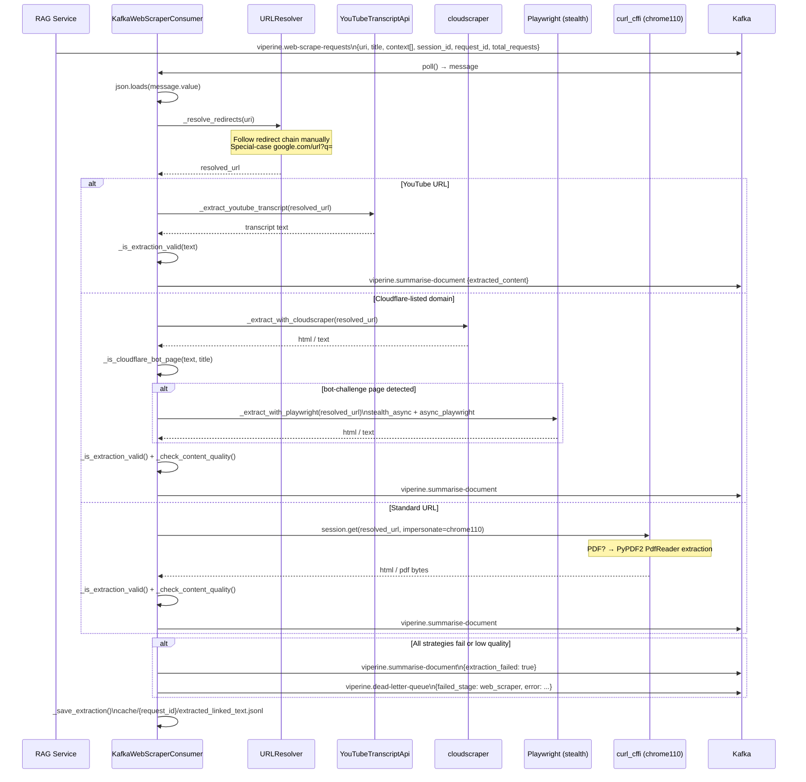

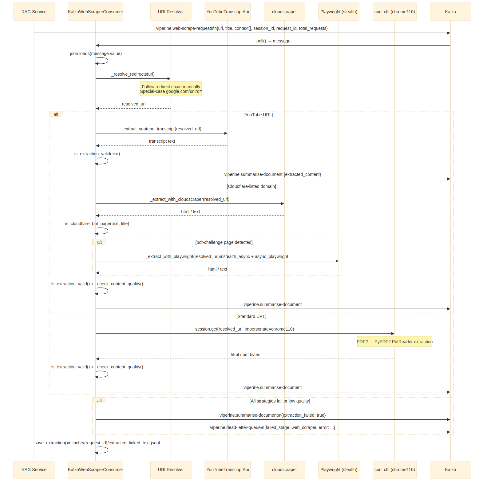

### Step-by-step

1. **Poll** — The main loop calls `confluent_kafka.Consumer.poll(timeout=1.0)`. Messages with `KafkaError` are logged and skipped. A `None` poll result (no message) triggers a lag check via `kafka_metrics.record_lag()`.

2. **Deserialise** — `json.loads(message.value().decode('utf-8'))`. If this fails, `metrics.increment_deserialization_errors()` is called with `ErrorCategory.KAFKA_DESERIALIZE` and the message is routed to the DLQ. No retry — a malformed message will always be malformed.

3. **`_resolve_redirects(uri)`** — Uses `URLResolver.resolve()` which follows each hop manually with a 10-second timeout per hop. Google redirect URLs (`google.com/url?q=...`) have the target extracted directly from the `q=` query parameter to avoid hitting the Google confirmation page. Returns the final resolved URL and the redirect chain.

4. **YouTube check** — If `youtube.com/watch?v=` or `youtu.be/` patterns are found in the resolved URL, `_extract_youtube_transcript()` is called. This uses `YouTubeTranscriptApi.fetch_transcript()` with preferred subtitle languages `['en', 'en-US', 'en-GB']` (config: `downloader.subtitle_languages`). YouTube transcripts are typically very high quality for research and bypass the web-scraping entirely.

5. **Cloudflare heuristic** — A domain list of known Cloudflare-heavy sites is checked against the resolved hostname. For those domains, cloudscraper is tried first because it spoofs the TLS handshake to pass Cloudflare's JS challenge check, usually succeeding where a plain `requests.get()` would get a 403.

6. **`_extract_with_cloudscraper(url)`** — Creates a `cloudscraper.create_scraper()` session and performs a GET. The HTML response is parsed by BeautifulSoup; `_extract_full_text_content(soup)` strips navigation and boilerplate. If `_is_cloudflare_bot_page()` detects that cloudscraper was also challenged, Playwright is tried next.

7. **`_extract_with_playwright(url)`** — Launches a headless Chromium browser via `async_playwright()`. `stealth_async(page)` patches the browser fingerprint (WebGL, `navigator.webdriver`, etc.) to reduce bot-detection. The page's `textContent` is extracted after the JS renders. This is the slowest strategy (3–10 seconds per page) but succeeds on sites that check for a real browser.

8. **`curl_cffi` extraction** — For non-Cloudflare URLs: `curl_cffi.requests.Session(impersonate="chrome110").get(url, timeout=30)`. For PDF responses (detected by `Content-Type: application/pdf` or `.pdf` URL suffix), `_extract_pdf_text()` uses `PyPDF2.PdfReader` to extract the text layer. For HTML, BeautifulSoup text extraction is used.

9. **Markdown conversion (opt-in)** — If `web_scraper.extract_markdown=True` and Docling is installed, `DocumentConverter().convert(html)` renders structured Markdown from the raw HTML. This preserves heading hierarchy and table structure, improving LLM summarisation quality. Disabled by default.

10. **Validity gates** — Before publishing, the extracted text is checked:
    - `_is_extraction_valid(text)` — rejects if fewer than `min_words_for_valid_extraction` words
    - `_is_cloudflare_bot_page(text, title)` — rejects if the response looks like a bot challenge
    - `_check_content_quality(text, title)` — rejects if the text is suspiciously short or pure navigation

11. **Publish to `viperine.summarise-document`** — `_publish_to_kafka()` builds the output message and calls `producer.produce()` followed by `producer.flush()`. The message includes `extraction_failed=False` on the success path.

12. **Degraded path** — If all strategies are exhausted or quality is too low, `_publish_failed_url_for_summary()` publishes the message with `extraction_failed=True`. The Summarizer will use Gemini web-grounding on that message. The original failure is also written to `viperine.dead-letter-queue`.

13. **Cache write** — `_save_extraction()` writes the extracted content to `cache/{request_id}/extracted_linked_text.jsonl` for debugging and replay.

### Error paths

| Condition | Behaviour | DLQ? |
|---|---|---|
| `JSONDecodeError` on incoming message | Increment `deserialization_errors`, skip message | Yes |
| URL redirect loop / DNS failure | `URLResolver` raises; `_publish_failed_url_for_summary(extraction_failed=True)` | Yes |
| All strategies return bot-challenge pages | Publish with `extraction_failed=True` | Yes |
| PDF has no text layer | Empty `_extract_pdf_text()` result → `extraction_failed=True` | Yes |
| Kafka producer `produce()` error | `kafka_metrics.record_publish(..., result='error')`, exception logged | No (message lost) |

---

## 2. LLM Summarisation — Summarizer

Once the WebScraper has extracted the raw content, the Summarizer turns it into a structured research asset. This is where raw webpage text becomes a citable, searchable summary that an analyst can read, share, and use as evidence in a research report.

`KafkaSummarizerConsumer` hands each extracted document to `CitationResearchClient.generate_summary()`, which constructs a structured JSON prompt asking Gemini to return a `metadata` block (author, publication date, source URL) and a `markdown_summary` block (the actual research content, formatted with headings, bullet points, and citations). The choice of structured JSON output rather than free-form text is deliberate: it means the metadata and the summary text can be indexed separately, and the RAG service can use the metadata when composing citations in its answers.

**What the analyst experiences:** A successful summarisation produces a readable markdown document attributed to the source. A degraded summary (status=`degraded`) means the LLM was unable to produce useful content after retries — the source will appear in the results but with an empty or minimal summary, which reduces the RAG service's ability to answer questions about it. A failed summary (status=`failed`) means the document is absent from the research index entirely.

**What operations should watch for:** The `kafka_consumer_llm_api_errors_total` counter (labelled by `error_type` using values from the `ErrorCategory` enum) is the primary failure signal. A sustained `error_type=transient` spike usually means Gemini is returning HTTP 429 (rate limit) or 503 (service unavailable) and the exponential backoff is delaying throughput. The `kafka_consumer_llm_estimated_cost_usd_total` counter is the spend signal — an unexpected spike without a corresponding increase in `documents_summarized_total` suggests the retry loop is consuming tokens without producing useful output.

This is the most latency-intensive step: a single Gemini call for a long article can take 15–60 seconds, and complex documents that trigger Gemini web-grounding can take longer. The retry-and-degrade framework ensures that even a difficult document eventually produces a terminal event so the session can close.

**Trigger:** `viperine.summarise-document` message consumed by `KafkaSummarizerConsumer`.
**Outcome:** A summary JSONL is written to `cache/{request_id}/summary.jsonl` and a message is published to `viperine.summary-completed`.

### Sequence

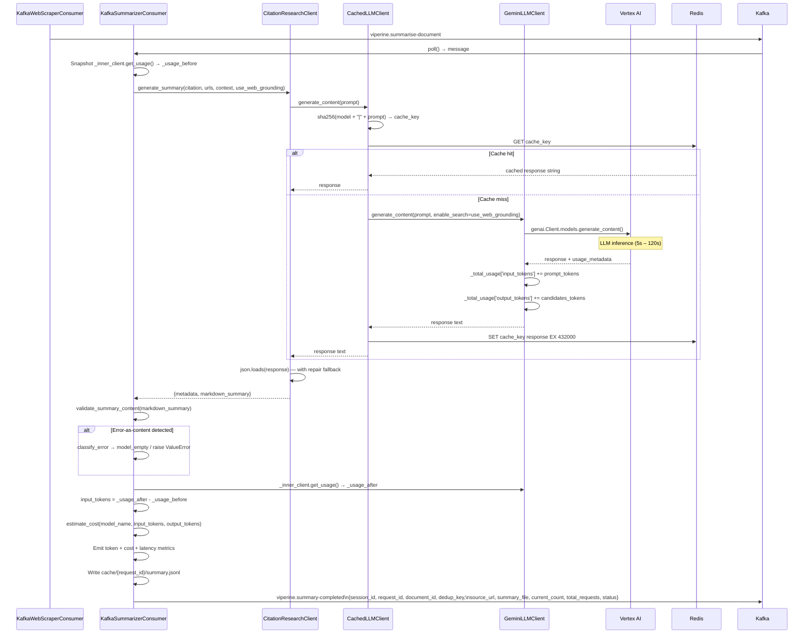

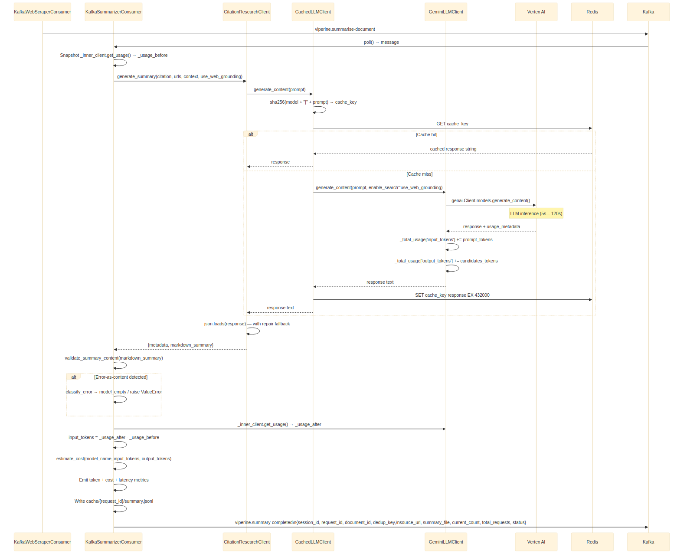

### Step-by-step

1. **Token snapshot** — Before any LLM activity, `_inner_client.get_usage()` is called on the `GeminiLLMClient` instance (reached via `self.llm_client.client` — the `CachedLLMClient`'s `_inner` property). This gives the cumulative token baseline for this process.

2. **`CitationResearchClient.generate_summary()`** — Builds a structured prompt: `f"{author}. {title}. {url}"` is used as the citation; `context_text` (first 2000 characters of the extracted body) is appended when `extraction_failed=False`. When `extraction_failed=True`, `use_web_grounding=True` is passed, instructing Gemini to retrieve the page content itself via Google Search grounding.

3. **`CachedLLMClient.generate_content(prompt)`** — Computes `cache_key = sha256(model_name + "|" + prompt)[:32]`. Checks Redis. A cache hit means the identical prompt has been seen within the last 5 days — this is most useful for retry scenarios where the summarizer was restarted mid-session.

4. **`GeminiLLMClient.generate_content()`** — Sends the async request to Vertex AI (`genai.Client(vertexai=True, project=..., location=...)`). Response `usage_metadata.prompt_token_count` and `candidates_token_count` are added to `_total_usage` on return. Exponential backoff retry (up to `llm.max_retries=3`) on transient errors.

5. **JSON repair fallback** — `CitationResearchClient` expects the LLM to return valid JSON. If `json.loads()` raises `JSONDecodeError`, a lenient repair pass is attempted before re-raising. This handles the common case where the model adds a markdown code fence around the JSON.

6. **`validate_summary_content(markdown_summary)`** — Scans the summary text against `_MODEL_ERROR_OUTPUT_PAT` in `_failure_taxonomy.py`. Patterns include `# Error`, `I am unable to generate`, `I cannot access`, etc. If matched, a `ValueError` is raised, which `classify_error()` maps to the `model_empty` category triggering a retry (max 2 attempts) and ultimately a degraded stub summary.

7. **Token delta computation** — After the call: `input_tokens = _usage_after.get('input_tokens', 0) - _usage_before.get('input_tokens', 0)`. If the delta is 0 (e.g. cache hit or older LLM client without usage metadata), the fallback is `summary_result.get('usage', {})` for any usage dict the result might carry.

8. **Cost estimation** — `estimate_cost(llm_model, input_tokens, output_tokens)` where `llm_model = getattr(self.llm_client, 'model_name', None)`. This resolves to `"gemini-2.5-pro"` which matches the pricing table. The returned float is added to `llm_estimated_cost_usd_total`.

9. **Retry loop** — `classify_error(exc)` returns a `FailureClassification`. If `retryable=True` and `_attempt < max_attempts`, the loop continues with `asyncio.sleep(2 ** _attempt)` backoff. On exhaustion with `degrade=True`, a stub summary (`{"markdown_summary": "", "metadata": {...}}`) is written and published with `status=degraded`. On exhaustion without degrade, `status=failed` is published.

10. **Always-emit invariant** — `_publish_summary_completed()` is called unconditionally in the `finally` block, regardless of outcome. This ensures the Indexer session counter always closes — no session can hang indefinitely because the Summarizer dropped its terminal event.

11. **`viperine.summary-completed` message** — Contains `session_id`, `request_id`, `document_id`, `dedup_key`, `source_url`, `summary_file` (local path to the written JSONL), `current_count` (how many summaries have been published for this session so far), `total_requests`, and `status` (`success`/`degraded`/`failed`).

### Error paths

| Exception | `classify_error()` category | Retries | Final action |
|---|---|---|---|
| `asyncio.TimeoutError` / HTTP 429 / 503 | `transient` | 3× with backoff | DLQ + `status=failed` |
| LLM returns empty STOP response | `model_empty` | 2× | Emit stub (`status=degraded`) |
| SAFETY / RECITATION / PROHIBITED_CONTENT | `policy_block` | None | DLQ + `status=failed` |
| 403 / `permission denied` | `auth` | None | DLQ + `status=failed` |
| 404 / no such file | `not_found` | None | DLQ + `status=failed` |
| Empty text / bad JSON input | `bad_input` | None | DLQ + `status=failed` |
| Embedding service error | `embedding` | 3× | DLQ + `status=failed` |
| `AssertionError` / `AttributeError` | `permanent_internal` | None | DLQ + `status=failed` |
| Any other `Exception` | `unknown` | 2× | DLQ + `status=failed` |

---

## 3. Embedding and Indexing — SummaryIndexer

With a validated summary in hand, the Indexer's job is to make it searchable. It calls the embedding service to convert the summary text into a 384-dimensional vector, writes the enriched record to the shared research index, and tracks session state to know when all documents in a research session have been processed.

Embedding works by mapping text into a high-dimensional numerical space where documents with similar meaning are geometrically close. When an analyst asks a question, the RAG service embeds the question using the same all-MiniLM-L6-v2 model, computes cosine similarity against all stored summary vectors, and retrieves the closest matches. Without the embedding stored alongside the summary text, retrieval would fall back to keyword matching — which is dramatically less accurate for research queries that use synonyms, paraphrase concepts, or ask questions that don't match the exact wording of the source documents.

**What the analyst experiences:** This is the step that makes new documents available for answering queries. Every time `KafkaSummaryIndexerConsumer` appends a record to the combined index (`ACTIVE_INDEX_FOLDER/research_summaries_filtered.jsonl`), it immediately publishes a `reload-index` message and a `viperine.frontend-message` notification. The analyst's browser receives the SSE notification and the "new documents available" badge updates in real time. The analyst does not need to wait for the entire research session to complete before reading available results.

**What operations should watch for:** The `kafka_consumer_summary_duplicates_detected_total` counter (labelled by `match` — either `document_id` or `dedup_key`) is an idempotency health indicator. A non-zero value after a clean run is normal and expected during Kafka rebalances or pod restarts. A consistently high value suggests that messages are being redelivered at a higher rate than expected, which may indicate consumer group lag issues or Kafka auto-commit problems. The `kafka_consumer_summary_embedding_duration_seconds` histogram shows the latency of calls to the embedding service; a p95 above 5 seconds suggests the embedding service is under load.

**Trigger:** `viperine.summary-completed` message consumed by `KafkaSummaryIndexerConsumer`.
**Outcome:** A new record is appended to `ACTIVE_INDEX_FOLDER/research_summaries_filtered.jsonl` and downstream notifications are published.

### Sequence

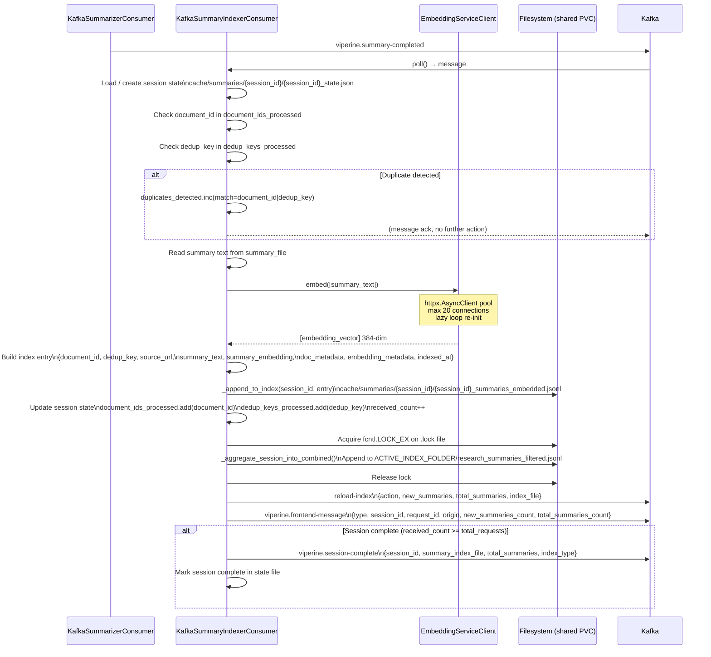

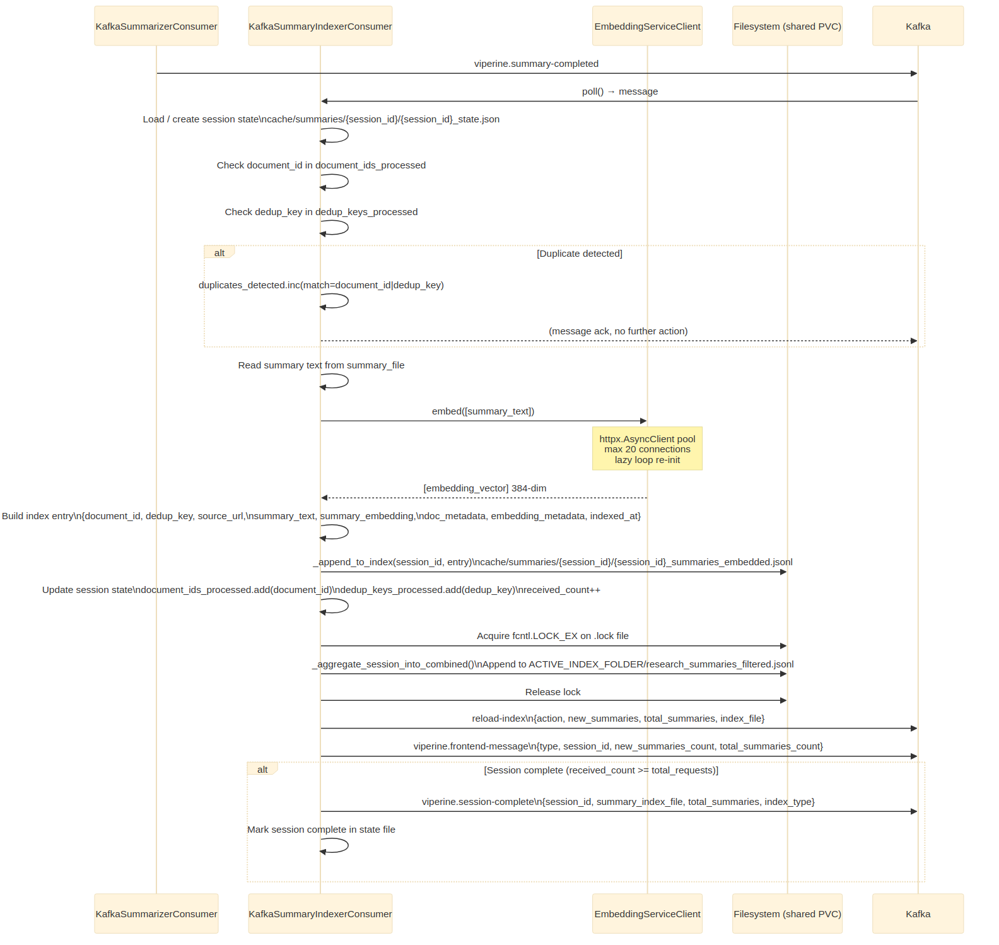

### Step-by-step

1. **Session state load** — `cache/summaries/{session_id}/{session_id}_state.json` is read (or created on first message). The state file persists across pod restarts, ensuring already-processed documents are not double-indexed even after a restart during a long session.

2. **Deduplication check** — `document_id` and `dedup_key` are both checked against the sets stored in the state file. Either match causes the message to be silently acknowledged without further processing. The `duplicates_detected` counter is incremented with `match=document_id` or `match=dedup_key` to make dedup activity visible in Grafana.

3. **Summary file read** — The `summary_file` field in the incoming message is a local path (`cache/web_scrapes/{request_id}/summary.jsonl`). The file is read and the `markdown_summary` field is extracted. If the file is missing (e.g. pod was rescheduled between Summarizer write and Indexer read), the error is classified and published to the DLQ.

4. **`EmbeddingServiceClient.embed([summary_text])`** — Sends an async POST to `https://embeddings.192-168-1-3.nip.io/embeddings`. The client detects if the current `asyncio.run()` created a new event loop (by comparing `id(asyncio.get_event_loop())` with `self._client_loop`) and creates a fresh `httpx.AsyncClient` if so. Retries up to `max_retries=3` with exponential backoff on connection errors.

5. **Index entry construction** — The record written to JSONL:
   ```json
   {
     "document_id": "req_20260610_090000_1001",
     "dedup_key": "6f3e4a2b...",
     "source_url": "https://...",
     "summary_text": "# Headline\n...",
     "summary_embedding": [0.123, ...],
     "doc_metadata": {"title": "...", "author": "...", "word_count": 5000},
     "embedding_metadata": {"embedding_id": "sum_req_...", "embedding_dim": 384, ...},
     "indexed_at": "2026-06-10T09:00:11Z"
   }
   ```

6. **Session JSONL append** — `_append_to_index()` opens `cache/summaries/{session_id}/{session_id}_summaries_embedded.jsonl` in append mode and writes the JSON line. No lock is needed here — only one Indexer pod processes a given session (session_id is routed deterministically by Kafka partition assignment).

7. **Combined index write (locked)** — `_aggregate_session_into_combined()` opens the master index file and `fcntl.flock(LOCK_EX)`. Reads existing entries, builds a dedup set of known `dedup_key` values, appends only new entries, writes back. Releases the lock in the `finally` block. The lock file path is `{index_file}.lock` — it is a sibling of the real index file, resolved through any symlinks before locking.

8. **`reload-index` publish** — Instructs the RAG service to reload its in-memory index from disk. The message includes the updated entry count so the RAG service can log a meaningful "loaded N documents" message.

9. **`viperine.frontend-message` publish** — Delivers a live notification to all connected browser tabs via the RapporteurFrontEnd SSE stream. Includes the count of new summaries and the updated total.

10. **Session completion check** — After incrementing `received_count`, if `received_count >= total_requests`, the session is marked complete and `viperine.session-complete` is published. The idle sweeper (background thread, `SESSION_IDLE_TIMEOUT=120s`) handles sessions that never receive all their messages (e.g. the Summarizer hard-failed on some).

### Error paths

| Condition | Behaviour |
|---|---|
| `summary_file` not found on disk | Classify as `not_found`, publish to DLQ, session count still incremented |
| Embedding service returns 5xx / timeout | Classify as `embedding`, retry 3× with backoff, publish to DLQ on exhaustion |
| `fcntl.flock()` blocks > 30s | Lock timeout, classify as `INDEX_FILE_LOCK`, publish to DLQ |
| JSON decode error in state file | Rebuild empty state (safe because dedup keys are also in the JSONL) |
| `status=failed` incoming message | Increment `received_count` (for session accounting), skip embedding, no index write |

---

## 4. Session Completion and Notification

A research session is a coordinated batch: a fixed number of URLs submitted together as part of a single analyst query. The `KafkaSummaryIndexerConsumer` tracks the session in memory (in `self.session_states`) and on disk (in `cache/summaries/{session_id}/{session_id}_state.json`). It knows the session is complete when `received_count >= total_requests` — where `total_requests` was set in the original message from the RAG service.

The session-complete signal matters because it is what triggers the full downstream notification chain: the `viperine.session-complete` message tells the IndexAggregator (if enabled) to run its Azure upload. More immediately, the Indexer has already been publishing `reload-index` and `viperine.frontend-message` on every individual document throughout the session, so the analyst has been seeing real-time updates. The session-complete event is the formal close of the session that clears in-memory state and frees resources.

**The idle sweeper problem:** The Summarizer guarantees that it always emits a terminal event for every document it processes. But what if a Summarizer pod crashes mid-session before emitting its terminal events? The session state file on disk is safe, but the Indexer's `received_count` will never reach `total_requests`. The idle sweeper in `KafkaSummaryIndexerConsumer.start()` solves this: a `threading.Thread(daemon=True)` checks every 30 seconds whether any active session's `last_event_at` timestamp is older than `SESSION_IDLE_TIMEOUT` (default 120 seconds, configurable via the `SESSION_IDLE_TIMEOUT` environment variable). Sessions that have gone quiet are closed gracefully, with `partial=true` in the session-complete message to indicate that not all documents were successfully processed.

When a research session reaches its final document (or the idle sweeper fires), the Indexer publishes to `viperine.session-complete`. This triggers the IndexAggregator if enabled. More importantly for immediate user feedback, the `reload-index` and `viperine.frontend-message` signals are also published on every indexed document, not just at session end.

**Session completion conditions:**
1. `received_count >= total_requests` — all expected documents accounted for
2. `SESSION_IDLE_TIMEOUT` (default 120 s, configurable via `SESSION_IDLE_TIMEOUT` env var) elapsed since `last_event_at` — graceful handling of Summarizer failures that consumed a DLQ slot instead of publishing a `summary-completed` event

The idle sweeper runs as a `threading.Thread(daemon=True)` inside `KafkaSummaryIndexerConsumer.start()`:

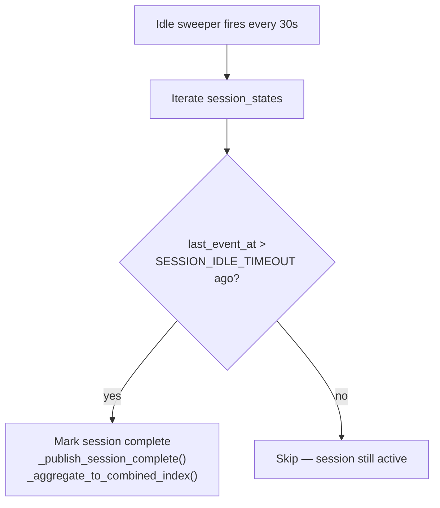

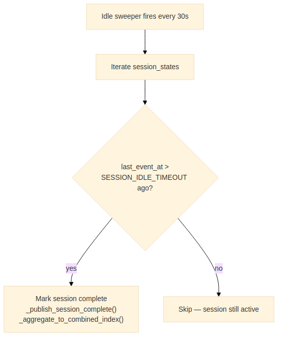

**`viperine.session-complete` message schema:**
```json
{
    "session_id": "sess_abc123",
    "summary_index_file": "cache/summaries/sess_abc123/sess_abc123_summaries_embedded.jsonl",
    "total_summaries": 14,
    "index_type": "summaries",
    "partial": true,
    "failed_request_ids": ["req_20260610_090000_1003"]
}
```

`partial=true` when `total_summaries < total_requests` (some documents failed). `failed_request_ids` lists the request IDs that did not produce a successful summary, so operators can identify which sources failed and why from the DLQ log.

---

## 5. Dead Letter Queue — Failure Audit

The DLQ consumer is a write-only audit sink. It does not retry, re-route, or alert — it only persists. The philosophy is that retry logic belongs in the publishing consumer (the WebScraper, Summarizer, or Indexer all have their own retry loops before publishing to the DLQ). By the time a message reaches the DLQ, the publishing consumer has already exhausted all recovery options.

For a product manager, the DLQ answers the question "why is this source missing from the research results?" When an analyst reports that a specific URL did not appear in their session, `cache/failures/failures.json` is the first place to look: filtering by `request_id` will show whether a failure was recorded and what stage it occurred at.

For a DevOps manager, the DLQ is a lagging indicator of pipeline health. The `kafka_consumer_dlq_messages_processed_total` counter in Prometheus (labelled by `failed_stage`) should be plotted against message throughput. A ratio of DLQ messages to successfully processed messages above 5% is a signal that something structural is wrong — a provider is consistently failing, a dependency is unreachable, or a new class of document is triggering an unhandled code path. The `kafka_consumer_dlq_age_seconds` histogram shows how long messages sat in the DLQ before being processed; a high age means the DLQ consumer itself is lagging, which reduces the fidelity of failure tracking.

To manually replay a failed message, read the `original_message` field from the DLQ record and re-publish it to the `origin_topic`. The corresponding consumer will process it on the next poll cycle, applying its full retry logic as if the message were fresh.

**Trigger:** Any consumer publishes to `viperine.dead-letter-queue`.
**Outcome:** Record appended to `cache/failures/failures.json`; `dlq_failures_by_stage` gauge updated.

### Sequence

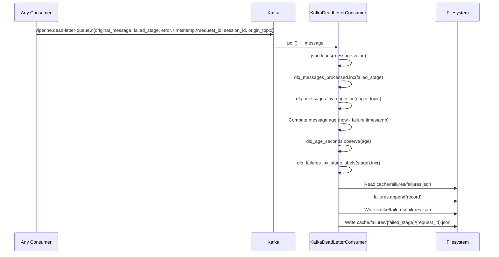

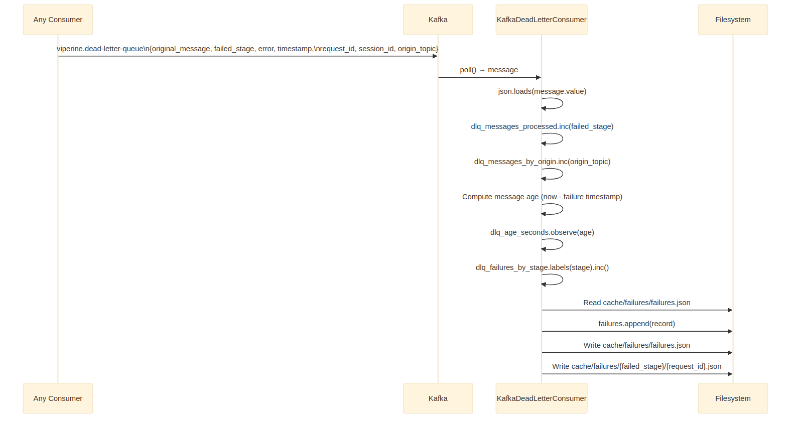

### DLQ record format

```json
{
    "original_message": {
        "uri": "https://example.com/article",
        "session_id": "sess_abc123",
        "request_id": "req_20260610_090000_1001"
    },
    "failed_stage": "summarizer",
    "error": "HTTP 429 Too Many Requests",
    "timestamp": "2026-06-10T09:00:00Z",
    "request_id": "req_20260610_090000_1001",
    "session_id": "sess_abc123",
    "origin_topic": "viperine.summarise-document"
}
```

### Replaying a failed message

The DLQ consumer does not support automatic replay. To manually re-process a failed document:

1. Read the `original_message` from `cache/failures/failures.json`
2. Re-publish it to the `origin_topic` using a Kafka producer or the Makefile's `kafka_produce` helper
3. The corresponding consumer will pick it up on the next poll cycle

---

## 6. Index Aggregation — IndexAggregator

The IndexAggregator handles the optional path where per-session chunk and Q&A pair indices are merged into a cloud-backed combined index in Azure Blob Storage. This is disabled by default (`ENABLE_AGGREGATOR=false` in Helm values) because the primary research flow — scrape, summarise, embed, index — is sufficient for the most common query patterns and does not require the Q&A generation pipeline to be active.

When the extended pipeline is running, the aggregator provides two services that the SummaryIndexer does not: it maintains an Azure-backed durable copy of the combined index (the SummaryIndexer only writes to local PVC storage), and it merges a richer representation of each document — chunks and Q&A pairs — rather than just a summary. This richer representation improves the RAG service's ability to answer targeted factual questions, because specific passages and anticipated questions are stored as separately retrievable vectors alongside the full-document summary.

For a DevOps manager enabling the aggregator for the first time: the `ENABLE_AGGREGATOR=true` Helm value causes the aggregator pod to become active and start consuming from `viperine.session-complete`. You will see `kafka_consumer_sessions_aggregated_total` increment after the first session completes. The `kafka_consumer_azure_upload_failures_total` counter (labelled by `index_type`) is the key failure signal — Azure connectivity issues, credential rotation, or blob container permission changes will all surface here. The aggregator also logs the Azure blob size after each upload (`kafka_consumer_azure_storage_bytes` gauge), which makes index growth visible without logging into the Azure portal.

**Trigger:** `viperine.session-complete` message consumed by `KafkaIndexAggregatorConsumer` (when `ENABLE_AGGREGATOR=true`).
**Outcome:** `research_chunks_with_embeddings_combined.jsonl` and `research_qa_pairs_with_embeddings_combined.jsonl` updated in Azure Blob Storage.

### Three-flag accumulation model

The aggregator requires three independent completion signals before triggering aggregation for a session:

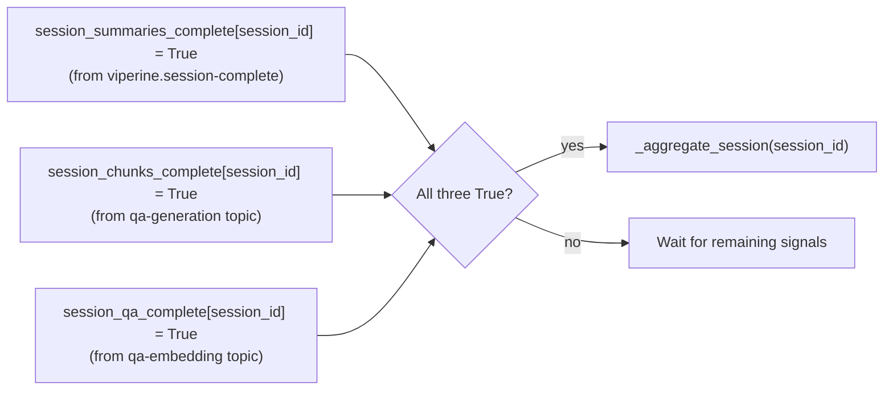

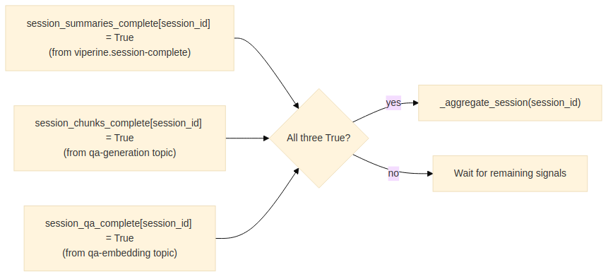

### Azure write sequence

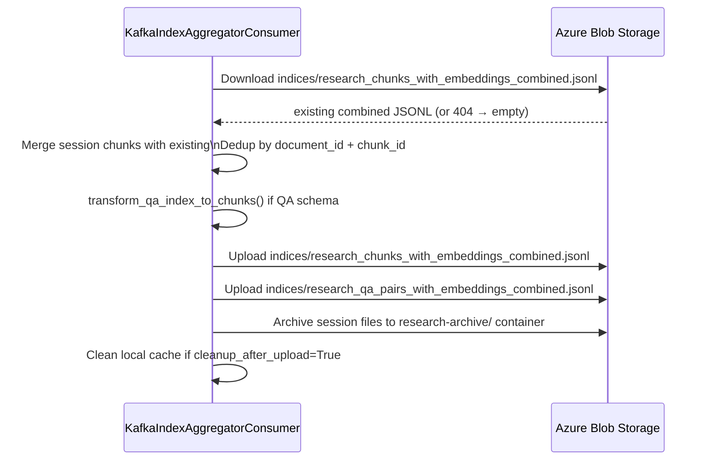

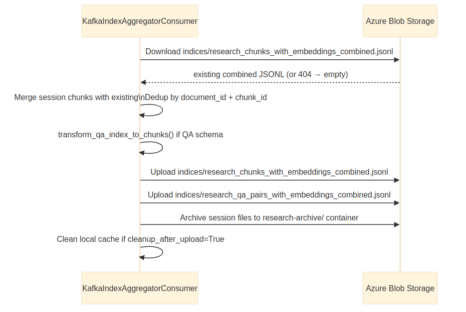

### Schema transformation

Q&A pairs use a flat schema that must be normalised to the enriched-chunks format before upload. `transform_qa_index_to_chunks()` in `src/utils/index_adapter.py` performs this conversion:

| Q&A Index field | Maps to Enriched Chunks field |
|---|---|
| `chunk_content` | `content` |
| `question` + `answer` | Prepended to `content` when `include_qa_in_content=True` |
| `combined_embedding` | `embedding_enrichment.combined_embedding` |
| `chunk_id` | `chunk_metadata.chunk_id` |
| `document_id` | `document_metadata.document_id` |

---

## 7. Hot Folder Switch — Live Index Migration

The `KafkaSummaryIndexerConsumer` supports live migration of the combined index to a different directory without a pod restart. This capability is used when the active `x_indices_*` folder needs to be rotated — for example, when a full re-indexing run has produced a new version of the research corpus and the system needs to switch to serving the new index without interrupting in-flight research sessions.

From an operations perspective, this is a zero-downtime index rotation. Without this mechanism, switching the active index folder would require redeploying the Indexer pod (which triggers a new Kafka consumer group rebalance and could cause message delivery delays) or writing custom tooling to coordinate the switch. The topic-based approach means an operator can publish a single message to `index-folder-switch` and the running pod handles the rest.

**Safety properties:** The path of `self.combined_index_file` is atomically reassigned at the Python level — Python's GIL guarantees that the attribute write is not torn. The `fcntl.LOCK_EX` advisory lock in `_aggregate_session_into_combined()` always resolves symlinks to the real underlying file before acquiring the lock, so the lock correctly targets the new index file path immediately after a switch, even if the symlink itself has not been updated.

**Trigger:** A message is published to the `index-folder-switch` Kafka topic.
**Outcome:** `self.combined_index_file` is atomically re-routed to the new directory path.

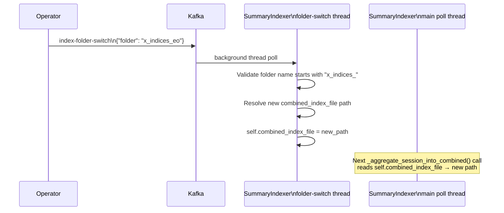

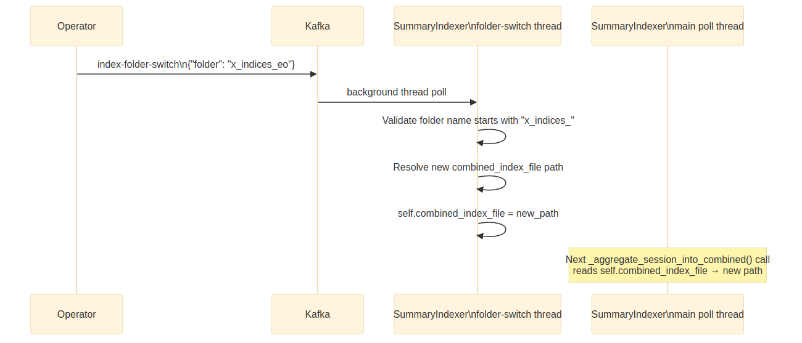

The folder-switch thread and the main poll thread share `self.combined_index_file`. Python's GIL makes the `self.combined_index_file = new_path` assignment atomic, so there is no window where the main thread reads a partially-updated path.

The `fcntl.LOCK_EX` call in `_aggregate_session_into_combined()` always resolves symlinks to the real file before acquiring the lock, so the lock file correctly sibling-targets the new index file after a switch.

---

## Correlation ID propagation

**Story:** [Phase_Plan_Story_VIPERINE_SESSION_IDs.md](Phase_Plan_Story_VIPERINE_SESSION_IDs.md)

Every Kafka message in the Viperine pipeline carries three correlation fields as top-level payload keys:

| Field | Type | Meaning |
|---|---|---|
| `session_id` | UUIDv4 string | Chat-tab identifier — opaque pass-through; the BFF uses this to route SSE events to the correct browser bucket. |
| `request_id` | UUIDv4 string | Per-query identifier — Viperine's internal aggregation key. All N per-URL messages for a single analyst query share the same `request_id`. |
| `origin` | string (`"frontend"` or `"direct"`) | Diagnostic field set by the RAG resolver. Pass-through only; never used for routing inside Viperine. |

**Two-name discipline:** `session_id` is the chat-tab UUID (shared across many requests); `request_id` is the per-query UUID (Viperine's aggregation unit). Viperine's internal state (`request_states`, on-disk `cache/summaries/<request_id>/`) is keyed on `request_id`. The wire `session_id` remains opaque.

**Outbound HTTP propagation:** `KafkaSummaryIndexerConsumer` forwards `X-Session-Id` and `X-Request-Id` HTTP headers to the embedding service on every `POST /embeddings` call. `origin` is diagnostic-only and does **not** travel as an HTTP header (mirrors RAG 0.2.0 contract).

**Logging convention:** Every consumer installs `install_correlation_record_factory()` at startup, which stamps every `logging.LogRecord` with `session_id` and `request_id` attributes from the active ContextVar. JSON log lines carry these as structured fields; text log lines use the canonical prefix `session_id=… request_id=… `.

**Cardinality invariant:** `session_id`, `request_id`, and `origin` are **never** Prometheus metric label values. They live in logs only. The regression suite (`pytest -m regression`) enforces this boundary.
