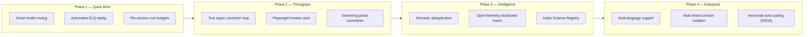

# Viperine Consumer Group — Roadmap

**Helm chart version:** 0.1.0
**Prepared:** June 2026
**Scope:** Suggested upgrades and extensions to the five-consumer pipeline, ordered by phase. Each item describes the motivation for product managers and the implementation path for developers.

The current pipeline is production-stable and handles the core research workflow reliably: scrape → summarise → embed → index → notify. This roadmap addresses the next layer of improvements — where cost can be reduced, where throughput can increase, and where the system can grow to support a larger organisation without a full rewrite.

Items in Phase 1 are independent of each other and can be picked up by any developer who is familiar with the codebase. Phases 2–4 build on each other and should be tackled in order within each phase.

---

## Table of Contents

1. [Phase 1 — Quick Wins](#phase-1--quick-wins)
   - [1.1 Smart Model Routing](#11-smart-model-routing)
   - [1.2 Automated DLQ Replay](#12-automated-dlq-replay)
   - [1.3 Per-Session Cost Budgets](#13-per-session-cost-budgets)
2. [Phase 2 — Throughput and Latency](#phase-2--throughput-and-latency)
   - [2.1 True Async Consumer Loop](#21-true-async-consumer-loop)
   - [2.2 Playwright Browser Pool](#22-playwright-browser-pool)
   - [2.3 Streaming Partial Summaries](#23-streaming-partial-summaries)
3. [Phase 3 — Intelligence Layer](#phase-3--intelligence-layer)
   - [3.1 Semantic Deduplication](#31-semantic-deduplication)
   - [3.2 OpenTelemetry Distributed Traces](#32-opentelemetry-distributed-traces)
   - [3.3 Kafka Schema Registry](#33-kafka-schema-registry)
4. [Phase 4 — Enterprise Readiness](#phase-4--enterprise-readiness)
   - [4.1 Multi-Language Content Support](#41-multi-language-content-support)
   - [4.2 Multi-Tenant Session Isolation](#42-multi-tenant-session-isolation)
   - [4.3 Horizontal Auto-Scaling with KEDA](#43-horizontal-auto-scaling-with-keda)
5. [Roadmap Diagram](#roadmap-diagram)

---

## Phase 1 — Quick Wins

These three items require no architectural changes. They work within the existing class structure and each pays for itself quickly in either cost reduction or operational time saved.

---

### 1.1 Smart Model Routing

**For the product manager:** Right now every document — a 300-word blog post and a 15-page academic paper — is summarised by the same `gemini-2.5-pro` model. That is equivalent to hiring a senior consultant to summarise a press release. The `gemini-2.5-flash` model is approximately 16× cheaper per token and produces summaries of comparable quality for short, straightforward documents. Routing short documents to flash and long or complex documents to pro would reduce the LLM API cost by an estimated 40–60% without any change to summary quality for the cases where it matters.

**For the developer:** The routing logic lives entirely inside `KafkaSummarizerConsumer._process_message()`. Before calling `CitationResearchClient.generate_summary()`, measure the length of the extracted text (already available as `len(extracted_content)`). Below a configurable threshold (e.g. `MODEL_ROUTING_FLASH_MAX_CHARS`, default 8 000 characters), instantiate `GeminiLLMClient` with `model_name="gemini-2.5-flash"` instead of the default. Above the threshold, or when `extraction_failed=True` (web-grounding path), always use pro. The model name is already plumbed through to `estimate_cost()` via `getattr(self.llm_client, 'model_name', None)`, so cost tracking will automatically reflect the split.

The `kafka_consumer_llm_input_tokens_total` and `kafka_consumer_llm_estimated_cost_usd_total` counters, labelled by `model`, will immediately show the cost split in Grafana after deployment.

**Config knobs to add to `src/config.py`:**
```python
"summarizer": {
    "model_routing_enabled": True,
    "flash_model_name": "gemini-2.5-flash",
    "flash_max_chars": 8000,
}
```

---

### 1.2 Automated DLQ Replay

**For the product manager:** Today, when a document fails — Gemini was rate-limited, the embedding service was briefly down, a website was temporarily unreachable — it ends up in `cache/failures/failures.json` and stays there until an operator manually re-publishes it. In practice, many of these failures are transient: the service recovers, but the document is never retried. Analysts notice the gap only when they ask a question and the answer is incomplete. An automated replay service would re-enqueue eligible failed messages on a schedule, transparently recovering coverage without any human intervention.

**For the developer:** The `KafkaDeadLetterConsumer` is intentionally write-only today — retry logic was excluded to avoid double-processing. The right approach is not to add retries inside the DLQ consumer but to add a separate `replay_scheduler.py` script (or a new Kubernetes CronJob) that reads `cache/failures/failures.json`, filters records where `failed_stage` is in a configurable replay-eligible set (e.g. `{"web_scraper", "summarizer", "summary_indexer"}`) and where the failure `timestamp` is older than a minimum cool-down (e.g. 5 minutes) but younger than a maximum age (e.g. 24 hours). Eligible records are re-published to their `origin_topic` using a standard `confluent_kafka.Producer`. A `replayed_at` timestamp is written back to the record to prevent infinite replay loops.

The `kafka_consumer_dlq_messages_reprocessed_total` counter in `KafkaDeadLetterConsumer` is already defined and waiting for an incrementing call site.

**Files to create/modify:**
- New: `scripts/replay_dlq.py` — standalone script, runnable as a CronJob
- Modify: `src/consumers/kafka_dead_letter_consumer.py` — add `replayed_at` field handling
- New Helm resource: `helm/rapporteur-consumer-group/templates/cronjob-dlq-replay.yaml`

---

### 1.3 Per-Session Cost Budgets

**For the product manager:** As the platform grows and more analysts run concurrent research sessions, the risk of a single runaway session consuming disproportionate LLM budget increases. A research query that resolves to 200 URLs (because the RAG service's source set is large) could trigger 200 Gemini pro calls in rapid succession. Per-session cost budgets let you set a maximum spend per research session. Once the budget is reached, remaining documents are routed to the flash model or summarised with a shorter prompt, rather than failing outright. Analysts still get results; they just get lighter summaries on the tail of a very large session.

**For the developer:** The `KafkaSummarizerConsumer` already snapshots token usage before each call (`_usage_before`) and computes the delta after. Extend this to maintain a per-`session_id` running cost total stored in a simple dict (`self._session_costs: dict[str, float]`). Before each LLM call, check `self._session_costs.get(session_id, 0.0)` against a configurable `SESSION_COST_BUDGET_USD` (e.g. `5.0`). If exceeded, force `model_name = flash_model_name` for the remainder of the session. Emit a `kafka_consumer_session_budget_exceeded_total` counter (new metric, labelled by `consumer_id`) so Grafana shows which sessions hit the cap.

The per-session cost dict must be cleared when a session-complete event is received (subscribe to `viperine.session-complete` in a background thread, same pattern as the folder-switch listener in `KafkaSummaryIndexerConsumer._start_folder_switch_listener()`).

---

## Phase 2 — Throughput and Latency

These items require more substantial changes to the consumer architecture but unlock a step-change in how many documents the pipeline can process per minute. The current single-threaded synchronous poll loop is the fundamental throughput constraint.

---

### 2.1 True Async Consumer Loop

**For the product manager:** Today, each consumer processes one Kafka message at a time. While the Summarizer is waiting 30 seconds for Gemini to respond, it is not processing any other messages. If a research session includes 50 documents, the analyst waits for all 50 to be summarised sequentially. Moving to a concurrent processing model — where multiple LLM calls are in-flight simultaneously — would reduce the wall-clock time for a 50-document session from roughly 25 minutes to 4–6 minutes, assuming a concurrency of 8 and Gemini's typical per-call latency.

**For the developer:** The core change is replacing the synchronous poll loop in `KafkaSummarizerConsumer.start()` with a fully async loop using `asyncio` and `confluent_kafka`'s async-compatible poll pattern. The main loop becomes:

```python
async def _run_loop(self):
    semaphore = asyncio.Semaphore(self.max_concurrency)  # config: summarizer.max_concurrency
    tasks: set[asyncio.Task] = set()
    while self.running:
        msg = self.consumer.poll(timeout=0.1)
        if msg and not msg.error():
            async with semaphore:
                task = asyncio.create_task(self._process_message(msg))
                tasks.add(task)
                task.add_done_callback(tasks.discard)
        await asyncio.sleep(0)
```

`_process_message()` is already `async` internally (it calls `CitationResearchClient.generate_summary()` which is async). The key challenge is that `confluent_kafka.Consumer.poll()` is synchronous — it must be called from a thread executor (`loop.run_in_executor(None, self.consumer.poll, 0.1)`) to avoid blocking the event loop.

The `EmbeddingServiceClient` already handles multiple event loops correctly via its `_client_loop` lazy re-init pattern, so the Indexer would benefit from the same change with minimal additional work.

The `KafkaMetricsWrapper.track_message_processing()` gauge (`kafka_consumer_messages_in_flight`) already exists to make concurrent in-flight counts visible in Grafana — it will become much more interesting after this change.

**Risk:** The `GeminiLLMClient._total_usage` accumulator is shared state accessed concurrently. Protect it with `asyncio.Lock` before enabling concurrency.

---

### 2.2 Playwright Browser Pool

**For the product manager:** The Playwright headless browser strategy is the most powerful tool the WebScraper has for extracting content from JavaScript-heavy sites, but it is also the slowest: launching a fresh Chromium process for each URL takes 2–4 seconds before the page even starts loading. On a session where 30% of URLs require Playwright (which is typical for sites like LinkedIn, certain news portals, and SPAs), this startup cost dominates the extraction time. A warm browser pool would eliminate the per-URL launch overhead, cutting Playwright-path latency from 8–15 seconds per URL to 3–5 seconds.

**For the developer:** Create a `PlaywrightPool` class in `src/components/playwright_pool.py`. At `KafkaWebScraperConsumer` startup, initialise a pool of `N` pre-launched browser contexts (`playwright.chromium.launch()` with `stealth_async()` applied once). The `_extract_with_playwright()` method acquires a context from the pool via `asyncio.Queue.get()`, uses it, and returns it with `queue.put_nowait()`. If the queue is empty (all contexts busy), it falls back to launching a temporary browser instance (current behaviour), ensuring no regression for burst scenarios.

```python
class PlaywrightPool:
    def __init__(self, size: int = 3):
        self._queue: asyncio.Queue = asyncio.Queue(maxsize=size)

    async def acquire(self) -> BrowserContext: ...
    async def release(self, ctx: BrowserContext) -> None: ...
    async def close_all(self) -> None: ...  # called in consumer shutdown
```

Pool size is configurable via `web_scraper.playwright_pool_size` (default 3). The metric `kafka_consumer_scrape_strategy_total{strategy="playwright"}` provides the data to tune this value in production.

---

### 2.3 Streaming Partial Summaries

**For the product manager:** Currently the Summarizer waits until Gemini has finished writing the entire summary before publishing anything downstream. For a long document, the analyst sees nothing for 30–60 seconds and then the full summary appears at once. Streaming would allow the analyst to start reading the summary while Gemini is still writing it — the first paragraph appears in 2–3 seconds, and the document fills in progressively. This is the single change that most improves the perceived responsiveness of the research product, even though it does not change the actual completion time.

**For the developer:** The Vertex AI SDK (`google.genai.Client`) supports streaming via `models.generate_content_stream()`. The `GeminiLLMClient` would need a new `generate_content_stream(prompt)` async generator method that yields text chunks. `CitationResearchClient` is currently coupled to a single-response JSON parse; streaming requires a different approach: yield chunks to the Indexer via a new `viperine.summary-stream` topic (with `chunk_index` and `is_final` fields), and only attempt JSON parsing on the final chunk.

This is the most architecturally invasive item in Phase 2 because it introduces a new Kafka topic and requires changes to the Indexer's session accounting (it needs to buffer stream chunks before embedding). Consider a feature-flag approach: `summarizer.enable_streaming=False` by default, with the existing batch path as the fallback.

**New topic:** `viperine.summary-stream` — messages contain `{session_id, request_id, chunk_index, text_chunk, is_final}`.

---

## Phase 3 — Intelligence Layer

Phase 3 makes the pipeline smarter about the data it processes and gives the engineering team deeper visibility into how messages flow across service boundaries.

---

### 3.1 Semantic Deduplication

**For the product manager:** The current deduplication in `KafkaSummaryIndexerConsumer` is URL-based: `dedup_key = md5(normalize_url(source_url))`. This means the same article published at two different URLs — for example, syndicated content, AMP mirror pages, or a news article available on both the publisher's site and an aggregator — is summarised and indexed twice. From the analyst's perspective, duplicate content is noise: the same information appears in search results twice, taking up space that could be filled by genuinely distinct sources. Semantic deduplication would detect when a new summary is very similar to an existing one and suppress the duplicate before it reaches the index.

**For the developer:** After generating the embedding vector in `KafkaSummaryIndexerConsumer._process_message()`, before writing to the index, compute cosine similarity between the new vector and the `N` most recently indexed vectors for the same session (stored in the session state). If similarity exceeds a configurable threshold (`summary_indexer.semantic_dedup_threshold`, suggested default `0.95`), log the suppression and increment a new `kafka_consumer_summary_semantic_duplicates_total` counter, but do not write the record. The threshold must be tuned carefully — `0.95` suppresses near-identical documents while allowing substantively different perspectives on the same topic to coexist. Use the `kafka_consumer_summaries_per_session` histogram to measure the impact on index density after rollout.

For cross-session deduplication (detecting when a URL from a new session covers the same ground as a document indexed weeks ago), a separate background indexer scan would be needed — out of scope for this item but a logical follow-on.

---

### 3.2 OpenTelemetry Distributed Traces

**For the product manager:** When an analyst reports that a specific URL produced a poor summary or did not appear in results at all, the current debugging workflow is: check the DLQ log, grep the WebScraper logs, grep the Summarizer logs, and piece together the sequence of events manually. This can take 15–30 minutes for a non-trivial failure. OpenTelemetry traces would link every stage of a document's journey — from the first `viperine.web-scrape-requests` message to the final index write — into a single trace visible in a tool like Jaeger or Tempo. An engineer could look up a `request_id` and see every step, every latency, and every error in one view.

**For the developer:** Add `opentelemetry-sdk`, `opentelemetry-instrumentation-confluent-kafka`, and `opentelemetry-exporter-otlp` to `requirements.in`. The trace context (`traceparent` header) is propagated via Kafka message headers — `confluent_kafka.Message.headers()` — so spans in the WebScraper and Summarizer can be linked into the same trace even though they run in separate processes. Each consumer's `_process_message()` method becomes the root span for that stage:

```python
with tracer.start_as_current_span(f"{self.consumer_name}.process_message") as span:
    span.set_attribute("session_id", message_data.get("session_id"))
    span.set_attribute("request_id", message_data.get("request_id"))
    ...
```

The `Base` mixin in `src/config_handler.py` is the right place to initialise the tracer and exporter once, shared by all consumers. Deploy Grafana Tempo in the `monitoring` namespace as the OTLP collector and add a Tempo data source to the existing Grafana instance.

---

### 3.3 Kafka Schema Registry

**For the product manager:** Today, when a developer changes the shape of a Kafka message — adds a new required field, renames an existing one — there is no automatic validation that the consumer on the other end knows how to handle the new shape. Breakages only surface at runtime when a consumer throws a `KeyError` processing a message in the new format. A Schema Registry enforces message contracts: a producer cannot publish a message that does not match the registered schema for that topic, and a consumer is alerted when a message arrives in an unexpected format. For a growing team, this is the difference between confident schema changes and carefully coordinated deployments.

**For the developer:** The Confluent Schema Registry is available as a Docker image and integrates directly with `confluent_kafka`. The migration path is:

1. Define Avro (or JSON Schema) schemas for each topic's message format. Start with the highest-volume, most-stable topics: `viperine.summarise-document` and `viperine.summary-completed`.
2. Register the schemas against the registry at startup using `confluent_kafka.schema_registry.SchemaRegistryClient`.
3. Replace the `json.loads(message.value())` calls in each consumer with `AvroDeserializer` (or `JSONDeserializer`) configured against the registry.
4. Replace `json.dumps(...)` in each producer with `AvroSerializer`.

The `confluent_kafka` library already supports schema registry natively — the change is largely a find-and-replace of serialisation calls rather than an architectural change. The biggest effort is writing the schema definitions themselves, which also serves as living documentation of the message contracts.

**Deploy:** Add a `schema-registry` service to `docker-compose.kafka.yml` for local development, and a new Kubernetes Deployment in the `kafka` namespace for production.

---

## Phase 4 — Enterprise Readiness

Phase 4 addresses the requirements that emerge when the platform moves from a single-team research tool to a shared service used by multiple teams or customers with different workloads, content types, and security boundaries.

---

### 4.1 Multi-Language Content Support

**For the product manager:** The current pipeline is English-first. The `web_scraper.extract_markdown` and Playwright paths work regardless of language, but `CitationResearchClient.generate_summary()` always prompts for an English-language summary. Research teams that work with French, German, Spanish, or Mandarin sources receive English summaries of foreign-language originals, which introduces a translation step that can lose nuance. Supporting native-language summarisation and multilingual embeddings would allow the platform to serve research teams in any language market.

**For the developer:** Two components need to change. First, `CitationResearchClient.generate_summary()` needs a `target_language` parameter (from session metadata or detected from the extracted text via `langdetect`). The structured JSON prompt gains a `language` instruction. Gemini 2.5 handles multilingual summarisation natively — no model change needed. Second, the embedding model (`all-MiniLM-L6-v2`) is English-optimised. Replace it with `paraphrase-multilingual-MiniLM-L12-v2` (384-dim, same interface) at the embedding service level for full multilingual semantic search. Note that changing the embedding model invalidates the existing index — a one-time re-embedding of the combined index is required on migration. The `kafka_consumer_summary_id_scheme_total` counter's `scheme` label can be extended to track the language distribution across sessions.

---

### 4.2 Multi-Tenant Session Isolation

**For the product manager:** As usage grows, different teams will want their research results kept separate from each other. A legal team's research into M&A targets should not appear in the results seen by a marketing team running competitor analysis. Today all research is pooled into the same combined index (`research_summaries_filtered.jsonl`). Multi-tenant isolation would give each team or project its own index partition, with access control enforced at the RAG service layer.

**For the developer:** The session message schema already carries a `session_id`. Extend it with a `tenant_id` field set by the RAG service when it enqueues the research request. In `KafkaSummaryIndexerConsumer`, route the combined index write to a tenant-specific path: `ACTIVE_INDEX_FOLDER/{tenant_id}/research_summaries_filtered.jsonl`. The `fcntl.LOCK_EX` pattern already uses the file path as the lock identity, so per-tenant lock files come for free. Add `tenant_id` as a label on the `kafka_consumer_summaries_indexed_total` and `kafka_consumer_summary_sessions_completed_total` counters so Grafana can show per-tenant throughput and cost.

The `CustConf.get()` system in `src/config.py` would need a tenant-config overlay capability to support per-tenant model choices or cost limits — dovetailing with the Per-Session Cost Budgets item from Phase 1.

---

### 4.3 Horizontal Auto-Scaling with KEDA

**For the product manager:** Research load is bursty. A large team may submit 20 concurrent research queries at 9 AM and nothing for the rest of the afternoon. Running five fixed-size consumer pods 24 hours a day to handle that morning peak is wasteful. KEDA (Kubernetes Event-Driven Autoscaler) allows the platform to automatically scale the number of WebScraper or Summarizer pods up when Kafka consumer lag grows (many URLs waiting to be processed) and back down to one pod when the queue is empty. Analysts get faster results during peak load; infrastructure costs drop during quiet periods.

**For the developer:** KEDA reads Kafka consumer group lag directly from the Kafka broker and scales Deployments accordingly. The integration requires a `ScaledObject` CRD per consumer:

```yaml
# helm/rapporteur-consumer-group/templates/scaledobject-summarizer.yaml
apiVersion: keda.sh/v1alpha1
kind: ScaledObject
metadata:
  name: viperine-summarizer-scaler
spec:
  scaleTargetRef:
    name: viperine-summarizer
  minReplicaCount: 1
  maxReplicaCount: 5
  triggers:
    - type: kafka
      metadata:
        bootstrapServers: kafka-service:9092
        consumerGroup: viperine-summarizer-v2
        topic: viperine.summarise-document
        lagThreshold: "10"  # scale up when lag > 10 messages per replica
```

The main caveat for the Indexer is the `fcntl.LOCK_EX` combined index write — this is safe under multiple replicas because the lock is advisory and file-based, but the lock-contention rate (`index_file_lock` errors) should be monitored after enabling horizontal scaling. The WebScraper scales most cleanly because it is stateless between messages.

---

## Roadmap Diagram

```mermaid
flowchart LR
    subgraph P1["Phase 1 — Quick Wins"]
        direction TB
        A1["Smart model routing"]
        A2["Automated DLQ replay"]
        A3["Per-session cost budgets"]
    end
    subgraph P2["Phase 2 — Throughput"]
        direction TB
        B1["True async consumer loop"]
        B2["Playwright browser pool"]
        B3["Streaming partial summaries"]
    end
    subgraph P3["Phase 3 — Intelligence"]
        direction TB
        C1["Semantic deduplication"]
        C2["OpenTelemetry distributed traces"]
        C3["Kafka Schema Registry"]
    end
    subgraph P4["Phase 4 — Enterprise"]
        direction TB
        D1["Multi-language support"]
        D2["Multi-tenant session isolation"]
        D3["Horizontal auto-scaling (KEDA)"]
    end
    P1 --> P2 --> P3 --> P4
```




