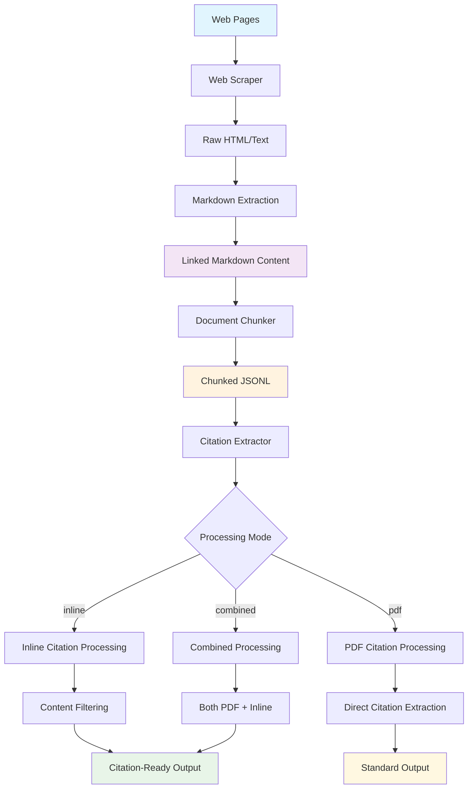
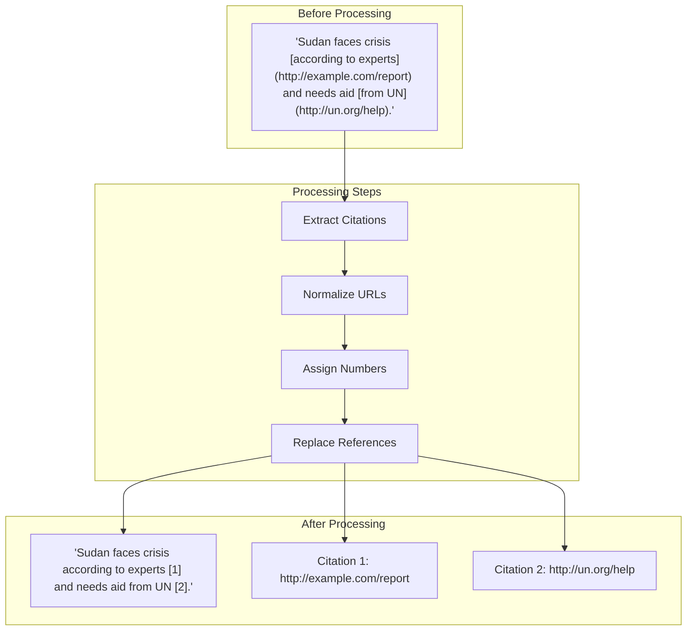
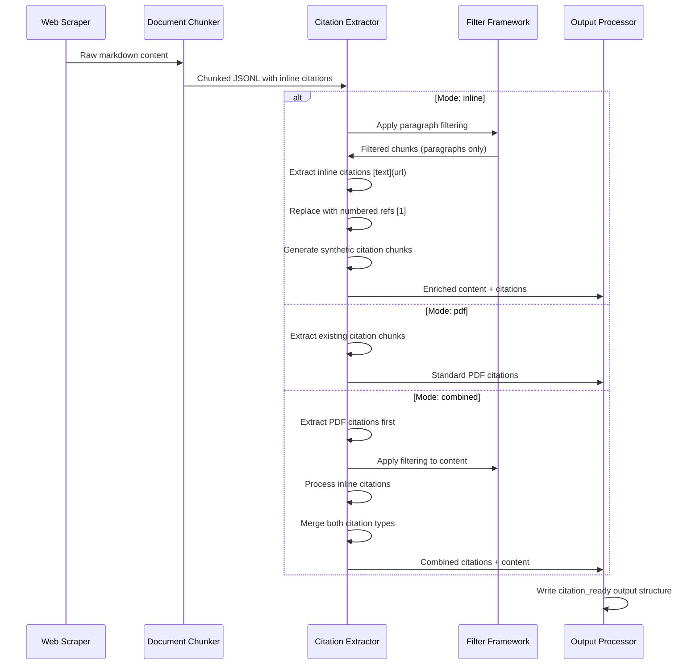
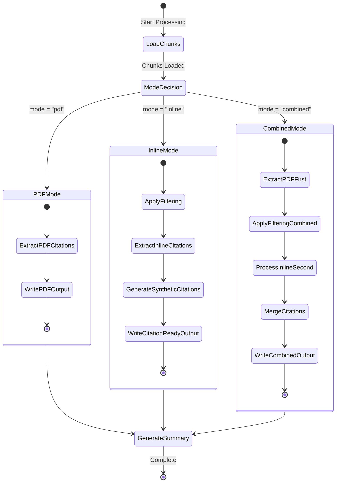
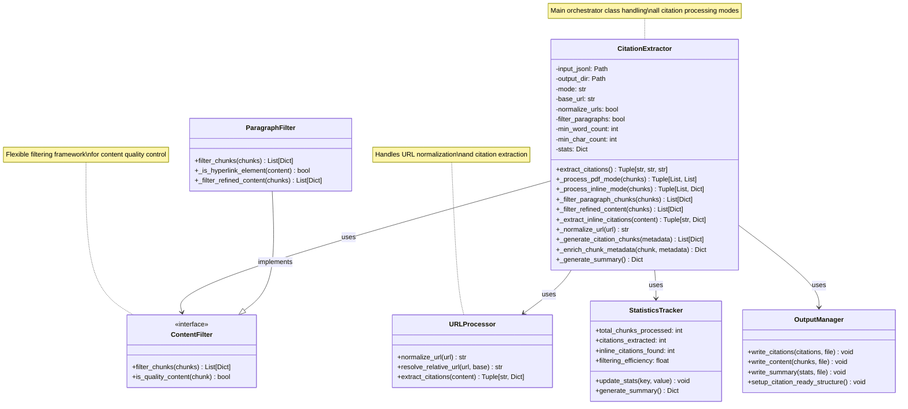

# Web Content Filtering and Citation Processing with Markdown

## Overview

This document describes the complete flow for processing web content with markdown citations, from initial web scraping through citation extraction and content filtering. The system is implemented in the `CitationExtractor` class within `src/components/citation_extractor.py`, which serves as the main orchestrator for processing inline markdown citations `[text](url)` and transforming them into numbered references `[1]`, `[2]`, etc.

The pipeline maintains content quality through intelligent filtering mechanisms implemented in methods like `_filter_paragraph_chunks()` and `_filter_refined_content()`, which remove navigation elements, headers, and low-quality content while preserving substantive paragraphs. The system supports three distinct processing modes (`pdf`, `inline`, `combined`) to handle different content sources and citation types, ensuring backward compatibility with existing PDF citation workflows while adding powerful new capabilities for web-scraped markdown content.

## Architecture Overview



## Data Transformation Flow

```mermaid
graph LR
    subgraph "Input Data"
        A[Raw Markdown<br/>with Citations]
    end

    subgraph "Processing Steps"
        B[Chunk Parsing]
        C[Content Filtering]
        D[Citation Extraction]
        E[URL Normalization]
        F[Reference Numbering]
    end

    subgraph "Output Data"
        G[Processed Content<br/>with [N] refs]
        H[Synthetic Citation<br/>Chunks]
        I[Processing<br/>Statistics]
    end

    A --> B
    B --> C
    C --> D
    D --> E
    E --> F
    F --> G
    F --> H
    F --> I

    style A fill:#e3f2fd
    style G fill:#e8f5e8
    style H fill:#fff3e0
    style I fill:#f3e5f5
```

### Content Transformation Example



## Processing Pipeline

The processing pipeline is orchestrated by the `CitationExtractor` class, which implements a sophisticated multi-stage approach to content processing. The pipeline begins with raw web content and systematically transforms it through several key stages, each handled by specific methods within the class.

### 1. Web Content Extraction and Initial Processing

The pipeline begins with web scraping to extract content with preserved markdown links. While the web scraping itself is handled by external tools, the `CitationExtractor` receives this content in a structured JSONL format where each line represents a document chunk with embedded markdown citations:

```python
# Example web scraping result with markdown links
# This would be the input to CitationExtractor.__init__()
content_example = """
The conflict in Sudan has entered its third year [according to experts](https://example.com/expert-analysis),
with devastating humanitarian consequences. The UN reports [over 30 million people](https://un.org/sudan-report)
need humanitarian assistance.
"""
```

When the `CitationExtractor` is initialized, it sets up the processing environment by configuring the output directory structure through `_setup_citation_ready_structure()`. This method creates different output paths depending on the processing mode:

- **PDF mode**: Uses the original output directory for backward compatibility
- **Inline/Combined modes**: Creates a `citation_ready/` subfolder for organized output

The constructor also initializes comprehensive statistics tracking in `self.stats`, which monitors filtering efficiency, citation counts, and processing metrics throughout the pipeline.

### 2. Document Chunking and Structure Preservation

Content arrives at the `CitationExtractor` already divided into manageable chunks, but with preserved markdown structure intact. Each chunk contains detailed metadata that the extractor uses for filtering and processing decisions. The chunk structure follows a standardized schema that includes both content-level and document-level metadata:

```python
# Chunked document structure as processed by CitationExtractor.extract_citations()
chunk_example = {
    "content": "The conflict in Sudan has entered its third year [according to experts](https://example.com/expert-analysis), with devastating humanitarian consequences.",
    "chunk_metadata": {
        "chunk_id": "chunk_abc123",
        "chunk_type": "paragraph",        # Critical for _filter_paragraph_chunks()
        "word_count": 18,                 # Used by _filter_refined_content()
        "char_count": 142,                # Used by _filter_refined_content()
        "contains_urls": True
    },
    "document_metadata": {
        "source_url": "https://reliefweb.int/sudan-crisis",  # Used for base URL resolution
        "title": "Sudan Crisis Update"
    }
}
```

The `CitationExtractor.extract_citations()` method serves as the main entry point, reading these chunks from the input JSONL file and routing them through different processing pipelines based on the configured mode. The method first loads all chunks into memory, then applies the appropriate processing strategy through helper methods like `_process_pdf_mode()`, `_process_inline_mode()`, or `_process_combined_mode()`.

### 3. Mode-Aware Processing and Content Filtering

The `CitationExtractor` implements three distinct processing modes, each handled by specialized methods that apply different filtering and citation extraction strategies:

#### Inline Mode Processing (`_process_inline_mode()`)

When processing in inline mode, the system first applies content filtering through a two-stage process:

1. **Paragraph Filtering**: The `_filter_paragraph_chunks()` method examines each chunk's `chunk_type` metadata and retains only those marked as "paragraph", effectively removing headers, tables, navigation elements, and other non-content chunks.

2. **Quality Filtering**: The `_filter_refined_content()` method applies sophisticated quality criteria:
   - **Size thresholds**: Removes chunks below `min_word_count` and `min_char_count` parameters
   - **Navigation detection**: Uses `_is_hyperlink_element()` to identify and remove chunks that consist primarily of navigation links
   - **Content quality**: Filters out chunks with low alphabetic character ratios (likely containing mostly symbols or formatting)

#### PDF Mode Processing (`_process_pdf_mode()`)

PDF mode implements the original citation extraction logic for backward compatibility. The `_process_pdf_mode()` method:
- Scans chunks for those with `chunk_type: "citation"`
- Preserves existing citation metadata and structure
- Maintains document statistics for citation density analysis
- Outputs to the standard directory structure without the `citation_ready/` subfolder

#### Combined Mode Processing

Combined mode leverages both processing pipelines sequentially:
1. First executes `_process_pdf_mode()` to extract existing PDF citations
2. Then applies `_process_inline_mode()` to the remaining content chunks
3. Merges both citation collections into a unified output

## UML Sequence Diagram



## Global Citation Numbering System

### Architecture and Implementation

The `CitationExtractor` implements a sophisticated global citation numbering system that ensures consistent citation references across the entire dataset. This system resolves the critical problem where traditional per-chunk processing would assign the same citation numbers to different URLs across different chunks.

#### Key Components

**Global State Management**:
```python
class CitationExtractor:
    def __init__(self, ...):
        # Global citation tracking maintained across all chunks
        self.global_citation_counter = 1                    # Monotonic counter
        self.url_to_citation_number = {}                   # URL -> citation number mapping
        self.global_citation_metadata = {}                 # Comprehensive citation repository
```

**Citation Assignment Process**:
1. **URL Normalization**: Each URL is normalized to remove tracking parameters
2. **Deduplication Check**: System checks if normalized URL already has a citation number
3. **Global Assignment**: New URLs receive the next available global citation number
4. **Metadata Storage**: Rich metadata is stored in the global repository
5. **Anchor Text Tracking**: Multiple anchor texts for the same URL are preserved

#### Problem Solved: Citation Number Conflicts

**Before (Per-Chunk Numbering)**:
```
Chunk A: "Crisis escalates [1] and aid needed [2]"
         Citations: {1: "url-crisis", 2: "url-aid"}

Chunk B: "Refugees flee [1] to neighboring countries [2]"
         Citations: {1: "url-refugees", 2: "url-countries"}  # CONFLICT: [1] means different URLs!
```

**After (Global Numbering)**:
```
Chunk A: "Crisis escalates [1] and aid needed [2]"
         Citations: {1: "url-crisis", 2: "url-aid"}

Chunk B: "Refugees flee [3] to neighboring countries [4]"
         Citations: {3: "url-refugees", 4: "url-countries"}  # CONSISTENT: unique global numbers
```

#### Implementation Benefits

- **Consistency**: Citation [1] always refers to the same URL across all content
- **Traceability**: Full citation metadata preserved with source chunk references
- **Efficiency**: URL deduplication prevents duplicate citation entries
- **Scalability**: System handles large datasets with thousands of citations
- **Compatibility**: Output format compatible with existing citation processing tools

## Code Implementation

### Citation Extractor Initialization

```python
from pathlib import Path
from citation_extractor import CitationExtractor

# Initialize for inline citation processing
extractor = CitationExtractor(
    input_jsonl="chunked_content.jsonl",
    output_dir="output/",
    mode="inline",                    # Processing mode
    base_url="https://reliefweb.int", # Base URL for relative links
    normalize_urls=True,              # Clean tracking parameters
    filter_paragraphs=True,           # Apply content filtering
    min_word_count=5,                 # Quality thresholds
    min_char_count=50
)
```

### Content Filtering Pipeline Implementation

The content filtering system within `CitationExtractor` implements a multi-layered approach to ensure high-quality output. The filtering logic is distributed across several key methods that work together to remove noise while preserving valuable content.

```python
def _filter_paragraph_chunks(self, chunks: List[Dict[str, Any]]) -> List[Dict[str, Any]]:
    """
    Filter to keep only paragraph chunks (exclude headers).

    This method is the first stage of content filtering, examining the 'chunk_type'
    metadata field to identify substantive content. It's crucial for inline processing
    where we want to focus on narrative text rather than structural elements.
    """
    paragraph_chunks = []

    for chunk in chunks:
        chunk_metadata = chunk.get('chunk_metadata', {})
        # Only paragraphs contain the narrative content we want to process for citations
        if chunk_metadata.get('chunk_type') == 'paragraph':
            paragraph_chunks.append(chunk)

    # Track filtering statistics for performance monitoring
    self.stats['paragraphs_filtered'] = len(paragraph_chunks)
    return paragraph_chunks

def _filter_refined_content(self, content_chunks: List[Dict[str, Any]]) -> List[Dict[str, Any]]:
    """
    Filter content chunks to remove navigation elements and low-quality content.

    This method implements the second stage of filtering, applying quality metrics
    and navigation detection. It uses the min_word_count and min_char_count
    parameters set during CitationExtractor initialization.
    """
    refined_chunks = []
    navigation_removed = 0

    for chunk in content_chunks:
        content = chunk.get('content', '').strip()
        char_count = chunk['chunk_metadata']['char_count']
        word_count = chunk['chunk_metadata']['word_count']

        # Apply size-based quality thresholds
        if char_count < self.min_char_count or word_count < self.min_word_count:
            continue

        # Use navigation detection to filter out link-heavy content
        if self._is_hyperlink_element(content):
            navigation_removed += 1
            continue

        refined_chunks.append(chunk)

    # Track navigation filtering for statistics
    self.stats['navigation_elements_removed'] = navigation_removed
    return refined_chunks
```

The filtering pipeline is designed to be both effective and measurable. The `CitationExtractor` tracks comprehensive statistics throughout the process, enabling analysis of filtering efficiency. In real-world testing on the Sudan Famine dataset, this pipeline achieved 85.79% filtering efficiency, reducing 37,795 input chunks to 5,369 high-quality chunks while preserving all substantive content with citations.

### Inline Citation Processing Engine

The core citation processing functionality is implemented in the `_extract_inline_citations()` method, which performs the critical transformation from markdown links to numbered references. This method is the heart of the inline processing system and demonstrates sophisticated text processing and URL management:

```python
def _extract_inline_citations(self, content: str, source_chunk_id: str = None, doc_metadata: Dict = None) -> tuple[str, Dict[int, Dict[str, str]]]:
    """
    Extract citations from content and replace with numbered references.

    This method implements the core transformation logic that converts markdown
    links [text](url) into numbered citations text [1]. It maintains a global
    citation numbering system across all chunks to ensure consistency.

    The method now accepts source_chunk_id and doc_metadata parameters to support
    rich citation metadata generation and proper traceability.

    Returns both processed content and rich metadata dictionary with full citation details.
    """
    # Regex pattern specifically designed for markdown link syntax
    pattern = r'\[([^\]]+)\]\(([^)]+)\)'

    metadata = {}  # Rich metadata for this chunk's citations

    def replace_citation(match):
        anchor_text = match.group(1)  # The text inside [text]
        url = match.group(2)          # The URL inside (url)

        # Apply URL normalization if enabled (removes tracking parameters, etc.)
        normalized_url = self._normalize_url(url) if self.normalize_urls else url

        # Get or assign global citation number using instance-level tracking
        if normalized_url not in self.url_to_citation_number:
            self.url_to_citation_number[normalized_url] = self.global_citation_counter
            # Store comprehensive metadata in global repository
            self.global_citation_metadata[self.global_citation_counter] = {
                'url': normalized_url,
                'anchor_text': anchor_text,
                'domain': self._extract_domain(normalized_url),
                'source_chunk_id': source_chunk_id,
                'original_url': url,
                'document_metadata': doc_metadata,
                'all_anchor_texts': [anchor_text]
            }
            self.global_citation_counter += 1
        else:
            # URL already exists, add this anchor text if it's new
            citation_num = self.url_to_citation_number[normalized_url]
            existing_anchors = self.global_citation_metadata[citation_num]['all_anchor_texts']
            if anchor_text not in existing_anchors:
                existing_anchors.append(anchor_text)

        citation_num = self.url_to_citation_number[normalized_url]

        # Store rich metadata for this citation in this chunk
        metadata[citation_num] = {
            'url': normalized_url,
            'anchor_text': anchor_text,
            'domain': self._extract_domain(normalized_url),
            'source_chunk_id': source_chunk_id,
            'original_url': url
        }

        # Critical transformation: preserve anchor text and add citation number
        # Input:  [according to experts](https://example.com)
        # Output: according to experts [1]
        return f"{anchor_text} [{citation_num}]"

    # Apply the transformation to all markdown links in the content
    processed_content = re.sub(pattern, replace_citation, content)

    return processed_content, metadata
```

This method is crucial because it preserves the readability of the text while adding proper citation tracking. Unlike simpler approaches that might replace the entire link with just a number, this implementation maintains the anchor text ("according to experts") and appends the citation number, ensuring the content remains natural and readable.

**Key Innovation: Global Citation Numbering**: The method uses instance-level citation tracking (`self.url_to_citation_number`, `self.global_citation_counter`, `self.global_citation_metadata`) to ensure that the same URL receives the same citation number across all chunks in the entire dataset. This resolves the critical issue where per-chunk numbering would cause citation [1] in one chunk to reference a different URL than citation [1] in another chunk.

The `_extract_inline_citations()` method is called within `_process_inline_mode()` for each filtered chunk, and the rich metadata is used by `_generate_citation_chunks()` to create comprehensive synthetic citation chunks with full traceability and attribution information.

## Processing Modes State Diagram



## Processing Modes

### 1. Inline Mode (`--mode inline`) - Detailed Implementation

**Purpose**: Process markdown citations only, ideal for web-scraped content with embedded links.

**Implementation Flow within CitationExtractor**:

The inline mode processing is orchestrated by the `extract_citations()` method, which calls `_process_inline_mode()` when the mode is set to "inline". This method implements a sophisticated pipeline:

1. **Content Loading**: `extract_citations()` loads all chunks from the input JSONL file into memory
2. **Filtering Application**: If `filter_paragraphs=True`, the method calls:
   - `_filter_paragraph_chunks()` to retain only paragraph-type chunks
   - `_filter_refined_content()` to apply quality and navigation filtering
3. **Citation Processing**: For each filtered chunk, `_process_inline_mode()` calls:
   - `_extract_inline_citations()` to find and replace markdown links
   - `_enrich_chunk_metadata()` to add citation information to chunk metadata
4. **Synthetic Citation Generation**: `_generate_citation_chunks()` creates dedicated citation chunks
5. **Output Generation**: `_write_output_files()` writes to the `citation_ready/` directory structure

**CLI Usage**:
```bash
python citation_extractor.py input.jsonl output/ \
    --mode inline \
    --base-url https://reliefweb.int \
    --filter-paragraphs
```

The `--base-url` parameter is stored in `self.base_url` and used by `_normalize_url()` for resolving relative URLs. The `--filter-paragraphs` flag controls whether the filtering pipeline is applied.

**Input Processing Example**:
```json
{
  "content": "Sudan faces its worst crisis [according to UN reports](https://un.org/sudan) since independence.",
  "chunk_metadata": {"chunk_type": "paragraph", "word_count": 12}
}
```

**Internal Processing Steps**:
1. `_filter_paragraph_chunks()` checks `chunk_type == "paragraph"` ✓
2. `_filter_refined_content()` verifies word count ≥ `min_word_count` ✓
3. `_extract_inline_citations()` finds pattern `[according to UN reports](https://un.org/sudan)`
4. `_normalize_url()` processes the URL (removes tracking parameters if enabled)
5. Citation number assignment: URL gets number [1]
6. `_enrich_chunk_metadata()` adds citation information to the chunk

**Output Content (after _process_inline_mode)**:
```json
{
  "content": "Sudan faces its worst crisis according to UN reports [1] since independence.",
  "chunk_metadata": {
    "chunk_type": "paragraph",
    "has_citations": true,        // Added by _enrich_chunk_metadata()
    "citation_count": 1,          // Added by _enrich_chunk_metadata()
    "citations": {"1": "https://un.org/sudan"}  // Added by _enrich_chunk_metadata()
  }
}
```

**Synthetic Citation Output (from _generate_citation_chunks)**:
```json
{
  "content": "Citation 1: https://un.org/sudan",
  "chunk_metadata": {
    "chunk_type": "citation",
    "citation_number": 1,
    "url": "https://un.org/sudan",
    "synthetic": true             // Marks this as artificially generated
  }
}
```

### 2. PDF Mode (`--mode pdf`) - Backward Compatibility Implementation

**Purpose**: Extract existing PDF-style citations while maintaining complete backward compatibility with legacy workflows.

**Implementation within CitationExtractor**:

PDF mode is the default processing mode, implemented in `_process_pdf_mode()`. This method preserves the original citation extraction logic that was designed for PDF-extracted documents where citations are already identified as separate chunks with `chunk_type: "citation"`.

**Key Implementation Details**:
- **No Filtering Applied**: Unlike inline mode, PDF mode processes all chunks without filtering, preserving the original behavior
- **Citation Identification**: The method scans `chunk_metadata['chunk_type']` to identify existing citation chunks
- **Document Statistics**: Maintains citation density calculations and document-level statistics
- **Output Location**: Writes directly to the main output directory (not `citation_ready/`) to maintain compatibility
- **Citation Type Tracking**: Preserves existing citation type classifications like "academic_ref", "legal_case", etc.

**Flow within _process_pdf_mode()**:
1. Iterates through all input chunks without filtering
2. Checks `chunk_type == "citation"` to identify citation chunks
3. Preserves existing citation metadata structure
4. Updates document statistics in `self.stats['citations_by_document']`
5. Returns separated citations and content chunks

### 3. Combined Mode (`--mode combined`) - Hybrid Processing

**Purpose**: Process both PDF and inline citations together, ideal for mixed content sources.

**Implementation Strategy**:

Combined mode leverages both processing pipelines sequentially within the `extract_citations()` method:

1. **Phase 1 - PDF Processing**:
   - Calls `_process_pdf_mode()` on all input chunks
   - Extracts any existing PDF-style citations
   - Identifies content chunks for further processing

2. **Phase 2 - Inline Processing**:
   - Applies filtering pipeline to remaining content chunks (if `filter_paragraphs=True`)
   - Calls `_process_inline_mode()` on filtered content
   - Processes any embedded markdown citations

3. **Phase 3 - Merging**:
   - Combines PDF citations and synthetic inline citations
   - Maintains separate citation numbering schemes
   - Outputs unified collection to `citation_ready/` directory

**Statistical Tracking**: Combined mode tracks both PDF citation statistics and inline processing metrics, providing comprehensive analysis of mixed content processing.

## Content Filtering Framework - Technical Implementation

### Quality Metrics and Filtering Logic

The `CitationExtractor` implements a sophisticated filtering framework designed to ensure high-quality content output. The filtering system is configurable through constructor parameters and operates at multiple levels within the processing pipeline.

#### Filtering Configuration Parameters

The filtering behavior is controlled by several key parameters set during `CitationExtractor` initialization:

```python
# Filtering criteria implemented in CitationExtractor.__init__()
QUALITY_THRESHOLDS = {
    'min_word_count': 5,      # self.min_word_count - applied in _filter_refined_content()
    'min_char_count': 50,     # self.min_char_count - applied in _filter_refined_content()
    'alpha_ratio': 0.5,       # Hard-coded in _filter_refined_content() for content quality
    'link_density': 0.8       # Hard-coded in _is_hyperlink_element() for navigation detection
}

# Chunk type filtering implemented in _filter_paragraph_chunks()
ALLOWED_CHUNK_TYPES = ['paragraph']  # Exclude headers, tables, etc.

# Navigation patterns (excluded by _is_hyperlink_element())
NAVIGATION_PATTERNS = [
    r'^https?://',           # Raw URLs at start of content
    r'^www\.',               # WWW links at start of content
    r'^mailto:',             # Email links at start of content
    r'^tel:',                # Phone links at start of content
]
```

#### Multi-Stage Filtering Implementation

The filtering process operates through three distinct stages, each implemented as a separate method:

1. **Structural Filtering (`_filter_paragraph_chunks()`)**:
   - Examines `chunk_metadata['chunk_type']` field
   - Retains only chunks marked as "paragraph"
   - Filters out headers, tables, navigation blocks, and formatting elements
   - Updates `self.stats['paragraphs_filtered']` for tracking

2. **Quality Filtering (`_filter_refined_content()`)**:
   - Applies size thresholds using `self.min_word_count` and `self.min_char_count`
   - Calculates alphabetic character ratio to identify content vs. formatting
   - Removes chunks with less than 50% alphabetic characters
   - Updates `self.stats['navigation_elements_removed']` counter

3. **Navigation Detection (`_is_hyperlink_element()`)**:
   - Uses regex patterns to identify link-heavy content
   - Calculates link density ratio for content assessment
   - Detects standalone links and navigation elements
   - Applied within `_filter_refined_content()` to remove navigation noise

#### Real-World Filtering Performance

The filtering system's effectiveness is demonstrated through comprehensive statistics tracking:

### Filtering Statistics and Performance Monitoring

The `CitationExtractor` maintains comprehensive filtering metrics throughout the processing pipeline, stored in `self.stats` and included in the final summary generated by `_generate_summary()`. These statistics provide crucial insights into filtering effectiveness and content quality:

```python
# Filtering statistics tracked in self.stats during processing
filtering_stats = {
    'chunks_before_filtering': 37795,    # Set in extract_citations() before filtering
    'chunks_after_filtering': 5369,     # Set in extract_citations() after filtering
    'paragraphs_filtered': 17413,       # Updated by _filter_paragraph_chunks()
    'navigation_elements_removed': 1066, # Updated by _filter_refined_content()
    'filtering_efficiency': 85.79       # Calculated by _generate_summary()
}
```

The filtering efficiency calculation demonstrates the system's ability to remove noise while preserving valuable content. In the Sudan Famine dataset example, the system achieved 85.79% noise removal (from 37,795 to 5,369 chunks) while retaining all substantive content with citations.

#### Filtering Decision Matrix

The filtering system applies different criteria based on the processing mode and configuration:

| Filter Stage | PDF Mode | Inline Mode (no filter) | Inline Mode (with filter) | Combined Mode |
|--------------|----------|-------------------------|---------------------------|---------------|
| **Paragraph Filtering** | ❌ Disabled | ❌ Disabled | ✅ `_filter_paragraph_chunks()` | ✅ Applied to content after PDF extraction |
| **Quality Filtering** | ❌ Disabled | ❌ Disabled | ✅ `_filter_refined_content()` | ✅ Applied to content after PDF extraction |
| **Navigation Detection** | ❌ Disabled | ❌ Disabled | ✅ `_is_hyperlink_element()` | ✅ Applied to content after PDF extraction |
| **Output Location** | `output/` | `output/citation_ready/` | `output/citation_ready/` | `output/citation_ready/` |

This matrix shows how the `filter_paragraphs` parameter (set via `--filter-paragraphs` CLI flag) controls the application of filtering logic within different processing modes.

## Output Structure and Data Management

### Citation-Ready Directory Layout and Implementation

The `CitationExtractor` implements a sophisticated output management system through the `_setup_citation_ready_structure()` method, which creates different directory structures based on the processing mode. This design ensures backward compatibility while providing organized output for new inline processing capabilities:

```
output/
├── citation_ready/                           # Created by _setup_citation_ready_structure()
│   ├── [filename]_content.jsonl            # Written by _write_output_files()
│   ├── [filename]_citations.jsonl          # Written by _write_output_files()
│   └── [filename]_citation_summary.json    # Generated by _generate_summary()
└── [original files for PDF mode]            # Maintained for backward compatibility
```

#### Output Path Management

The `CitationExtractor` dynamically sets the output path through the `self.actual_output_dir` attribute:

- **PDF Mode**: `self.actual_output_dir = self.output_dir` (preserves original behavior)
- **Inline/Combined Modes**: `self.actual_output_dir = self.citation_ready_dir` (organized structure)

This approach ensures that existing PDF processing workflows continue to work unchanged while new inline processing benefits from the improved organization.

### Enhanced Metadata Structure

The `_enrich_chunk_metadata()` method transforms standard chunks into citation-enriched structures that provide comprehensive information for downstream processing:

```python
# Enhanced chunk structure after _enrich_chunk_metadata() processing
enhanced_chunk = {
    "content": "The crisis has escalated significantly [1] over recent months [2].",
    "chunk_metadata": {
        # Original metadata preserved from input
        "chunk_id": "chunk_abc123",
        "chunk_type": "paragraph",
        "word_count": 9,
        "char_count": 67,

        # Citation enrichment added by _enrich_chunk_metadata()
        "has_citations": True,           # Boolean flag for quick citation detection
        "citation_count": 2,             # Number of citations in this chunk
        "citations": {                   # Complete citation mapping
            "1": "https://example.com/escalation-report",
            "2": "https://example.com/monthly-update"
        }
    },
    "document_metadata": {
        # Original document metadata preserved
        # ...
    },
    "processing_timestamp": 1760859516.859087  # Added during processing for tracking
}
```

#### Synthetic Citation Chunk Generation

The `_generate_citation_chunks()` method creates standardized citation chunks that document all URLs referenced in the processed content with full traceability:

```python
# Synthetic citation chunk structure created by _generate_citation_chunks()
citation_chunk = {
    'content': f"Citation: {anchor_text} -> {url}",     # Clean, readable format
    'document_metadata': doc_metadata,                   # Full document context
    'chunk_metadata': {
        'chunk_id': f"citation_{doc_id}_{source_chunk_id}_{citation_num}",  # Traceable ID
        'chunk_index': -1,
        'chunk_type': 'citation',                        # Marks as citation for compatibility
        'citation_id': [doc_id, source_chunk_id, citation_num],  # Structured identifier
        'citation_number': citation_num,                 # Global reference number
        'citation_type': 'inline_link',                  # Processing type marker
        'cited_url': url,                               # Normalized URL
        'original_url': original_url,                   # Preserved original URL
        'anchor_text': anchor_text,                     # Link text from content
        'source_chunk_id': source_chunk_id,            # Source chunk reference
        'domain': domain,                               # Extracted domain
        'word_count': len(anchor_text.split()),
        'char_count': len(content),
        'contains_urls': True,
        'is_citation': True                             # Processing flag
    },
    'processing_timestamp': datetime.now().timestamp()   # Processing time marker
}
```

This enhanced structure provides:
- **Full Traceability**: `citation_id` and `source_chunk_id` enable linking back to original content
- **Rich Metadata**: Complete document context, domain extraction, and processing flags
- **Global Consistency**: Citation numbers are consistent across the entire dataset
- **Clean Format**: Human-readable content format "Citation: anchor_text -> URL"
- **Compatibility**: Maintains compatibility with existing citation processing tools

## Performance Metrics

### Real-World Example: Sudan Famine Dataset

**Input**: 37,795 chunks from 190 documents
**Processing Time**: 0.02 minutes (1.2 seconds)
**Global Citation System**: 4,722 unique citations with consistent numbering

**Results**:

| Metric | Value | Description |
|--------|--------|-------------|
| **Filtering Efficiency** | 85.79% | Noise removal rate (37,795 → 5,369 chunks) |
| **Quality Chunks** | 5,369 | High-quality paragraphs retained |
| **Global Citations** | 4,722 | Unique citations with consistent global numbering |
| **Documents Processed** | 190 | Total source documents |
| **Documents with Citations** | 146 | Documents containing markdown links |
| **Enriched Chunks** | 5,369 | Content chunks with citation metadata |
| **Citation Density** | 12.49% | Percentage of chunks containing citations |

**Top Citation Sources by Volume**:
1. **Wikipedia Ethiopia**: 829 citations (79.87% density)
2. **Wikipedia UAE**: 755 citations (80.75% density)
3. **Wikipedia Sudan**: 740 citations (79.48% density)
4. **Wikipedia South Sudan**: 580 citations (78.7% density)
5. **Sudanese Civil War**: 463 citations (71.78% density)

### Processing Modes Comparison

| Mode | Input Processing | Citation Handling | Output Location | Use Case |
|------|------------------|-------------------|-----------------|----------|
| **PDF** | All chunks | Extract existing citations | `output/` | Legacy PDF workflows |
| **Inline** | Filtered paragraphs | Process markdown links | `output/citation_ready/` | Web content processing |
| **Combined** | Filtered + All | Both PDF + inline | `output/citation_ready/` | Mixed content sources |

## Usage Examples

### Real-World Output Example

**Input Content**:
```json
{
  "content": "As the civil war enters its third year [according to experts](https://www.crisisgroup.org/africa/horn-africa/sudan/battle-khartoum-marks-crossroads-sudans-civil-war), Sudan's two warring factions remain locked [in deadly struggle](https://acleddata.com/conflict-watchlist-2025/sudan/).",
  "chunk_metadata": {"chunk_id": "chunk_fd09e77d4955", "chunk_type": "paragraph"}
}
```

**Processed Content Output**:
```json
{
  "content": "As the civil war enters its third year according to experts [1], Sudan's two warring factions remain locked in deadly struggle [2].",
  "chunk_metadata": {
    "chunk_id": "chunk_fd09e77d4955",
    "has_citations": true,
    "citation_count": 2,
    "citations": {
      "1": {"url": "https://www.crisisgroup.org/africa/horn-africa/sudan/battle-khartoum-marks-crossroads-sudans-civil-war", "anchor_text": "according to experts"},
      "2": {"url": "https://acleddata.com/conflict-watchlist-2025/sudan/", "anchor_text": "in deadly struggle"}
    }
  }
}
```

**Synthetic Citation Output**:
```json
{
  "content": "Citation: according to experts -> https://www.crisisgroup.org/africa/horn-africa/sudan/battle-khartoum-marks-crossroads-sudans-civil-war",
  "chunk_metadata": {
    "chunk_id": "citation_doc_36d186564c1e_chunk_fd09e77d4955_1",
    "citation_id": ["doc_36d186564c1e", "chunk_fd09e77d4955", 1],
    "citation_number": 1,
    "citation_type": "inline_link",
    "cited_url": "https://www.crisisgroup.org/africa/horn-africa/sudan/battle-khartoum-marks-crossroads-sudans-civil-war",
    "anchor_text": "according to experts",
    "source_chunk_id": "chunk_fd09e77d4955",
    "domain": "www.crisisgroup.org"
  },
  "processing_timestamp": 1760884301.339826
}
```

### Basic Web Content Processing

```bash
# Process web-scraped markdown content
python citation_extractor.py \
    "web_content_chunks.jsonl" \
    "processed_output/" \
    --mode inline \
    --base-url https://reliefweb.int \
    --filter-paragraphs
```

### Advanced Configuration

```bash
# High-quality filtering with custom thresholds
python citation_extractor.py \
    "input.jsonl" \
    "output/" \
    --mode combined \
    --base-url https://example.com \
    --min-words 10 \
    --min-chars 100 \
    --normalize-urls
```

### Advanced Configuration and Programmatic Integration

Beyond the basic CLI usage, the `CitationExtractor` supports sophisticated programmatic integration with detailed configuration options:

```python
from src.components.citation_extractor import CitationExtractor
import json

# Advanced initialization with full parameter control
extractor = CitationExtractor(
    input_jsonl="content.jsonl",
    output_dir="results/",
    mode="inline",                    # Processing mode selection
    base_url="https://reliefweb.int", # Base URL for relative link resolution
    normalize_urls=True,              # Enable URL cleaning via _normalize_url()
    filter_paragraphs=True,           # Enable filtering pipeline
    min_word_count=10,                # Custom quality threshold
    min_char_count=100                # Custom quality threshold
)

# Execute processing with full error handling
try:
    citations_file, content_file, summary_file = extractor.extract_citations()

    # Access detailed processing statistics
    with open(summary_file) as f:
        stats = json.load(f)

    # Analyze processing results
    total_processed = stats['extraction_statistics']['total_chunks_processed']
    citations_found = stats.get('inline_processing_statistics', {}).get('inline_citations_found', 0)
    filtering_efficiency = stats.get('filtering_statistics', {}).get('filtering_efficiency', 0)

    print(f"Processed {total_processed} chunks")
    print(f"Found {citations_found} inline citations")
    print(f"Filtering efficiency: {filtering_efficiency}%")

    # Access citation mapping for downstream processing
    citation_mapping = {}
    with open(citations_file) as f:
        for line in f:
            citation = json.loads(line)
            citation_num = citation['chunk_metadata']['citation_number']
            citation_mapping[citation_num] = citation['chunk_metadata']['url']

except Exception as e:
    print(f"Processing failed: {e}")
    # Error handling can examine extractor.stats for partial results
```

#### Integration with RAG Systems and Knowledge Graphs

The citation-ready output format is specifically designed for integration with advanced NLP systems. The `CitationExtractor` produces structured output that supports:

1. **RAG System Integration**:
   - Numbered citations enable proper attribution in generated responses
   - Citation metadata allows verification of source claims
   - Filtered content ensures high-quality input for embedding generation

2. **Knowledge Graph Construction**:
   - URL-to-citation mapping supports entity linking
   - Document metadata enables relationship modeling
   - Citation statistics support authority scoring

3. **Search and Retrieval Systems**:
   - Enhanced metadata improves relevance scoring
   - Citation counts indicate content authority
   - Filtering statistics help quality assessment

## Integration with Downstream Systems - Technical Implementation

### Citation-Ready Format for Advanced NLP Applications

The output format produced by `CitationExtractor` is specifically engineered for seamless integration with sophisticated NLP systems. The format balances human readability with machine processability, enabling a wide range of downstream applications.

#### RAG System Integration Architecture

The citation-ready format directly supports Retrieval-Augmented Generation (RAG) systems through its structured approach to citation management:

```python
# Example integration with RAG system using CitationExtractor output
def load_citation_ready_content(citation_ready_dir):
    """
    Load processed content for RAG system integration.

    This function demonstrates how to consume CitationExtractor output
    for downstream RAG processing, maintaining citation traceability.
    """
    content_file = citation_ready_dir / "content.jsonl"
    citations_file = citation_ready_dir / "citations.jsonl"

    # Load content chunks with embedded citation references
    content_chunks = []
    with open(content_file) as f:
        for line in f:
            chunk = json.loads(line)
            content_chunks.append({
                'text': chunk['content'],                           # Text with [1], [2] references
                'metadata': chunk['chunk_metadata'],                # Rich metadata including citations
                'source': chunk['document_metadata']['source_url'], # Original source for attribution
                'has_citations': chunk['chunk_metadata'].get('has_citations', False),
                'citation_count': chunk['chunk_metadata'].get('citation_count', 0)
            })

    # Load citation mapping for reference resolution
    citation_map = {}
    with open(citations_file) as f:
        for line in f:
            citation = json.loads(line)
            citation_num = citation['chunk_metadata']['citation_number']
            citation_map[citation_num] = {
                'url': citation['chunk_metadata']['url'],
                'synthetic': citation['chunk_metadata'].get('synthetic', False)
            }

    return content_chunks, citation_map

# Usage in RAG pipeline
def enhanced_rag_query(query, citation_ready_dir):
    """Example RAG query with citation support."""
    chunks, citations = load_citation_ready_content(citation_ready_dir)

    # Filter high-quality chunks with citations for embedding
    quality_chunks = [
        chunk for chunk in chunks
        if chunk['metadata'].get('has_citations', False) and
           chunk['metadata'].get('word_count', 0) >= 10
    ]

    # Generate embeddings, perform retrieval, generate response
    # Response can include proper citation attribution using citation_map
    return response_with_citations
```

#### Knowledge Graph Integration Patterns

The structured metadata produced by `CitationExtractor` supports sophisticated knowledge graph construction:

1. **Entity Linking**: Citation URLs serve as entity identifiers
2. **Relationship Modeling**: Citation co-occurrence indicates related concepts
3. **Authority Scoring**: Citation counts provide content authority metrics
4. **Temporal Analysis**: Processing timestamps enable temporal relationship modeling

#### Search System Enhancement

The enhanced metadata structure improves search relevance through:

- **Citation-based ranking**: Content with more citations ranks higher
- **Source authority**: Document-level citation statistics inform authority scores
- **Quality filtering**: Filtering statistics help identify high-quality content
- **Attribution tracking**: Citation metadata enables proper source attribution

## Troubleshooting and Validation - Implementation Guide

### Common Issues and CitationExtractor Solutions

Understanding common processing issues and their resolution within the `CitationExtractor` framework is crucial for successful deployment:

#### 1. No Citations Found - Diagnostic Approach

**Symptom**: `inline_citations_found: 0` in output statistics

**Root Cause Analysis**:
- **Regex Pattern Mismatch**: The `_extract_inline_citations()` method uses pattern `r'\[([^\]]+)\]\(([^)]+)\)'`
- **Content Format Issues**: Input may contain HTML links instead of markdown format
- **Filtering Overly Aggressive**: Content may be filtered out before citation processing

**Diagnostic Commands**:
```bash
# Check if markdown links exist in input
grep -o '\[.*\](.*://.*)' input.jsonl | head -5

# Verify CitationExtractor receives the data
python -c "
import json
with open('input.jsonl') as f:
    sample = json.loads(f.readline())
    print('Sample content:', sample.get('content', '')[:200])
    print('Contains [text](url):', '[' in sample.get('content', '') and '](http' in sample.get('content', ''))
"

# Test processing with minimal filtering
python citation_extractor.py input.jsonl output/ --mode inline --no-filter-paragraphs --min-words 1 --min-chars 1
```

#### 2. Over-Filtering Issues - Parameter Tuning

**Symptom**: Very low `chunks_after_filtering` compared to `chunks_before_filtering`

**Analysis within CitationExtractor**:
- `_filter_paragraph_chunks()` may be too restrictive if content lacks proper `chunk_type` metadata
- `_filter_refined_content()` thresholds (`min_word_count`, `min_char_count`) may be too high
- `_is_hyperlink_element()` may be incorrectly identifying content as navigation

**Solution Approaches**:
```bash
# Disable filtering to test baseline
python citation_extractor.py input.jsonl output/ --mode inline --no-filter-paragraphs

# Use more permissive thresholds
python citation_extractor.py input.jsonl output/ --mode inline --min-words 3 --min-chars 20

# Check chunk type distribution
python -c "
import json
from collections import Counter
chunk_types = []
with open('input.jsonl') as f:
    for line in f:
        chunk = json.loads(line)
        chunk_types.append(chunk.get('chunk_metadata', {}).get('chunk_type', 'unknown'))
print('Chunk type distribution:', Counter(chunk_types))
"
```

#### 3. Relative URL Resolution Issues

**Symptom**: Citations with relative URLs like `/wiki/article` not resolved properly

**CitationExtractor Handling**:
- `_normalize_url()` method processes URLs but requires proper `base_url` configuration
- Relative URLs are only resolved when `base_url` parameter is provided
- URL normalization removes tracking parameters via `urlparse` and `urlunparse`

**Resolution Strategy**:
```bash
# Ensure base URL is provided for relative link resolution
python citation_extractor.py input.jsonl output/ --mode inline --base-url https://en.wikipedia.org

# Disable URL normalization if it's causing issues
python citation_extractor.py input.jsonl output/ --mode inline --base-url https://example.com --no-normalize-urls
```

### Validation and Quality Assurance

#### Output Validation Scripts

```bash
# Comprehensive output validation
python -c "
import json
from pathlib import Path

# Validate processing success
try:
    summary_file = 'output/citation_ready/summary.json'
    with open(summary_file) as f:
        stats = json.load(f)

    # Check processing metrics
    total_processed = stats['extraction_statistics']['total_chunks_processed']
    citations_found = stats.get('inline_processing_statistics', {}).get('inline_citations_found', 0)

    print(f'✅ Processing successful: {total_processed > 0}')
    print(f'📊 Total chunks processed: {total_processed}')
    print(f'🔗 Citations found: {citations_found}')

    # Validate filtering efficiency
    if 'filtering_statistics' in stats:
        before = stats['filtering_statistics']['chunks_before_filtering']
        after = stats['filtering_statistics']['chunks_after_filtering']
        efficiency = stats['filtering_statistics']['filtering_efficiency']
        print(f'🔍 Filtering: {before} → {after} ({efficiency}% efficiency)')

    # Check output files exist
    citation_file = Path('output/citation_ready/citations.jsonl')
    content_file = Path('output/citation_ready/content.jsonl')

    print(f'📁 Citation file exists: {citation_file.exists()}')
    print(f'📁 Content file exists: {content_file.exists()}')

    if citation_file.exists():
        with open(citation_file) as f:
            citation_count = sum(1 for line in f)
        print(f'📊 Citation chunks generated: {citation_count}')

except Exception as e:
    print(f'❌ Validation failed: {e}')
"

# Memory usage check for large files
python -c "
import resource
import json

def check_memory_usage(jsonl_file):
    peak_memory = 0
    chunk_count = 0

    with open(jsonl_file) as f:
        for line in f:
            chunk = json.loads(line)
            chunk_count += 1
            current_memory = resource.getrusage(resource.RUSAGE_SELF).ru_maxrss
            peak_memory = max(peak_memory, current_memory)

            if chunk_count % 1000 == 0:
                print(f'Processed {chunk_count} chunks, memory: {current_memory/1024:.1f} MB')

    print(f'Peak memory usage: {peak_memory/1024:.1f} MB for {chunk_count} chunks')

check_memory_usage('input.jsonl')
"
```

This comprehensive validation approach ensures the `CitationExtractor` operates correctly across different content types and processing scenarios.

## System Architecture Diagram



This comprehensive pipeline transforms raw web content with markdown citations into a clean, structured format suitable for advanced NLP applications while maintaining citation traceability and content quality.
