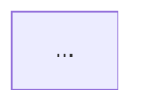

# EO Event Linking

Stage 5 (`EOLinkStage`) maps official .gov/.mil communications to the Executive Order framework through a 7-phase sub-pipeline. It is the most complex stage in the CLI, involving cache loading, RAG queries, two-call LLM synthesis, diagram generation, and chapter injection.

## Pipeline Overview

```{mermaid}
flowchart LR
    P1["1. Index &\nRegistry"] --> P2["2. Batch &\nConversation"]
    P2 --> P3["3. LINK-REFLECT\n(Gemini LLM)"]
    P3 --> P4["4. Extract &\nCache"]
    P4 --> P5["5. Mermaid\nDiagrams"]
    P4 --> P6["6. Implementation\nTables"]
    P5 --> P7["7. Chapter\nInjection"]
    P6 --> P7

    style P3 fill:#9b59b6,color:#fff
```

## Phase 1 — Index Catalog & EO Registry

The pipeline begins by loading two data structures:

**Article catalog** — `IndexLoader` reads `research_summaries_*.jsonl` files from configured index folders (e.g., `x_indices_hegseth`, `x_indices_trump`). A `GovMilExtractor` then filters to .gov/.mil domains using strict suffix matching. Duplicates (by normalised URL) are deduplicated, keeping the copy with the longest summary.

**EO Registry** — `EORegistry.load()` builds a map of `{eo_number → EOEntry}` from three sources:

1. Chapter Markdown files in `eo_book_dir`.
2. EO event JSONL files in `eo_index_folder`.
3. EO research summaries matched to registry entries.

The registry also detects supercession chains via regex (`rescind|revok|supersed|replac` + EO reference), recording which EOs rescind or replace others.

## Phase 2 — Batching & Conversation Assembly

`TokenBudgetBatcher` groups articles into batches of up to **150** articles, sub-grouped by index folder to minimise RAG `/switch-index` calls. There is no semantic clustering — batching is purely mechanical.

For each batch, `ConversationBuilder` writes a `batch_{b}/conversation.json` in the same schema as ExportStage output. Each entry contains article metadata (URL, title, publisher, date, domain, summary) but *not* the full article body, keeping token costs low.

## Phase 3 — LINK-REFLECT LLM Synthesis

This is the only phase that makes LLM calls.

### Call 1 — LINK

The model receives the full EO legal framework (all chapter text concatenated) plus the batch's article metadata. It identifies, for each EO-communication pair:

- EO number, title, subsection.
- Action type: `implements`, `extends`, `modifies`, or `announces`.
- Responsible official and date.
- Precedence links: `rescinds`, `derived_from`, `read_with`.

### Call 2 — REFLECT

The model reviews the LINK output and validates each linkage:

- Are EO assignments correct? Are there missing linkages?
- Are supercession chains complete and chronologically consistent?
- Are there cross-EO actions (one communication implementing multiple EOs)?

The output is refined JSON with corrected linkages and confidence scores.

### Checkpointing

Each batch writes `batch_{b}/status.json` after completion. On re-run, batches marked `"complete"` are skipped, enabling crash-safe resumption.

| Field | Value |
|-------|-------|
| Model | `gemini-3.1-pro-preview` (configurable) |
| Temperature | 0.2 |
| Max output | 32,000 tokens |
| Pricing | Input $1.25 / Output $10.00 per 1M tokens |

## Phase 4 — Linkage Extraction & Cache

`LinkageExtractor` parses the variable-schema JSON from the REFLECT output into flat, normalised linkage records. Each record captures one EO-to-communication link with fields for action type, responsible official, confidence score, and precedence edges.

Records are deduplicated by a deterministic ID — `SHA256("{comm_url}:{eo_number}")` — and upserted into an append-only JSONL cache (`eo_implementation_cache.jsonl`). The cache supports queries by EO number, by domain, and exposes a merged precedence graph across all records.

If the LLM omitted article metadata, the extractor backfills from the original article lookup using URL match, title match, or fuzzy substring match.

## Phase 5 — Mermaid Precedence Diagrams

`EODiagramGenerator` produces left-to-right Mermaid flowcharts showing EO legal relationships:

- **Root node** (blue): the chapter's primary EO.
- **Left** (grey): EOs this one rescinds.
- **Right** (white): EOs linked via `derived_from` or `read_with`.

Labels show the EO number and a cleaned title (truncated to 50 chars). The generator walks `derived_from`/`read_with` edges transitively via BFS to capture the full chain.

### EO Name Resolution

`EONameLookup` resolves official EO titles from (in priority order):

1. Warm cache file (`eo_names.json`).
2. Implementation cache JSONL.
3. EO index JSONL.
4. Quoted references in chapter body text.
5. Hardcoded fallbacks for pre-data-source EOs.

## Phase 6 — Implementation Tables

`ImplementationTableGenerator` builds chronologically-sorted Markdown tables of linked communications:

| Date | EO Linkage | EO Name | Official | Action | Source | Media columns |
|------|-----------|---------|----------|--------|--------|---------------|
| 2025-01-20 | Exec. Order No. 14148 (2025) | Advancing Racial Equity | The White House | Implements | whitehouse.gov | — |

Per-chapter tables include rows for the primary EO (marked with a bullet marker) plus related EOs from the precedence graph. A separate cross-EO table captures communications that implement multiple EOs simultaneously.

Dates are normalised to ISO format via a multi-format parser that handles `YYYY-MM-DD`, `Month DD, YYYY`, `Month YYYY`, and bare `YYYY`.

## Phase 7 — Chapter Injection

`ChapterEnricher` assembles diagrams and tables into an `## Implementation Record` section and writes it into each chapter file:

````markdown
## Implementation Record

### EO Precedence



### Official Communications Timeline

| Date | EO Linkage | ...
|------|-----------|-----
| ...  | ...       | ...
````

If the section already exists it is replaced (idempotent). If no communications are linked, a placeholder note is inserted instead.

## EO Filtering (`--exclude-eos`)

The `--exclude-eos` flag accepts one or more EO numbers to suppress from all diagrams and tables. Filtering is applied at three points:

1. `filter_precedence_graph()` removes excluded EOs as top-level keys and strips references from all edge lists.
2. Diagram generation skips excluded EOs and removes edges pointing to them.
3. Table generation removes rows for excluded EOs and strips them from `related_eos` sets.

```bash
python -m src.components.publisher.rapporteur_cli \
    document.yaml --eo-link --exclude-eos 14165 14370
```

## Inputs & Outputs

| Direction | Artefact |
|-----------|----------|
| In | Index folders (`research_summaries_*.jsonl`) |
| In | EO book directory (chapter `.md` files) |
| In | EO index folder (`eo_events_*.jsonl`) |
| In | RAG service (`/switch-index`, `/query_metadata`) |
| Out | `batch_{b}/conversation.json`, `link.md`, `reflect.md`, `status.json` |
| Out | `eo_implementation_cache.jsonl` |
| Out | `diagrams/{ch}_eo_{num}.md` |
| Out | `tables/{ch}_implementation.md`, `tables/cross_eo_actions.md` |
| Out | Updated chapter files with `## Implementation Record` |
| Out | Updated `manifest.json` (eo_linking metadata block) |
