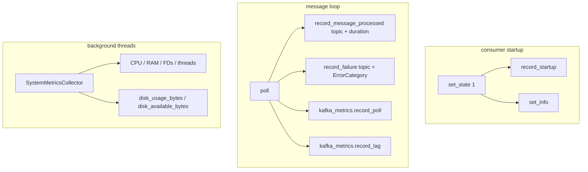
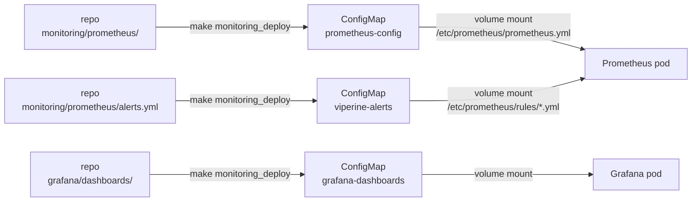

# Viperine Consumer Monitoring

Observability for the five Viperine Kafka consumers running on the local k3s cluster.

---

## Quick Start

```bash
# Deploy/refresh all monitoring config (idempotent)
make monitoring_deploy

# Check that all Prometheus targets are UP
make monitoring_status

# Print dashboard and Prometheus URLs
make monitoring_open
```

After `make monitoring_deploy` Prometheus will pick up the new config within ~30 s via hot-reload (no restart required).

---

## Architecture

### Scrape Path

```mermaid
graph LR
    subgraph k3s — consumers namespace
        WS[web-scraper :8001]
        SU[summarizer :8010]
        SI[summary-indexer :8006]
        IA[index-aggregator :8008]
        DL[dead-letter :8009]
    end

    subgraph k3s — monitoring namespace
        PROM[Prometheus :30090]
        GF[Grafana :30030]
    end

    WS -- /metrics 10s --> PROM
    SU -- /metrics 10s --> PROM
    SI -- /metrics 10s --> PROM
    IA -- /metrics 10s --> PROM
    DL -- /metrics 10s --> PROM
    PROM -- PromQL --> GF
```

Each pod's `MetricsServer` listens on its assigned port and serves:
- `GET /metrics` — Prometheus text format
- `GET /health` — liveness probe
- `GET /ready` — readiness probe

### Instrumentation Call-sites



### Config Ownership



> **Rule:** Always edit source files in this repo and re-run `make monitoring_deploy`. Never edit ConfigMaps directly — they will be overwritten on the next deploy.

---

## File & Config Reference

| Path | Purpose |
|------|---------|
| `monitoring/prometheus/prometheus.yml` | Prometheus global config + scrape jobs (cluster copy) |
| `monitoring/prometheus/alerts.yml` | All 14 alert rules (8 critical, 6 warning) |
| `monitoring/runbooks/` | Per-alert remediation playbooks |
| `grafana/dashboards/viperine-pipeline-overview.json` | Dashboard JSON (11 sections, 63 panels) — provisioned via ConfigMap |
| `DASHBOARD_DESIGN.md` | Source-of-truth design spec for the dashboard (grid, sections, metrics) |
| `scripts/deploy_cluster_monitoring.sh` | Idempotent deploy script — patches ConfigMaps + reloads |
| `src/monitoring/prometheus_metrics.py` | `PrometheusMetrics` — base counters, lifecycle helpers |
| `src/monitoring/kafka_metrics.py` | `KafkaMetricsWrapper` — lag, poll, produce tracking |
| `src/monitoring/system_metrics.py` | `SystemMetricsCollector` — psutil background thread |
| `src/monitoring/cost.py` | `estimate_cost()` + `PRICING_TABLE` — LLM USD cost from token counts |
| `src/monitoring/error_categories.py` | `ErrorCategory` enum — validated label values |
| `src/monitoring/exporters/metrics_server.py` | `MetricsServer` — HTTP server for /metrics /health /ready |

### Consumer Ports

| Consumer | Metrics Port | k8s Service DNS |
|----------|-------------|----------------|
| web-scraper | 8001 | `viperine-web-scraper.consumers.svc.cluster.local` |
| summarizer | 8010 | `viperine-summarizer.consumers.svc.cluster.local` |
| summary-indexer | 8006 | `viperine-summary-indexer.consumers.svc.cluster.local` |
| index-aggregator | 8008 | `viperine-index-aggregator.consumers.svc.cluster.local` |
| dead-letter | 8009 | `viperine-dead-letter-consumer.consumers.svc.cluster.local` |

---

## Metrics Catalogue

All metrics share the `kafka_consumer_` prefix and include at minimum a `consumer_id` label. The `pipeline="viperine"` label is added by Prometheus at scrape time.

### Base / Lifecycle (`PrometheusMetrics`)

| Metric | Type | Labels | Description |
|--------|------|--------|-------------|
| `kafka_consumer_messages_consumed_total` | Counter | `consumer_id`, `topic` | Messages consumed |
| `kafka_consumer_message_processing_duration_seconds` | Histogram | `consumer_id`, `topic`, `status` | End-to-end processing time |
| `kafka_consumer_processing_failures_total` | Counter | `consumer_id`, `topic`, `error_type` | Processing failures (validated `ErrorCategory`) |
| `kafka_consumer_state` | Gauge | `consumer_id` | `0`=stopped `1`=running `2`=error |
| `kafka_consumer_info` | Info | `consumer_id`, `consumer_group`, `input_topic`, `output_topic` | Consumer identity |
| `kafka_consumer_startup_timestamp_seconds` | Gauge | `consumer_id` | Unix timestamp of last startup |
| `kafka_consumer_last_message_processed_timestamp` | Gauge | `consumer_id`, `topic` | Unix timestamp of last processed message |
| `kafka_consumer_sessions_in_progress` | Gauge | `consumer_id` | Active sessions being tracked |
| `kafka_consumer_dead_letter_messages_total` | Counter | `consumer_id`, `topic`, `reason` | Messages sent to DLQ |
| `kafka_consumer_connection_errors_total` | Counter | `consumer_id`, `error_type` | Kafka connection errors |

### Kafka Transport (`KafkaMetricsWrapper`)

| Metric | Type | Labels | Description |
|--------|------|--------|-------------|
| `kafka_consumer_lag_messages` | Gauge | `consumer_id`, `topic`, `partition` | Partition lag in messages |
| `kafka_consumer_lag_seconds` | Gauge | `consumer_id`, `topic`, `partition` | Partition lag in seconds |
| `kafka_consumer_poll_duration_seconds` | Histogram | `consumer_id`, `topic` | Time spent in Kafka poll |
| `kafka_consumer_batch_size` | Histogram | `consumer_id`, `topic` | Messages per poll batch |
| `kafka_consumer_messages_in_flight` | Gauge | `consumer_id`, `topic` | Messages currently being processed |
| `kafka_consumer_last_successful_poll_timestamp` | Gauge | `consumer_id` | Unix timestamp of last successful poll |
| `kafka_consumer_message_age_seconds` | Histogram | `consumer_id`, `topic` | Message age at consumption time |
| `kafka_consumer_rebalances_total` | Counter | `consumer_id` | Partition rebalance count |
| `kafka_consumer_messages_published_total` | Counter | `consumer_id`, `topic`, `result` | Produce operations (`result`=success/error) |
| `kafka_consumer_publish_duration_seconds` | Histogram | `consumer_id`, `topic` | Time for produce + flush |
| `kafka_consumer_offset_commit_duration_seconds` | Histogram | `consumer_id`, `topic` | Time for offset commit |
| `kafka_consumer_offset_commit_failures_total` | Counter | `consumer_id`, `topic`, `error_type` | Offset commit failures |

### System Resources (`SystemMetricsCollector`)

| Metric | Type | Labels | Description |
|--------|------|--------|-------------|
| `kafka_consumer_process_cpu_percent` | Gauge | `consumer_id` | Process CPU % |
| `kafka_consumer_process_memory_rss_bytes` | Gauge | `consumer_id` | Process RSS memory |
| `kafka_consumer_process_memory_vms_bytes` | Gauge | `consumer_id` | Process virtual memory |
| `kafka_consumer_process_memory_percent` | Gauge | `consumer_id` | Process memory % |
| `kafka_consumer_system_cpu_percent` | Gauge | `consumer_id` | System-wide CPU % |
| `kafka_consumer_system_memory_percent` | Gauge | `consumer_id` | System-wide memory % |
| `kafka_consumer_disk_usage_bytes` | Gauge | `consumer_id`, `mount_point` | Disk space used |
| `kafka_consumer_disk_available_bytes` | Gauge | `consumer_id`, `mount_point` | Disk space free |
| `kafka_consumer_open_file_descriptors` | Gauge | `consumer_id` | Open file descriptors |
| `kafka_consumer_thread_count` | Gauge | `consumer_id` | OS thread count |

### Consumer-specific Metrics

**web-scraper**

| Metric | Type | Labels |
|--------|------|--------|
| `kafka_consumer_urls_scraped_total` | Counter | `consumer_id`, `strategy`, `status` |
| `kafka_consumer_scraping_duration_seconds` | Histogram | `consumer_id`, `strategy` |
| `kafka_consumer_cache_files_total` | Gauge | `consumer_id` |
| `kafka_consumer_cache_size_bytes` | Gauge | `consumer_id` |

**summarizer**

| Metric | Type | Labels |
|--------|------|--------|
| `kafka_consumer_documents_summarized_total` | Counter | `consumer_id`, `model` |
| `kafka_consumer_summarization_duration_seconds` | Histogram | `consumer_id`, `model` |
| `kafka_consumer_llm_api_calls_total` | Counter | `consumer_id`, `provider` |
| `kafka_consumer_llm_api_errors_total` | Counter | `consumer_id`, `model`, `error_type` |
| `kafka_consumer_llm_latency_seconds` | Histogram | `consumer_id`, `model` |
| `kafka_consumer_summary_length_chars` | Histogram | `consumer_id` |
| `kafka_consumer_llm_input_tokens_total` | Counter | `consumer_id`, `model` | Input token count per call |
| `kafka_consumer_llm_output_tokens_total` | Counter | `consumer_id`, `model` | Output token count per call |
| `kafka_consumer_llm_tokens_used_total` | Counter | `consumer_id`, `provider` | Combined tokens (fallback when split unavailable) |
| `kafka_consumer_llm_estimated_cost_usd_total` | Counter | `consumer_id`, `model` | Estimated USD spend via pricing table |
| `kafka_consumer_model_error_outputs_total` | Counter | `consumer_id`, `model` | Calls where LLM returned error-as-content |
| `kafka_consumer_cost_unknown_model_total` | Counter | `model` | Incremented when model string is not in the pricing table (alerts on untracked models) |

**summary-indexer**

| Metric | Type | Labels |
|--------|------|--------|
| `kafka_consumer_summaries_indexed_total` | Counter | `consumer_id` |
| `kafka_consumer_summary_sessions_completed_total` | Counter | `consumer_id` |
| `kafka_consumer_summary_embedding_duration_seconds` | Histogram | `consumer_id` |
| `kafka_consumer_summaries_per_session` | Histogram | `consumer_id` |

**dead-letter**

| Metric | Type | Labels |
|--------|------|--------|
| `kafka_consumer_dlq_messages_processed_total` | Counter | `consumer_id` |
| `kafka_consumer_dlq_messages_by_origin_total` | Counter | `consumer_id`, `origin_consumer`, `error_type` |
| `kafka_consumer_dlq_failures_by_stage` | Counter | `consumer_id`, `stage` |
| `kafka_consumer_dlq_processing_duration_seconds` | Histogram | `consumer_id` |
| `kafka_consumer_dlq_age_seconds` | Histogram | `consumer_id` |

---

## Alert Rules

All rules are in `monitoring/prometheus/alerts.yml` and grouped by severity. Runbooks are in `monitoring/runbooks/`.

### Critical (fires immediately after `for` window)

| Alert | Condition | For | Runbook |
|-------|-----------|-----|---------|
| `ConsumerDown` | `state != 1` | 2 m | [consumer_down.md](runbooks/consumer_down.md) |
| `ProcessingFailureRateHigh` | failure rate > 10% | 5 m | [processing_failure_rate_high.md](runbooks/processing_failure_rate_high.md) |
| `ConsumerLagHigh` | lag > 50 messages | 5 m | [consumer_lag_high.md](runbooks/consumer_lag_high.md) |
| `LLMCostBurnRateHigh` | LLM cost > $5/h | 0 m | [llm_cost_burn_rate_high.md](runbooks/llm_cost_burn_rate_high.md) |
| `LLMErrorRateHigh` | LLM error rate > 10% | 10 m | [llm_error_rate_high.md](runbooks/llm_error_rate_high.md) |
| `ProduceFailuresSustained` | produce error rate > 0.1/s | 5 m | [produce_failures_sustained.md](runbooks/produce_failures_sustained.md) |
| `ConsumerRestartLooping` | > 3 restarts in 1 h | 5 m | [consumer_restart_looping.md](runbooks/consumer_restart_looping.md) |
| `DiskUsageCritical` | disk > 95% full | 2 m | [disk_usage_critical.md](runbooks/disk_usage_critical.md) |

### Warning

| Alert | Condition | For | Runbook |
|-------|-----------|-----|---------|
| `DLQRateHigh` | DLQ rate > 1 msg/min | 10 m | [dlq_rate_high.md](runbooks/dlq_rate_high.md) |
| `EmbeddingLatencyHigh` | embedding p95 > 10 s | 5 m | [embedding_latency_high.md](runbooks/embedding_latency_high.md) |
| `SessionStuck` | sessions > 0 & no messages for 10 m | 5 m | [session_stuck.md](runbooks/session_stuck.md) |
| `DiskUsageWarning` | disk > 80% full | 5 m | [disk_usage_warning.md](runbooks/disk_usage_warning.md) |
| `ConsumerStale` | no message processed for 30 m | 5 m | [consumer_stale.md](runbooks/consumer_stale.md) |
| `LLMLatencyHigh` | LLM p95 > 60 s | 10 m | [llm_latency_high.md](runbooks/llm_latency_high.md) |

---

## Dashboard

Grafana: `http://192.168.1.3:30030/d/viperine-pipeline-overview`

The dashboard (`grafana/dashboards/viperine-pipeline-overview.json`) was fully redesigned to 11 sections and 63 panels. Design spec: [DASHBOARD_DESIGN.md](../DASHBOARD_DESIGN.md).

| Section | Default | Panels | Notes |
|---------|---------|--------|-------|
| Fleet Health | expanded | 6 KPI stats | Consumers Up, Total Lag, Messages Consumed, Failures, DLQ count, Last Poll freshness |
| Consumer Status | expanded | per-consumer state tiles + uptime + state-timeline strip | Colour-coded green/amber/red |
| Throughput & Lag | expanded | consume/publish rate, lag by consumer, p50–p99 processing latency, in-flight, lag by partition | Primary lag view is per-consumer; partition is drill-down |
| Kafka Client Health | collapsed | 4 | Poll duration p95, rebalances, message age p50/p95, time since last poll |
| LLM & Cost | collapsed | 6 | Calls/s, latency p50–p99, errors by type, token usage in/out, cost (USD total), cost burn rate $/h |
| Cache | collapsed | 4 | Hit rate gauge, size, files, evictions |
| Indices | collapsed | 13 | Active index folder, records, last reload time, delta, ingestion rate, by-corpus breakdown, doc-ID scheme, duplicates, session counts |
| Errors & Failures | collapsed | 3 | Produce failures, connection/deser/timeout errors |
| Dead Letter Queue | collapsed | 5 | DLQ rate, by stage, by origin |
| System Resources | collapsed | 6 | CPU, RSS, disk %, FDs, threads, disk available |
| Azure & Aggregation | collapsed | 7 | Upload/download rates, duration, blobs, bytes, failures, sessions aggregated |

**Expected "No data" panels** (not query bugs):

| Cause | Example panels |
|-------|---------------|
| Activity-gated | Lag, token usage, LLM cost, cache, DLQ — populate once the pipeline processes traffic |
| RAG service not scraped | Indices section state tiles (Active Index, Records in Index, etc.) — emitted by RAG API, not consumers |
| Azure disabled | All `Azure & Aggregation` panels — require `AZURE_STORAGE_CONNECTION_STRING` |
| Aggregator disabled | Sessions Aggregated — `index_aggregator` consumer is off by default |

---

## Troubleshooting

| Symptom | Likely Cause | Fix |
|---------|-------------|-----|
| Target shows `DOWN` in Prometheus | Pod not running or MetricsServer not started | `kubectl -n consumers get pods`, check logs |
| `ConsumerLagHigh` fires | Downstream consumer can't keep up or is crashing | Check processing errors, increase replicas if applicable |
| `kafka_consumer_kafka_consumer_*` names in TSDB | Stale TSDB series from image before Phase 6 fix — historical only | Run instant query; if new pods return 0 for old names, they will age out within retention. Rebuild with `make k8s_deploy` if still emitting. |
| `kafka_consumer_cost_unknown_model_total` incrementing | `estimate_cost()` called with provider string (`"gemini"`) instead of model name | Fixed in REVISION 14 — ensure `self.llm_client.model_name` is used, not `llm_provider` |
| LLM cost/token panels show "No data" | Counters only emit after a successful summarization call | Wait for pipeline activity; verify series appear after next summary |
| Alerts not loading (`rule_files` error) | `viperine-alerts` ConfigMap missing or wrong key | `make monitoring_deploy` then verify with `make monitoring_status` |
| Prometheus won't reload | `/etc/prometheus` volume mounted read-only, or RWO PVC locked | `kubectl -n monitoring describe pod` — check mount errors; **never restart Prometheus** |
| Grafana shows wrong dashboard / provisioning stale | ConfigMap updated but pod hasn't propagated yet | Wait 30 s, then `POST http://192.168.1.3:30030/api/admin/provisioning/dashboards/reload` |
| `DiskUsageCritical` on all consumers | All share the same NVMe volume — one consumer filled it | `du -sh /mnt/workspace_2/viperine-cache/*` to find culprit |
| `ConsumerStale` fires but lag is 0 | No upstream messages (pipeline idle), not a fault | Silence the alert or adjust `for` duration |
| "No data" on LLM / DLQ / Index panels | Activity-gated, RAG-service, or Azure-disabled panels (see Dashboard section) | Expected — see "Expected No data panels" table above |

---

## Operational Notes

### Prometheus — reload only, never restart

The Prometheus pod uses a `ReadWriteOnce` PVC for its TSDB. Restarting the pod while writing to the PVC risks locking the volume and losing scrape history. Always reload:

```bash
curl -s -X POST http://192.168.1.3:30090/-/reload
# or
make monitoring_reload
```

ConfigMap changes take ~30 s to propagate to the pod's filesystem before a reload will pick them up.

### Adding a new consumer

1. Add a scrape job to `k8s/monitoring/viperine-scrape-jobs.yaml`
2. Run `make monitoring_deploy`
3. Verify the new target appears in `make monitoring_status`

### Adjusting alert thresholds

Edit `monitoring/prometheus/alerts.yml`, then run `make monitoring_deploy`. No deploy of consumer pods is required.

### Error category label hygiene

`processing_failures_total` labels are validated at emit time via `PrometheusMetrics.record_failure()`, which calls `ErrorCategory.validate()` and raises `ValueError` for unregistered strings. This prevents high-cardinality freeform labels from reaching Prometheus. To add a new category, add it to `src/monitoring/error_categories.py`.

### k8s rollout — nvidia-container-runtime workaround

The local k3s node has the nvidia toolkit installed. During rolling updates the container runtime occasionally fails to kill old containers (`permission denied on signal init`). Use the safe rollout target instead of a plain helm upgrade:

```bash
make k8s_deploy       # build + push + safe rollout
make k8s_rollout      # safe rollout only (already-pushed image)
```

`k8s_rollout` scales all deployments to 0, waits 15 s, force-deletes any stuck Terminating pods, then runs `helm upgrade`.
